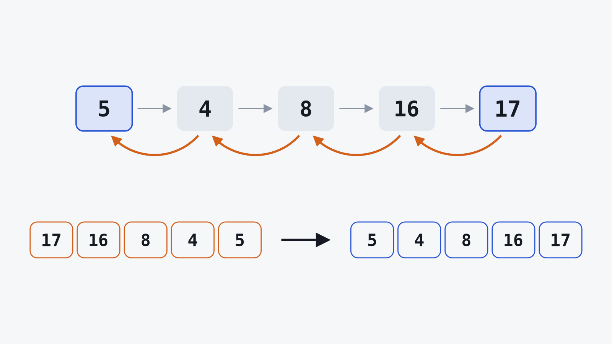
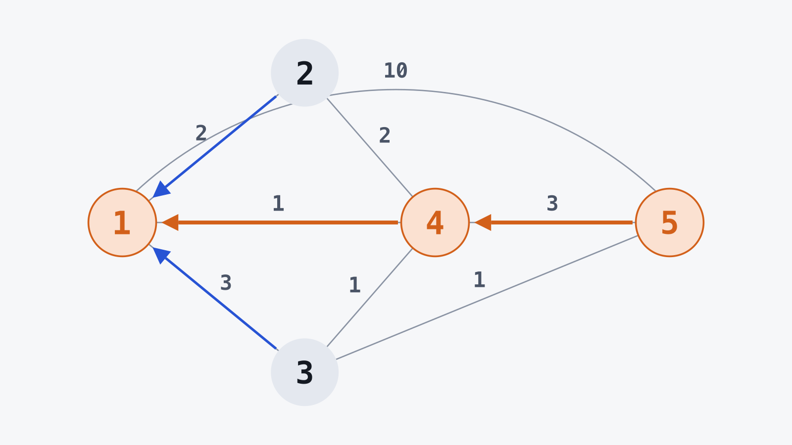
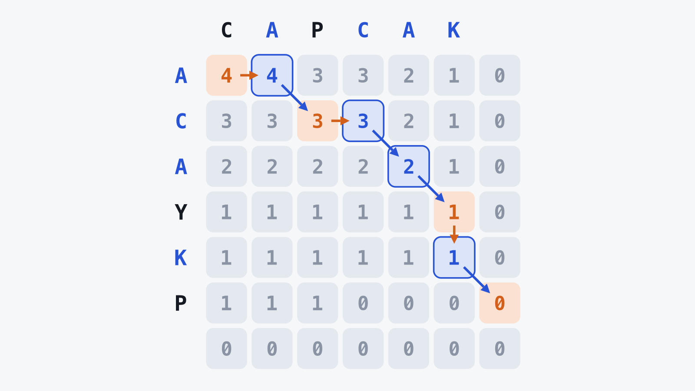

# 답만으론 부족해?: 역추적

> rilog 발행 글: <https://www.rilog.kr/@iqed/posts/610> (2026-11-23)

안녕하세요 ~ 오늘은 역추적 이야기를 해보려고 합니다.

최단 거리는 구했습니다. 최댓값도 구했고요.  
그런데 문제 끝에 한 줄이 더 붙어 있습니다. “그 방법도 출력한다.”

이렇게 답이 만들어진 과정을 거슬러 올라가며 찾아내는 걸 **역추적**이라고 합니다.  
경로 복원이라고도 부릅니다.

값만 내면 되는 문제와, 그 값이 나온 과정까지 내야 하는 문제는 느낌이 꽤 다릅니다.  
처음 보면 풀이를 새로 짜야 할 것 같지만, 그렇지 않습니다.  
원래 풀이는 그대로 두고 **한 줄을 더 적거나, 한 번 더 따라가면** 됩니다.

BFS든 다익스트라든 DP든 방법은 두 가지뿐입니다.

1. 값을 정하는 순간에 **어디서 왔는지 적어 둔다.**
2. 아무것도 적지 않고, 다 구한 **값을 보고 다시 따라간다.**

## 방법 1. 어디서 왔는지 적어 둡니다

[BOJ 13913 숨바꼭질 4](https://www.acmicpc.net/problem/13913)부터 보겠습니다.  
수빈이는 X에서 X−1, X+1, 2X로 1초에 한 번 이동합니다.  
N에서 K까지 가는 가장 빠른 시간과, 그때 지나는 위치를 순서대로 출력합니다.

가장 빠른 시간은 BFS로 구합니다. 여기에 배열 하나만 더 둡니다.  
`pre[v]` = v에 오기 바로 전 위치

```cpp
#include <bits/stdc++.h>
#define ibm514 ios::sync_with_stdio(0), cin.tie(0), cout.tie(0);
using namespace std;
typedef long long ll;
const int MX = 200001;
int n, k, dist[MX], pre[MX];              // pre[v] = v에 오기 바로 전 위치

void solve() {
    cin >> n >> k;
    memset(dist, -1, sizeof(dist));
    queue<int> q;
    q.push(n);
    dist[n] = 0, pre[n] = -1;             // 시작점은 "온 곳이 없다"
    while (!q.empty()) {
        int cur = q.front(); q.pop();
        if (cur == k) break;
        for (int nxt : {cur - 1, cur + 1, cur * 2}) {
            if (nxt < 0 || nxt >= MX || dist[nxt] != -1) continue;
            dist[nxt] = dist[cur] + 1;
            pre[nxt] = cur;               // 거리를 적는 줄 바로 옆에 한 줄
            q.push(nxt);
        }
    }

    vector<int> path;
    for (int v = k; v != -1; v = pre[v]) path.push_back(v); // 도착점에서 거슬러 올라간다
    reverse(path.begin(), path.end()); // 거꾸로 모았으니 뒤집는다

    cout << dist[k] << '\n';
    for (int v : path) cout << v << ' ';
}

int main() {
    ibm514
    solve();
    return 0;
}
```

추가된 건 `pre[nxt] = cur` 한 줄과 맨 아래 역추적 세 줄입니다.  
거리를 적는 바로 그 자리에서 “여기에는 cur에서 왔다”를 같이 적습니다.



*N = 5, K = 17일 때입니다. 주황색 화살표가 pre이고,  
17에서 따라가며 모으면 순서가 거꾸로라 마지막에 뒤집습니다.*

전체 경로를 통째로 들고 다니지 않는다는 점을 보세요.  
칸마다 “바로 앞 한 칸”만 적어 두면, 그걸 이어 붙여서 전체가 나옵니다.

### 다익스트라: 덮어씁니다

[BOJ 11779 최소비용 구하기 2](https://www.acmicpc.net/problem/11779)는 같은 일을 다익스트라에서 합니다.

```cpp
#include <bits/stdc++.h>
#define ibm514 ios::sync_with_stdio(0), cin.tie(0), cout.tie(0);
using namespace std;
typedef long long ll;
typedef pair<ll, int> pli;
const ll INF = 1e18;
int n, m, s, e, pre[1005];
ll dist[1005];
vector<pair<int, ll>> adj[1005];

void solve() {
    cin >> n >> m;
    for (int i = 0; i < m; ++i) {
        int u, v; ll w;
        cin >> u >> v >> w;
        adj[u].push_back({v, w});
    }
    cin >> s >> e;

    fill(dist, dist + n + 1, INF);
    priority_queue<pli, vector<pli>, greater<pli>> pq;
    dist[s] = 0, pre[s] = -1;
    pq.push({0, s});
    while (!pq.empty()) {
        auto [d, cur] = pq.top(); pq.pop();
        if (d > dist[cur]) continue;
        for (auto [nxt, w] : adj[cur]) {
            if (dist[nxt] <= d + w) continue;
            dist[nxt] = d + w;
            pre[nxt] = cur;               // 더 짧은 길을 찾을 때마다 덮어쓴다
            pq.push({dist[nxt], nxt});
        }
    }

    vector<int> path;
    for (int v = e; v != -1; v = pre[v]) path.push_back(v);
    reverse(path.begin(), path.end());

    cout << dist[e] << '\n' << path.size() << '\n';
    for (int v : path) cout << v << ' ';
}

int main() {
    ibm514
    solve();
    return 0;
}
```

BFS와 다른 점은 하나입니다.  
BFS는 처음 방문할 때 한 번만 적지만, 다익스트라는 거리가 줄어들 때마다 `pre`도 덮어씁니다.  
`dist`와 `pre`는 항상 같은 줄에서 같이 바뀌어야 합니다.



*다익스트라가 끝난 뒤의 pre 화살표입니다. 도착점 5에서 화살표를 따라가면 4를 거쳐 1에 닿습니다.*

### DP: 이 값을 만든 이전 칸을 적습니다

[BOJ 14002 가장 긴 증가하는 부분 수열 4](https://www.acmicpc.net/problem/14002)입니다. 그래프가 아니어도 똑같습니다.  
`dp[i]`를 `dp[j] + 1`로 갱신했다면, i 앞에는 j가 있었던 겁니다.

```cpp
#include <bits/stdc++.h>
#define ibm514 ios::sync_with_stdio(0), cin.tie(0), cout.tie(0);
using namespace std;
typedef long long ll;
int n, a[1005], dp[1005], pre[1005];      // dp[i] = a[i]로 끝나는 가장 긴 증가 부분 수열의 길이

void solve() {
    cin >> n;
    for (int i = 1; i <= n; ++i) cin >> a[i];

    int last = 1;                         // 답이 끝나는 위치
    for (int i = 1; i <= n; ++i) {
        dp[i] = 1, pre[i] = -1;
        for (int j = 1; j < i; ++j) {
            if (a[j] < a[i] && dp[j] + 1 > dp[i]) {
                dp[i] = dp[j] + 1;
                pre[i] = j;               // a[i] 바로 앞에 a[j]를 뒀다
            }
        }
        if (dp[i] > dp[last]) last = i;
    }

    vector<int> path;
    for (int v = last; v != -1; v = pre[v]) path.push_back(a[v]);
    reverse(path.begin(), path.end());

    cout << dp[last] << '\n';
    for (int v : path) cout << v << ' ';
}

int main() {
    ibm514
    solve();
    return 0;
}
```

출발점만 다릅니다. 도착점이 정해져 있지 않으니, `dp` 값이 가장 큰 위치 `last`에서 거슬러 올라갑니다.

### 정점이 아니라 “무엇을 했는지”가 답일 때

[BOJ 9019 DSLR](https://www.acmicpc.net/problem/9019)은 지나온 수가 아니라 사용한 명령어를 출력합니다.  
이럴 때는 `pre` 옆에 배열을 하나 더 둡니다.  
`how[v]` = `pre[v]`에서 v로 올 때 쓴 명령어

```cpp
#include <bits/stdc++.h>
#define ibm514 ios::sync_with_stdio(0), cin.tie(0), cout.tie(0);
using namespace std;
int pre[10000];                        // pre[v] = v 바로 전의 수
char how[10000];                       // how[v] = pre[v]에서 v로 올 때 쓴 명령어

void solve() {
    int a, b;
    cin >> a >> b;
    memset(pre, -1, sizeof(pre));
    queue<int> q;
    q.push(a);
    pre[a] = a;                        // 방문 표시를 겸한다
    while (!q.empty()) {
        int cur = q.front(); q.pop();
        if (cur == b) break;
        int nxt[4] = {cur * 2 % 10000, (cur + 9999) % 10000,
                      cur % 1000 * 10 + cur / 1000, cur / 10 + cur % 10 * 1000};
        for (int i = 0; i < 4; ++i) {
            if (pre[nxt[i]] != -1) continue;
            pre[nxt[i]] = cur;
            how[nxt[i]] = "DSLR"[i];  // 어디서 왔는지와 함께, 무엇을 했는지도 적는다
            q.push(nxt[i]);
        }
    }

    string cmd;
    for (int v = b; v != a; v = pre[v]) cmd += how[v];
    reverse(cmd.begin(), cmd.end());
    cout << cmd << '\n';
}

int main() {
    ibm514
    int t;
    cin >> t;
    while (t--) solve();
    return 0;
}
```

격자에서 방향(U, D, L, R)을 출력하는 문제도 같은 방식입니다.  
[BOJ 15644 구슬 탈출 3](https://www.acmicpc.net/problem/15644)처럼 상태가 (빨간 구슬, 파란 구슬)로 복잡해져도,  
상태마다 “직전 상태와 그때 쓴 방향”을 적는다는 건 그대로입니다.

## 방법 2. 적지 않고, 값을 보고 다시 따라갑니다

DP는 표를 다 채우고 나면 그 표 자체가 기록입니다.  
어떤 칸의 값이 어느 쪽에서 왔는지는, 점화식을 한 번 더 확인해 보면 알 수 있습니다.

[BOJ 9252 LCS 2](https://www.acmicpc.net/problem/9252)입니다. LCS의 길이와 함께 LCS 자체를 출력합니다.

```cpp
#include <bits/stdc++.h>
#define ibm514 ios::sync_with_stdio(0), cin.tie(0), cout.tie(0);
using namespace std;
typedef long long ll;
string a, b;
int n, m, dp[1005][1005];

// f(i, j) = a의 i번째 글자부터, b의 j번째 글자부터만 봤을 때의 LCS 길이
int f(int i, int j) {
    if (i == n || j == m) return 0;
    int &ret = dp[i][j];
    if (ret != -1) return ret;
    if (a[i] == b[j]) return ret = f(i + 1, j + 1) + 1;
    return ret = max(f(i + 1, j), f(i, j + 1));
}

// f가 값을 고른 방식 그대로 한 번 더 내려가면서, 고른 글자를 모은다
void track(int i, int j, string &out) {
    if (i == n || j == m) return;
    if (a[i] == b[j]) {
        out += a[i];
        track(i + 1, j + 1, out);
    }
    else if (f(i + 1, j) >= f(i, j + 1)) track(i + 1, j, out);
    else track(i, j + 1, out);
}

void solve() {
    cin >> a >> b;
    n = a.size(), m = b.size();
    memset(dp, -1, sizeof(dp));

    string out;
    track(0, 0, out);
    cout << f(0, 0) << '\n' << out;
}

int main() {
    ibm514
    solve();
    return 0;
}
```

`track`은 `f`와 모양이 같습니다.  
다른 점은 값을 계산하지 않고, **값이 만들어진 쪽으로 걸어간다**는 것뿐입니다.  
글자가 같으면 그 글자를 골랐던 것이고, 다르면 둘 중 값이 큰 쪽으로 갔던 겁니다.



*ACAYKP와 CAPCAK의 f(i, j) 표입니다.  
(0, 0)에서 출발해 값이 만들어진 쪽으로 따라갑니다. 파란 칸이 고른 글자입니다.*

탑다운으로 짰다면 “여기서부터 끝까지”로 정의했기 때문에, 앞에서부터 따라가면 답도 앞에서부터 나옵니다. 뒤집을 필요가 없습니다.

### 선택을 적어 둬도 됩니다

다시 계산하는 게 번거롭다면 두 방법을 섞습니다. 값을 정할 때 **무엇을 골랐는지**를 같이 적는 겁니다.  
[BOJ 2494 숫자 맞추기](https://www.acmicpc.net/problem/2494)에서는 나사마다 왼쪽으로 몇 칸,  
또는 오른쪽으로 몇 칸 돌렸는지를 `path[step][pf]`에 적습니다.

```cpp
#include <bits/stdc++.h>
#define ibm514 ios::sync_with_stdio(0), cin.tie(0), cout.tie(0);
using namespace std;
int n, dp[10001][10], path[10001][10]; // path[step][pf] = 그 상태에서 고른 회전
string S, E;

// go(step, pf) = 위쪽 나사들을 왼쪽으로 돌린 칸 수의 합이 pf일 때,
//                step번 나사부터 끝까지 맞추는 최소 회전 칸 수
int go(int step, int pf) {
    if (step == n) return 0;

    int &ret = dp[step][pf];
    if (ret != 0x7f7f7f7f) return ret;

    int s_val = S[step] - '0', e_val = E[step] - '0';
    int cur_val = (s_val + pf) % 10;      // 위에서 돌린 만큼 이미 같이 돌아가 있다

    int left = (e_val - cur_val + 10) % 10;

    if (left == 0) {
        ret = go(step + 1, pf);
        path[step][pf] = 0;
        return ret;
    }

    // 왼쪽으로 돌리면 아래 나사들도 같이 돈다
    int cost_left = left + go(step + 1, (pf + left) % 10);

    // 오른쪽으로 돌리면 이 나사만 돈다
    int right_cost = 10 - left;
    int cost_right = right_cost + go(step + 1, pf);

    if (cost_left <= cost_right) {
        ret = cost_left;
        path[step][pf] = left;          // 값을 정하는 자리에서 고른 것도 적는다
    }
    else {
        ret = cost_right;
        path[step][pf] = -right_cost;
    }

    return ret;
}

void solve() {
    cin >> n;
    cin >> S >> E;

    memset(dp, 0x7f, sizeof(dp));
    cout << go(0, 0) << '\n';

    // 역추적: 적어 둔 선택을 앞에서부터 읽는다
    int cur_pf = 0;
    for (int i = 0; i < n; ++i) {
        int move = path[i][cur_pf];
        cout << i + 1 << ' ' << move << '\n';

        if (move > 0) cur_pf = (cur_pf + move) % 10; // 상태도 같이 따라 움직인다
    }
}

int main() {
    ibm514
    solve();
    return 0;
}
```

주의할 점은 역추적할 때 **상태도 같이 따라 움직여야 한다**는 겁니다.  
`path`는 상태마다 적혀 있으니,  
선택을 하나 읽을 때마다 그 선택으로 바뀐 다음 상태(`cur_pf`)로 넘어가야 다음 칸을 제대로 읽습니다.

## 경로가 하나가 아닐 때

`pre`는 칸마다 하나만 적으니 경로도 하나만 나옵니다. 스페셜 저지 문제는 그걸로 충분합니다.  
하나로 안 되는 문제가 따로 있습니다.

### 모든 최단 경로가 필요할 때

[BOJ 5719 거의 최단 경로](https://www.acmicpc.net/problem/5719)는 최단 경로에 포함된 간선을 **전부** 지운 뒤의 최단 거리를 구합니다.  
`pre`를 벡터로 바꿔서 여러 개를 적어도 되지만, 방법 2가 더 간단합니다.

```cpp
#include <bits/stdc++.h>
#define ibm514 ios::sync_with_stdio(0), cin.tie(0), cout.tie(0);
using namespace std;
const int INF = 0x7f7f7f7f;
int n, m, s, e;
int dst[505];
bool del[505][505];
bool visited[505];
vector<pair<int, int>> adj[505], inv[505];  // inv = 간선을 뒤집은 그래프

// 도착점에서 거꾸로 가면서, 최단 경로 위에 있는 간선을 전부 지운다
void path_del(int cur) {
    if (visited[cur]) return;
    visited[cur] = 1;

    for (auto [cst, nxt] : inv[cur]) {
        if (dst[nxt] + cst == dst[cur]) {   // 이 간선은 어떤 최단 경로 위에 있다
            del[nxt][cur] = 1;
            path_del(nxt);
        }
    }
}

int short_path() {
    priority_queue<pair<int, int>, vector<pair<int, int>>, greater<>> pq;
    memset(dst, 0x7f, sizeof(dst));
    dst[s] = 0;
    pq.emplace(dst[s], s);

    while (!pq.empty()) {
        auto [cst, cur] = pq.top(); pq.pop();
        if (dst[cur] < cst) continue;

        for (auto [nCst, nxt] : adj[cur]) {
            if (del[cur][nxt]) continue;      // 지운 간선은 쓰지 않는다

            if (dst[nxt] > dst[cur] + nCst) {
                dst[nxt] = dst[cur] + nCst;
                pq.emplace(dst[nxt], nxt);
            }
        }
    }

    return dst[e];
}

void solve() {
    while (cin >> n >> m) {
        if (n == 0 && m == 0) break;
        cin >> s >> e;

        memset(del, 0, sizeof(del));
        memset(visited, 0, sizeof(visited));
        for (int i = 0; i < n; ++i) adj[i].clear(), inv[i].clear();

        int u, v, cst;
        for (int i = 0; i < m; ++i) {
            cin >> u >> v >> cst;
            adj[u].emplace_back(cst, v);
            inv[v].emplace_back(cst, u);
        }

        if (short_path() == INF) {
            cout << "-1\n";
            continue;
        }

        path_del(e);

        int ans = short_path();
        if (ans == INF) cout << "-1\n";
        else cout << ans << "\n";
    }
}

int main() {
    ibm514
    solve();
    return 0;
}
```

도착점에서 간선을 거꾸로 보면서 `dst[앞] + 비용 == dst[지금]`인 간선만 따라갑니다.  
이 식이 성립하는 간선이 곧 최단 경로 위의 간선입니다.  
아무것도 적어 두지 않고, 다 구한 거리만 보고 되짚은 겁니다.

### K번째 경로가 필요할 때

[BOJ 18892 가장 긴 증가하는 부분 수열 ks](https://www.acmicpc.net/problem/18892)는 사전순으로 K번째인 LIS를 출력합니다.  
이때는 값과 함께 **개수**를 세어 둡니다.  
후보를 사전순으로 보면서, 그 후보로 시작하는 LIS가 K개보다 적으면 통째로 건너뜁니다.

```cpp
#include <bits/stdc++.h>
#define ibm514 ios::sync_with_stdio(0), cin.tie(0), cout.tie(0);
using namespace std;
typedef long long ll;
const ll MX = 1e9 + 7;
int n, k, S[505], dp[505], dpC[505];
vector<int> L;

// lis(st) = st번 원소에서 시작하는 LIS의 길이 (st = -1이면 아직 아무것도 안 고른 상태)
int lis(int st) {
    int &ret = dp[st + 1];
    if (ret != -1) return ret;
    ret = 1;

    for (int nxt = st + 1; nxt < n; ++nxt) {
        if (st == -1 || S[st] < S[nxt])
            ret = max(ret, lis(nxt) + 1);
    }

    return ret;
}

// count(st) = st번 원소에서 시작하는 LIS의 개수
int count(int st) {
    if (lis(st) == 1) return 1;
    int &ret = dpC[st + 1];
    if (ret != -1) return ret;
    ret = 0;

    for (int nxt = st + 1; nxt < n; ++nxt) {
        if ((st == -1 || S[st] < S[nxt]) && lis(st) == lis(nxt) + 1)
            ret = min(MX, (ll)count(nxt) + ret);
    }
    return ret;
}

// 앞에서 skip개를 건너뛴 LIS를 st 다음부터 이어 붙인다
void path(int st, int skip) {
    if (st != -1) L.push_back(S[st]);

    vector<pair<int, int>> flw;
    for (int nxt = st + 1; nxt < n; ++nxt) {
        if ((st == -1 || S[st] < S[nxt]) && lis(st) == lis(nxt) + 1)
            flw.push_back({S[nxt], nxt});
    }

    sort(flw.begin(), flw.end());       // 사전순으로 작은 후보부터
    for (int i = 0; i < flw.size(); ++i) {
        int idx = flw[i].second;
        int cnt = count(idx);

        if (skip >= cnt) skip -= cnt;  // 이 후보로 시작하는 것들을 통째로 건너뛴다
        else {
            path(idx, skip);
            break;
        }
    }
}

void solve() {
    cin >> n >> k;
    for (int i = 0; i < n; ++i) cin >> S[i];

    memset(dp, -1, sizeof(dp));
    memset(dpC, -1, sizeof(dpC));
    lis(-1);
    count(-1);

    path(-1, k - 1);
    if (L.empty()) cout << -1;
    for (auto e : L) cout << e << ' ';
}

int main() {
    ibm514
    solve();
    return 0;
}
```

모든 쌍의 경로를 출력하는 [BOJ 11780 플로이드 2](https://www.acmicpc.net/problem/11780)도 있습니다.  
시작점마다 `pre`를 두는 대신 `nxt[i][j]`(i에서 j로 갈 때 다음 정점)를 두고,  
거리를 갱신할 때 `nxt[i][j] = nxt[i][k]`로 같이 바꿉니다.

## 역추적이 답이 아니라 도구일 때

경로를 출력하라는 말이 없어도 역추적이 필요한 문제가 있습니다.  
[BOJ 2325 개코전쟁](https://www.acmicpc.net/problem/2325)은 도로 하나를 끊어서 최단 거리를 최대로 늘립니다.  
최단 경로 위에 있지 않은 도로는 끊어도 거리가 그대로이니, 후보는 최단 경로 위의 간선뿐입니다.

```cpp
#include <bits/stdc++.h>
#define ibm514 ios::sync_with_stdio(0), cin.tie(0), cout.tie(0);
using namespace std;
int n, m;
int dst[1005], pre[1005];
bool usd[1005][1005];                     // usd[a][b] = a-b 도로를 끊었다
vector<pair<int, int>> adj[1005];

int go() {
    priority_queue<pair<int, int>, vector<pair<int, int>>, greater<>> pq;
    pq.emplace(0, 1);
    memset(pre, -1, sizeof(pre));
    memset(dst, 0x7f, sizeof(dst));
    dst[1] = 0;

    while (!pq.empty()) {
        auto [cst, cur] = pq.top();
        pq.pop();
        if (dst[cur] < cst) continue;

        for (auto [nxt, c] : adj[cur]) {
            if (usd[cur][nxt]) continue;
            if (dst[nxt] > dst[cur] + c) {
                dst[nxt] = dst[cur] + c;
                pre[nxt] = cur;
                pq.emplace(dst[nxt], nxt);
            }
        }
    }

    return dst[n];
}

void input() {
    cin >> n >> m;
    int st, en, cst;
    for (int i = 0; i < m; ++i) {
        cin >> st >> en >> cst;
        adj[st].emplace_back(en, cst);
        adj[en].emplace_back(st, cst);
    }
}

// pre를 따라가며 최단 경로 위의 간선을 모은다
void make_edge(vector<pair<int, int>>& E) {
    int cur = n;
    while (cur != -1) {
        if (pre[cur] != -1) E.emplace_back(cur, pre[cur]);
        cur = pre[cur];
    }
}

// 모아 둔 간선만 하나씩 끊어 보고 다시 최단 거리를 구한다
int broken_go(vector<pair<int, int>>& E, int mx) {
    for (auto [a, b] : E) {
        usd[a][b] = 1;
        usd[b][a] = 1;
        mx = max(mx, go());
        usd[a][b] = 0;
        usd[b][a] = 0;
    }
    return mx;
}

void solve() {
    input();
    int mx = go();

    vector<pair<int, int>> E;
    make_edge(E);

    cout << broken_go(E, mx);
}

int main() {
    ibm514
    solve();
    return 0;
}
```

`pre`로 경로를 역추적해 간선 목록을 만들고, 그 간선들만 하나씩 끊어 봅니다.  
간선 M개를 다 해보는 대신 많아야 N−1개만 보면 됩니다.

## 백트래킹은 이미 경로를 들고 있습니다

백트래킹은 사정이 다릅니다. 고를 때 넣고, 돌아올 때 빼는 `path`가 탐색 내내 손에 있습니다.  
[BOJ 15649 N과 M (1)](https://www.acmicpc.net/problem/15649)처럼 끝에 도착했을 때 그대로 출력하면 됩니다.

```cpp
#include <bits/stdc++.h>
#define ibm514 ios::sync_with_stdio(0), cin.tie(0), cout.tie(0);
using namespace std;
typedef long long ll;
int n, m;
bool used[10];
vector<int> path;                         // 지금까지 고른 수

void go() {
    if ((int)path.size() == m) {          // 끝에 도착하면 경로가 이미 손에 있다
        for (int v : path) cout << v << ' ';
        cout << '\n';
        return;
    }
    for (int i = 1; i <= n; ++i) {
        if (used[i]) continue;
        used[i] = true, path.push_back(i);    // 고르고
        go();
        used[i] = false, path.pop_back();     // 되돌린다
    }
}

void solve() {
    cin >> n >> m;
    go();
}

int main() {
    ibm514
    solve();
    return 0;
}
```

## 자주 틀리는 곳

- **뒤집기.** `pre`를 따라가면 도착점부터 나옵니다. 모은 뒤에 뒤집습니다.
- **시작점.** `pre[시작점] = -1`처럼 멈출 표시를 꼭 넣습니다. 0으로 두면 0번 정점과 헷갈립니다.
- **값과 기록은 같은 줄에서.** `dist`만 갱신하고 `pre`를 빼먹거나,  
갱신되지 않았는데 `pre`를 바꾸면 경로가 끊기거나 엉뚱한 길이 나옵니다.
- **출력 조건.** 아무 경로나 되는지, 사전순 같은 조건이 있는지 먼저 확인합니다.

## 정리

1. 값을 정하는 줄에서 `pre`(어디서 왔는지)나 선택(무엇을 골랐는지)을 같이 적습니다.
2. 또는 다 구한 값을 보고, 그 값이 만들어진 쪽으로 다시 따라갑니다.
3. `pre`로 모은 경로는 거꾸로이니 뒤집습니다.

## 추천 문제

1. [BOJ 13913 숨바꼭질 4](https://www.acmicpc.net/problem/13913): BFS에서 pre 적기
2. [BOJ 9019 DSLR](https://www.acmicpc.net/problem/9019): 명령어를 같이 적기
3. [BOJ 11779 최소비용 구하기 2](https://www.acmicpc.net/problem/11779): 다익스트라에서 pre 덮어쓰기
4. [BOJ 9252 LCS 2](https://www.acmicpc.net/problem/9252): 값을 보고 다시 따라가기
5. [BOJ 11780 플로이드 2](https://www.acmicpc.net/problem/11780): 모든 쌍의 경로
6. [BOJ 5719 거의 최단 경로](https://www.acmicpc.net/problem/5719): 모든 최단 경로의 간선
7. [BOJ 2325 개코전쟁](https://www.acmicpc.net/problem/2325): 역추적한 경로를 다음 단계에 쓰기
8. [BOJ 18892 가장 긴 증가하는 부분 수열 ks](https://www.acmicpc.net/problem/18892): K번째 경로
