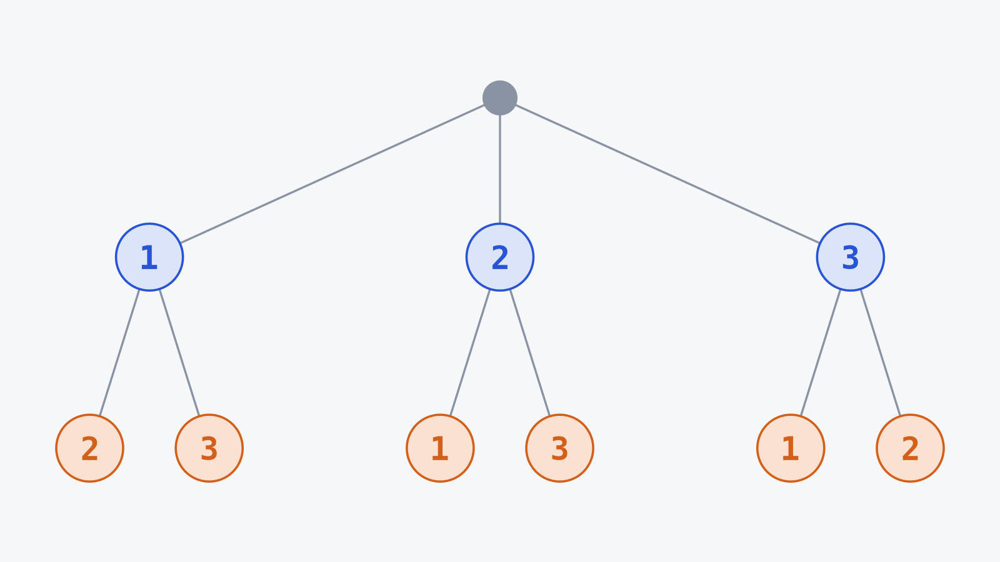
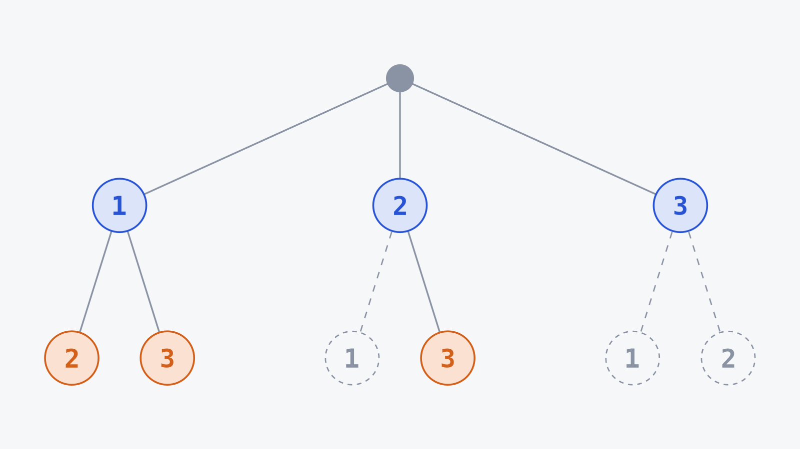
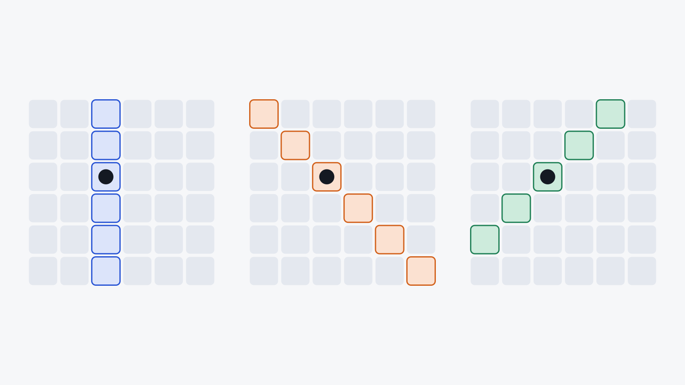
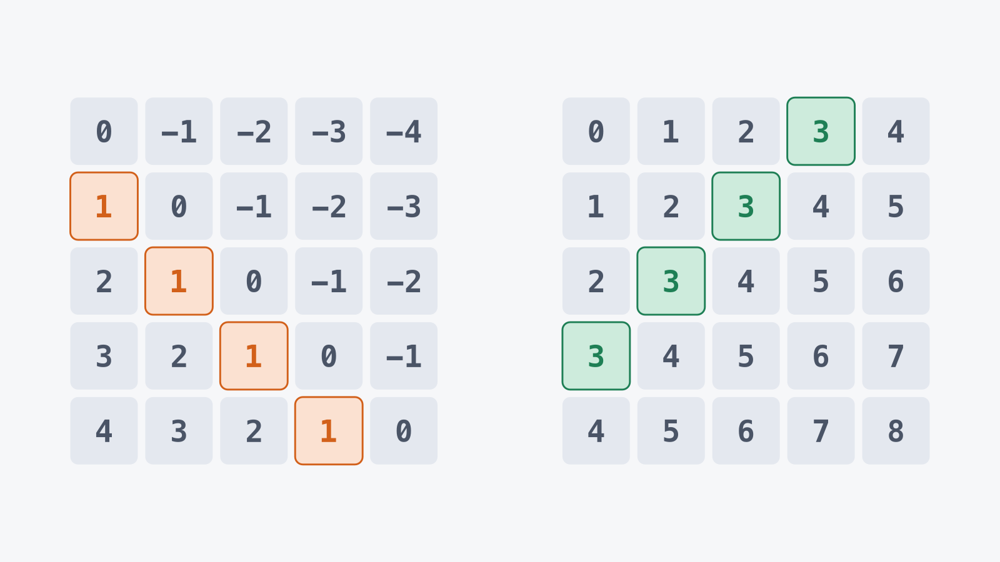
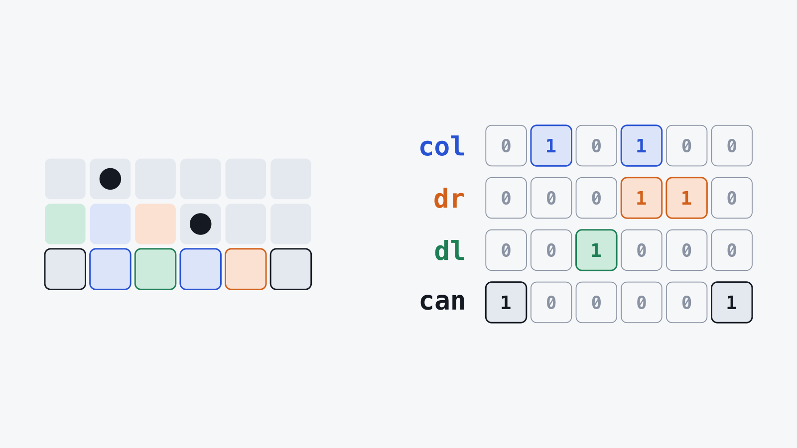
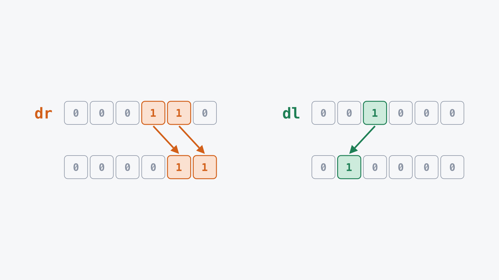
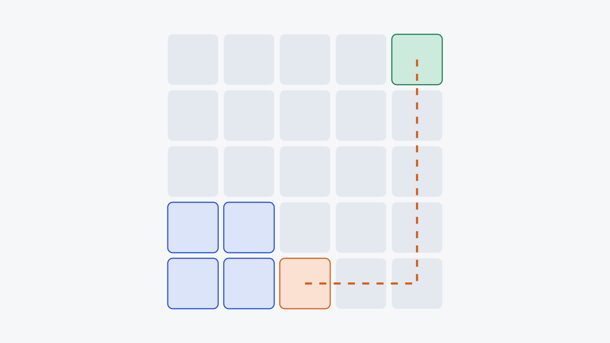
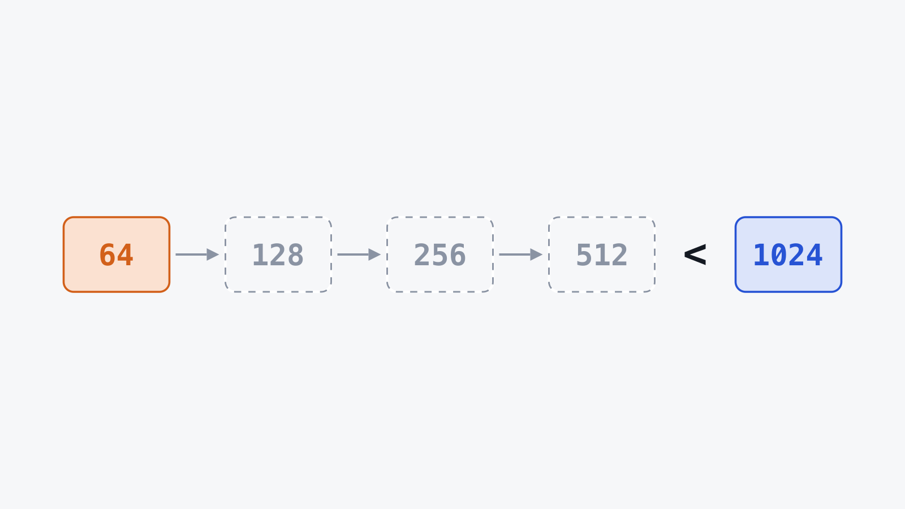

# 그 길 아니야, 돌아가: 백트래킹

> rilog 발행 글: <https://www.rilog.kr/@iqed/posts/617> (2026-11-24)

안녕하세요 ~ 오늘은 백트래킹 이야기를 해보려고 합니다.

백트래킹은 한마디로 가능한 경우를 다 해 보는 방법입니다.  
다만 무작정 끝까지 가 보는 게 아니라, 가다가 안 될 것 같으면 그 자리에서 돌아 나온다는 점이 다르죠.

그래서 백트래킹 문제에서 진짜 고민해야 하는 건 하나입니다.  
어디서 돌아 나올 것인가.

이번 글은 N과 M으로 기본 틀부터 잡고, N-Queen에서 상태를 표시하는 방법을 다듬어 볼 겁니다.  
그다음에는 “여기서 더 가 봐야 소용없다”를 계산으로 판단하는 평가함수 이야기로 넘어가고,  
마지막에는 평가함수가 핵심인 고난도 문제를 하나 같이 풀어 보겠습니다.

백트래킹은 재귀로 짜기 때문에, 재귀가 아직 낯설다면 [지난 글](https://www.rilog.kr/@iqed/posts/615)을 먼저 보고 오시는 걸 추천합니다.

## 기본 틀: N과 M

[BOJ 15649 N과 M (1)](https://www.acmicpc.net/problem/15649)부터 봅시다.  
1부터 N까지의 수 중에서 중복 없이 M개를 골라 만들 수 있는 수열을 전부 출력하는 문제입니다.

자리를 하나씩 채워 나간다고 생각하면 됩니다.  
첫 번째 자리에 올 수를 하나 고르고, 그 상태에서 두 번째 자리에 올 수를 고르고, 이런 식으로요.  
고를 수 있는 경우를 전부 그려 보면 나무 모양이 됩니다.



*N = 3, M = 2일 때입니다. 위에서 첫 번째 수를 고르고, 아래에서 두 번째 수를 고릅니다.*

이 나무를 위에서 아래로, 왼쪽에서 오른쪽으로 전부 돌아다니는 코드를 짜면 되는 거죠.

```cpp
#include <bits/stdc++.h>
#define ibm514 ios::sync_with_stdio(0), cin.tie(0), cout.tie(0);
using namespace std;
typedef long long ll;
int n, m, pick[8];
bool used[9];

// go(k) = k번째 자리에 올 수를 고른다
void go(int k) {
    if (k == m) {
        for (int i = 0; i < m; ++i) cout << pick[i] << ' ';
        cout << '\n';
        return;
    }
    for (int i = 1; i <= n; ++i) {
        if (used[i]) continue;   // 이미 쓴 수는 건너뛴다
        used[i] = true;
        pick[k] = i;
        go(k + 1);
        used[i] = false;         // 돌아오면 고르기 전 상태로 되돌린다
    }
}

void solve() {
    cin >> n >> m;
    go(0);
}

int main() {
    ibm514
    solve();
    return 0;
}
```

for문 안의 네 줄이 백트래킹의 기본 틀입니다.  
수를 하나 **고르고**(`used[i] = true`), 다음 자리로 **들어갔다가**(`go(k + 1)`), 돌아오면 **되돌립니다**(`used[i] = false`).  
되돌리는 줄을 빼먹으면 한 번 쓴 수를 다른 가지에서 영영 못 쓰게 되니 주의하세요.

이어서 [BOJ 15650 N과 M (2)](https://www.acmicpc.net/problem/15650)입니다.  
조건이 하나 붙었습니다. 고른 수열이 오름차순이어야 해요.

앞의 코드로 전부 만든 다음에 오름차순인 것만 출력해도 답은 맞습니다.  
그런데 생각해 보면, 2를 고른 뒤에 1을 고르는 순간 이미 틀린 수열이잖아요?  
그 아래로는 내려가 볼 필요가 없습니다.



*점선으로 그린 가지는 내려가 봐야 어차피 버려집니다. 아예 들어가지 않으면 됩니다.*

```cpp
#include <bits/stdc++.h>
#define ibm514 ios::sync_with_stdio(0), cin.tie(0), cout.tie(0);
using namespace std;
typedef long long ll;
int n, m, pick[8];

// go(k, start) = k번째 자리에 start 이상인 수를 고른다
void go(int k, int start) {
    if (k == m) {
        for (int i = 0; i < m; ++i) cout << pick[i] << ' ';
        cout << '\n';
        return;
    }
    for (int i = start; i <= n; ++i) {
        pick[k] = i;
        go(k + 1, i + 1);   // 다음 자리는 방금 고른 수보다 큰 수만 본다
    }
}

void solve() {
    cin >> n >> m;
    go(0, 1);
}

int main() {
    ibm514
    solve();
    return 0;
}
```

`start`를 넘겨서 방금 고른 수보다 큰 수만 보게 했습니다.  
덕분에 `used` 배열도 필요 없어졌고요.  
이렇게 볼 필요 없는 가지를 미리 잘라 내는 걸 가지치기라고 부릅니다.  
백트래킹의 성능은 결국 이 가지치기를 얼마나 잘하느냐에 달려 있어요.

## 상태를 표시하는 방법: N-Queen

[BOJ 9663 N-Queen](https://www.acmicpc.net/problem/9663)입니다. 백트래킹 하면 제일 먼저 나오는 문제죠.  
N × N 체스판에 퀸 N개를 서로 공격하지 못하게 놓는 경우의 수를 구합니다.

한 행에 퀸이 두 개 있을 수는 없으니, 행마다 하나씩 놓는다고 생각하면 됩니다.  
0번 행에 놓을 열을 고르고, 1번 행에 놓을 열을 고르고… N과 M이랑 틀이 똑같습니다.  
달라지는 건 “여기에 놓아도 되는가”를 확인하는 부분입니다.

퀸 하나를 놓으면 그 아래 행들에서는 세 가지가 막힙니다.  
같은 열, 오른쪽 아래로 내려가는 대각선, 왼쪽 아래로 내려가는 대각선입니다.



*퀸 하나가 막는 칸입니다. 왼쪽부터 같은 열, ↘ 대각선, ↙ 대각선입니다.*

놓을 때마다 위쪽 퀸들을 전부 훑어서 확인해도 되지만, 그러면 느립니다.  
대신 퀸을 놓을 때 “이 열은 썼다”, “이 대각선은 썼다”라고 표시해 두면 한 번에 확인할 수 있어요.

열은 번호가 있으니 쉬운데, 대각선은 어떻게 번호를 붙일까요?  
같은 대각선 위에 있는 칸들의 좌표를 적어 보면 규칙이 보입니다.



*칸마다 왼쪽은 r - c를, 오른쪽은 r + c를 적었습니다. 같은 대각선 위의 칸은 값이 같습니다.*

↘ 대각선은 `r - c`가 같고, ↙ 대각선은 `r + c`가 같습니다.  
그러니 이 값을 배열의 인덱스로 쓰면 됩니다. `r - c`는 음수가 될 수 있어서 `n - 1`을 더해 줍니다.

```cpp
#include <bits/stdc++.h>
#define ibm514 ios::sync_with_stdio(0), cin.tie(0), cout.tie(0);
using namespace std;
typedef long long ll;
int n, ans;
bool col[15], d1[30], d2[30];   // 열, ↘ 대각선, ↙ 대각선에 퀸이 있는가

// go(r) = r번 행에 퀸을 놓는다
void go(int r) {
    if (r == n) {
        ++ans;
        return;
    }
    for (int c = 0; c < n; ++c) {
        // ↘ 대각선은 r - c가 같고, ↙ 대각선은 r + c가 같다
        if (col[c] || d1[r - c + n - 1] || d2[r + c]) continue;
        col[c] = d1[r - c + n - 1] = d2[r + c] = true;
        go(r + 1);
        col[c] = d1[r - c + n - 1] = d2[r + c] = false;
    }
}

void solve() {
    cin >> n;
    go(0);
    cout << ans << '\n';
}

int main() {
    ibm514
    solve();
    return 0;
}
```

N과 M (1)의 `used` 배열이 세 개로 늘어난 것 말고는 달라진 게 없습니다. 고르고, 들어갔다가, 되돌립니다.

### 배열을 비트마스크로

여기서 한 단계 더 다듬어 봅시다.  
`col`, `d1`, `d2`는 전부 “썼다 / 안 썼다”만 담는 배열이라, 정수 하나의 비트로 바꿀 수 있습니다.  
다만 그대로 옮기는 게 아니라 보는 방식을 살짝 바꿉니다.

배열 버전은 대각선마다 번호를 붙여서 관리했습니다.  
비트마스크 버전은 **지금 놓으려는 행에서 못 놓는 칸**만 들고 다닙니다.



*퀸 두 개를 놓은 뒤 세 번째 행을 볼 차례입니다.  
col, dr, dl 중 하나라도 1인 칸에는 못 놓고, 전부 0인 칸(can)에만 놓을 수 있습니다.*

`col`은 열 때문에, `dr`은 ↘ 대각선 때문에, `dl`은 ↙ 대각선 때문에 못 놓는 칸입니다.  
셋을 OR로 합친 다음 뒤집으면 놓을 수 있는 칸이 바로 나옵니다.

그럼 다음 행으로 내려갈 때는 어떻게 될까요?  
열은 그대로 내려가고, 대각선은 한 칸씩 옆으로 밀립니다.



*한 행 내려가면 dr은 오른쪽으로, dl은 왼쪽으로 한 칸씩 밀립니다.*

비트를 한 칸 미는 건 시프트 연산 한 번이죠.  
그림은 0번 열을 왼쪽에 그렸기 때문에, 그림에서 오른쪽으로 미는 것이 코드에서는 `<< 1`입니다.

```cpp
#include <bits/stdc++.h>
#define ibm514 ios::sync_with_stdio(0), cin.tie(0), cout.tie(0);
using namespace std;
typedef long long ll;
int n, ans, full;

// go(col, dr, dl) = 열, ↘ 대각선, ↙ 대각선 때문에 이번 행에서 못 놓는 칸이 각각 col, dr, dl일 때
void go(int col, int dr, int dl) {
    if (col == full) {   // 모든 열에 퀸이 하나씩 놓였다
        ++ans;
        return;
    }
    int can = full & ~(col | dr | dl);   // 이번 행에서 놓을 수 있는 칸
    while (can) {
        int bit = can & -can;            // 그중 가장 낮은 비트 하나
        can ^= bit;
        // 한 행 내려가면 ↘ 대각선은 오른쪽으로, ↙ 대각선은 왼쪽으로 한 칸 밀린다
        go(col | bit, (dr | bit) << 1, (dl | bit) >> 1);
    }
}

void solve() {
    cin >> n;
    full = (1 << n) - 1;
    go(0, 0, 0);
    cout << ans << '\n';
}

int main() {
    ibm514
    solve();
    return 0;
}
```

몇 가지만 짚고 넘어가겠습니다.

- `can & -can`은 켜져 있는 비트 중 가장 낮은 것 하나만 남깁니다.  
놓을 수 있는 칸을 하나씩 꺼내는 데 씁니다.
- 밀려서 보드 밖으로 나간 비트는 `full &`에서 걸러집니다.
- 되돌리는 코드가 없습니다. 배열을 고치는 게 아니라 값을 새로 만들어서 넘기기 때문에,  
돌아오면 원래 값이 그대로 남아 있어요.

N = 14로 돌려 보면 배열 버전은 1.4초쯤, 비트마스크 버전은 0.1초쯤 걸립니다.  
탐색하는 경우의 수는 똑같은데,  
못 놓는 칸을 하나씩 확인하지 않고 놓을 수 있는 칸만 골라서 보기 때문에 차이가 납니다.

## 평가함수로 가지치기

지금까지 자른 가지는 전부 규칙을 어긴 가지였습니다. 오름차순이 아니거나, 퀸끼리 공격하거나요.  
그런데 규칙은 안 어겼지만 더 가 봐야 소용없는 가지도 있습니다.

이걸 잘라 내려면 “여기서 계속 가면 아무리 잘해도 이 정도다”를 계산할 수 있어야 합니다.  
이 계산을 하는 함수를 평가함수라고 부르겠습니다.  
평가함수의 값이 이미 찾아 둔 답보다 나쁘거나 목표에 못 미치면, 그 가지는 더 볼 필요가 없는 거죠.

### 지금까지 쓴 비용

[BOJ 10971 외판원 순회 2](https://www.acmicpc.net/problem/10971)입니다.  
한 도시에서 출발해 모든 도시를 한 번씩 들르고 돌아오는 가장 싼 경로의 비용을 구합니다.

도시를 방문하는 순서를 전부 해 보면 되니까 틀은 N과 M (1)과 같습니다.  
여기에 가장 단순한 평가함수를 하나 붙여 봅시다.  
비용은 더해지기만 하니까,  
지금까지 쓴 비용이 이미 찾아 둔 답 이상이라면 끝까지 가 봐야 더 싸질 수가 없습니다.

```cpp
#include <bits/stdc++.h>
#define ibm514 ios::sync_with_stdio(0), cin.tie(0), cout.tie(0);
using namespace std;
typedef long long ll;
int n, w[10][10], best = INT_MAX;
bool vis[10];

// go(cur, cnt, cost) = 지금 cur번 도시에 있고, cnt개 도시를 들렀고, 비용을 cost만큼 썼다
void go(int cur, int cnt, int cost) {
    if (cost >= best) return;   // 이미 찾아 둔 답보다 비싸면 더 볼 필요가 없다
    if (cnt == n) {
        if (w[cur][0]) best = min(best, cost + w[cur][0]);
        return;
    }
    for (int nxt = 1; nxt < n; ++nxt) {
        if (vis[nxt] || !w[cur][nxt]) continue;
        vis[nxt] = true;
        go(nxt, cnt + 1, cost + w[cur][nxt]);
        vis[nxt] = false;
    }
}

void solve() {
    cin >> n;
    for (int i = 0; i < n; ++i) {
        for (int j = 0; j < n; ++j) cin >> w[i][j];
    }
    vis[0] = true;   // 어디서 출발하든 같은 순회이므로 0번에서 출발한다
    go(0, 1, 0);
    cout << best << '\n';
}

int main() {
    ibm514
    solve();
    return 0;
}
```

`go`의 첫 줄이 평가함수입니다. 한 줄뿐이지만, 좋은 답을 일찍 찾을수록 잘려 나가는 가지가 늘어납니다.

### 앞으로 필요한 거리

[BOJ 1189 컴백홈](https://www.acmicpc.net/problem/1189)입니다.  
왼쪽 아래에서 출발해 오른쪽 위의 집까지,  
같은 칸을 두 번 밟지 않고 가는 방법 중 정확히 K칸을 밟는 경우의 수를 구합니다.

이번에는 지금까지 쓴 것 말고 **앞으로 필요한 것**을 계산해 봅니다.  
지금 위치에서 집까지는 아무리 빨리 가도 맨해튼 거리만큼은 걸어야 합니다.  
남은 걸음 수가 그것보다 적다면, 어떻게 가도 집에 닿을 수 없죠.



*파란 칸을 지나 주황 칸에 와 있습니다. 집(초록)까지는 곧장 가도 여섯 칸이 필요한데,  
남은 걸음이 그보다 적으면 여기서 그만둡니다.*

```cpp
#include <bits/stdc++.h>
#define ibm514 ios::sync_with_stdio(0), cin.tie(0), cout.tie(0);
using namespace std;
typedef long long ll;
int R, C, K, ans;
string a[5];
bool vis[5][5];
const int dr[] = {-1, 1, 0, 0}, dc[] = {0, 0, -1, 1};

// go(r, c, d) = (r, c)에 있고, 지금까지 d칸을 밟았다
void go(int r, int c, int d) {
    if (r == 0 && c == C - 1) {         // 집에 도착하면 여기서 끝난다
        if (d == K) ++ans;
        return;
    }
    int left = K - d;                   // 앞으로 더 밟을 수 있는 칸 수
    int need = r + (C - 1 - c);         // 집까지의 맨해튼 거리
    if (need > left) return;            // 곧장 가도 못 닿는다
    if ((left - need) % 2) return;      // 돌아가는 길은 항상 2칸씩 늘어난다
    for (int i = 0; i < 4; ++i) {
        int nr = r + dr[i], nc = c + dc[i];
        if (nr < 0 || nr >= R || nc < 0 || nc >= C) continue;
        if (vis[nr][nc] || a[nr][nc] == 'T') continue;
        vis[nr][nc] = true;
        go(nr, nc, d + 1);
        vis[nr][nc] = false;
    }
}

void solve() {
    cin >> R >> C >> K;
    for (int i = 0; i < R; ++i) cin >> a[i];
    vis[R - 1][0] = true;
    go(R - 1, 0, 1);
    cout << ans << '\n';
}

int main() {
    ibm514
    solve();
    return 0;
}
```

조건이 하나 더 들어가 있습니다.  
격자에서는 돌아가는 길을 택할 때마다 걸음 수가 꼭 2씩 늘어납니다.  
한 칸 옆으로 비켰으면 다시 한 칸 돌아와야 하니까요.  
그래서 남은 걸음 수와 맨해튼 거리의 차이가 홀수면 정확히 K칸에 도착하는 건 불가능합니다.

사실 이 문제는 보드가 최대 5 × 5라서 가지치기 없이도 통과합니다.  
다만 “앞으로 최소한 이만큼은 필요하다”를 계산해서 자르는 방식은 보드가 커질수록 효과가 커지니,  
여기서 익혀 두면 좋습니다.

### 찾아 둔 답과 비교하기

[BOJ 17136 색종이 붙이기](https://www.acmicpc.net/problem/17136)입니다.  
10 × 10 종이에서 1이 적힌 칸을 1 × 1부터 5 × 5까지의 색종이로 덮습니다.  
종류마다 5장씩 있고, 가장 적게 쓰는 장수를 구합니다.

왼쪽 위부터 차례로 보면서, 1이 적힌 칸을 만나면 거기에 붙일 색종이 크기를 골라 봅니다.  
평가함수는 외판원 순회와 같습니다. 지금까지 쓴 장수가 찾아 둔 답 이상이면 그만둡니다.

```cpp
#include <bits/stdc++.h>
#define ibm514 ios::sync_with_stdio(0), cin.tie(0), cout.tie(0);
using namespace std;
typedef long long ll;
int a[10][10], paper[6] = {0, 5, 5, 5, 5, 5}, best = INT_MAX;

bool can(int r, int c, int s) {
    if (r + s > 10 || c + s > 10) return false;
    for (int i = r; i < r + s; ++i) {
        for (int j = c; j < c + s; ++j) {
            if (!a[i][j]) return false;
        }
    }
    return true;
}

void paint(int r, int c, int s, int v) {
    for (int i = r; i < r + s; ++i) {
        for (int j = c; j < c + s; ++j) a[i][j] = v;
    }
}

// go(pos, used) = pos번 칸부터 보면 되고, 지금까지 색종이를 used장 썼다
void go(int pos, int used) {
    if (used >= best) return;   // 이미 찾아 둔 답보다 좋아질 수 없다
    while (pos < 100 && !a[pos / 10][pos % 10]) ++pos;
    if (pos == 100) {
        best = used;
        return;
    }
    int r = pos / 10, c = pos % 10;
    for (int s = 5; s >= 1; --s) {   // 큰 색종이부터 붙여 본다
        if (!paper[s] || !can(r, c, s)) continue;
        paint(r, c, s, 0), --paper[s];
        go(pos + 1, used + 1);
        paint(r, c, s, 1), ++paper[s];
    }
}

void solve() {
    for (int i = 0; i < 10; ++i) {
        for (int j = 0; j < 10; ++j) cin >> a[i][j];
    }
    go(0, 0);
    cout << (best == INT_MAX ? -1 : best) << '\n';
}

int main() {
    ibm514
    solve();
    return 0;
}
```

눈여겨볼 건 큰 색종이부터 붙여 본다는 점입니다.  
큰 것부터 붙이면 적은 장수로 덮는 답이 일찍 나오고,  
`best`가 일찍 작아질수록 평가함수에 걸리는 가지가 많아집니다.  

평가함수만큼이나 **어떤 순서로 해 보느냐**도 중요하다는 얘기죠.

세 문제에서 쓴 평가함수를 정리하면 이렇습니다.

- 지금까지 쓴 것만으로 이미 찾아 둔 답보다 나쁘면 그만둔다.
- 앞으로 최소한 필요한 것을 더했을 때 목표를 넘으면 그만둔다.

한 가지만 조심하면 됩니다. 평가함수는 **낙관적으로** 잡아야 합니다.  
“아무리 잘해도 이 정도”를 실제보다 나쁘게 계산하면, 답이 있는 가지까지 잘라 버리게 되거든요.

## 고난도: 2048 (Hard)

마지막으로 [BOJ 12094 2048 (Hard)](https://www.acmicpc.net/problem/12094)를 같이 풀어 봅시다.  
N × N 보드에서 블록을 상하좌우로 최대 10번 밀어서 만들 수 있는 가장 큰 블록을 구합니다.  
N은 최대 20입니다.

방향이 네 가지이고 10번 미니까 경우의 수는 4의 10제곱, 약 100만 가지입니다.  
한 번 밀 때마다 보드 400칸을 다 움직여야 하니, 전부 해 보면 4억 번이 넘는 연산이 필요합니다.  
제한 시간 1초에는 빠듯하죠.

여기서 평가함수를 생각해 봅시다.  
한 번 밀어서 블록이 합쳐져도 값은 두 배까지만 커집니다.  
그러면 남은 횟수가 세 번일 때, 지금 가장 큰 블록이 64라면 아무리 잘해도 512까지밖에 못 만듭니다.



*남은 세 번을 전부 가장 큰 블록을 합치는 데 써도 512입니다.  
이미 1024를 만들어 본 적이 있다면 이 가지는 더 볼 필요가 없습니다.*

실제로는 매번 가장 큰 블록을 합칠 수 있는 경우가 드물지만, 그래도 상관없습니다.  
평가함수는 낙관적이기만 하면 되니까요.

```cpp
#include <bits/stdc++.h>
#define ibm514 ios::sync_with_stdio(0), cin.tie(0), cout.tie(0);
using namespace std;
typedef long long ll;
const int LIMIT = 10;
int n, best;
int idx[4][20][20]; // idx[dir][i][j] = dir 방향으로 밀 때, i번 줄에서 j번째로 읽는 칸

struct Board {
    int a[400], mx;
};

// b를 dir 방향으로 민 결과를 nb에 담고, 모양이 바뀌었는지 돌려준다
bool push(const Board &b, int dir, Board &nb) {
    bool changed = false;
    nb.mx = 0;
    for (int i = 0; i < n; ++i) {
        const int *at = idx[dir][i];
        int m = 0, last = 0;   // last = 아직 합쳐지지 않은 채 맨 끝에 놓인 블록
        for (int j = 0; j < n; ++j) {
            int v = b.a[at[j]];
            if (!v) continue;
            if (v == last) {
                nb.a[at[m - 1]] = v * 2;   // 같은 블록이 이어지면 한 번만 합친다
                last = 0;
            } else {
                nb.a[at[m++]] = v;
                last = v;
            }
        }
        for (int j = m; j < n; ++j) nb.a[at[j]] = 0;
        for (int j = 0; j < n; ++j) {
            int v = nb.a[at[j]];
            if (v != b.a[at[j]]) changed = true;
            if (v > nb.mx) nb.mx = v;
        }
    }
    return changed;
}

// go(b, cnt) = 보드가 b이고 지금까지 cnt번 움직였다
void go(const Board &b, int cnt) {
    best = max(best, b.mx);
    if (cnt == LIMIT) return;
    // 남은 횟수마다 가장 큰 블록이 두 배가 된다고 쳐도 best를 못 넘으면 그만둔다
    if ((b.mx << (LIMIT - cnt)) <= best) return;
    for (int dir = 0; dir < 4; ++dir) {
        Board nb;
        if (!push(b, dir, nb)) continue;   // 밀어도 그대로면 볼 필요 없다
        go(nb, cnt + 1);
    }
}

void solve() {
    cin >> n;
    Board b;
    b.mx = 0;
    for (int i = 0; i < n * n; ++i) {
        cin >> b.a[i];
        b.mx = max(b.mx, b.a[i]);
    }
    for (int i = 0; i < n; ++i) {
        for (int j = 0; j < n; ++j) {
            idx[0][i][j] = i * n + j;             // 왼쪽으로
            idx[1][i][j] = i * n + (n - 1 - j);   // 오른쪽으로
            idx[2][i][j] = j * n + i;             // 위로
            idx[3][i][j] = (n - 1 - j) * n + i;   // 아래로
        }
    }
    go(b, 0);
    cout << best << '\n';
}

int main() {
    ibm514
    solve();
    return 0;
}
```

`go` 안의 이 한 줄이 평가함수입니다.

`if ((b.mx << (LIMIT - cnt)) <= best) return;`

가장 큰 블록에 2를 남은 횟수만큼 곱한 값이 `best` 이하면 돌아 나옵니다.  
20 × 20 보드에 블록을 무작위로 채워서 돌려 보면,  
이 줄이 없을 때 0.6초쯤 걸리던 것이 0.07초로 줄어듭니다.

나머지 부분도 간단히 보면,

- `push`는 한 방향으로 미는 함수입니다. 네 방향을 따로 짜지 않으려고,  
방향마다 칸을 읽는 순서를 `idx`에 미리 적어 두었습니다.
- 밀었는데 보드가 그대로면 그 방향은 건너뜁니다. 같은 상태를 다시 탐색할 이유가 없으니까요.
- 보드를 고쳤다가 되돌리지 않고, 새 보드 `nb`를 만들어서 넘깁니다.  
N-Queen 비트마스크 버전과 같은 방식입니다.

## 자주 하는 실수

- **되돌리는 걸 빼먹는다.** 배열에 표시했다면, 돌아온 뒤에 반드시 지워야 합니다.
- **평가함수를 비관적으로 잡는다.** 가능한 답까지 잘려 나가서 틀린 답이 나옵니다.
- **좋은 답을 늦게 찾는다.** 평가함수는 찾아 둔 답이 좋을수록 잘 듣습니다.  
좋은 답이 나올 법한 쪽부터 해 봅니다.

## 마무리

1. 백트래킹의 기본 틀은 고르고, 들어갔다가, 되돌리는 것입니다.
2. “여기에 놓아도 되는가”는 매번 훑지 말고 표시해 둡니다.  
표시는 배열로 시작해서 비트마스크로 줄일 수 있습니다.
3. 규칙을 어긴 가지만 자르지 말고, 평가함수로 가 봐야 소용없는 가지도 자릅니다.
4. 평가함수는 낙관적으로 잡고, 좋은 답이 일찍 나오는 순서로 탐색합니다.

## 추천 문제

본문에서 다루지 않은 방식이 하나씩 들어 있는 문제들입니다. 아래로 갈수록 어려워집니다.

1. [BOJ 15663 N과 M (9)](https://www.acmicpc.net/problem/15663): 같은 수가 여러 개일 때 중복되는 가지 자르기
2. [BOJ 1987 알파벳](https://www.acmicpc.net/problem/1987): 지나온 알파벳을 비트마스크로 표시하기
3. [BOJ 2580 스도쿠](https://www.acmicpc.net/problem/2580): 행, 열, 3 × 3 칸을 각각 표시하기
4. [BOJ 2661 좋은수열](https://www.acmicpc.net/problem/2661): 첫 번째 답을 찾는 순간 전부 끝내기
5. [BOJ 1248 Guess](https://www.acmicpc.net/problem/1248): 수를 하나 고를 때마다 조건을 확인해서 일찍 포기하기
6. [BOJ 1799 비숍](https://www.acmicpc.net/problem/1799): 흑과 백 칸을 따로 풀어서 탐색 범위 줄이기
7. [BOJ 2646 같은 길이 막대기 만들기](https://www.acmicpc.net/problem/2646): 가지치기 여러 개를 겹쳐 쓰기
