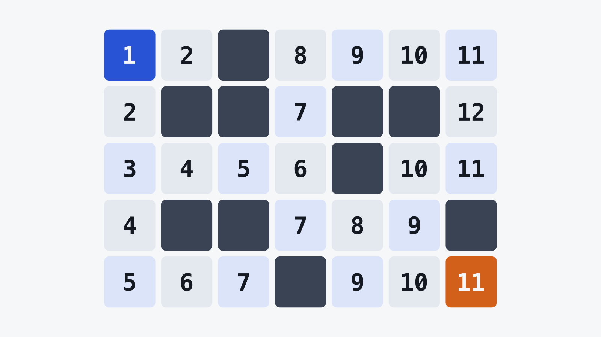
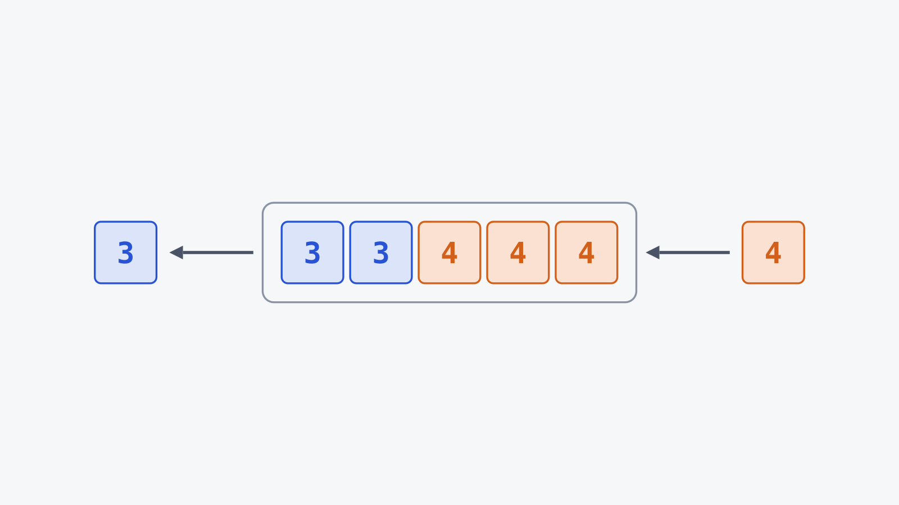
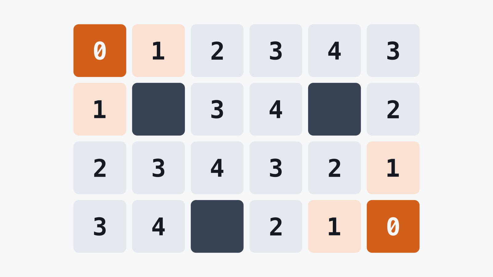
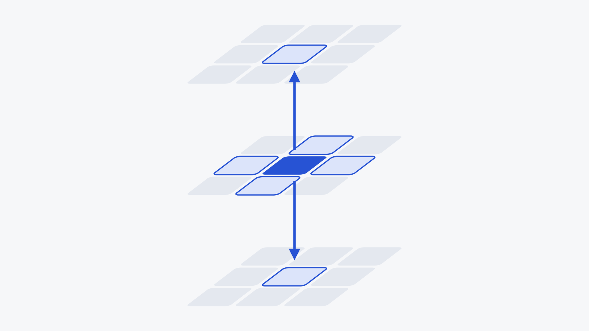
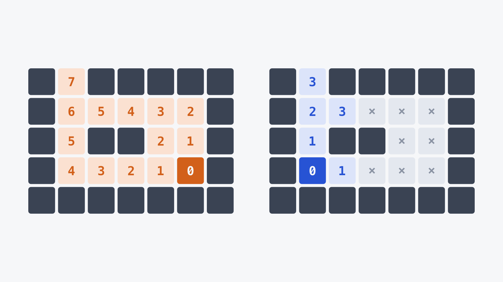
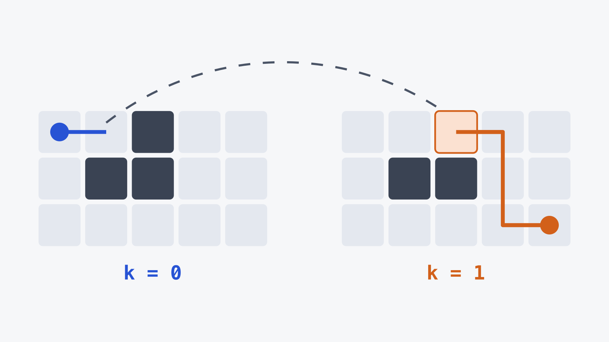
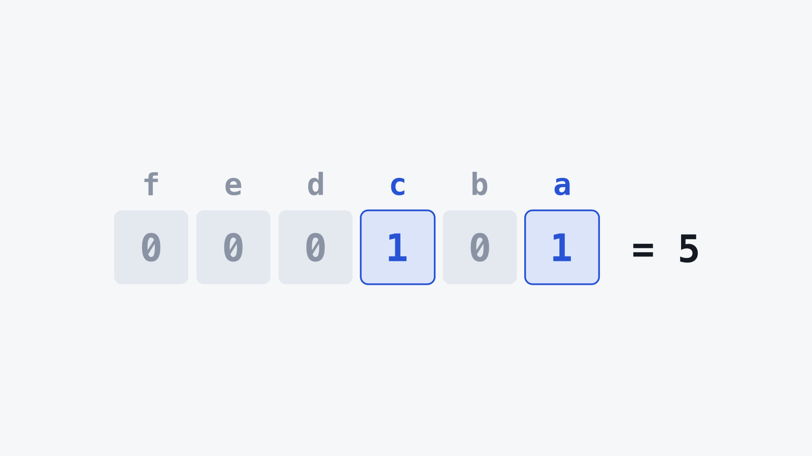
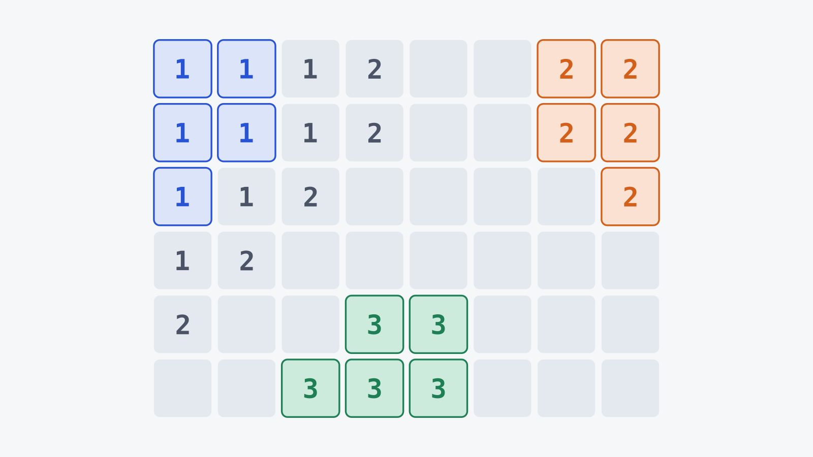
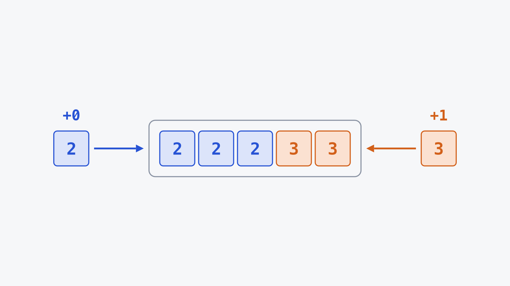
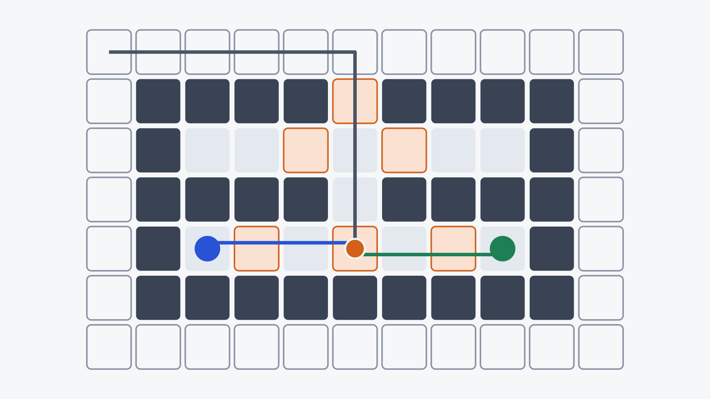

# BFS: 근데 0-1을 곁들인

> rilog 발행 글: <https://www.rilog.kr/@iqed/posts/620> (2026-11-24)

안녕하세요 ~ 오늘은 BFS 이야기를 해보려고 합니다.

코테에서 BFS는 정말 자주 나오는데, 미로에서 최단 거리를 구하는 기본형 그대로 나오는 일은 드뭅니다.  
출발점이 여러 개가 되거나, 불이 번지거나, 벽을 부술 수 있게 되는 식으로 조건이 하나씩 붙어서 나오죠.  
그래서 이번 글에서는 가장 기본적인 2차원 BFS에서 시작해서,  
조건이 하나 붙을 때마다 코드의 어디가 바뀌는지를 차례로 보겠습니다.  
  
뒤쪽에서는 큐를 덱으로 바꿔서 푸는 0-1 BFS도 곁들였습니다.

## 2차원 BFS: 미로 탐색

[BOJ 2178 미로 탐색](https://www.acmicpc.net/problem/2178)부터 봅시다.  
1은 갈 수 있는 칸이고 0은 벽입니다.  
왼쪽 위에서 오른쪽 아래까지 갈 때 지나야 하는 칸 수의 최솟값을 구합니다.

BFS가 하는 일은 단순합니다.  
시작 칸에서 한 걸음에 갈 수 있는 칸을 전부 찾고,  
그다음엔 그 칸들에서 한 걸음에 갈 수 있는 칸을 전부 찾습니다.  
이걸 더 갈 곳이 없을 때까지 되풀이하는 거예요.



*시작 칸(파랑)에서 가까운 칸부터 차례로 번호가 적힙니다.  
칸에 적힌 수가 그 칸까지 지나는 칸 수이고, 도착 칸(주황)은 11입니다.*

여기서 “가까운 칸부터 차례로”를 지켜 주는 게 큐입니다.  
새로 찾은 칸은 큐의 맨 뒤에 넣고, 다음에 볼 칸은 맨 앞에서 꺼냅니다.



*큐 안에는 거리 3인 칸들이 앞에, 거리 4인 칸들이 뒤에 서 있습니다.  
앞에서 3을 꺼내면 거기서 찾은 4가 맨 뒤에 붙습니다.*

거리가 3인 칸들을 다 꺼내기 전에는 거리가 4인 칸이 나올 수 없습니다.  
그러니 어떤 칸에 처음 도착했을 때의 거리가 그 칸까지의 최단 거리가 되죠.  
이미 거리가 적힌 칸은 다시 볼 필요가 없고요.

```cpp
#include <bits/stdc++.h>
#define ibm514 ios::sync_with_stdio(0), cin.tie(0), cout.tie(0);
using namespace std;
typedef long long ll;
const int dr[] = {-1, 1, 0, 0}, dc[] = {0, 0, -1, 1};
// dist[r][c] = 시작 칸에서 (r, c)까지 지나는 칸 수. 0이면 아직 안 가 본 칸
int n, m, dist[100][100];   
string g[100];

void solve() {
    cin >> n >> m;
    for (int i = 0; i < n; ++i) cin >> g[i];
    queue<pair<int, int>> q;
    dist[0][0] = 1;
    q.push({0, 0});
    while (!q.empty()) {
        auto [r, c] = q.front();
        q.pop();
        for (int d = 0; d < 4; ++d) {
            int nr = r + dr[d], nc = c + dc[d];
            if (nr < 0 || nr >= n || nc < 0 || nc >= m) continue;
            // 벽이거나 이미 가 본 칸
            if (g[nr][nc] == '0' || dist[nr][nc]) continue;
            dist[nr][nc] = dist[r][c] + 1;
            q.push({nr, nc});
        }
    }
    cout << dist[n - 1][m - 1];
}

int main() {
    ibm514
    solve();
    return 0;
}
```

`dist`가 두 가지 일을 같이 합니다.  
거리를 적어 두는 배열이면서, 0인지 아닌지로 이미 가 본 칸인지도 알려 주죠.  
이 문제는 시작 칸도 1로 세기 때문에 0을 “아직 안 가 봄”으로 쓸 수 있었습니다.

한 가지만 조심하면 됩니다.  
거리는 큐에서 **꺼낼 때가 아니라 넣을 때** 적어야 해요.  
꺼낼 때 적으면 같은 칸이 큐에 여러 번 들어가서, 칸이 많아지면 시간이나 메모리가 터집니다.

앞으로 나오는 문제는 전부 이 코드에서 조금씩만 바뀝니다.

## 출발점이 여러 개: 토마토

[BOJ 7576 토마토](https://www.acmicpc.net/problem/7576)입니다.  
익은 토마토 옆에 있는 안 익은 토마토는 하루가 지나면 익습니다.  
상자 안의 토마토가 전부 익으려면 며칠이 걸리는지 구합니다.

익은 토마토가 하나라면 방금 본 미로 탐색과 똑같습니다.  
문제는 익은 토마토가 여러 개라는 건데요.  
토마토마다 BFS를 따로 돌려서 칸마다 최솟값을 고르면 될까요?  
답은 나오지만 토마토가 많으면 시간이 모자랍니다.

해결책은 싱겁습니다.  
시작할 때 익은 토마토를 **전부** 큐에 넣고 출발하면 됩니다.



*출발점(주황)이 두 개입니다. 각 칸에는 둘 중 더 가까운 출발점까지의 거리가 적힙니다.*

큐 안에서는 여전히 거리가 작은 칸이 앞에 있습니다.  
처음에 거리 0인 칸이 여러 개 들어 있을 뿐이죠.  
그래서 어떤 칸에 처음 도착한 쪽이 그 칸에서 가장 가까운 출발점이 됩니다.

```cpp
#include <bits/stdc++.h>
#define ibm514 ios::sync_with_stdio(0), cin.tie(0), cout.tie(0);
using namespace std;
typedef long long ll;
const int dr[] = {-1, 1, 0, 0}, dc[] = {0, 0, -1, 1};
int n, m, a[1000][1000], dist[1000][1000];

void solve() {
    cin >> m >> n;
    queue<pair<int, int>> q;
    for (int i = 0; i < n; ++i)
        for (int j = 0; j < m; ++j) {
            cin >> a[i][j];
            dist[i][j] = -1;
            // 익은 토마토는 전부 출발점
            if (a[i][j] == 1) dist[i][j] = 0, q.push({i, j});   
        }
    while (!q.empty()) {
        auto [r, c] = q.front();
        q.pop();
        for (int d = 0; d < 4; ++d) {
            int nr = r + dr[d], nc = c + dc[d];
            if (nr < 0 || nr >= n || nc < 0 || nc >= m) continue;
            if (a[nr][nc] != 0 || dist[nr][nc] != -1) continue;
            dist[nr][nc] = dist[r][c] + 1;
            q.push({nr, nc});
        }
    }
    int ans = 0;
    for (int i = 0; i < n; ++i)
        for (int j = 0; j < m; ++j) {
             // 끝까지 안 익은 토마토
            if (a[i][j] == 0 && dist[i][j] == -1) { cout << -1; return; }  
            ans = max(ans, dist[i][j]);
        }
    cout << ans;
}

int main() {
    ibm514
    solve();
    return 0;
}
```

BFS 부분은 미로 탐색과 한 글자도 다르지 않습니다.  
달라진 건 큐에 처음 넣는 칸이 여러 개라는 것뿐이에요.  
이번에는 시작 칸의 거리가 0이라서, 안 가 본 칸은 -1로 표시했습니다.

## 3차원으로: 상범 빌딩

[BOJ 6593 상범 빌딩](https://www.acmicpc.net/problem/6593)입니다.  
여러 층짜리 건물에서 S에서 출발해 E로 탈출하는 가장 빠른 시간을 구합니다.  
같은 층에서 동서남북으로 움직일 수 있고, 위층이나 아래층의 같은 자리로도 갈 수 있습니다.



*가운데 칸(파랑)에서 갈 수 있는 곳은 같은 층의 네 칸과, 위층과 아래층의 같은 자리입니다. 모두 여섯 칸이죠.*

차원이 하나 늘었다고 겁먹을 필요는 없습니다.  
좌표가 (층, 행, 열) 세 개가 되고, 방향이 4개에서 6개로 늘어날 뿐이에요.

```cpp
#include <bits/stdc++.h>
#define ibm514 ios::sync_with_stdio(0), cin.tie(0), cout.tie(0);
using namespace std;
typedef long long ll;
const int dz[] = {-1, 1, 0, 0, 0, 0}, dr[] = {0, 0, -1, 1, 0, 0}, dc[] = {0, 0, 0, 0, -1, 1};
int L, R, C, dist[30][30][30];
string g[30][30];

void solve() {
    while (cin >> L >> R >> C && L) {
        queue<tuple<int, int, int>> q;
        for (int z = 0; z < L; ++z)
            for (int r = 0; r < R; ++r) {
                cin >> g[z][r];
                for (int c = 0; c < C; ++c) {
                    dist[z][r][c] = -1;
                    if (g[z][r][c] == 'S') dist[z][r][c] = 0, q.push({z, r, c});
                }
            }
        int ans = -1;
        while (!q.empty()) {
            auto [z, r, c] = q.front();
            q.pop();
            if (g[z][r][c] == 'E') { ans = dist[z][r][c]; break; }
            for (int d = 0; d < 6; ++d) {
                int nz = z + dz[d], nr = r + dr[d], nc = c + dc[d];
                if (nz < 0 || nz >= L || nr < 0 || nr >= R || nc < 0 || nc >= C) continue;
                if (g[nz][nr][nc] == '#' || dist[nz][nr][nc] != -1) continue;
                dist[nz][nr][nc] = dist[z][r][c] + 1;
                q.push({nz, nr, nc});
            }
        }
        if (ans == -1) cout << "Trapped!\n";
        else cout << "Escaped in " << ans << " minute(s).\n";
    }
}

int main() {
    ibm514
    solve();
    return 0;
}
```

`dz`, `dr`, `dc` 세 배열을 세로로 읽으면 여섯 방향이 나옵니다.  
앞의 두 개가 위아래 층이고, 나머지 넷이 같은 층의 동서남북입니다.

도착 칸을 큐에서 꺼낸 순간 바로 멈춘 것도 봐 두세요.  
처음 도착한 게 최단이니까 나머지 칸은 더 볼 이유가 없습니다.

## 퍼지는 것이 둘: 불!

[BOJ 4179 불!](https://www.acmicpc.net/problem/4179)입니다.  
지훈이는 미로의 가장자리로 나가면 탈출합니다.  
그런데 불도 매 분 네 방향으로 번져요.  
지훈이가 불에 타기 전에 탈출할 수 있는지, 있다면 얼마나 빨리 나가는지 구합니다.

움직이는 게 둘이라 복잡해 보이지만, 잘 보면 한쪽은 다른 쪽에 영향을 받지 않습니다.  
불은 지훈이가 어디에 있든 똑같이 번지거든요.  
그러니 **불부터 끝까지 퍼뜨려서** 칸마다 불이 닿는 시각을 미리 적어 둘 수 있습니다.

그다음에 지훈이의 BFS를 돌립니다.  
다음 칸에 도착하는 시각이 그 칸에 불이 닿는 시각보다 빠를 때만 가면 됩니다.



*왼쪽은 칸마다 불이 닿는 시각, 오른쪽은 지훈이가 닿는 시각입니다.  
불이 먼저 오거나 동시에 오는 칸(×)으로는 갈 수 없어서, 지훈이는 위쪽 출구로 나갑니다.*

```cpp
#include <bits/stdc++.h>
#define ibm514 ios::sync_with_stdio(0), cin.tie(0), cout.tie(0);
using namespace std;
typedef long long ll;
const int dr[] = {-1, 1, 0, 0}, dc[] = {0, 0, -1, 1};
 // fire = 불이 닿는 시각, dist = 지훈이가 닿는 시각 (-1이면 안 닿음)
int n, m, fire[1000][1000], dist[1000][1000];  
string g[1000];

void solve() {
    cin >> n >> m;
    queue<pair<int, int>> fq, jq;
    for (int i = 0; i < n; ++i) {
        cin >> g[i];
        for (int j = 0; j < m; ++j) {
            fire[i][j] = dist[i][j] = -1;
            if (g[i][j] == 'F') fire[i][j] = 0, fq.push({i, j});
            if (g[i][j] == 'J') dist[i][j] = 0, jq.push({i, j});
        }
    }
    // 1. 불부터 퍼뜨려서 칸마다 불이 닿는 시각을 적어 둔다
    while (!fq.empty()) {
        auto [r, c] = fq.front();
        fq.pop();
        for (int d = 0; d < 4; ++d) {
            int nr = r + dr[d], nc = c + dc[d];
            if (nr < 0 || nr >= n || nc < 0 || nc >= m) continue;
            if (g[nr][nc] == '#' || fire[nr][nc] != -1) continue;
            fire[nr][nc] = fire[r][c] + 1;
            fq.push({nr, nc});
        }
    }
    // 2. 지훈이는 불보다 먼저 닿을 수 있는 칸으로만 간다
    while (!jq.empty()) {
        auto [r, c] = jq.front();
        jq.pop();
        for (int d = 0; d < 4; ++d) {
            int nr = r + dr[d], nc = c + dc[d];
            if (nr < 0 || nr >= n || nc < 0 || nc >= m) { cout << dist[r][c] + 1; return; }   // 밖으로 나갔다
            if (g[nr][nc] == '#' || dist[nr][nc] != -1) continue;
            if (fire[nr][nc] != -1 && fire[nr][nc] <= dist[r][c] + 1) continue;               // 불이 먼저 와 있다
            dist[nr][nc] = dist[r][c] + 1;
            jq.push({nr, nc});
        }
    }
    cout << "IMPOSSIBLE";
}

int main() {
    ibm514
    solve();
    return 0;
}
```

불의 BFS는 토마토와 똑같습니다. 불이 난 칸을 전부 큐에 넣고 시작하죠.  
지훈이의 BFS에는 조건이 한 줄 더 붙었습니다.  
`fire[nr][nc] <= dist[r][c] + 1`이면, 그러니까 불이 먼저 왔거나 같이 도착하면 못 갑니다.

불이 아예 닿지 않는 칸도 있다는 걸 잊으면 안 됩니다.  
벽으로 막혀서 `fire`가 -1로 남은 칸은 언제든 갈 수 있어야 하니까,  
`fire[nr][nc] != -1`을 같이 확인합니다.

물이 차오르거나 바이러스가 퍼지는 문제도 전부 같은 방법으로 풉니다.  
혼자서 퍼지는 쪽을 먼저 계산해 두고, 그 결과를 보면서 움직이는 쪽을 돌리는 거죠.

## 같은 칸, 다른 상태: 벽 부수고 이동하기

[BOJ 2206 벽 부수고 이동하기](https://www.acmicpc.net/problem/2206)입니다.  
미로 탐색과 같은데, 가는 동안 벽을 **딱 한 번** 부술 수 있습니다.

지금까지는 칸에 한 번 도착하면 그걸로 끝이었습니다.  
그런데 이 문제에서는 같은 칸이라도 사정이 다를 수 있어요.  
벽을 아직 안 부수고 온 사람과 이미 부수고 온 사람은,  
같은 칸에 서 있어도 앞으로 갈 수 있는 곳이 다르잖아요?

늦게 도착했더라도 벽을 아직 안 부쉈다면 그쪽이 결국 더 빨리 도착할 수도 있습니다.  
그래서 둘을 다른 것으로 쳐야 합니다.  
칸만 기억하는 게 아니라 **(행, 열, 벽을 부쉈는지)**를 통째로 하나의 상태로 보는 겁니다.



*같은 지도를 두 장 놓았습니다. 벽을 안 부순 동안에는 왼쪽 장(k = 0)에서 움직이고,  
벽을 부수는 순간 오른쪽 장(k = 1)의 그 벽 자리로 넘어갑니다.*

지도가 두 장 있다고 생각하면 편합니다.  
벽을 부수면 다른 장으로 넘어가고, 한 번 넘어가면 돌아오지 못합니다.  
결국 앞에서 본 3차원 BFS와 같은 모양이 되죠.

```cpp
#include <bits/stdc++.h>
#define ibm514 ios::sync_with_stdio(0), cin.tie(0), cout.tie(0);
using namespace std;
typedef long long ll;
const int dr[] = {-1, 1, 0, 0}, dc[] = {0, 0, -1, 1};
 // dist[r][c][k] = 벽을 k번 부순 채로 (r, c)에 닿기까지 지난 칸 수
int n, m, dist[1000][1000][2];  
string g[1000];

void solve() {
    cin >> n >> m;
    for (int i = 0; i < n; ++i) cin >> g[i];
    queue<tuple<int, int, int>> q;
    dist[0][0][0] = 1;
    q.push({0, 0, 0});
    while (!q.empty()) {
        auto [r, c, k] = q.front();
        q.pop();
        if (r == n - 1 && c == m - 1) { cout << dist[r][c][k]; return; }
        for (int d = 0; d < 4; ++d) {
            int nr = r + dr[d], nc = c + dc[d];
            if (nr < 0 || nr >= n || nc < 0 || nc >= m) continue;
            int nk = k + (g[nr][nc] == '1');  // 벽이면 부수고 들어간다
            if (nk > 1 || dist[nr][nc][nk]) continue;
            dist[nr][nc][nk] = dist[r][c][k] + 1;
            q.push({nr, nc, nk});
        }
    }
    cout << -1;
}

int main() {
    ibm514
    solve();
    return 0;
}
```

`nk = k + (g[nr][nc] == '1')` 한 줄이 핵심입니다.  
다음 칸이 벽이면 부순 횟수가 하나 늘고, 그게 1을 넘으면 못 갑니다.  
방문 확인도 `dist[nr][nc][nk]`로, 상태 전체를 놓고 합니다.

문제에 “K번까지 할 수 있다”, “아이템을 가지고 있으면” 같은 말이 나오면 이 방법을 떠올리면 됩니다.  
앞으로의 움직임에 영향을 주는 것은 전부 상태에 넣는다고 기억해 두세요.

## 상태가 여러 개일 때: 달이 차오른다, 가자.

[BOJ 1194 달이 차오른다, 가자.](https://www.acmicpc.net/problem/1194)입니다.  
미로에 열쇠 a~f와 문 A~F가 있습니다.  
문은 같은 알파벳의 열쇠를 가지고 있어야 지나갈 수 있어요.  
출구까지 가는 최소 이동 횟수를 구합니다.

벽 부수기와 생각하는 방법은 똑같습니다.  
같은 칸이라도 어떤 열쇠를 들고 있느냐에 따라 갈 수 있는 곳이 달라지니까,  
들고 있는 열쇠를 상태에 넣으면 됩니다.

문제는 열쇠가 여섯 종류라는 건데요.  
열쇠마다 차원을 하나씩 늘려서 8차원 배열을 만들 수는 없으니,  
여섯 개의 “있다/없다”를 비트 여섯 개로 묶어서 정수 하나로 만듭니다.



*열쇠 a와 c를 가진 상태입니다. a는 0번 비트, c는 2번 비트라서 정수로는 5가 됩니다.*

이러면 열쇠 묶음은 0부터 63까지의 수가 되고, `dist[r][c][key]`로 깔끔하게 정리됩니다.

```cpp
#include <bits/stdc++.h>
#define ibm514 ios::sync_with_stdio(0), cin.tie(0), cout.tie(0);
using namespace std;
typedef long long ll;
const int dr[] = {-1, 1, 0, 0}, dc[] = {0, 0, -1, 1};
// dist[r][c][key] = 열쇠 묶음 key를 들고 (r, c)에 닿기까지의 이동 횟수
int n, m, dist[50][50][64];   
string g[50];

void solve() {
    cin >> n >> m;
    memset(dist, -1, sizeof(dist));
    queue<tuple<int, int, int>> q;
    for (int i = 0; i < n; ++i) {
        cin >> g[i];
        for (int j = 0; j < m; ++j)
            if (g[i][j] == '0') dist[i][j][0] = 0, q.push({i, j, 0});
    }
    while (!q.empty()) {
        auto [r, c, key] = q.front();
        q.pop();
        if (g[r][c] == '1') { cout << dist[r][c][key]; return; }
        for (int d = 0; d < 4; ++d) {
            int nr = r + dr[d], nc = c + dc[d];
            if (nr < 0 || nr >= n || nc < 0 || nc >= m || g[nr][nc] == '#') continue;
            char ch = g[nr][nc];
            int nkey = key;
            // 맞는 열쇠가 없는 문
            if ('A' <= ch && ch <= 'F' && !(key >> (ch - 'A') & 1)) continue; 
            // 열쇠를 줍는다 
            if ('a' <= ch && ch <= 'f') nkey |= 1 << (ch - 'a');              
            if (dist[nr][nc][nkey] != -1) continue;
            dist[nr][nc][nkey] = dist[r][c][key] + 1;
            q.push({nr, nc, nkey});
        }
    }
    cout << -1;
}

int main() {
    ibm514
    solve();
    return 0;
}
```

열쇠를 주우면 `nkey |= 1 << (ch - 'a')`로 그 비트를 켭니다.  
문 앞에서는 `key >> (ch - 'A') & 1`로 그 비트가 켜져 있는지 봅니다.

열쇠를 주운 뒤에는 왔던 길을 되돌아가야 할 때가 많습니다.  
칸만 보고 방문 처리를 하면 이게 막히는데,  
열쇠를 주우면 `key`가 바뀌어서 새로운 상태가 되니까 자연스럽게 되돌아갈 수 있습니다.

## BFS를 여러 번: 다리 만들기

[BOJ 2146 다리 만들기](https://www.acmicpc.net/problem/2146)입니다.  
섬이 여러 개 있는 지도에서, 서로 다른 두 섬을 잇는 가장 짧은 다리의 길이를 구합니다.

이번에는 BFS를 두 가지 용도로 씁니다.

1. 어느 칸이 어느 섬인지부터 알아야 합니다.  
땅 한 칸에서 시작해 이어진 땅을 전부 찾아 같은 번호를 붙입니다.
2. 섬 하나를 골라, 그 섬의 모든 칸에서 바다 쪽으로 동시에 퍼져 나갑니다.  
다른 번호의 섬에 처음 닿는 순간까지 건넌 바다 칸 수가 그 섬에서 놓을 수 있는 가장 짧은 다리입니다.



*섬마다 번호를 붙였습니다.  
1번 섬에서 바다로 퍼져 나가면 칸마다 섬에서 떨어진 거리가 적히고, 이게 다른 섬에 닿을 때까지 계속됩니다.*

1번은 거리를 재는 게 아니라 이어진 칸을 **묶는** 용도입니다. BFS가 이런 데도 쓰이죠.  
2번은 토마토에서 본 “출발점 여러 개”를 그대로 쓴 것이고요.

```cpp
#include <bits/stdc++.h>
#define ibm514 ios::sync_with_stdio(0), cin.tie(0), cout.tie(0);
using namespace std;
typedef long long ll;
const int dr[] = {-1, 1, 0, 0}, dc[] = {0, 0, -1, 1};
int n, a[100][100], id[100][100], dist[100][100], cnt;

bool out(int r, int c) { return r < 0 || r >= n || c < 0 || c >= n; }

// (sr, sc)가 속한 섬 전체에 번호 k를 붙인다
void label(int sr, int sc, int k) {
    queue<pair<int, int>> q;
    id[sr][sc] = k;
    q.push({sr, sc});
    while (!q.empty()) {
        auto [r, c] = q.front();
        q.pop();
        for (int d = 0; d < 4; ++d) {
            int nr = r + dr[d], nc = c + dc[d];
            if (out(nr, nc) || !a[nr][nc] || id[nr][nc]) continue;
            id[nr][nc] = k;
            q.push({nr, nc});
        }
    }
}

// k번 섬에서 바다로 퍼져 나가다가 다른 섬에 처음 닿을 때까지 건넌 바다 칸 수
int bridge(int k) {
    queue<pair<int, int>> q;
    for (int i = 0; i < n; ++i)
        for (int j = 0; j < n; ++j) {
            dist[i][j] = -1;
            if (id[i][j] == k) dist[i][j] = 0, q.push({i, j});
        }
    while (!q.empty()) {
        auto [r, c] = q.front();
        q.pop();
        for (int d = 0; d < 4; ++d) {
            int nr = r + dr[d], nc = c + dc[d];
            if (out(nr, nc) || dist[nr][nc] != -1) continue;
            if (a[nr][nc]) return dist[r][c];   // 다른 섬에 닿았다
            dist[nr][nc] = dist[r][c] + 1;
            q.push({nr, nc});
        }
    }
    return INT_MAX;
}

void solve() {
    cin >> n;
    for (int i = 0; i < n; ++i)
        for (int j = 0; j < n; ++j) cin >> a[i][j];
    for (int i = 0; i < n; ++i)
        for (int j = 0; j < n; ++j)
            if (a[i][j] && !id[i][j]) label(i, j, ++cnt);
    int ans = INT_MAX;
    for (int k = 1; k <= cnt; ++k) ans = min(ans, bridge(k));
    cout << ans;
}

int main() {
    ibm514
    solve();
    return 0;
}
```

`bridge`는 섬마다 한 번씩 부릅니다.  
섬이 많으면 느릴 것 같지만, 최악의 경우에도 섬 개수 × 칸 수만큼이라 N이 100이면 충분합니다.

## 상황이 바뀔 때마다 다시: 아기 상어

[BOJ 16236 아기 상어](https://www.acmicpc.net/problem/16236)입니다.  
아기 상어는 자기보다 작은 물고기만 먹을 수 있고, 자기보다 큰 물고기가 있는 칸은 지나가지 못합니다.  
먹을 수 있는 물고기 중 가장 가까운 것을 먹으러 가고, 거리가 같으면 가장 위쪽,  
그것도 같으면 가장 왼쪽 물고기를 고릅니다.  
  
자기 크기만큼 먹으면 크기가 1 커집니다.  
더 먹을 물고기가 없을 때까지 걸리는 시간을 구합니다.

삼성 기출로 유명한 문제죠.  
조건이 길어서 어려워 보이는데, 풀이는 문제에 적힌 대로 하는 게 전부입니다.

1. 지금 위치에서 BFS를 돌려 모든 칸까지의 거리를 구합니다.
2. 먹을 수 있는 물고기 중에서 규칙에 맞는 한 마리를 고릅니다.
3. 거기로 옮겨 가서 먹고, 시간과 크기를 고칩니다.
4. 먹을 물고기가 없을 때까지 1번부터 다시 합니다.

한 마리를 먹을 때마다 상어의 위치도 바뀌고 크기도 바뀝니다.  
크기가 커지면 못 지나가던 칸을 지나갈 수 있게 되니까, 전에 구해 둔 거리는 쓸 수 없어요.  
그래서 매번 BFS를 **처음부터 다시** 돌립니다.

```cpp
#include <bits/stdc++.h>
#define ibm514 ios::sync_with_stdio(0), cin.tie(0), cout.tie(0);
using namespace std;
typedef long long ll;
const int dr[] = {-1, 1, 0, 0}, dc[] = {0, 0, -1, 1};
int n, a[20][20], dist[20][20];

void solve() {
    cin >> n;
    int sr = 0, sc = 0, sz = 2, eaten = 0, ans = 0;
    for (int i = 0; i < n; ++i)
        for (int j = 0; j < n; ++j) {
            cin >> a[i][j];
            if (a[i][j] == 9) sr = i, sc = j, a[i][j] = 0;
        }
    while (true) {
        // 지금 위치에서 갈 수 있는 모든 칸까지의 거리
        memset(dist, -1, sizeof(dist));
        queue<pair<int, int>> q;
        dist[sr][sc] = 0;
        q.push({sr, sc});
        while (!q.empty()) {
            auto [r, c] = q.front();
            q.pop();
            for (int d = 0; d < 4; ++d) {
                int nr = r + dr[d], nc = c + dc[d];
                if (nr < 0 || nr >= n || nc < 0 || nc >= n) continue;
                 // 자기보다 큰 물고기는 못 지나간다
                if (a[nr][nc] > sz || dist[nr][nc] != -1) continue;  
                dist[nr][nc] = dist[r][c] + 1;
                q.push({nr, nc});
            }
        }
        // 먹을 수 있는 물고기 중 가장 가깝고, 가장 위, 가장 왼쪽인 것
        int br = -1, bc = -1;
        for (int i = 0; i < n; ++i)
            for (int j = 0; j < n; ++j) {
                if (a[i][j] == 0 || a[i][j] >= sz || dist[i][j] == -1) continue;
                if (br == -1 || dist[i][j] < dist[br][bc]) br = i, bc = j;
            }
        if (br == -1) break;
        ans += dist[br][bc];
        sr = br, sc = bc;
        a[sr][sc] = 0;
        if (++eaten == sz) ++sz, eaten = 0;
    }
    cout << ans;
}

int main() {
    ibm514
    solve();
    return 0;
}
```

“가장 위, 그다음 가장 왼쪽”은 따로 정렬하지 않았습니다.  
격자를 위에서 아래로, 왼쪽에서 오른쪽으로 훑으면서 거리가 **더 작을 때만** 바꾸면,  
거리가 같은 것 중에서는 먼저 만난 쪽이 남으니까요.

BFS 도중에 먹을 물고기를 고르려고 하면 실수하기 쉽습니다.  
방향 배열의 순서만으로는 “위쪽 먼저, 왼쪽 먼저”가 지켜지지 않거든요.  
거리를 전부 구해 놓고 나서 고르는 편이 안전합니다.

## 덱으로 푸는 0-1 BFS: 미로만들기

[BOJ 2665 미로만들기](https://www.acmicpc.net/problem/2665)입니다.  
흰 방은 지나갈 수 있고 검은 방은 지나갈 수 없습니다.  
시작 방에서 끝 방까지 가려면 검은 방을 최소 몇 개 흰 방으로 바꿔야 하는지 구합니다.

구하는 게 이동 횟수가 아니라 **바꾼 검은 방의 수**입니다.  
흰 방으로 가는 건 비용이 0이고, 검은 방으로 가는 건 비용이 1인 셈이죠.

그러면 그냥 큐로는 안 됩니다.  
큐가 통하는 이유는 뒤에 넣는 칸의 거리가 항상 제일 크기 때문인데,  
비용이 0인 이동은 거리가 그대로라서 뒤에 넣으면 순서가 어긋나요.

이럴 때 먼저 떠오르는 건 다익스트라입니다.  
우선순위 큐에 넣어 두면 비용이 작은 것부터 알아서 꺼내 주니까요.  
그런데 비용이 0과 1 두 가지뿐이라면 그렇게까지 할 필요가 없습니다.

고치는 방법은 간단합니다.  
비용이 0인 이동은 **앞에**, 비용이 1인 이동은 **뒤에** 넣으면 됩니다.  
양쪽으로 넣을 수 있어야 하니 큐 대신 덱을 씁니다.



*덱 안은 여전히 비용이 작은 순서입니다.  
비용이 안 드는 이동(+0)은 앞에, 비용이 드는 이동(+1)은 뒤에 넣으면 이 순서가 유지됩니다.*

왜 이게 되는지는 덱 안을 들여다보면 알 수 있습니다.  
지금 꺼낸 칸의 비용이 d라면, 덱 안에는 비용이 d인 칸과 d + 1인 칸만 들어 있습니다.  
여기서 비용 0으로 가는 칸은 그대로 d니까 앞에 넣어야 하고,  
비용 1로 가는 칸은 d + 1이니까 뒤에 넣으면 되죠.  
따로 정렬하지 않아도 덱은 늘 비용이 작은 순서로 서 있게 됩니다.

이걸 0-1 BFS라고 부릅니다.  
우선순위 큐는 넣고 꺼낼 때마다 시간이 조금씩 더 드는데,  
덱은 그런 게 없어서 보통의 BFS와 같은 시간에 끝납니다.

```cpp
#include <bits/stdc++.h>
#define ibm514 ios::sync_with_stdio(0), cin.tie(0), cout.tie(0);
using namespace std;
typedef long long ll;
const int dr[] = {-1, 1, 0, 0}, dc[] = {0, 0, -1, 1};
int n, cost[50][50];   // cost[r][c] = (r, c)까지 가면서 바꾼 검은 방의 최소 개수
string g[50];

void solve() {
    cin >> n;
    for (int i = 0; i < n; ++i) cin >> g[i];
    for (int i = 0; i < n; ++i) fill(cost[i], cost[i] + n, INT_MAX);
    deque<pair<int, int>> dq;
    cost[0][0] = 0;
    dq.push_back({0, 0});
    while (!dq.empty()) {
        auto [r, c] = dq.front();
        dq.pop_front();
        for (int d = 0; d < 4; ++d) {
            int nr = r + dr[d], nc = c + dc[d];
            if (nr < 0 || nr >= n || nc < 0 || nc >= n) continue;
            // 검은 방이면 비용 1, 흰 방이면 0
            int w = g[nr][nc] == '0';                   
            if (cost[nr][nc] <= cost[r][c] + w) continue;
            cost[nr][nc] = cost[r][c] + w;
            // 비용이 드는 이동은 뒤로
            if (w) dq.push_back({nr, nc});            
            // 공짜 이동은 앞으로
            else dq.push_front({nr, nc});                   
        }
    }
    cout << cost[n - 1][n - 1];
}

int main() {
    ibm514
    solve();
    return 0;
}
```

방문 확인이 달라진 걸 눈여겨보세요.  
지금까지는 한 번 가 본 칸이면 무조건 건너뛰었는데, 여기서는 `cost`가 **더 작아질 때만** 갑니다.  
0-1 BFS에서는 어떤 칸에 처음 적힌 값이 최소가 아닐 수도 있어서 그렇습니다.

0-1 BFS로 푸는 문제는 대개 비슷하게 생겼습니다.  
어떤 이동은 공짜이고, 특정한 이동만 횟수를 세는 거예요.  
벽을 최소 몇 개 부수는지, 방향을 최소 몇 번 꺾는지, 순간이동은 0초인데 걷는 건 1초인지 같은 식이죠.

## 고난도: 탈옥

[BOJ 9376 탈옥](https://www.acmicpc.net/problem/9376)입니다. 플래티넘 4 문제예요.  
감옥 안에 죄수가 두 명 있습니다.  
상근이는 감옥 밖에 있고, 두 죄수를 모두 밖으로 빼내려면 문을 최소 몇 개 열어야 하는지 구합니다.  
한 번 연 문은 계속 열려 있습니다.

문을 여는 게 비용 1이고 나머지 이동은 비용 0이니, 방금 본 0-1 BFS입니다.  
죄수가 한 명이라면 그 죄수에서 바깥까지 0-1 BFS 한 번으로 끝나겠죠.

두 명이라서 어려워집니다.  
각자 구한 답을 더하면 안 되거든요.  
두 죄수가 같은 문을 지나가면 그 문은 한 번만 열면 되는데, 그냥 더하면 두 번 세게 됩니다.

여기서 발상을 바꿉니다.  
두 죄수가 탈출하는 길을 그려 보면, 각자 오다가 어디선가 만나고,  
거기서부터는 같은 길로 밖에 나가는 모양이 됩니다.  
(끝까지 안 만난다면 바깥에서 만난다고 보면 됩니다.)  
그렇다면 **만나는 칸**을 하나 정해 놓고 이렇게 셀 수 있어요.

- 바깥에서 그 칸까지 열어야 하는 문의 수
- 죄수 1에서 그 칸까지 열어야 하는 문의 수
- 죄수 2에서 그 칸까지 열어야 하는 문의 수

이 셋을 더한 값이 그 칸에서 만날 때의 답이고, 모든 칸에 대해 구해서 가장 작은 것을 고르면 됩니다.  
셋 다 “한 출발점에서 모든 칸까지의 비용”이니까 0-1 BFS를 **세 번** 돌리면 전부 나옵니다.



*예제 1번입니다. 바깥(회색), 죄수 1(파랑), 죄수 2(초록)에서 출발한 길이 한 칸에서 만납니다.  
주황 테두리가 문이고, 세 길이 지나는 문은 모두 4개입니다.*

두 가지만 더 챙기면 됩니다.

첫째, 바깥은 어디서 출발해야 할까요?  
감옥 둘레에 빈 칸을 한 줄 둘러 주면 바깥 전체가 하나로 이어집니다.  
그러면 그중 아무 칸, 예를 들어 (0, 0)에서 출발하면 됩니다.

둘째, 만나는 칸이 문인 경우입니다.  
그 문은 한 번만 열면 되는데 세 BFS가 각자 한 번씩 세었으니, 합에서 2를 빼 줍니다.  
위 그림이 딱 이 경우예요. 셋이 각자 문을 2개씩 세어서 합이 6이고, 만나는 문을 두 번 빼서 4가 됩니다.

```cpp
#include <bits/stdc++.h>
#define ibm514 ios::sync_with_stdio(0), cin.tie(0), cout.tie(0);
using namespace std;
typedef long long ll;
const int dr[] = {-1, 1, 0, 0}, dc[] = {0, 0, -1, 1};
const int INF = 1e9;
// dist[i] = i번 출발점에서 각 칸까지 열어야 하는 문의 최소 개수
int h, w, dist[3][102][102];   
string g[102];

void bfs(int sr, int sc, int d[102][102]) {
    for (int i = 0; i <= h + 1; ++i) fill(d[i], d[i] + w + 2, INF);
    deque<pair<int, int>> dq;
    d[sr][sc] = 0;
    dq.push_back({sr, sc});
    while (!dq.empty()) {
        auto [r, c] = dq.front();
        dq.pop_front();
        for (int k = 0; k < 4; ++k) {
            int nr = r + dr[k], nc = c + dc[k];
            if (nr < 0 || nr > h + 1 || nc < 0 || nc > w + 1 || g[nr][nc] == '*') continue;
            int cost = g[nr][nc] == '#';
            if (d[nr][nc] <= d[r][c] + cost) continue;
            d[nr][nc] = d[r][c] + cost;
            if (cost) dq.push_back({nr, nc});
            else dq.push_front({nr, nc});
        }
    }
}

void solve() {
    int T;
    cin >> T;
    while (T--) {
        cin >> h >> w;
        // 감옥 둘레에 빈 칸을 한 줄 둘러서 바깥을 하나의 공간으로 만든다
        g[0] = g[h + 1] = string(w + 2, '.');
        vector<pair<int, int>> st = {{0, 0}};
        for (int i = 1; i <= h; ++i) {
            cin >> g[i];
            g[i] = "." + g[i] + ".";
            for (int j = 1; j <= w; ++j)
                if (g[i][j] == '$') st.push_back({i, j});
        }
        for (int i = 0; i < 3; ++i) bfs(st[i].first, st[i].second, dist[i]);
        int ans = INF;
        for (int i = 0; i <= h + 1; ++i)
            for (int j = 0; j <= w + 1; ++j) {
                if (g[i][j] == '*' || dist[0][i][j] == INF) continue;
                int sum = dist[0][i][j] + dist[1][i][j] + dist[2][i][j];
                // 만나는 칸이 문이면 셋이 한 번씩 세었으니 두 번을 뺀다
                if (g[i][j] == '#') sum -= 2;  
                ans = min(ans, sum);
            }
        cout << ans << '\n';
    }
}

int main() {
    ibm514
    solve();
    return 0;
}
```

`bfs` 함수는 미로만들기의 코드를 그대로 함수로 옮긴 것입니다.  
새로 한 일은 세 번 돌려서 칸마다 더한 것뿐이죠.

BFS 하나로는 안 풀리는 문제도, 출발점을 바꿔 가며 여러 번 돌린 결과를 합치면 풀리는 경우가 있습니다.  
“어디서 만나는지를 정해 놓고 센다”는 생각은 다른 문제에서도 종종 쓰이니 기억해 두면 좋습니다.

## 자주 하는 실수

- **큐에서 꺼낼 때 방문 처리를 한다.** 넣을 때 해야 같은 칸이 여러 번 들어가지 않습니다.
- **행과 열을 바꿔 읽는다.** 토마토처럼 가로가 먼저 주어지는 문제가 있습니다.
- **안 닿는 칸을 생각하지 않는다.** 불이 못 가는 칸의 -1을 “0분에 도착”처럼 비교하면 틀립니다.
- **상태를 빼먹고 칸만으로 방문 처리를 한다.** 벽을 부쉈는지, 열쇠가 뭔지에 따라 따로 기록해야 합니다.
- **0-1 BFS에서 한 번 간 칸을 무조건 건너뛴다.** 값이 더 작아지면 다시 가야 합니다.
- **테스트 케이스마다 초기화하지 않는다.** 거리 배열과 큐를 매번 새로 준비해야 합니다.

## 마무리

1. BFS는 가까운 칸부터 차례로 봅니다. 그래서 처음 도착했을 때의 거리가 최단 거리입니다.
2. 출발점이 여러 개면 전부 큐에 넣고 시작합니다.
3. 차원이 늘어나면 좌표와 방향만 늘리면 됩니다.
4. 혼자 퍼지는 것이 있으면 그쪽을 먼저 계산해 두고 비교합니다.
5. 앞으로의 움직임에 영향을 주는 것은 상태에 넣습니다. 가짓수가 많으면 비트로 묶습니다.
6. BFS는 여러 번 돌려도 됩니다. 묶는 용도로도 쓰고, 상황이 바뀌면 다시 돌리고, 결과를 합치기도 합니다.
7. 비용이 0과 1뿐이면 큐를 덱으로 바꿉니다. 0은 앞에, 1은 뒤에 넣는 0-1 BFS입니다.

## 추천 문제

본문에서 본 유형을 그대로 연습할 수 있는 문제들입니다.

1. [BOJ 7569 토마토](https://www.acmicpc.net/problem/7569): 출발점 여러 개를 3차원에서
2. [BOJ 3055 탈출](https://www.acmicpc.net/problem/3055): 불 대신 물이 차오르는 문제
3. [BOJ 24513 좀비 바이러스](https://www.acmicpc.net/problem/24513): 두 가지가 동시에 퍼지다가 같은 시각에 만나는 칸 처리하기
4. [BOJ 1600 말이 되고픈 원숭이](https://www.acmicpc.net/problem/1600): 남은 횟수를 상태에 넣기
5. [BOJ 2589 보물섬](https://www.acmicpc.net/problem/2589): 모든 칸에서 BFS 돌려 보기
6. [BOJ 13549 숨바꼭질 3](https://www.acmicpc.net/problem/13549): 격자가 아닌 곳에서 0-1 BFS

여기서부터는 도전 문제입니다. 아래로 갈수록 어려워집니다.

1. [BOJ 16933 벽 부수고 이동하기 3](https://www.acmicpc.net/problem/16933): 낮과 밤까지 상태에 넣기
2. [BOJ 4991 로봇 청소기](https://www.acmicpc.net/problem/4991): 지점 사이 거리를 BFS로 구한 뒤 순서 정하기
3. [BOJ 9328 열쇠](https://www.acmicpc.net/problem/9328): 열쇠가 없어서 못 연 문을 기억해 두기
4. [BOJ 3197 백조의 호수](https://www.acmicpc.net/problem/3197): 매일 녹는 얼음을 다시 계산하지 않고 이어 가기
5. [BOJ 16930 달리기](https://www.acmicpc.net/problem/16930): 한 번에 여러 칸을 갈 때 시간 줄이기
