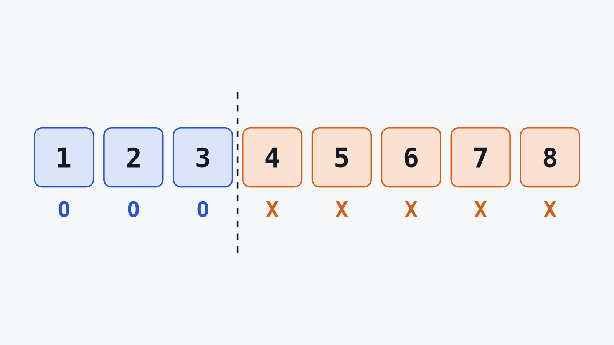
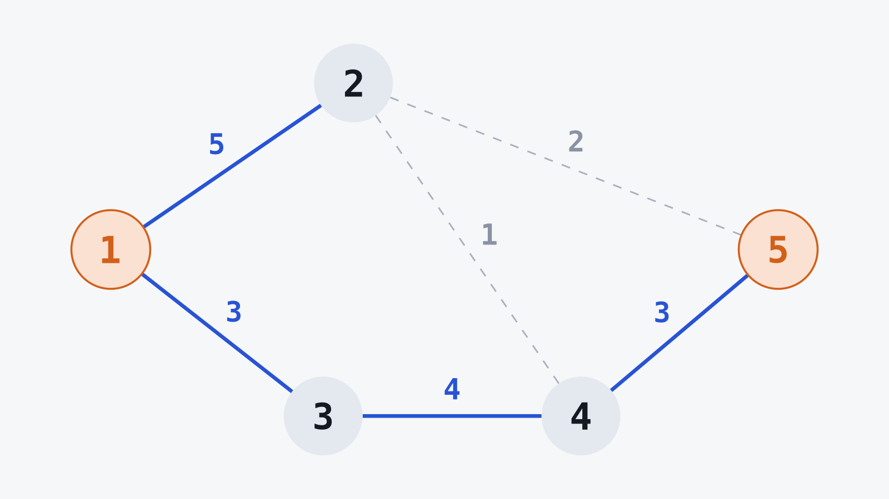
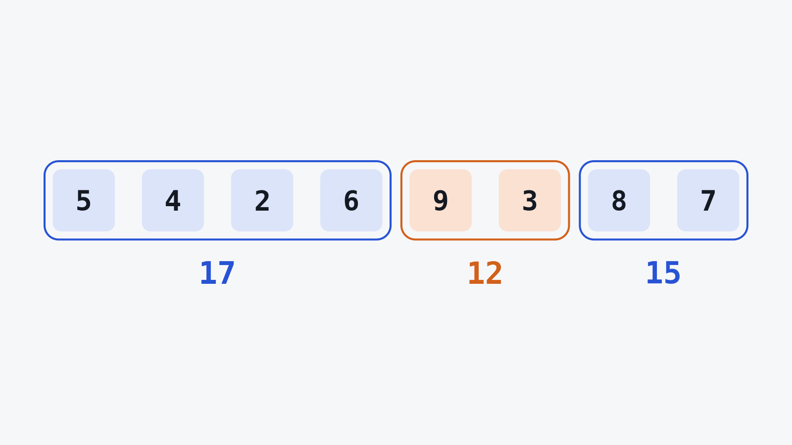
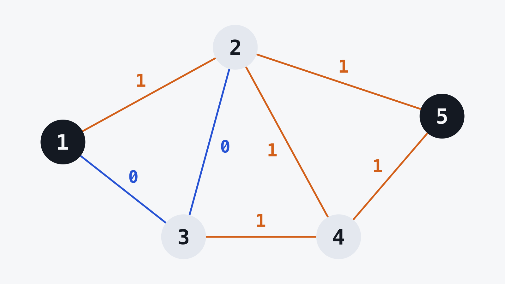
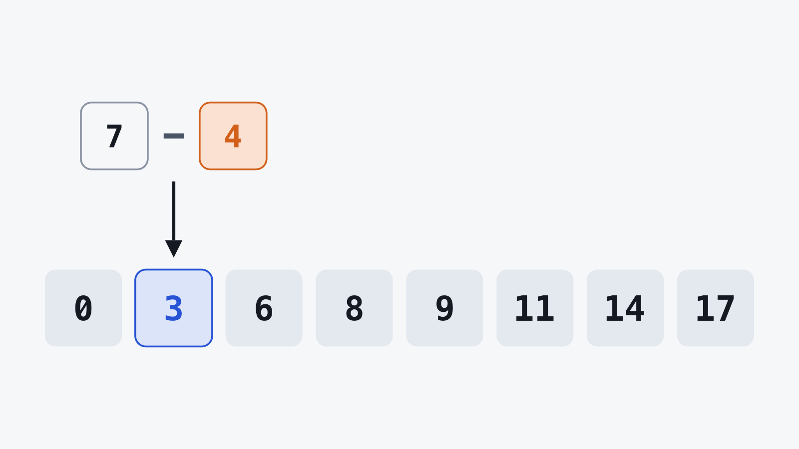
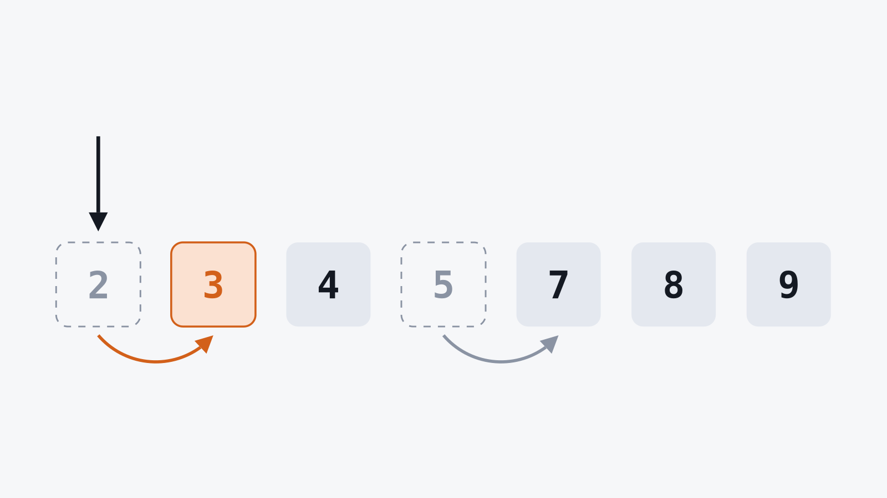
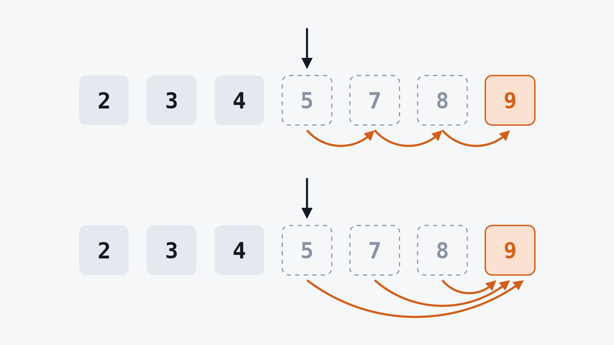

# 값 하나 고정해보실?: 이분탐색 + α

> rilog 발행 글: <https://www.rilog.kr/@iqed/posts/611> (2026-11-23)

안녕하세요 ~ 오늘은 이분탐색 이야기를 해보려고 합니다.

문제를 풀다 보면 아예 손을 못 대겠거나, 겨우 떠올린 풀이가 시간 초과인 경우가 있죠.  
그럴 때 한 번쯤 이런 생각이 듭니다.

“아, 이 값 하나만 알면 쉬운데.”

그럼 그 값을 그냥 **정해 놓고** 풀어 보면 어떨까요?  
물론 아무 값이나 찍을 수는 없으니, 정해 놓을 값은 이분탐색으로 좁혀 갑니다.  
이분탐색은 값을 log번만 시도하면 되니까 전체 시간은 이렇게 되겠죠.

**값을 정해 놓았을 때의 풀이 시간 × logN**

이게 제한 시간 안에 들어온다면 이분탐색을 붙여 볼 만한 문제입니다.  
이분탐색이 BFS, DP, 다익스트라, 누적합, 유니온 파인드와 같이 나오는 문제들이 사실 전부 이 구조거든요.  
값을 고정한 뒤의 문제는 BFS나 DP로 풀고, 이분탐색은 그 값을 찾는 일만 합니다.  
말로만 하면 감이 잘 안 오니, 바로 문제를 보면서 확인해 봅시다.

## 답을 정해 놓고 묻습니다

[BOJ 2110 공유기 설치](https://www.acmicpc.net/problem/2110)부터 봅시다. 이분탐색을 배우면 꼭 한 번은 만나는 문제죠.  
수직선 위에 집이 N개 있고, 그중 C곳에 공유기를 놓습니다.  
이때 가장 가까운 두 공유기 사이의 거리를 최대로 만들어야 합니다.

어느 집에 놓을지를 직접 고르려고 하면 경우가 너무 많아서 막막합니다.  
그래서 질문을 뒤집어 봅니다. 답을 x라고 **정해 놓고** 이렇게 물어보는 거죠.

“공유기 사이의 거리를 전부 x 이상으로 해서 C개를 놓을 수 있는가?”

이건 어렵지 않습니다.  
맨 왼쪽 집에 하나 놓고, 직전 공유기에서 x 이상 떨어진 집이 나올 때마다 하나씩 놓으면 됩니다.  
그렇게 놓은 개수가 C개 이상이면 되는 거고요.



*집이 1, 2, 4, 8, 9에 있고 C = 3일 때, x를 1부터 하나씩 물어본 결과입니다.  
되는 x와 안 되는 x가 딱 한 곳에서 갈리는 게 보이죠.*

생각해 보면 당연합니다. 거리 x로 놓을 수 있다면 그보다 좁은 간격으로도 놓을 수 있으니까요.  
그래서 “된다”와 “안 된다”는 한 번만 갈리고, 그 경계가 바로 답입니다.  
경계를 찾는 건 이분탐색이 제일 잘하는 일이죠.

```cpp
#include <bits/stdc++.h>
#define ibm514 ios::sync_with_stdio(0), cin.tie(0), cout.tie(0);
using namespace std;
typedef long long ll;
int n, c;
vector<int> a;

// 가장 가까운 두 공유기의 거리를 x 이상으로 해서 c개를 놓을 수 있는가
bool check(int x) {
    int cnt = 1, last = a[0];
    for (int i = 1; i < n; ++i) {
        if (a[i] - last < x) continue;
        ++cnt, last = a[i];
    }
    return cnt >= c;
}

void solve() {
    cin >> n >> c;
    a.resize(n);
    for (int &v : a) cin >> v;
    sort(a.begin(), a.end());

    int lo = 1, hi = 1e9 + 1;       // lo는 되는 값, hi는 안 되는 값
    while (lo + 1 < hi) {
        int mid = (lo + hi) / 2;
        if (check(mid)) lo = mid;
        else hi = mid;
    }
    cout << lo;
}

int main() {
    ibm514
    solve();
    return 0;
}
```

코드는 두 덩어리로 보면 됩니다.  
`check(x)`는 x를 정해 놓았을 때의 쉬운 문제를 풀고,  
while문은 되는 값 `lo`와 안 되는 값 `hi` 사이를 좁혀 가면서 경계를 찾습니다.

시간도 한번 계산해 봅시다.  
`check` 한 번은 집을 한 번 훑으니까 N입니다.  
답의 범위가 10억이니 `check`는 30번쯤 불리고요.  
20만 × 30 = 600만이니 넉넉합니다.

앞으로 나올 문제들도 while문은 거의 그대로입니다.  
**바뀌는 건 check 안쪽뿐입니다.**  
그래서 새 문제를 만나면 `check` 한 번이 얼마나 걸리는지,  
거기에 log를 곱해도 괜찮은지만 따져 보면 됩니다.

### 판정이 BFS일 때

[BOJ 1939 중량제한](https://www.acmicpc.net/problem/1939)입니다.  
섬들을 잇는 다리마다 버틸 수 있는 중량이 정해져 있습니다.  
공장이 있는 두 섬 사이로 한 번에 옮길 수 있는 물건의 최대 중량을 구하는 문제입니다.

최대 중량 경로를 바로 찾으려고 하면 꽤 까다롭습니다.  
그런데 중량을 x로 정해 놓으면 이야기가 달라집니다. x를 못 버티는 다리는 없는 셈 치면 되거든요.  
남은 다리만으로 도착할 수 있는지는 BFS 한 번이면 알 수 있습니다.



*x = 3으로 정했을 때입니다.  
3을 못 버티는 다리(점선)는 지우고, 남은 다리만으로 1에서 5까지 닿는지만 보면 됩니다.*

```cpp
#include <bits/stdc++.h>
#define ibm514 ios::sync_with_stdio(0), cin.tie(0), cout.tie(0);
using namespace std;
typedef long long ll;
const int MX = 10001;
int n, m, s, e;
vector<pair<int, int>> adj[MX];
bool vis[MX];

// 중량 x를 싣고 s에서 e까지 갈 수 있는가
bool check(int x) {
    memset(vis, 0, sizeof(vis));
    queue<int> q;
    q.push(s);
    vis[s] = 1;
    while (!q.empty()) {
        int cur = q.front(); q.pop();
        if (cur == e) return 1;
        for (auto [nxt, w] : adj[cur]) {
            if (vis[nxt] || w < x) continue; // x를 못 버티는 다리는 없는 셈 친다
            vis[nxt] = 1;
            q.push(nxt);
        }
    }
    return 0;
}

void solve() {
    cin >> n >> m;
    for (int i = 0; i < m; ++i) {
        int a, b, c;
        cin >> a >> b >> c;
        adj[a].push_back({b, c});
        adj[b].push_back({a, c});
    }
    cin >> s >> e;

    int lo = 1, hi = 1e9 + 1;       // lo는 되는 값, hi는 안 되는 값
    while (lo + 1 < hi) {
        int mid = (lo + hi) / 2;
        if (check(mid)) lo = mid;
        else hi = mid;
    }
    cout << lo;
}

int main() {
    ibm514
    solve();
    return 0;
}
```

BFS는 늘 짜던 그대로이고, `w < x`인 다리를 건너뛰는 조건 하나만 붙었습니다.  
“최대 중량 경로를 찾아라”가 “갈 수 있냐 없냐”로 바뀐 거죠.

BFS 한 번이 N + M이고 중량의 범위가 10억이니 30번, 11만 × 30 = 330만입니다. 이번에도 넉넉하네요.

### 판정이 DP일 때

[BOJ 2613 숫자구슬](https://www.acmicpc.net/problem/2613)입니다.  
한 줄로 놓인 구슬 N개를 순서를 유지한 채 M개의 그룹으로 나눕니다.  
그룹 합 중 최댓값이 최소가 되게 하고, 그룹마다 구슬이 몇 개씩 들어가는지도 출력해야 합니다.

이번에도 똑같이 갑니다. 최댓값을 x로 정해 놓고 물어봅니다.  
“모든 그룹의 합이 x 이하가 되도록 M개 이하로 나눌 수 있는가?”

판정은 DP로 합니다.  
`dp[i]` = 앞에서 i개를 나눌 때 필요한 최소 그룹 수  
마지막 그룹이 j + 1번째부터 i번째까지라면 `dp[i] = dp[j] + 1`이 되겠죠.  
물론 그 구간의 합이 x 이하인 j만 볼 수 있고, 구간의 합은 누적합으로 바로 구합니다.



*구슬이 5 4 2 6 9 3 8 7이고 x = 17로 정했을 때입니다.  
합이 17을 넘지 않게 묶어 보면 세 그룹으로 충분합니다.*

```cpp
#include <bits/stdc++.h>
#define ibm514 ios::sync_with_stdio(0), cin.tie(0), cout.tie(0);
using namespace std;
typedef long long ll;
const int MX = 301;
int n, m, a[MX], sum[MX], dp[MX];

// 그룹의 합이 모두 x 이하가 되도록 m개 이하의 그룹으로 나눌 수 있는가
bool check(int x) {
    // dp[i] = 앞에서 i개를 나눌 때 필요한 최소 그룹 수
    dp[0] = 0;
    for (int i = 1; i <= n; ++i) {
        dp[i] = MX;
        for (int j = i - 1; j >= 0 && sum[i] - sum[j] <= x; --j) {
             // j + 1번째부터 i번째까지가 마지막 그룹
            dp[i] = min(dp[i], dp[j] + 1); 
        }
    }
    return dp[n] <= m;
}

void solve() {
    cin >> n >> m;
    for (int i = 1; i <= n; ++i) {
        cin >> a[i];
        sum[i] = sum[i - 1] + a[i];
    }

    int lo = 0, hi = sum[n];   // lo는 안 되는 값, hi는 되는 값
    while (lo + 1 < hi) {
        int mid = (lo + hi) / 2;
        if (check(mid)) hi = mid;
        else lo = mid;
    }
    cout << hi << '\n';

    // 합이 hi를 넘지 않게 앞에서부터 담되, 남은 구슬이 남은 그룹 수만큼이면 하나씩 끊는다
    int cnt = 0, cur = 0, left = m;
    for (int i = 1; i <= n; ++i) {
        if (cnt && (cur + a[i] > hi || n - i + 1 < left)) {
            cout << cnt << ' ';
            cnt = cur = 0, --left;
        }
        ++cnt, cur += a[i];
    }
    cout << cnt;
}

int main() {
    ibm514
    solve();
    return 0;
}
```

DP 한 번이 N²이라 9만이고, 합의 범위가 3만이라 15번쯤 돕니다. 9만 × 15 = 135만이네요.

주의할 점이 하나 있는데요, 이번에는 최솟값을 찾는 문제라 방향이 반대입니다.  
x가 클수록 나누기 쉬우니까 `lo`가 안 되는 값, `hi`가 되는 값이 됩니다. 그래서 답도 `hi`입니다.

그리고 `dp[n]`이 M보다 작아도 괜찮습니다.  
그룹을 더 쪼개면 합은 줄어들기만 하니까, M개로 맞추는 건 언제든 가능하거든요.  
코드 마지막의 출력 부분이 그 일을 합니다.  
남은 구슬 수가 남은 그룹 수와 같아지면 그때부터 하나씩 끊어 줍니다.

### 판정이 다익스트라일 때

[BOJ 1800 인터넷 설치](https://www.acmicpc.net/problem/1800)입니다. 이번 문제는 조금 더 꼬여 있습니다.  
1번 컴퓨터에서 N번 컴퓨터까지 선을 이어야 하는데,  
쓴 선 중 K개는 공짜이고 나머지 중에서 가장 비싼 선의 값만 냅니다. 이때 내는 돈의 최솟값을 구합니다.

내는 돈을 x로 정해 놓고 생각해 봅시다.  
x원 이하인 선은 몇 개를 쓰든 상관이 없습니다.  
문제가 되는 건 x원보다 비싼 선인데, 이 선들은 전부 공짜로 받아야 하죠.  
그러니 물어볼 건 이것입니다.

“x원보다 비싼 선을 K개 이하로 쓰면서 N번까지 갈 수 있는가?”

여기서 한 번 더 바꿔 봅니다.  
비싼 선의 가중치를 1, 나머지를 0으로 두면 “비싼 선을 가장 적게 쓰는 경로”는 그냥 최단 거리 문제입니다.



*x = 4로 정했을 때입니다. 4원보다 비싼 선은 1, 나머지는 0이 됩니다.  
1 → 3 → 2 → 5로 가면 합이 1이니까, 공짜 선이 하나만 있어도 됩니다.*

```cpp
#include <bits/stdc++.h>
#define ibm514 ios::sync_with_stdio(0), cin.tie(0), cout.tie(0);
using namespace std;
typedef long long ll;
const int MX = 1001;
int n, p, k, dist[MX];
vector<pair<int, int>> adj[MX];

// x원보다 비싼 선을 k개 이하로 쓰면서 1번에서 n번까지 이을 수 있는가
bool check(int x) {
    // dist[v] = 1번에서 v번까지 가면서 쓰는 "x원보다 비싼 선"의 최소 개수
    fill(dist, dist + MX, INT_MAX);
    priority_queue<pair<int, int>, vector<pair<int, int>>, greater<>> pq;
    pq.push({0, 1});
    dist[1] = 0;
    while (!pq.empty()) {
        auto [d, cur] = pq.top(); pq.pop();
        if (d > dist[cur]) continue;
        for (auto [nxt, w] : adj[cur]) {
            int nd = d + (w > x);           // 비싼 선이면 1, 아니면 0
            if (dist[nxt] <= nd) continue;
            dist[nxt] = nd;
            pq.push({nd, nxt});
        }
    }
    return dist[n] <= k;
}

void solve() {
    cin >> n >> p >> k;
    for (int i = 0; i < p; ++i) {
        int a, b, c;
        cin >> a >> b >> c;
        adj[a].push_back({b, c});
        adj[b].push_back({a, c});
    }

    int lo = -1, hi = 1e6;              // lo는 안 되는 값, hi는 되는 값
    if (!check(hi)) {                   // 모든 선을 써도 못 잇는다
        cout << -1;
        return;
    }
    while (lo + 1 < hi) {
        int mid = (lo + hi) / 2;
        if (check(mid)) hi = mid;
        else lo = mid;
    }
    cout << hi;
}

int main() {
    ibm514
    solve();
    return 0;
}
```

간선의 원래 가격은 다익스트라 안에서 `w > x`인지 볼 때만 쓰입니다.  
x를 정해 놓는 순간 가격이 0과 1로 바뀌면서, 평범한 최단 거리 문제가 된 거죠.

다익스트라 한 번이 P log N으로 10만쯤이고, 가격의 범위가 100만이니 20번입니다. 200만이면 끝나네요.

두 가지만 조심하면 됩니다.  
모든 선을 다 써도 N번에 닿지 못하면 답이 없으니, 먼저 확인하고 -1을 출력합니다.  
그리고 답이 0일 수도 있어서 `lo`는 -1에서 시작합니다.

## 한쪽을 정해 놓고 나머지를 찾습니다

지금까지는 정해 놓는 값이 곧 답이었는데, 꼭 그럴 필요는 없습니다.  
두 값을 골라서 조건을 맞춰야 하는 문제라면, 하나를 정해 놓는 순간 나머지 하나는 “찾기만” 하면 되거든요.  
둘을 전부 짝지어 보는 대신, 한쪽의 개수에 log만 곱하면 됩니다.

[BOJ 2632 피자판매](https://www.acmicpc.net/problem/2632)입니다.  
원형 피자 A와 B가 여러 조각으로 나뉘어 있고, 한 피자에서는 연속한 조각만 팔 수 있습니다.  
A와 B에서 고른 조각의 크기 합이 손님이 주문한 크기가 되는 경우의 수를 구합니다.

먼저 피자 한 판에서 연속으로 잘라 만들 수 있는 크기를 누적합으로 전부 구해 둡니다.  
조각이 1,000개라고 해도 100만 가지 정도라 부담 없습니다.

문제는 그다음입니다.  
A에서 만들 수 있는 크기와 B에서 만들 수 있는 크기를 전부 짝지어 보면 100만 × 100만이라 절대 안 됩니다.  
그래서 A에서 x만큼 쓰기로 **정해 놓습니다.**  
그러면 B에서 필요한 크기는 `target - x` 하나로 정해지죠.  
B의 목록을 미리 정렬해 두면, 그 값이 몇 개 있는지는 이분탐색으로 바로 찾을 수 있습니다.



*주문한 크기가 7일 때입니다.  
A에서 4를 쓰기로 정하면, 정렬해 둔 B의 크기 목록에서 3만 찾으면 됩니다.*

```cpp
#include <bits/stdc++.h>
#define ibm514 ios::sync_with_stdio(0), cin.tie(0), cout.tie(0);
using namespace std;
typedef long long ll;
int target, m, n;

// 원형 피자 한 판에서 연속으로 잘라 만들 수 있는 크기를 전부 모은다
vector<int> make(int len) {
    vector<int> sum(2 * len + 1);
    for (int i = 1; i <= len; ++i) cin >> sum[i];
    // 원형이라 두 번 이어 붙인다
    for (int i = len + 1; i <= 2 * len; ++i) sum[i] = sum[i - len];   
    for (int i = 1; i <= 2 * len; ++i) sum[i] += sum[i - 1];

    vector<int> ret = {0, sum[len]};   // 하나도 안 쓰는 경우와 한 판을 다 쓰는 경우
    for (int i = 0; i < len; ++i) {
        for (int cnt = 1; cnt < len; ++cnt) ret.push_back(sum[i + cnt] - sum[i]);
    }
    return ret;
}

void solve() {
    cin >> target >> m >> n;
    vector<int> a = make(m), b = make(n);
    sort(b.begin(), b.end());

    ll ans = 0;
    for (int x : a) { // A에서 x만큼 쓰기로 정하면
         // B에서는 target - x가 몇 개인지만 찾는다
        auto [l, r] = equal_range(b.begin(), b.end(), target - x);   
        ans += r - l;
    }
    cout << ans;
}

int main() {
    ibm514
    solve();
    return 0;
}
```

`equal_range`는 `lower_bound`와 `upper_bound`를 한 번에 돌려주는 함수입니다.  
둘의 차이가 곧 그 값의 개수가 되고요.  
여기서 이분탐색은 답을 찾는 게 아니라, 정해 놓은 x의 **짝**을 찾고 있습니다.

100만 × 100만이던 계산이 100만 × 20으로 줄었습니다. 이 정도면 할 만하죠.

### 찾은 값을 한 번만 쓸 수 있을 때

[BOJ 16566 카드 게임](https://www.acmicpc.net/problem/16566)입니다.  
민수는 카드 M장을 들고 있습니다.  
철수가 카드를 낼 때마다, 민수는 그보다 큰 카드 중에서 가장 작은 카드를 내야 합니다.  
한 번 낸 카드는 다시 쓸 수 없고, 민수가 내는 카드를 차례로 출력하면 됩니다.

철수의 카드 x는 이미 정해져 있으니,  
민수의 카드를 정렬해 두고 `upper_bound`로 x보다 큰 첫 카드를 찾으면 될 것 같습니다.  
그런데 한 가지 걸리는 게 있습니다. 그 카드를 이미 냈다면 어떻게 할까요?  
배열에서 지우자니 느리고, 옆으로 한 칸씩 넘어가자니 그것도 느립니다.

여기서 유니온 파인드가 등장합니다.  
카드를 낼 때마다 그 자리를 바로 뒤 자리에 붙여 두는 겁니다.  
그러면 `find(i)`는 “i번째부터 봤을 때 아직 남아 있는 첫 카드”를 돌려주게 됩니다.



*5와 2를 이미 낸 뒤에 철수가 1을 낸 상황입니다.  
upper_bound는 2를 가리키지만, 2는 3에 붙어 있어서 find가 3을 돌려줍니다.*

```cpp
#include <bits/stdc++.h>
#define ibm514 ios::sync_with_stdio(0), cin.tie(0), cout.tie(0);
using namespace std;
typedef long long ll;
const int MX = 4000001;
int n, m, k, card[MX], par[MX];

// find(i) = 정렬된 카드에서 i번째 이후로 아직 안 낸 가장 앞의 카드
int find(int i) {
    if (par[i] == i) return i;
    return par[i] = find(par[i]);
}

void solve() {
    cin >> n >> m >> k;
    for (int i = 0; i < m; ++i) cin >> card[i];
    sort(card, card + m);
    for (int i = 0; i <= m; ++i) par[i] = i;

    while (k--) {
        int x;
        cin >> x;
        // x보다 큰 가장 작은 카드의 자리
        int idx = upper_bound(card, card + m, x) - card;  
        idx = find(idx);                  // 그 카드를 이미 냈다면 다음 남은 카드로
        cout << card[idx] << '\n';
        par[idx] = idx + 1;               // 낸 카드는 바로 뒤 카드에 붙인다
    }
}

int main() {
    ibm514
    solve();
    return 0;
}
```

역할을 나눠 보면, 이분탐색이 자리를 찾고 유니온 파인드가 그 자리에서 **남아 있는 것**까지 건너뛰어 줍니다.  
카드 배열은 처음 정렬한 그대로이고 지우는 일이 없어서, 이분탐색을 계속 쓸 수 있는 거죠.

그런데 코드를 보면 union 함수가 없습니다. 이상하지 않나요?  
사실 `par[idx] = idx + 1` 한 줄이 그 역할을 하고 있습니다.  
`idx`는 방금 `find`로 얻은 대표라서, 바로 뒤 카드에 붙여 주기만 하면 되거든요.

그럼 낸 카드가 길게 이어져 있으면 `find`가 느려지지 않을까요?  
괜찮슴다. `find`는 지나간 카드를 전부 도착한 카드에 직접 붙여 두기 때문에, 같은 길을 두 번 걷지 않습니다.



*5, 7, 8을 이미 낸 뒤에 철수가 4를 낸 상황입니다.  
위는 find가 5 → 7 → 8 → 9로 따라가는 길이고, 아래는 find가 끝난 뒤입니다.  
5, 7, 8이 모두 9에 직접 붙어서, 다음에는 이 길을 다시 걷지 않습니다.*

카드를 낼 때마다 M장을 훑으면 K × M인데, 이렇게 하면 한 번에 log M 정도로 끝납니다.

## 자주 틀리는 곳

- **log를 곱해도 되는가.** `check` 한 번이 무거우면 log를 곱했을 때 시간 초과가 납니다.  
붙이기 전에 먼저 계산합니다.
- **한 번만 갈리는가.** x가 되면 x보다 작은(또는 큰) 값도 전부 되는지 먼저 확인합니다.  
아니라면 이분탐색을 쓸 수 없습니다.
- **lo와 hi의 처음 값.** 한쪽은 반드시 되는 값, 다른 쪽은 반드시 안 되는 값으로 시작합니다.  
답이 될 수 있는 범위의 바로 바깥까지 잡습니다.
- **최대인가 최소인가.** 최댓값을 찾으면 답은 되는 쪽 끝인 `lo`, 최솟값을 찾으면 `hi`입니다.
- **check의 초기화.** check는 여러 번 불립니다. 방문 배열과 거리 배열은 부를 때마다 초기화합니다.
- **자료형.** x의 범위나 경우의 수가 int를 넘는지 확인합니다. 피자판매의 답은 `long long`입니다.

## 정리

1. 풀이가 안 보이거나 시간 초과가 난다면, “값 하나만 알면 쉬워지지 않을까?”를 먼저 떠올려 봅니다.
2. 그 값을 정해 놓았을 때의 풀이 시간에 log를 곱해 봅니다. 제한 시간 안이라면 이분탐색을 붙이면 됩니다.
3. 정해 놓는 값이 답이라면 “x가 가능한가”를 판정하고,  
답이 아니라면 정해 놓은 값의 짝을 정렬된 목록에서 찾습니다.
4. 찾은 값을 다시 쓸 수 없다면, 지우지 말고 유니온 파인드로 건너뜁니다.

## 추천 문제

1. [BOJ 2110 공유기 설치](https://www.acmicpc.net/problem/2110): 답을 정해 놓고 그리디로 판정
2. [BOJ 1939 중량제한](https://www.acmicpc.net/problem/1939): BFS로 판정
3. [BOJ 2585 경비행기](https://www.acmicpc.net/problem/2585): BFS가 횟수까지 세는 판정
4. [BOJ 2613 숫자구슬](https://www.acmicpc.net/problem/2613): DP로 판정
5. [BOJ 1800 인터넷 설치](https://www.acmicpc.net/problem/1800): 다익스트라로 판정
6. [BOJ 2632 피자판매](https://www.acmicpc.net/problem/2632): 한쪽을 정해 놓고 짝 찾기
7. [BOJ 16566 카드 게임](https://www.acmicpc.net/problem/16566): 찾은 자리에서 남은 것으로 건너뛰기
8. [BOJ 1981 배열에서 이동](https://www.acmicpc.net/problem/1981): 정해 놓을 값이 두 개일 때
