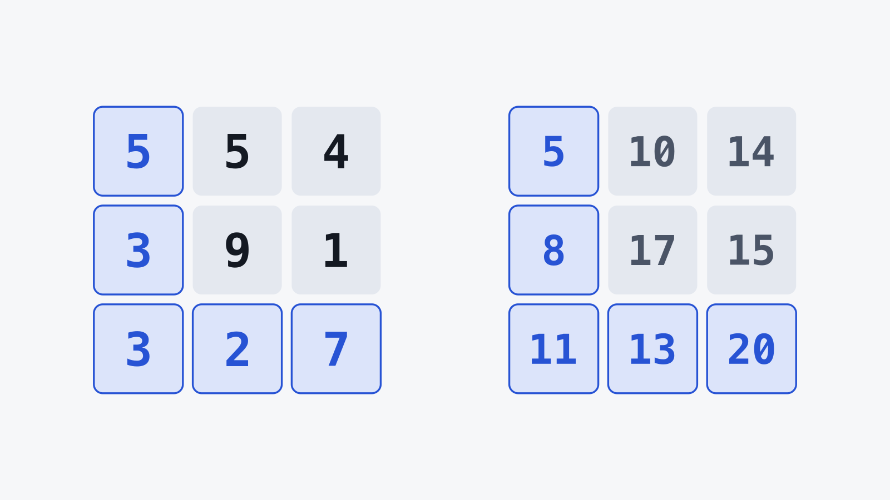
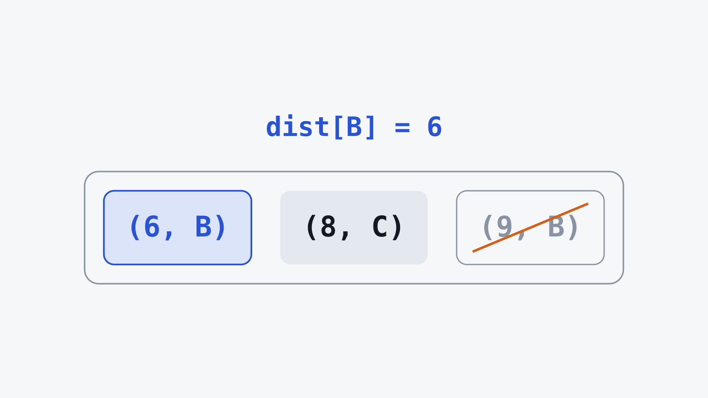
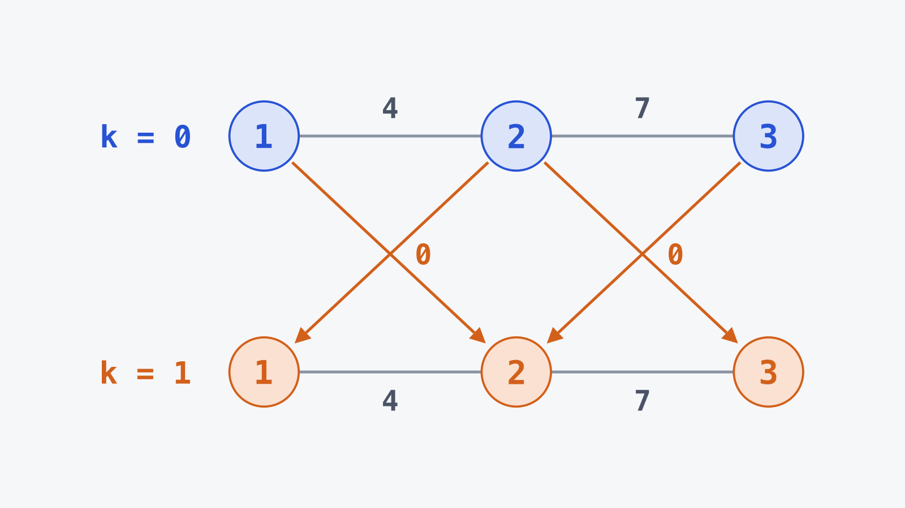
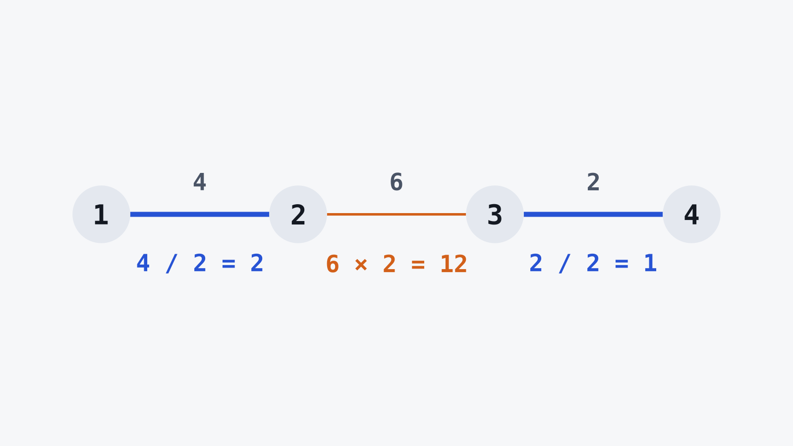
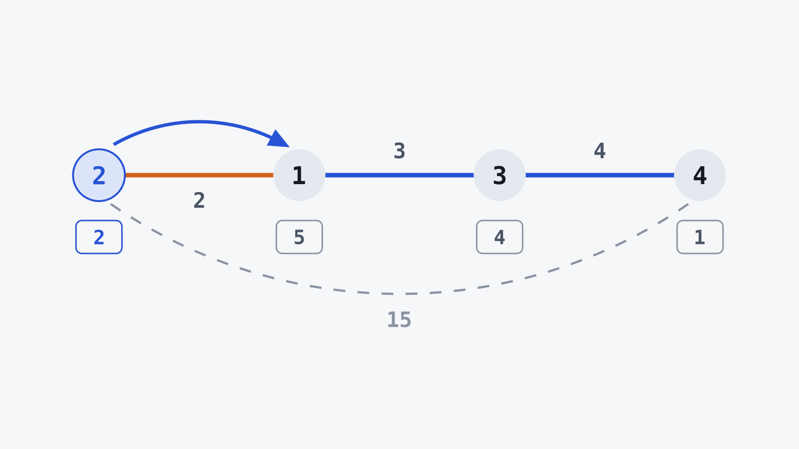
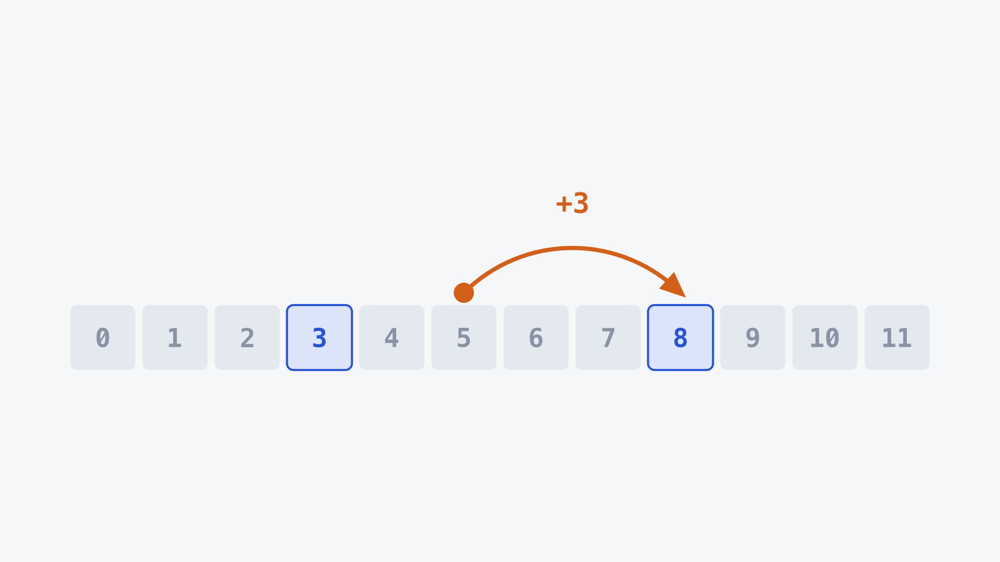
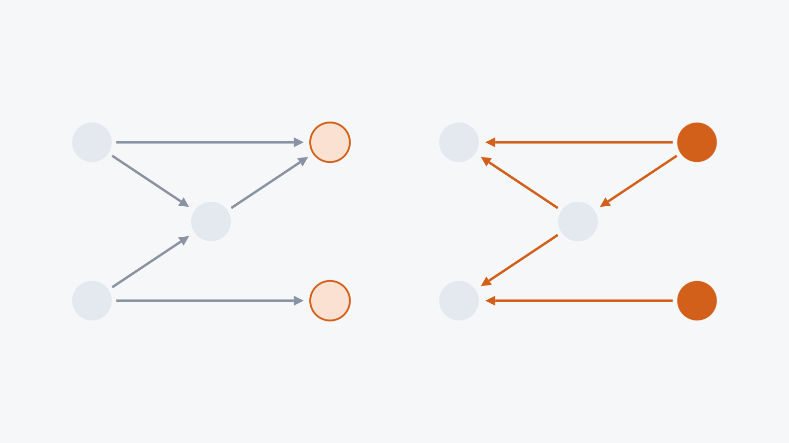
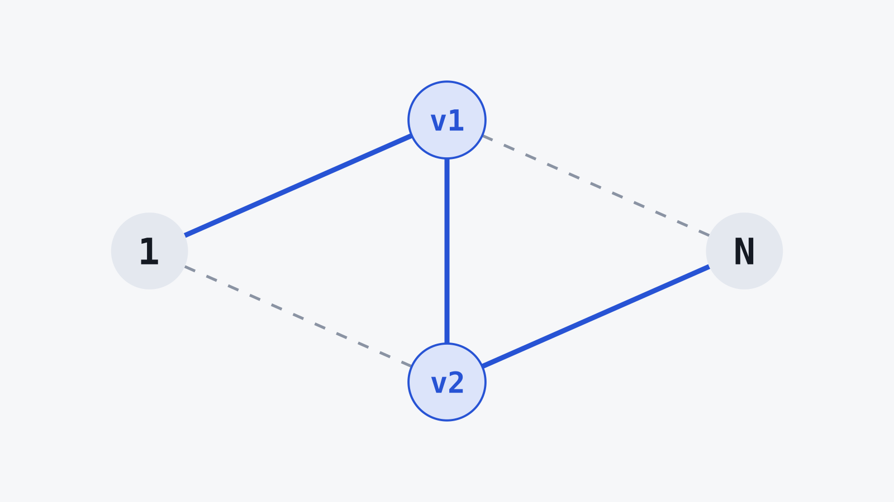
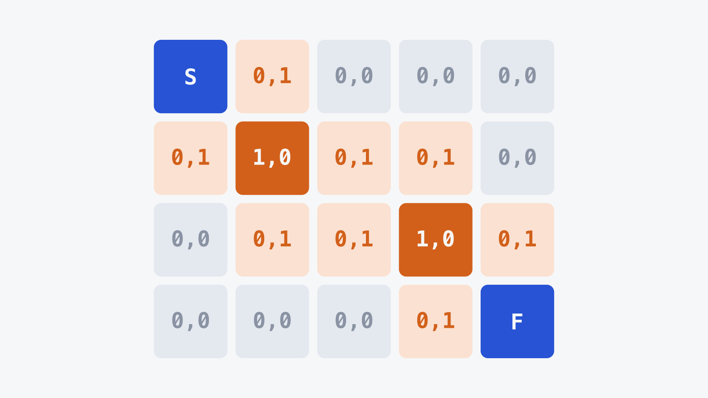
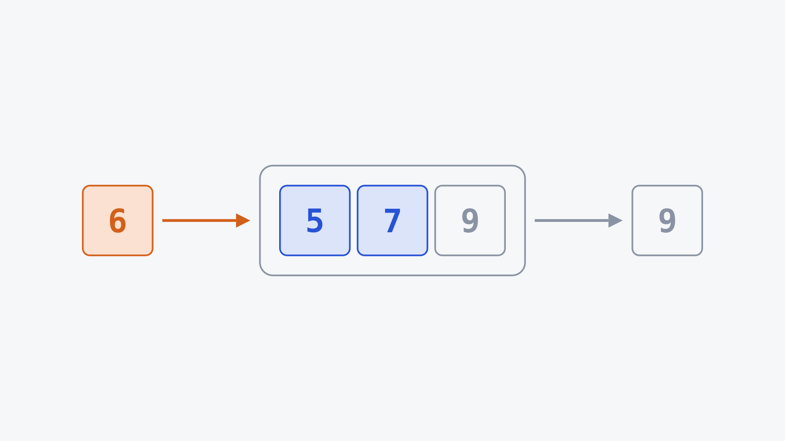

# 새치기 좀 할게: 다익스트라

> rilog 발행 글: <https://www.rilog.kr/@iqed/posts/621> (2026-11-25)

안녕하세요 ~ 오늘은 다익스트라 이야기를 해보려고 합니다.

다익스트라라고 하면 보통 “도시와 도로가 주어지고 최단 경로를 구하는 알고리즘”으로 기억하죠.  
틀린 말은 아닌데, 그렇게만 알고 있으면 도시와 도로가 안 보이는 문제에서는 떠올리기가 어렵습니다.

저는 다익스트라를 BFS의 연장으로 보는 편이 훨씬 쓸모 있다고 생각해요.  
[지난 글](https://www.rilog.kr/@iqed/posts/620)에서 BFS에 조건을 하나씩 붙여 봤는데,  
그러다 보면 큐로는 더 이상 순서를 지킬 수 없는 순간이 옵니다.  
그때 큐를 우선순위 큐로 바꾼 것이 다익스트라입니다.

그래서 이번 글은 BFS가 막히는 자리에서 시작합니다.  
그다음 BFS에서 했던 것처럼 상태를 붙여 보고,  
뒤쪽에서는 다익스트라로 풀리는 다른 유형들도 하나씩 살펴보겠습니다.

## 큐로는 안 되는 순간: 녹색 옷 입은 애가 젤다지?

[BOJ 4485 녹색 옷 입은 애가 젤다지?](https://www.acmicpc.net/problem/4485)입니다.  
N×N 동굴의 칸마다 0부터 9까지의 수가 적혀 있고, 그 칸을 지나면 적힌 만큼 돈을 잃습니다.  
왼쪽 위에서 오른쪽 아래까지 갈 때 잃는 돈의 최솟값을 구합니다.

격자에서 상하좌우로 움직이니까 BFS처럼 생겼습니다.  
그런데 BFS를 돌리면 답이 안 나와요.  
BFS가 구해 주는 건 가장 적은 **칸 수**인데, 여기서 필요한 건 가장 적은 **금액**이거든요.



*예제 1번입니다. 왼쪽은 칸마다 잃는 금액이고, 오른쪽은 그 칸까지 오면서 잃는 금액의 최솟값입니다.  
파란 칸을 따라가면 20으로 가장 덜 잃습니다.*

지난 글의 마지막에 본 0-1 BFS는 어떨까요?  
비용이 0이면 덱의 앞에, 1이면 뒤에 넣어서 순서를 지켰었죠.  
하지만 이번에는 비용이 0부터 9까지라서, 앞에 넣어도 뒤에 넣어도 순서가 어긋납니다.

큐와 덱이 통했던 이유를 다시 떠올려 봅시다.  
꺼낼 때마다 **지금까지의 비용이 가장 작은 칸**이 나왔기 때문이에요.  
넣는 위치만 잘 고르면 그게 저절로 지켜졌던 거고요.

이제는 넣는 위치로 해결이 안 되니, 아예 “가장 작은 것부터 꺼내 주는” 자료구조를 씁니다.  
그게 우선순위 큐이고, 큐를 우선순위 큐로 바꾼 BFS가 다익스트라입니다.

```cpp
#include <bits/stdc++.h>
#define ibm514 ios::sync_with_stdio(0), cin.tie(0), cout.tie(0);
using namespace std;
typedef long long ll;
typedef tuple<int, int, int> T;   // (지금까지 잃은 금액, 행, 열)
const int dr[] = {-1, 1, 0, 0}, dc[] = {0, 0, -1, 1};
int n, a[125][125], dist[125][125];

void solve() {
    for (int tc = 1; cin >> n && n; ++tc) {
        for (int i = 0; i < n; ++i)
            for (int j = 0; j < n; ++j) cin >> a[i][j], dist[i][j] = INT_MAX;
        // 잃은 금액이 가장 작은 칸이 맨 위로 온다
        priority_queue<T, vector<T>, greater<T>> pq;   
        dist[0][0] = a[0][0];
        pq.push({dist[0][0], 0, 0});
        while (!pq.empty()) {
            auto [d, r, c] = pq.top();
            pq.pop();
            if (d > dist[r][c]) continue;    // 더 좋은 값으로 이미 처리한 칸
            for (int k = 0; k < 4; ++k) {
                int nr = r + dr[k], nc = c + dc[k];
                if (nr < 0 || nr >= n || nc < 0 || nc >= n) continue;
                if (dist[nr][nc] <= d + a[nr][nc]) continue;
                dist[nr][nc] = d + a[nr][nc];
                pq.push({dist[nr][nc], nr, nc});
            }
        }
        cout << "Problem " << tc << ": " << dist[n - 1][n - 1] << '\n';
    }
}

int main() {
    ibm514
    solve();
    return 0;
}
```

BFS 코드와 나란히 놓고 보면 달라진 곳이 세 군데뿐입니다.

1. `queue`가 `priority_queue`로 바뀌었습니다.
2. 큐에 좌표만 넣지 않고 **비용을 맨 앞에** 같이 넣습니다. 이 값을 기준으로 순서가 정해집니다.
3. 방문 확인이 “가 본 적 있나”에서 “**더 싸게** 갈 수 있나”로 바뀌었습니다.

`if (d > dist[r][c]) continue;`는 바로 다음 문제에서 설명할게요.

한 가지 조건이 있습니다.  
다익스트라는 비용이 음수가 아닐 때만 맞습니다.  
가장 작은 걸 꺼냈을 때 “이 칸은 이게 최소다”라고 믿을 수 있는 건,  
다른 길로 돌아와 봐야 비용이 늘기만 하기 때문이거든요.  
음수가 있으면 나중에 더 싼 길이 생길 수 있어서 이 믿음이 깨집니다.

## 그래프로 옮기기: 최단경로

[BOJ 1753 최단경로](https://www.acmicpc.net/problem/1753)입니다.  
방향이 있는 그래프에서, 시작 정점에서 다른 모든 정점까지의 최단 거리를 구합니다.

우리가 흔히 아는 다익스트라의 모습이죠.  
방금 본 코드에서 “상하좌우 네 칸”이 “이 정점에서 나가는 간선들”로 바뀔 뿐입니다.

```cpp
#include <bits/stdc++.h>
#define ibm514 ios::sync_with_stdio(0), cin.tie(0), cout.tie(0);
using namespace std;
typedef long long ll;
typedef pair<int, int> P;   // (거리, 정점)
const int MX = 20001, INF = 1e9;
int n, m, s, dist[MX];
vector<P> adj[MX];          // adj[u] = (v, w) 목록

void solve() {
    cin >> n >> m >> s;
    while (m--) {
        int u, v, w;
        cin >> u >> v >> w;
        adj[u].push_back({v, w});
    }
    fill(dist, dist + n + 1, INF);
    priority_queue<P, vector<P>, greater<P>> pq;
    dist[s] = 0;
    pq.push({0, s});
    while (!pq.empty()) {
        auto [d, u] = pq.top();
        pq.pop();
        if (d > dist[u]) continue;   // 낡은 값이면 버린다
        for (auto [v, w] : adj[u]) {
            if (dist[v] <= d + w) continue;
            dist[v] = d + w;
            pq.push({dist[v], v});
        }
    }
    for (int i = 1; i <= n; ++i) {
        if (dist[i] == INF) cout << "INF\n";
        else cout << dist[i] << '\n';
    }
}

int main() {
    ibm514
    solve();
    return 0;
}
```

이제 `if (d > dist[u]) continue;`를 설명할 차례입니다.

우선순위 큐에는 이미 들어 있는 값을 고치는 기능이 없습니다.  
그래서 어떤 정점까지 더 짧은 길을 찾으면 새 값을 **한 번 더** 넣습니다.  
그러면 큐 안에 같은 정점이 여러 번 들어 있게 되죠.



*B까지의 거리가 9에서 6으로 줄어서 (6, B)를 새로 넣었습니다.  
전에 넣어 둔 (9, B)는 큐에 그대로 남아 있다가, 꺼내졌을 때 버려집니다.*

작은 값이 먼저 나오니까 (6, B)가 먼저 처리됩니다.  
나중에 (9, B)가 나오면 `dist[B]`는 이미 6이니, 꺼낸 값이 더 큰 걸 보고 바로 버리는 겁니다.

이 줄이 없어도 답은 맞게 나옵니다.  
하지만 낡은 값으로 간선을 전부 다시 훑게 돼서, 입력이 크면 시간 초과가 납니다.  
다익스트라에서 가장 흔한 시간 초과 원인이니 습관처럼 넣어 두세요.

## 상태 붙이기: 도로포장

[BOJ 1162 도로포장](https://www.acmicpc.net/problem/1162)입니다.  
1번 도시에서 N번 도시까지 가는데, 도로를 K개까지 골라 포장할 수 있습니다.  
포장한 도로는 지나는 시간이 0이 됩니다.  
가장 빨리 가는 시간을 구합니다.

어디서 본 것 같지 않나요?  
[BFS 글](https://www.rilog.kr/@iqed/posts/620)의 벽 부수고 이동하기와 똑같은 문제입니다.  
거기서는 벽을 한 번 부술 수 있었고, 여기서는 도로를 K번 공짜로 지날 수 있죠.

그때 했던 생각을 그대로 가져옵니다.  
같은 도시에 있더라도 포장 기회를 몇 번 썼느냐에 따라 앞으로 할 수 있는 일이 다릅니다.  
그러니 **(도시, 포장한 도로 수)**를 하나의 상태로 봅니다.



*같은 그래프를 두 층으로 쌓았습니다.  
같은 층 안에서는 원래 시간이 들고, 도로를 포장하면 시간 0으로 아래층으로 내려갑니다(주황 화살표).*

그래프를 K + 1층으로 쌓았다고 생각하면 됩니다.  
한 도로를 지날 때 선택지가 둘이에요.  
그냥 지나가서 같은 층에 머물거나, 포장해서 시간 없이 한 층 내려가거나.

```cpp
#include <bits/stdc++.h>
#define ibm514 ios::sync_with_stdio(0), cin.tie(0), cout.tie(0);
using namespace std;
typedef long long ll;
typedef tuple<ll, int, int> T; // (시간, 도시, 포장한 도로 수)
const int MX = 10001;
int n, m, K;
ll dist[MX][21];   // dist[u][k] = 도로를 k개 포장하고 u에 도착하는 최소 시간
vector<pair<int, int>> adj[MX];

void solve() {
    cin >> n >> m >> K;
    while (m--) {
        int u, v, w;
        cin >> u >> v >> w;
        adj[u].push_back({v, w});
        adj[v].push_back({u, w});
    }
    memset(dist, 0x3f, sizeof(dist));
    priority_queue<T, vector<T>, greater<T>> pq;
    dist[1][0] = 0;
    pq.push({0, 1, 0});
    while (!pq.empty()) {
        auto [d, u, k] = pq.top();
        pq.pop();
        if (d > dist[u][k]) continue;
        if (u == n) { cout << d; return; }   // 처음 꺼낸 도착 상태가 답이다
        for (auto [v, w] : adj[u]) {
            if (dist[v][k] > d + w) {              // 그냥 지나간다
                dist[v][k] = d + w;
                pq.push({dist[v][k], v, k});
            }
            if (k < K && dist[v][k + 1] > d) {     // 이 도로를 포장한다
                dist[v][k + 1] = d;
                pq.push({d, v, k + 1});
            }
        }
    }
}

int main() {
    ibm514
    solve();
    return 0;
}
```

`dist`가 2차원이 되고, 큐에 넣는 값에 `k`가 하나 붙었습니다.  
간선 하나에서 두 가지 이동을 다 시도하는 것 말고는 앞의 코드와 같습니다.

N번 도시를 처음 꺼낸 순간 바로 답을 출력했습니다.  
몇 층에서 도착했든, 가장 먼저 꺼내진 것이 가장 빠른 것이니까요.

“최단 경로를 먼저 구하고 그 위에서 가장 긴 도로 K개를 포장하면 되지 않나?” 싶을 수 있는데, 안 됩니다.  
포장을 하면 최단 경로 자체가 바뀌거든요.  
예제만 봐도 원래 최단 경로는 1-2-4(20)인데, 답은 1-3-4에서 100짜리 도로를 포장한 1입니다.

## 번갈아 바뀌는 조건: 달빛 여우

[BOJ 16118 달빛 여우](https://www.acmicpc.net/problem/16118)입니다.  
여우와 늑대가 1번 그루터기에서 출발합니다.  
여우는 항상 같은 속도로 달립니다.  
늑대는 첫 번째 길을 여우의 두 배 속도로 달리고,  
다음 길은 절반 속도로 걷고, 그다음 길은 다시 두 배로 달리기를 되풀이합니다.  
여우가 늑대보다 먼저 도착할 수 있는 그루터기의 수를 구합니다.

여우는 보통의 다익스트라입니다. 문제는 늑대예요.



*늑대가 1에서 4까지 갑니다. 달리는 길(파랑)은 시간이 절반이 되고, 걷는 길(주황)은 두 배가 됩니다.*

늑대가 어떤 그루터기에 도착했을 때,  
다음 길을 **달릴 차례인지 걸을 차례인지**에 따라 그 뒤가 완전히 달라집니다.  
조금 늦게 도착했더라도 달릴 차례라면 결국 더 빨리 갈 수도 있죠.  
그래서 둘을 다른 상태로 칩니다. **(그루터기, 다음이 걸을 차례인가)**입니다.

```cpp
#include <bits/stdc++.h>
#define ibm514 ios::sync_with_stdio(0), cin.tie(0), cout.tie(0);
using namespace std;
typedef long long ll;
typedef tuple<ll, int, int> T;   // (시간, 그루터기, 다음 길을 걸을 차례인가)
const int MX = 4001;
const ll INF = 1e18;
int n, m;
// wolf[u][t] = 다음 길을 달릴 차례(t = 0) / 걸을 차례(t = 1)로 u에 도착하는 최소 시간
ll fox[MX], wolf[MX][2];
vector<pair<int, int>> adj[MX];

void solve() {
    cin >> n >> m;
    while (m--) {
        int a, b, d;
        cin >> a >> b >> d;
        // 반으로 나눠도 정수가 되도록 길이를 두 배로 받는다
        adj[a].push_back({b, d * 2});
        adj[b].push_back({a, d * 2});
    }
    for (int i = 1; i <= n; ++i) fox[i] = wolf[i][0] = wolf[i][1] = INF;
    priority_queue<T, vector<T>, greater<T>> pq;

    // 여우: 보통의 다익스트라
    fox[1] = 0;
    pq.push({0, 1, 0});
    while (!pq.empty()) {
        auto [d, u, t] = pq.top();
        pq.pop();
        if (d > fox[u]) continue;
        for (auto [v, w] : adj[u]) {
            if (fox[v] <= d + w) continue;
            fox[v] = d + w;
            pq.push({fox[v], v, 0});
        }
    }

    // 늑대: 같은 그루터기라도 달릴 차례인지 걸을 차례인지에 따라 다른 상태
    wolf[1][0] = 0;
    pq.push({0, 1, 0});
    while (!pq.empty()) {
        auto [d, u, t] = pq.top();
        pq.pop();
        if (d > wolf[u][t]) continue;
        for (auto [v, w] : adj[u]) {
            ll nd = d + (t == 0 ? w / 2 : w * 2);
            if (wolf[v][t ^ 1] <= nd) continue;
            wolf[v][t ^ 1] = nd;
            pq.push({nd, v, t ^ 1});
        }
    }

    int ans = 0;
    for (int i = 2; i <= n; ++i)
        if (fox[i] < min(wolf[i][0], wolf[i][1])) ++ans;
    cout << ans;
}

int main() {
    ibm514
    solve();
    return 0;
}
```

길을 하나 지날 때마다 `t`가 0과 1 사이를 오갑니다.  
달릴 차례(`t == 0`)면 `w / 2`가, 걸을 차례면 `w * 2`가 더해지죠.

세세하게 챙길 것이 두 가지 있습니다.

첫째, 절반으로 나누면 소수가 나올 수 있습니다.  
그래서 입력을 받을 때 길이를 전부 두 배로 늘렸습니다.  
여우와 늑대를 같은 기준으로 비교하는 거라, 둘 다 두 배가 되면 대소 관계는 그대로입니다.

둘째, 처음에 `wolf[1][0]`만 0입니다.  
`wolf[1][1]`은 “걸을 차례인 채로 1번에 있는 것”이라, 어딘가 다녀와야만 될 수 있는 상태예요.  
그리고 늑대의 도착 시간은 두 상태 중 더 작은 쪽입니다.

## 상태를 직접 찾아야 할 때: 주유소

[BOJ 13308 주유소](https://www.acmicpc.net/problem/13308)입니다.  
도시마다 주유소가 하나씩 있고 리터당 가격이 다릅니다.  
도로 1km를 가는 데 기름 1리터가 들고, 기름통에는 얼마든지 넣을 수 있습니다.  
1번 도시에서 N번 도시까지 가는 최소 비용을 구합니다.

앞의 두 문제는 무엇을 상태에 넣어야 할지가 문제에 적혀 있었습니다. 포장한 횟수, 달릴 차례.  
이번에는 그게 안 보여요.  
남은 기름의 양을 상태에 넣자니 가짓수가 너무 많고요.

생각을 바꿔 봅시다.  
기름통이 무제한이니까,  
지금 달리는 도로에 쓰는 기름은 **지나온 도시 중 가장 싼 곳에서 미리 넣어 온 것**이라고 쳐도 됩니다.  
싼 곳을 지날 때 넉넉히 넣어 두면 되니까요.

그러면 도로 하나를 지나는 비용이 깔끔하게 정해집니다.  
**도로의 길이 × 지금까지 본 가장 싼 기름값**입니다.  
앞으로의 비용을 결정하는 건 “지금까지 본 가장 싼 값” 하나뿐이니, 이걸 상태에 넣습니다.



*예제 1번입니다. 원 아래의 수가 기름값이에요.  
1번에서 2번까지는 5원짜리 기름으로 가고(주황), 가장 싼 2번을 지난 뒤로는 계속 2원짜리로 갑니다(파랑). 2×5 + 9×2 = 28원입니다.*

그림처럼 일부러 싼 주유소에 **들렀다가 되돌아오는** 길이 답이 될 수 있습니다.  
도시만 보고 방문 처리를 하면 1번으로 되돌아올 수 없는데,  
상태가 (1번, 가장 싼 값 5)에서 (1번, 가장 싼 값 2)로 바뀌었으니 자연스럽게 다시 방문하게 되죠.

```cpp
#include <bits/stdc++.h>
#define ibm514 ios::sync_with_stdio(0), cin.tie(0), cout.tie(0);
using namespace std;
typedef long long ll;
typedef tuple<ll, int, int> T; // (비용, 도시, 지금까지 본 가장 싼 기름값)
const int MX = 2501;
int n, m, price[MX];
ll dist[MX][MX]; // dist[u][p] = 가장 싼 기름값이 p인 채로 u에 도착하는 최소 비용
vector<pair<int, int>> adj[MX];

void solve() {
    cin >> n >> m;
    for (int i = 1; i <= n; ++i) cin >> price[i];
    while (m--) {
        int u, v, w;
        cin >> u >> v >> w;
        adj[u].push_back({v, w});
        adj[v].push_back({u, w});
    }
    memset(dist, 0x3f, sizeof(dist));
    priority_queue<T, vector<T>, greater<T>> pq;
    dist[1][price[1]] = 0;
    pq.push({0, 1, price[1]});
    while (!pq.empty()) {
        auto [d, u, p] = pq.top();
        pq.pop();
        if (d > dist[u][p]) continue;
        if (u == n) { cout << d; return; }
        for (auto [v, w] : adj[u]) {
            // 이 도로에서 쓸 기름은 지금까지 가장 쌌던 곳에서 넣은 셈 친다
            ll nd = d + (ll)p * w;   
            int np = min(p, price[v]);
            if (dist[v][np] <= nd) continue;
            dist[v][np] = nd;
            pq.push({nd, v, np});
        }
    }
}

int main() {
    ibm514
    solve();
    return 0;
}
```

`dist[u][p]`의 두 번째 칸이 기름값이라서 배열이 2,501 × 2,501로 꽤 큽니다.  
값이 `long long`이라 50MB쯤 되는데, 이 문제는 메모리 제한이 512MB라 괜찮습니다.

이런 문제에서는 스스로에게 이렇게 물어보면 됩니다.  
“여기까지 온 길 중에서, 앞으로의 비용에 영향을 주는 건 뭐지?”  
그 답이 상태입니다.

## 상태가 필요 없을 때: 횡단보도

[BOJ 24042 횡단보도](https://www.acmicpc.net/problem/24042)입니다.  
횡단보도 신호가 M분 주기로 돌아갑니다.  
i번째 신호는 i분, M + i분, 2M + i분, …에 1분 동안 켜지고, 그때만 그 횡단보도를 건널 수 있습니다.  
건너는 데는 1분이 걸립니다.  
1번 지역에서 N번 지역까지 가는 최소 시간을 구합니다.

방금까지의 흐름대로라면 “주기 안에서 지금이 몇 분째인지”를 상태에 넣고 싶어집니다.  
그런데 이 문제는 그럴 필요가 없어요.

어떤 지역에 일찍 도착하는 게 손해일 수가 있을까요?  
없습니다. 일찍 도착했으면 그 자리에서 기다리면 되니까요.  
늦게 도착한 사람이 할 수 있는 건 일찍 도착한 사람도 전부 할 수 있습니다.

그러니 지역마다 **가장 이른 도착 시각** 하나만 알면 충분합니다.  
달라지는 건 간선의 비용이에요.  
고정된 값이 아니라, 도착 시각에 따라 “다음 신호까지 기다리는 시간 + 1분”으로 그때그때 계산됩니다.



*주기가 5분이고 3번 신호라면 3분, 8분, 13분에 켜집니다.  
5분에 도착했다면 3분을 기다려 8분에 건너기 시작하고, 9분에 반대편에 닿습니다.*

```cpp
#include <bits/stdc++.h>
#define ibm514 ios::sync_with_stdio(0), cin.tie(0), cout.tie(0);
using namespace std;
typedef long long ll;
typedef pair<ll, int> P;   // (도착 시각, 지역)
int n, m;

void solve() {
    cin >> n >> m;
    // adj[u] = (v, 파란불이 켜지는 순번 i)
    vector<vector<pair<int, int>>> adj(n + 1);   
    for (int i = 0; i < m; ++i) {
        int a, b;
        cin >> a >> b;
        adj[a].push_back({b, i});
        adj[b].push_back({a, i});
    }
    vector<ll> dist(n + 1, LLONG_MAX);
    priority_queue<P, vector<P>, greater<P>> pq;
    dist[1] = 0;
    pq.push({0, 1});
    while (!pq.empty()) {
        auto [d, u] = pq.top();
        pq.pop();
        if (d > dist[u]) continue;
        for (auto [v, i] : adj[u]) {
            // d분 이후에 i번 신호가 처음 켜지는 시각: m으로 나눈 나머지가 i인 가장 가까운 시각
            ll start = d + ((i - d % m) + m) % m;
            if (dist[v] <= start + 1) continue;
            dist[v] = start + 1;
            pq.push({dist[v], v});
        }
    }
    cout << dist[n];
}

int main() {
    ibm514
    solve();
    return 0;
}
```

`(i - d % m + m) % m`이 기다리는 시간입니다.  
지금이 주기의 `d % m`분째이고 신호는 `i`분째에 켜지니, 그 차이만큼 기다립니다.  
이미 지났으면 다음 주기까지 가야 해서 `m`을 더하고 다시 나눈 거예요.

상태를 늘려야 하는지 헷갈릴 때는 이렇게 따져 보면 됩니다.  
“값이 더 좋은데도 불리한 경우가 있나?”  
달빛 여우는 있었고(일찍 왔지만 걸을 차례), 횡단보도는 없습니다.

답이 M × N 근처까지 커질 수 있어서 `long long`을 썼습니다.

## 그 밖의 유형

여기서부터는 상태와는 상관없이, 다익스트라 문제에서 자주 보이는 유형들을 하나씩 보겠습니다.

### 뒤집어서 한 번에: 면접보는 승범이네

[BOJ 17835 면접보는 승범이네](https://www.acmicpc.net/problem/17835)입니다.  
도시들이 일방통행 도로로 이어져 있고, 그중 K개 도시에 면접장이 있습니다.  
모든 사람은 자기 도시에서 가장 가까운 면접장으로 갑니다.  
면접장까지의 거리가 가장 먼 도시와 그 거리를 구합니다.

도시마다 다익스트라를 돌리면 되지만, 도시가 10만 개라 턱도 없습니다.  
두 가지를 바꾸면 한 번에 끝납니다.



*왼쪽은 원래 방향입니다. 모든 도시에서 면접장(주황)으로 가는 길을 구해야 하죠.  
도로를 전부 뒤집으면(오른쪽) 면접장에서 출발해 모든 도시로 가는 문제가 됩니다.*

1. **도로를 뒤집습니다.** “모든 도시 → 면접장”은 출발점이 많아서 어렵지만, 도로를 뒤집으면 “면접장 → 모든 도시”가 됩니다. 뒤집은 그래프에서의 거리는 원래 그래프에서 거꾸로 가는 거리와 같습니다.
2. **면접장을 전부 출발점으로 넣습니다.** BFS 글의 토마토에서 익은 토마토를 전부 큐에 넣었던 것과 같습니다. 그러면 각 도시에는 가장 가까운 면접장까지의 거리가 적힙니다.

```cpp
#include <bits/stdc++.h>
#define ibm514 ios::sync_with_stdio(0), cin.tie(0), cout.tie(0);
using namespace std;
typedef long long ll;
typedef pair<ll, int> P;
const int MX = 100001;
int n, m, K;
ll dist[MX];
vector<pair<int, int>> radj[MX];   // 도로를 뒤집어서 저장한다

void solve() {
    cin >> n >> m >> K;
    while (m--) {
        int u, v, c;
        cin >> u >> v >> c;
        radj[v].push_back({u, c});
    }
    fill(dist, dist + n + 1, LLONG_MAX);
    priority_queue<P, vector<P>, greater<P>> pq;
    while (K--) {
        int x;
        cin >> x;
        dist[x] = 0;
        pq.push({0, x});   // 면접장은 전부 출발점
    }
    while (!pq.empty()) {
        auto [d, u] = pq.top();
        pq.pop();
        if (d > dist[u]) continue;
        for (auto [v, w] : radj[u]) {
            if (dist[v] <= d + w) continue;
            dist[v] = d + w;
            pq.push({dist[v], v});
        }
    }
    int best = 1;
    for (int i = 2; i <= n; ++i)
        if (dist[i] > dist[best]) best = i;
    cout << best << '\n' << dist[best];
}

int main() {
    ibm514
    solve();
    return 0;
}
```

“여러 곳에서 한 곳으로”를 구해야 하면 간선을 뒤집어 보고,  
“여러 곳 중 가장 가까운 곳”을 구해야 하면 전부 출발점으로 넣어 보세요.  
이 문제는 둘 다 필요했습니다.

### 여러 번 돌려서 잇기: 특정한 최단 경로

[BOJ 1504 특정한 최단 경로](https://www.acmicpc.net/problem/1504)입니다.  
1번에서 N번까지 가는데, 두 정점 v1과 v2를 반드시 거쳐야 합니다.  
같은 정점이나 간선을 여러 번 지나도 됩니다.



*1에서 N까지를 세 구간으로 나눕니다.  
1 → v1 → v2 → N(파랑)이 한 가지이고, v2를 먼저 들르는 1 → v2 → v1 → N이 다른 한 가지입니다.*

거쳐야 하는 곳이 정해져 있으면 길을 구간으로 자르면 됩니다.  
각 구간은 그냥 최단 거리이고, 구간끼리는 서로 영향을 주지 않으니까 따로 구해서 더하면 되죠.

순서가 두 가지라는 것만 조심하면 됩니다.  
필요한 거리는 1번, v1, v2에서 출발하는 것들이라 다익스트라를 세 번 돌립니다.

```cpp
#include <bits/stdc++.h>
#define ibm514 ios::sync_with_stdio(0), cin.tie(0), cout.tie(0);
using namespace std;
typedef long long ll;
typedef pair<int, int> P;
const int MX = 801, INF = 1e9;
int n, m, v1, v2;
vector<P> adj[MX];

vector<int> dijkstra(int s) {
    vector<int> dist(n + 1, INF);
    priority_queue<P, vector<P>, greater<P>> pq;
    dist[s] = 0;
    pq.push({0, s});
    while (!pq.empty()) {
        auto [d, u] = pq.top();
        pq.pop();
        if (d > dist[u]) continue;
        for (auto [v, w] : adj[u]) {
            if (dist[v] <= d + w) continue;
            dist[v] = d + w;
            pq.push({dist[v], v});
        }
    }
    return dist;
}

void solve() {
    cin >> n >> m;
    while (m--) {
        int a, b, c;
        cin >> a >> b >> c;
        adj[a].push_back({b, c});
        adj[b].push_back({a, c});
    }
    cin >> v1 >> v2;
    vector<int> d1 = dijkstra(1), da = dijkstra(v1), db = dijkstra(v2);
    ll x = (ll)d1[v1] + da[v2] + db[n];   // 1 → v1 → v2 → N
    ll y = (ll)d1[v2] + db[v1] + da[n];   // 1 → v2 → v1 → N
    ll ans = min(x, y);
    cout << (ans >= INF ? -1 : ans);
}

int main() {
    ibm514
    solve();
    return 0;
}
```

길이 없는 구간이 있으면 `INF`가 더해집니다.  
`INF`를 세 번 더하면 `int` 범위를 넘으니 합은 `long long`으로 받았습니다.

### 비용이 두 개일 때: 일요일 아침의 데이트

[BOJ 1445 일요일 아침의 데이트](https://www.acmicpc.net/problem/1445)입니다.  
숲의 S에서 F까지 가는데, 쓰레기가 있는 칸을 되도록 적게 지나고 싶습니다.  
그게 같다면 쓰레기 **옆** 칸을 되도록 적게 지나고 싶고요.

비용이 숫자 하나가 아니라 우선순위가 있는 두 개입니다.  
이럴 때는 비용을 **쌍**으로 만들면 됩니다.



*칸마다 비용을 쌍으로 적었습니다. 쓰레기 칸은 (1, 0), 쓰레기 옆의 빈 칸은 (0, 1), 나머지는 (0, 0)입니다.*

C++의 `pair`는 앞의 값을 먼저 비교하고, 같을 때만 뒤의 값을 비교합니다.  
문제가 원하는 순서와 정확히 같죠.  
그래서 `int` 대신 `pair`를 쓰기만 하면 나머지 코드는 그대로입니다.

```cpp
#include <bits/stdc++.h>
#define ibm514 ios::sync_with_stdio(0), cin.tie(0), cout.tie(0);
using namespace std;
typedef long long ll;
typedef pair<int, int> C;  // 비용 = (지나간 쓰레기 칸 수, 쓰레기 옆을 지나간 칸 수)
typedef tuple<C, int, int> T;
const int dr[] = {-1, 1, 0, 0}, dc[] = {0, 0, -1, 1};
int n, m;
string g[50];
C cost[50][50], dist[50][50];

void solve() {
    cin >> n >> m;
    for (int i = 0; i < n; ++i) cin >> g[i];
    int sr = 0, sc = 0, fr = 0, fc = 0;
    for (int i = 0; i < n; ++i)
        for (int j = 0; j < m; ++j) {
            dist[i][j] = {INT_MAX, INT_MAX};
            if (g[i][j] == 'S') sr = i, sc = j;
            if (g[i][j] == 'F') fr = i, fc = j;
            if (g[i][j] == 'g') cost[i][j] = {1, 0};
            if (g[i][j] != '.') continue;
            for (int k = 0; k < 4; ++k) { // 빈 칸인데 옆에 쓰레기가 있으면 (0, 1)
                int r = i + dr[k], c = j + dc[k];
                if (r >= 0 && r < n && c >= 0 && c < m && g[r][c] == 'g') cost[i][j] = {0, 1};
            }
        }
    priority_queue<T, vector<T>, greater<T>> pq;
    dist[sr][sc] = {0, 0};
    pq.push({dist[sr][sc], sr, sc});
    while (!pq.empty()) {
        auto [d, r, c] = pq.top();
        pq.pop();
        if (d > dist[r][c]) continue;
        for (int k = 0; k < 4; ++k) {
            int nr = r + dr[k], nc = c + dc[k];
            if (nr < 0 || nr >= n || nc < 0 || nc >= m) continue;
            C nd = {d.first + cost[nr][nc].first, d.second + cost[nr][nc].second};
            // pair끼리의 비교: 앞의 값이 먼저, 같으면 뒤의 값
            if (dist[nr][nc] <= nd) continue;   
            dist[nr][nc] = nd;
            pq.push({nd, nr, nc});
        }
    }
    cout << dist[fr][fc].first << ' ' << dist[fr][fc].second;
}

int main() {
    ibm514
    solve();
    return 0;
}
```

더하기만 직접 써 줬습니다. `pair`끼리는 `+`가 없어서요.  
비교(`<=`, `>`)와 우선순위 큐의 정렬은 `pair`가 알아서 해 줍니다.

“첫째 조건이 같으면 둘째 조건으로”라는 말이 보이면 이 방법을 떠올리면 됩니다.  
쌍 대신 `쓰레기 수 × 큰 수 + 옆 칸 수`처럼 숫자 하나로 합쳐도 되는데,  
큰 수를 잘못 고르면 틀리니까 쌍이 더 안전합니다.

## 고난도: K번째 최단경로 찾기

[BOJ 1854 K번째 최단경로 찾기](https://www.acmicpc.net/problem/1854)입니다. 플래티넘 4 문제예요.  
1번 도시에서 각 도시까지 가는 경로 중 **K번째로 짧은** 것의 길이를 구합니다.  
같은 도시를 여러 번 지나는 경로도 셉니다.

지금까지는 `dist[v]`에 값을 하나만 적었습니다. 가장 짧은 것만 필요했으니까요.  
이제 K번째가 필요하니, 정점마다 **짧은 것 K개**를 들고 있으면 됩니다.

새 경로가 v에 도착했을 때 할 일은 이렇습니다.

- 아직 K개가 안 찼으면 그냥 넣습니다.
- K개가 찼는데 그중 가장 큰 값보다 새 값이 작으면, 가장 큰 값을 빼고 새 값을 넣습니다.
- 그렇지 않으면 버립니다. K번째 안에 못 드는 경로는 거기서 더 뻗어 봐야 쓸모가 없습니다.



*K가 3일 때입니다. 5, 7, 9를 들고 있는데 6이 새로 오면, 가장 큰 9가 밀려나고 5, 6, 7이 남습니다.*

“가장 큰 값”을 빨리 찾아야 하니, 정점마다 **큰 값이 맨 위에 오는** 우선순위 큐를 하나씩 둡니다.  
이러면 K개가 다 찼을 때 맨 위에 있는 값이 곧 K번째 최단 거리가 됩니다.

```cpp
#include <bits/stdc++.h>
#define ibm514 ios::sync_with_stdio(0), cin.tie(0), cout.tie(0);
using namespace std;
typedef long long ll;
typedef pair<int, int> P;
const int MX = 1001;
int n, m, K;
vector<P> adj[MX];
// best[v] = v까지 가는 경로 길이 중 작은 것 K개 (가장 큰 값이 맨 위)
priority_queue<int> best[MX];   

void solve() {
    cin >> n >> m >> K;
    while (m--) {
        int a, b, c;
        cin >> a >> b >> c;
        adj[a].push_back({b, c});
    }
    priority_queue<P, vector<P>, greater<P>> pq;
    best[1].push(0);
    pq.push({0, 1});
    while (!pq.empty()) {
        auto [d, u] = pq.top();
        pq.pop();
        for (auto [v, w] : adj[u]) {
            int nd = d + w;
            if ((int)best[v].size() < K) {
                best[v].push(nd);          // 아직 K개가 안 찼으면 무조건 넣는다
                pq.push({nd, v});
            } else if (best[v].top() > nd) {
                best[v].pop();             // K개 중 가장 큰 값을 밀어내고 들어간다
                best[v].push(nd);
                pq.push({nd, v});
            }
        }
    }
    for (int i = 1; i <= n; ++i)
        cout << ((int)best[i].size() == K ? best[i].top() : -1) << '\n';
}

int main() {
    ibm514
    solve();
    return 0;
}
```

우선순위 큐를 두 종류로 쓰고 있습니다.  
`pq`는 다음에 볼 경로를 짧은 순서로 꺼내는 용도이고(작은 값 우선),  
`best[v]`는 정점마다 K개를 관리하는 용도입니다(큰 값 우선).

`if (d > dist[u]) continue;`가 없는 것도 눈여겨보세요.  
정점마다 값을 K개까지 받아 주니까 “더 큰 값이면 버린다”는 기준을 그대로 쓸 수가 없습니다.  
대신 큐에 넣기 전에 K번째 안에 드는지를 보고 걸러서 넣습니다.

생각해 보면 보통의 다익스트라는 K가 1인 경우입니다.  
`dist[v]` 하나가 “K개짜리 묶음”으로 바뀌었을 뿐이죠.  
앞에서 상태를 늘려서 풀었던 것과는 방향이 다른데,  
정점에 적어 두는 것을 값 하나에서 여러 개로 늘리는 방법도 있다는 걸 기억해 두면 좋습니다.

## 자주 하는 실수

- **낡은 값을 버리지 않는다.** `if (d > dist[u]) continue;`가 없으면 시간 초과가 납니다.
- **비용을 맨 앞에 두지 않는다.** `pair`나 `tuple`은 앞의 값부터 비교하니, 비용이 첫 번째여야 합니다.
- `int`**로 거리를 더한다.** 간선이 10만 개에 비용이 10만이면 합이 `int`를 넘습니다.  
`INF`끼리 더할 때도 마찬가지입니다.
- **상태를 빼먹고 정점만으로 **`dist`**를 잡는다.** 포장 횟수나 달릴 차례처럼 앞으로의 비용을 바꾸는 것은 `dist`의 칸으로 있어야 합니다.
- **음수 비용에 쓴다.** 다익스트라는 비용이 0 이상일 때만 맞습니다.

## 마무리

글이 길었는데, 정리하면 이 정도입니다.

1. 다익스트라는 큐를 우선순위 큐로 바꾼 BFS입니다.  
비용이 제각각이어도 가장 싼 것부터 꺼낼 수 있습니다.
2. 같은 정점이 큐에 여러 번 들어가니, 꺼냈을 때 낡은 값이면 버립니다.
3. BFS에서처럼 상태를 붙일 수 있습니다.  
앞으로의 비용에 영향을 주는 것을 찾아서 `dist`의 칸으로 만듭니다.
4. 값이 더 좋은데 불리한 경우가 없다면 상태를 늘릴 필요가 없습니다.  
대신 간선의 비용을 그때그때 계산합니다.
5. 간선을 뒤집거나, 출발점을 여러 개 넣거나,  
여러 번 돌려서 이어 붙이는 방법은 BFS와 똑같이 쓸 수 있습니다.
6. 비용은 쌍이어도 되고, 정점마다 값을 K개씩 들고 있어도 됩니다.

## 추천 문제

본문에서 본 유형을 그대로 연습할 수 있는 문제들입니다.

1. [BOJ 1916 최소비용 구하기](https://www.acmicpc.net/problem/1916): 기본형을 한 번 더
2. [BOJ 1238 파티](https://www.acmicpc.net/problem/1238): 간선을 뒤집어서 돌아오는 길까지 구하기
3. [BOJ 13911 집 구하기](https://www.acmicpc.net/problem/13911): 출발점 여러 개로 두 번 돌리기
4. [BOJ 6087 레이저 통신](https://www.acmicpc.net/problem/6087): 격자에서 방향을 상태에 넣기
5. [BOJ 9370 미확인 도착지](https://www.acmicpc.net/problem/9370): 특정 도로를 지났는지 알아내기

여기서부터는 도전 문제입니다. 아래로 갈수록 어려워집니다.

1. [BOJ 10217 KCM Travel](https://www.acmicpc.net/problem/10217): 쓴 돈을 상태에 넣고 가장 빠른 길 찾기
2. [BOJ 2307 도로검문](https://www.acmicpc.net/problem/2307): 최단 경로 위의 도로를 하나씩 막아 보기
3. [BOJ 2982 국왕의 방문](https://www.acmicpc.net/problem/2982): 지날 수 없는 시간대가 있는 도로
4. [BOJ 28707 배열 정렬](https://www.acmicpc.net/problem/28707): 배열 전체를 정점 하나로 보기
5. [BOJ 13907 세금](https://www.acmicpc.net/problem/13907): 지나온 도로의 수를 상태에 넣고 질문마다 다시 계산하기
