# 뭉치면 죽고 흩어지면 산다: 분할정복

> rilog 발행 글: <https://www.rilog.kr/@iqed/posts/629> (2026-11-26)

안녕하세요 ~ 오늘은 분할정복 이야기를 해보려고 합니다.

분할정복은 세 단계입니다. 문제를 작은 조각으로 **쪼개고**, 조각마다 **풀고**, 그 답들을 **합칩니다**.  
조각을 푸는 건 같은 함수를 다시 부르면 되니, 실제로 생각할 것은 쪼개는 법과 합치는 법 두 가지예요.

쪼개는 쪽은 [재귀 글](https://www.rilog.kr/@iqed/posts/615)에서 꽤 다뤘습니다. 칸토어 집합이나 별 찍기가 그런 문제였죠.  
[PS 수학 기본편](https://www.rilog.kr/@iqed/posts/623)의 빠른 거듭제곱도 지수를 반으로 쪼갠 분할정복이었고요.

그래서 이번 글은 **합치는 쪽**에 무게를 둡니다.  
쪼개기만 하면 되는 문제로 몸을 풀고, 합치는 단계에서 답이 나오는 문제들을 본 다음,  
다른 방법과 섞이는 문제와 고난도 문제로 넘어가겠습니다.

## 쪼개고 더하기: 색종이 만들기

[BOJ 2630 색종이 만들기](https://www.acmicpc.net/problem/2630)입니다.  
N×N 종이의 칸마다 하얀색(0) 또는 파란색(1)이 칠해져 있습니다.  
종이가 한 가지 색이 아니면 똑같은 크기 넷으로 자르고, 잘린 종이마다 같은 일을 반복합니다.  
다 자른 뒤 하얀 종이와 파란 종이의 수를 구합니다.

문제에 적힌 대로 옮기면 됩니다.  
한 가지 색이면 그 색의 개수를 하나 올리고, 아니면 넷으로 쪼개서 각각 다시 부릅니다.

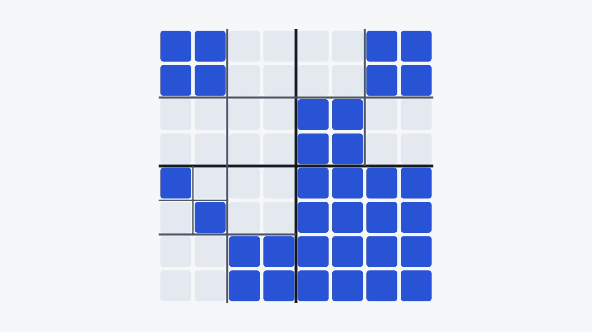

*예제의 종이입니다. 색이 섞여 있으면 넷으로 자르고(굵은 선), 잘린 조각이 또 섞여 있으면 다시 자릅니다.*

```cpp
#include <bits/stdc++.h>
#define ibm514 ios::sync_with_stdio(0), cin.tie(0), cout.tie(0);
using namespace std;
typedef long long ll;

int n;
int paper[128][128];
int cnt[2];   // cnt[0]: 하얀 종이, cnt[1]: 파란 종이

// (r, c)에서 시작하는 한 변 size짜리 종이를 센다
void cut(int r, int c, int size) {
    bool same = true;
    for (int i = r; i < r + size; i++) {
        for (int j = c; j < c + size; j++) {
            if (paper[i][j] != paper[r][c]) same = false;
        }
    }
    if (same) {
        cnt[paper[r][c]]++;
        return;
    }

    int half = size / 2;
    cut(r, c, half);
    cut(r, c + half, half);
    cut(r + half, c, half);
    cut(r + half, c + half, half);
}

void solve() {
    cin >> n;
    for (int i = 0; i < n; i++) {
        for (int j = 0; j < n; j++) cin >> paper[i][j];
    }
    cut(0, 0, n);
    cout << cnt[0] << '\n' << cnt[1];
}

int main() {
    ibm514
    solve();
    return 0;
}
```

세 단계를 찾아보면 이렇습니다.

- **쪼개기**: 가로와 세로를 반으로 나눠 네 조각을 만듭니다.
- **풀기**: 조각마다 `cut`을 다시 부릅니다.
- **합치기**: 조각들의 개수를 더합니다. 여기서는 전역 변수에 더하는 것으로 끝나서 눈에 잘 안 띕니다.

이 문제는 합치기가 덧셈 한 번이라 사실상 쪼개기만 있습니다. 재귀 글의 문제들이 대개 이런 모양이었어요.

## 한쪽만 내려가기: Moo 게임

[BOJ 5904 Moo 게임](https://www.acmicpc.net/problem/5904)입니다.  
S(0)은 `moo`이고, S(k)는 S(k−1), `m` 뒤에 `o`가 k + 2개 붙은 토막, 다시 S(k−1)을 이어 붙인 문자열입니다.  
이렇게 끝없이 이어지는 문자열의 N번째 글자를 구합니다. N은 10억까지입니다.

10억 글자를 만들 수는 없습니다. 그런데 N번째 글자 하나만 알면 되니, 전부 만들 필요가 없어요.  
S(k)는 세 덩어리로 되어 있고, N이 **어느 덩어리에 속하는지**만 알면 나머지 두 덩어리는 볼 필요가 없습니다.

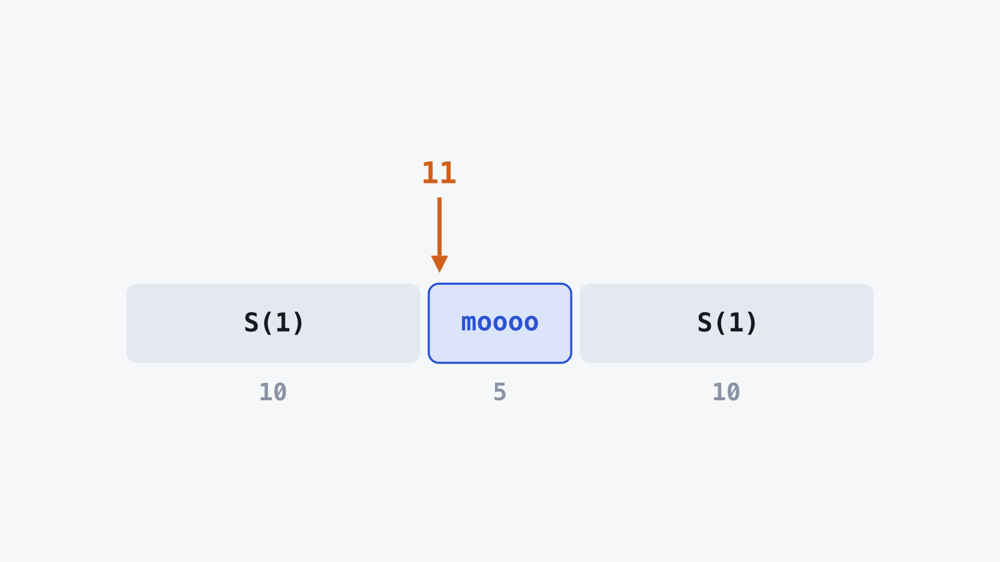

*S(2)는 길이 10인 S(1), 길이 5인 가운데 토막, 다시 길이 10인 S(1)입니다.  
11번째 글자는 앞의 10글자를 지나 가운데 토막의 첫 글자라서 m입니다.*

- 앞쪽 S(k−1) 안이면, 같은 자리를 S(k−1)에서 찾습니다.
- 가운데 토막 안이면, 토막의 첫 글자만 `m`이고 나머지는 `o`입니다.
- 뒤쪽 S(k−1) 안이면, 앞의 두 덩어리 길이를 빼고 S(k−1)에서 찾습니다.

```cpp
#include <bits/stdc++.h>
#define ibm514 ios::sync_with_stdio(0), cin.tie(0), cout.tie(0);
using namespace std;
typedef long long ll;

int n;
ll len[40];   // len[k]: S(k)의 길이

// S(k)의 pos번째 글자
char moo(int k, ll pos) {
    if (k == 0) return pos == 1 ? 'm' : 'o';

    // S(k) = S(k-1) + (m 하나와 o가 k+2개) + S(k-1)
    if (pos <= len[k - 1]) return moo(k - 1, pos);
    pos -= len[k - 1];
    if (pos <= k + 3) return pos == 1 ? 'm' : 'o';
    return moo(k - 1, pos - (k + 3));
}

void solve() {
    cin >> n;

    int k = 0;
    len[0] = 3;
    while (len[k] < n) {
        k++;
        len[k] = 2 * len[k - 1] + k + 3;
    }
    cout << moo(k, n);
}

int main() {
    ibm514
    solve();
    return 0;
}
```

길이가 매번 두 배 넘게 늘어나서, S(27)쯤이면 이미 10억 글자를 넘습니다.  
그래서 재귀는 많아야 서른 번 안쪽으로 끝납니다.

조각을 전부 풀지 않고 **답이 있는 조각 하나만** 따라 내려가는 모양입니다.  
이분탐색도 이런 분할정복이에요. 반으로 쪼개고 한쪽만 보니까요.

## 어디서 쪼갤지 찾기: 트리의 순회

[BOJ 2263 트리의 순회](https://www.acmicpc.net/problem/2263)입니다.  
이진 트리의 인오더와 포스트오더가 주어질 때 프리오더를 구합니다. 정점은 10만 개까지입니다.

앞의 두 문제는 쪼개는 자리가 정해져 있었습니다. 이번에는 그 자리를 찾아야 합니다.

두 순회가 정점을 적는 순서를 떠올려 봅시다.

- 인오더: 왼쪽 서브트리 → **루트** → 오른쪽 서브트리
- 포스트오더: 왼쪽 서브트리 → 오른쪽 서브트리 → **루트**

포스트오더의 맨 끝이 루트입니다.  
그 루트를 인오더에서 찾으면,  
루트의 왼쪽에 있는 것들이 왼쪽 서브트리이고 오른쪽에 있는 것들이 오른쪽 서브트리입니다.  
왼쪽 서브트리의 크기를 알았으니 포스트오더도 같은 크기로 끊을 수 있어요.

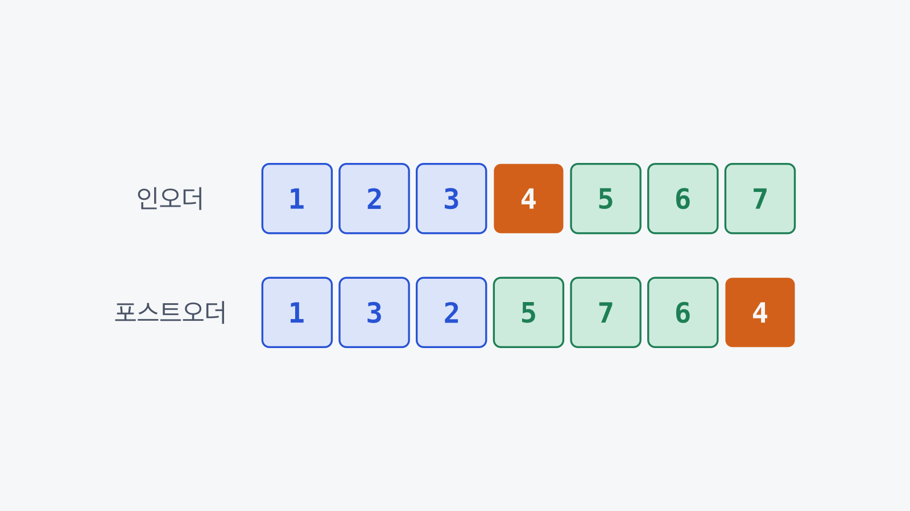

*포스트오더의 맨 끝 4가 루트입니다(주황).  
인오더에서 4의 왼쪽 세 개가 왼쪽 서브트리(파랑), 오른쪽 세 개가 오른쪽 서브트리(초록)이고,  
포스트오더도 앞에서부터 세 개, 세 개로 끊깁니다.*

프리오더는 루트 → 왼쪽 → 오른쪽 순서니까,  
루트를 출력하고 왼쪽 조각과 오른쪽 조각에 대해 같은 일을 합니다.

```cpp
#include <bits/stdc++.h>
#define ibm514 ios::sync_with_stdio(0), cin.tie(0), cout.tie(0);
using namespace std;
typedef long long ll;

int n;
int in[100001], post[100001];
int where[100001];   // where[x]: 인오더에서 x가 있는 자리

// 인오더의 [inL, inR]과 포스트오더의 [postL, postR]이 같은 서브트리다
void go(int inL, int inR, int postL, int postR) {
    if (inL > inR) return;

    int root = post[postR];   // 포스트오더의 맨 끝이 루트
    cout << root << ' ';

    int mid = where[root];
    int leftSize = mid - inL;
    go(inL, mid - 1, postL, postL + leftSize - 1);
    go(mid + 1, inR, postL + leftSize, postR - 1);
}

void solve() {
    cin >> n;
    for (int i = 0; i < n; i++) {
        cin >> in[i];
        where[in[i]] = i;
    }
    for (int i = 0; i < n; i++) cin >> post[i];
    go(0, n - 1, 0, n - 1);
}

int main() {
    ibm514
    solve();
    return 0;
}
```

루트의 자리를 매번 인오더를 훑어서 찾으면 한쪽으로 치우친 트리에서 N²이 됩니다.  
그래서 `where`에 값마다 인오더에서의 자리를 미리 적어 둡니다.

배열을 실제로 잘라서 넘기지 않고, 구간의 양 끝 번호만 넘긴다는 점도 봐 두세요.  
분할정복 코드는 거의 다 이렇게 씁니다.

## 합치는 단계가 본체

여기까지는 쪼개는 게 전부였습니다.  
이제부터는 조각을 풀고 나서 **합치는 단계에서 일을 하는** 문제들입니다.  
분할정복이라고 하면 보통 이쪽을 가리켜요.

### 정렬된 두 묶음 합치기: 치킨 TOP N

[BOJ 11582 치킨 TOP N](https://www.acmicpc.net/problem/11582)입니다.  
치킨집 N곳의 점수를 정렬하는데, 처음엔 두 개씩 묶어 정렬하고,  
다음엔 정렬된 묶음 두 개씩을 합치고, 이렇게 묶음을 키워 갑니다.  
k명이 정렬하는 단계가 끝났을 때의 상태를 출력합니다. N과 k는 2의 거듭제곱입니다.

문제가 설명하는 방법이 바로 **병합 정렬**입니다.  
배열을 반으로 쪼개서 각각 정렬하고, 정렬된 두 묶음을 하나로 합칩니다.

쪼개는 건 반으로 나누면 끝이고, 일은 전부 합칠 때 합니다.  
두 묶음이 이미 정렬되어 있으니, 전체에서 가장 작은 수는 두 묶음의 **맨 앞 둘 중 하나**입니다.  
둘을 비교해 작은 쪽을 꺼내고, 이걸 반복하면 됩니다.

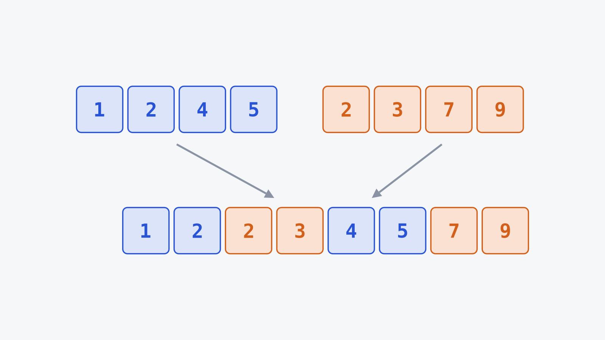

*정렬된 두 묶음 (1, 2, 4, 5)와 (2, 3, 7, 9)를 합칩니다.  
양쪽의 맨 앞끼리 비교해서 작은 것부터 아래로 내려보냅니다.*

```cpp
#include <bits/stdc++.h>
#define ibm514 ios::sync_with_stdio(0), cin.tie(0), cout.tie(0);
using namespace std;
typedef long long ll;

int n, k, limit;
int a[1 << 20], tmp[1 << 20];

// 정렬된 [l, mid)와 [mid, r)을 하나로 합친다
void merge(int l, int mid, int r) {
    int i = l, j = mid, t = l;
    while (i < mid && j < r) {
        if (a[i] <= a[j]) tmp[t++] = a[i++];
        else tmp[t++] = a[j++];
    }
    while (i < mid) tmp[t++] = a[i++];
    while (j < r) tmp[t++] = a[j++];
    for (int x = l; x < r; x++) a[x] = tmp[x];
}

void mergeSort(int l, int r) {
    if (r - l == 1) return;
    int mid = (l + r) / 2;
    mergeSort(l, mid);
    mergeSort(mid, r);
    if (r - l <= limit) merge(l, mid, r);   // 지금 단계의 묶음 크기까지만 합친다
}

void solve() {
    cin >> n;
    for (int i = 0; i < n; i++) cin >> a[i];
    cin >> k;

    limit = n / k;   // k명이 정렬을 마치면 묶음 하나의 크기는 n / k
    mergeSort(0, n);
    for (int i = 0; i < n; i++) cout << a[i] << ' ';
}

int main() {
    ibm514
    solve();
    return 0;
}
```

`merge`는 두 묶음을 한 번씩만 훑으니 묶음 크기만큼의 일입니다.  
묶음을 반으로 쪼개는 횟수가 log N이고 단계마다 전체를 한 번씩 훑으니, 병합 정렬은 O(N log N)입니다.

이 문제는 중간에서 멈춰야 합니다. k명이 정렬을 마치면 묶음 하나의 크기는 N / k입니다.  
그래서 묶음이 그 크기를 넘으면 합치지 않도록 한 줄을 넣었습니다.

### 합치면서 센다: 버블 소트

[BOJ 1517 버블 소트](https://www.acmicpc.net/problem/1517)입니다.  
수 N개를 버블 소트로 정렬할 때 교환이 몇 번 일어나는지 구합니다. N은 50만까지입니다.

버블 소트를 직접 돌리면 N²이라 안 됩니다.  
교환 횟수가 무엇과 같은지부터 봅시다.  
버블 소트는 이웃한 두 수가 뒤집혀 있을 때만 바꾸고,  
한 번 바꿀 때마다 **순서가 뒤집힌 쌍**이 정확히 하나 줄어듭니다.  
그러니 답은 “앞에 있는 수가 뒤에 있는 수보다 큰 쌍”의 개수입니다.

배열을 반으로 쪼개면, 뒤집힌 쌍은 세 종류입니다.

- 둘 다 왼쪽 절반에 있는 쌍
- 둘 다 오른쪽 절반에 있는 쌍
- 하나는 왼쪽, 하나는 오른쪽에 있는 쌍

앞의 둘은 재귀가 세어 줍니다. 남은 건 **양쪽에 걸친 쌍**이고, 이걸 합치는 단계에서 셉니다.

병합 정렬로 합칠 때 양쪽은 이미 정렬되어 있습니다.  
오른쪽 묶음의 수가 먼저 나간다는 건, 왼쪽 묶음의 맨 앞 수가 그 수보다 크다는 뜻입니다.  
왼쪽은 정렬되어 있으니 **왼쪽에 남아 있는 수 전부**가 그 수보다 큽니다.

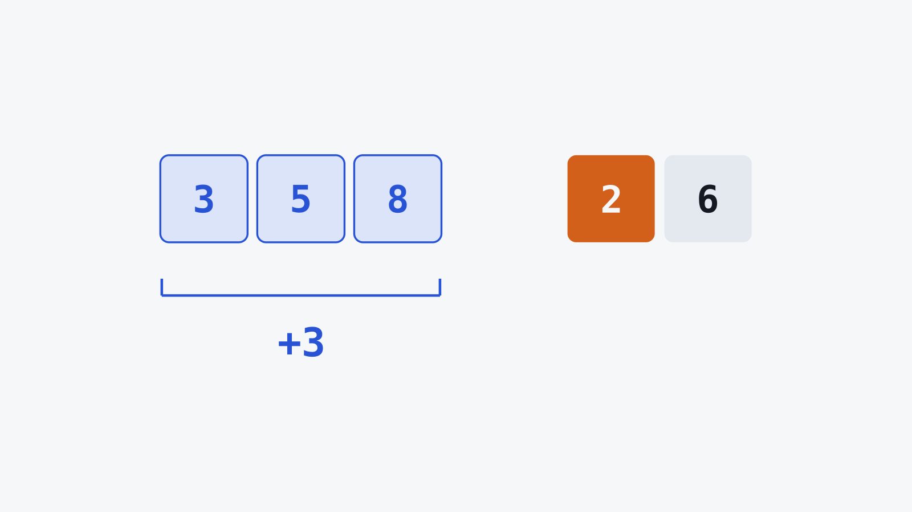

*왼쪽 묶음 (3, 5, 8)과 오른쪽 묶음 (2, 6)을 합치는 중입니다.  
2가 먼저 나가는 순간, 왼쪽에 남은 세 수는 모두 2보다 앞에 있던 큰 수라서 뒤집힌 쌍이 3개 생깁니다.*

```cpp
#include <bits/stdc++.h>
#define ibm514 ios::sync_with_stdio(0), cin.tie(0), cout.tie(0);
using namespace std;
typedef long long ll;

int n;
int a[500000], tmp[500000];
ll ans;

void mergeSort(int l, int r) {
    if (r - l <= 1) return;
    int mid = (l + r) / 2;
    mergeSort(l, mid);
    mergeSort(mid, r);

    int i = l, j = mid, t = l;
    while (i < mid && j < r) {
        if (a[i] <= a[j]) {
            tmp[t++] = a[i++];
        } else {
            // 오른쪽 수가 먼저 나간다. 왼쪽에 남은 수는 전부 이 수보다 크다
            ans += mid - i;
            tmp[t++] = a[j++];
        }
    }
    while (i < mid) tmp[t++] = a[i++];
    while (j < r) tmp[t++] = a[j++];
    for (int x = l; x < r; x++) a[x] = tmp[x];
}

void solve() {
    cin >> n;
    for (int i = 0; i < n; i++) cin >> a[i];
    mergeSort(0, n);
    cout << ans;
}

int main() {
    ibm514
    solve();
    return 0;
}
```

병합 정렬 코드에 `ans += mid - i` 한 줄이 들어갔을 뿐입니다.

- `a[i] <= a[j]`의 등호를 빼면 안 됩니다.  
같은 수는 뒤집힌 쌍이 아니라서, 같을 때는 왼쪽 것이 먼저 나가야 합니다.
- 답은 최대 N(N − 1) / 2로 1,250억쯤이라 `long long`입니다.

“왼쪽에서만, 오른쪽에서만, **양쪽에 걸쳐서**”로 나누는 생각은 다음 두 문제에서도 그대로 씁니다.  
분할정복의 대부분은 이 세 번째 경우를 어떻게 빨리 처리하느냐의 문제예요.

### 가운데를 걸치는 경우: 히스토그램에서 가장 큰 직사각형

[BOJ 6549 히스토그램에서 가장 큰 직사각형](https://www.acmicpc.net/problem/6549)입니다.  
폭이 1인 막대 N개가 나란히 서 있습니다.  
막대들 안에 들어가는 가장 넓은 직사각형의 넓이를 구합니다. N은 10만까지입니다.

직사각형은 연속한 막대 몇 개를 고르면 정해지고, 높이는 그중 가장 낮은 막대입니다.  
구간을 전부 보면 N²이니 쪼갭니다. 가운데에 선을 그으면 답이 될 직사각형은 셋 중 하나예요.

- 선의 왼쪽에만 있다.
- 선의 오른쪽에만 있다.
- 선을 걸친다.

앞의 둘은 재귀입니다.  
선을 걸치는 직사각형은 **가운데 두 막대를 반드시 포함**하니, 거기서 시작해 한 칸씩 넓혀 갑니다.

왼쪽으로 넓힐지 오른쪽으로 넓힐지는 **더 높은 막대가 있는 쪽**으로 정합니다.  
넓힐 때마다 높이는 지금까지 포함한 막대 중 가장 낮은 것으로 줄어들고, 그때의 넓이로 답을 고칩니다.

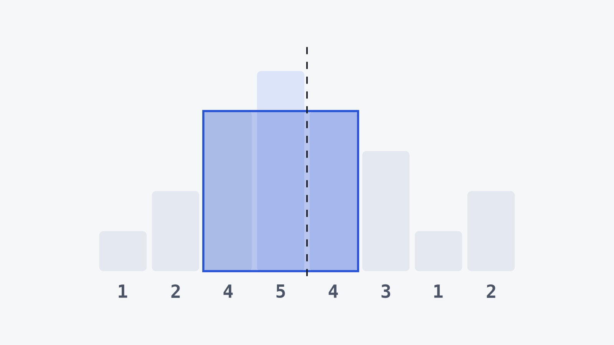

*막대 여덟 개짜리 히스토그램입니다.  
가운데 선(점선)을 걸치는 직사각형은 가운데 두 막대 5와 4에서 시작합니다.  
양옆 중 더 높은 왼쪽의 4로 먼저 넓히면 높이 4, 폭 3인 12가 되고,  
선을 걸치는 것 중에는 이것이 가장 큽니다.*

왜 높은 쪽으로만 가도 되는지 따져 보겠습니다.  
선을 걸치는 직사각형 중 가장 큰 것이 a번 막대부터 b번 막대까지이고 높이가 H라고 합시다.

- a부터 b까지의 막대는 전부 H 이상입니다.
- a의 바로 왼쪽 막대와 b의 바로 오른쪽 막대는 H보다 낮습니다. 높았다면 더 넓힐 수 있었을 테니까요.

우리는 a와 b 사이에서 출발합니다.  
아직 a와 b까지 다 넓히지 못했다면, 양옆 중 적어도 하나는 구간 안쪽의 막대라 H 이상입니다.  
구간을 벗어나는 막대는 H보다 낮고요.  
높은 쪽을 고르니 항상 구간 안쪽으로 넓혀 가고, 결국 정확히 a부터 b까지를 지나게 됩니다.  
그래서 가장 큰 직사각형을 놓치지 않습니다.

```cpp
#include <bits/stdc++.h>
#define ibm514 ios::sync_with_stdio(0), cin.tie(0), cout.tie(0);
using namespace std;
typedef long long ll;

int n;
ll h[100000];

// [l, r] 안에서 만들 수 있는 가장 큰 직사각형
ll largest(int l, int r) {
    if (l == r) return h[l];

    int mid = (l + r) / 2;
    ll best = max(largest(l, mid), largest(mid + 1, r));

    // 가운데 두 막대를 모두 포함하는 직사각형. 더 높은 쪽으로 한 칸씩 넓힌다
    int lo = mid, hi = mid + 1;
    ll height = min(h[lo], h[hi]);
    best = max(best, height * 2);
    while (l < lo || hi < r) {
        if (hi < r && (lo == l || h[lo - 1] < h[hi + 1])) {
            hi++;
            height = min(height, h[hi]);
        } else {
            lo--;
            height = min(height, h[lo]);
        }
        best = max(best, height * (hi - lo + 1));
    }
    return best;
}

void solve() {
    while (cin >> n && n != 0) {
        for (int i = 0; i < n; i++) cin >> h[i];
        cout << largest(0, n - 1) << '\n';
    }
}

int main() {
    ibm514
    solve();
    return 0;
}
```

걸치는 경우를 처리하는 데 구간 길이만큼 걸리니, 병합 정렬과 같은 모양이라 O(N log N)입니다.

높이가 10억이고 막대가 10만 개라 넓이는 `long long`이 필요합니다.

이 문제는 스택으로 O(N)에 푸는 방법이 더 유명합니다.  
다만 “양쪽에 걸친 경우만 따로 처리한다”는 생각을 연습하기에는 이 풀이가 좋아요.

### 가운데 띠만 본다: 가장 가까운 두 점

[BOJ 2261 가장 가까운 두 점](https://www.acmicpc.net/problem/2261)입니다.  
평면 위의 점 N개 중 가장 가까운 두 점 사이의 거리의 제곱을 구합니다. N은 10만까지입니다.

모든 쌍을 보면 50억 쌍입니다. 점들을 x좌표 순으로 정렬하고 가운데에 세로선을 그어 반으로 쪼갭니다.  
가장 가까운 쌍은 이번에도 셋 중 하나입니다. 둘 다 왼쪽, 둘 다 오른쪽, 하나씩 걸친 쌍.

왼쪽과 오른쪽에서 각각 구한 답 중 작은 쪽을 d라고 합시다.  
걸친 쌍은 d보다 가까운 것만 찾으면 됩니다. d 이상인 쌍은 찾아 봐야 답이 안 바뀌니까요.

여기서 볼 점이 확 줄어듭니다.  
세로선에서 d 이상 떨어진 점은 선 건너편의 어떤 점과도 d 이상 떨어져 있습니다.  
그러니 **선에서 d보다 가까운 띠 안의 점**만 보면 돼요.

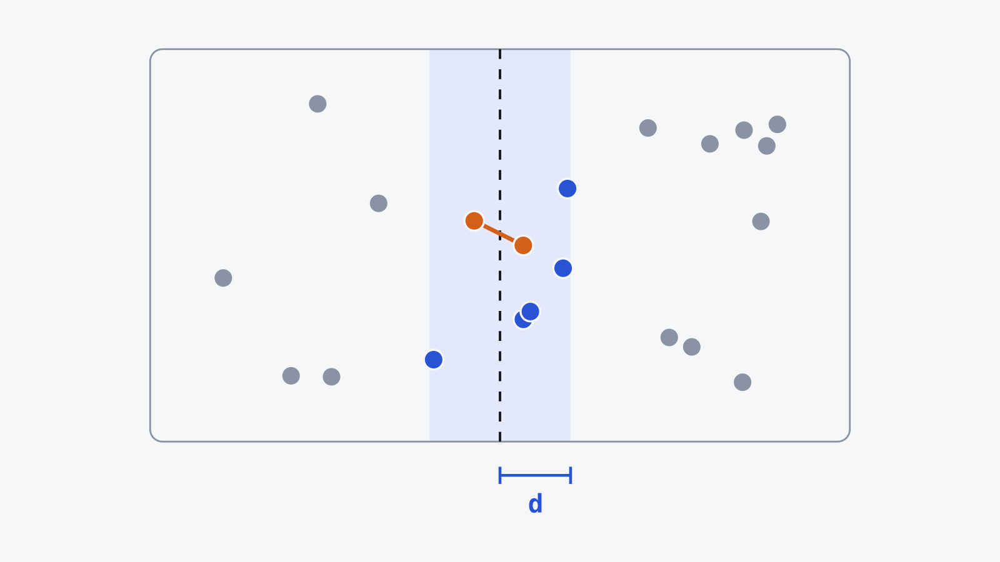

*가운데 선에서 d보다 가까운 띠(파란 영역) 안의 점만 다시 봅니다.  
띠 밖의 점(회색)은 선 건너편과 짝을 지어도 d보다 가까울 수 없습니다.*

띠 안의 점끼리도 전부 짝지을 필요가 없습니다.  
띠 안의 점들을 y좌표 순으로 정렬하고, 점마다 **y좌표 차이가 d보다 작은 점까지만** 위로 올라가며 봅니다.  
그 위는 y만으로 이미 d 이상 떨어져 있으니까요.

그렇게 봐야 하는 점은 몇 개 안 됩니다.  
선의 같은 쪽에 있는 점들은 서로 d 이상 떨어져 있어서,  
폭이 d이고 높이가 d인 칸에 많이 들어갈 수가 없거든요. 점 하나마다 많아야 일곱 개쯤만 보면 됩니다.

```cpp
#include <bits/stdc++.h>
#define ibm514 ios::sync_with_stdio(0), cin.tie(0), cout.tie(0);
using namespace std;
typedef long long ll;

int n;
pair<int, int> p[100000];   // (x, y), x 순으로 정렬해 둔다

int dist(const pair<int, int>& a, const pair<int, int>& b) {
    int dx = a.first - b.first, dy = a.second - b.second;
    return dx * dx + dy * dy;
}

// [l, r) 안에서 가장 가까운 두 점의 거리의 제곱
int closest(int l, int r) {
    if (r - l <= 3) {
        int best = INT_MAX;
        for (int i = l; i < r; i++) {
            for (int j = i + 1; j < r; j++) best = min(best, dist(p[i], p[j]));
        }
        return best;
    }

    int mid = (l + r) / 2;
    int midX = p[mid].first;
    int best = min(closest(l, mid), closest(mid, r));

    // 가운데 선에서 지금 답보다 가까운 점만 모아 y 순으로 정렬한다
    vector<pair<int, int>> band;   // (y, x)
    for (int i = l; i < r; i++) {
        int dx = p[i].first - midX;
        if (dx * dx < best) band.push_back({p[i].second, p[i].first});
    }
    sort(band.begin(), band.end());

    for (int i = 0; i < (int)band.size(); i++) {
        for (int j = i + 1; j < (int)band.size(); j++) {
            int dy = band[j].first - band[i].first;
            if (dy * dy >= best) break;   // 위로 더 가 봐야 멀어지기만 한다
            int dx = band[j].second - band[i].second;
            best = min(best, dx * dx + dy * dy);
        }
    }
    return best;
}

void solve() {
    cin >> n;
    for (int i = 0; i < n; i++) cin >> p[i].first >> p[i].second;
    sort(p, p + n);
    cout << closest(0, n);
}

int main() {
    ibm514
    solve();
    return 0;
}
```

- 거리 대신 **거리의 제곱**으로 비교합니다. 제곱근을 쓰지 않으니 오차가 없습니다.  
`dx * dx < best`처럼 한쪽 좌표만 볼 때도 제곱끼리 비교합니다.
- 점이 3개 이하면 직접 비교합니다.  
점이 하나인 조각은 거리를 구할 수 없어서, 그렇게 되기 전에 멈춥니다.
- 같은 점이 여러 번 주어지면 답은 0이고, 이 코드는 그대로 0을 냅니다.

띠를 매번 정렬해서 O(N log² N)입니다. 10만 개에는 충분합니다.

세 문제를 나란히 놓으면 같은 틀이 보입니다.  
반으로 쪼개고, 양쪽은 재귀에 맡기고, **걸친 경우를 구간 길이에 비례하는 시간 안에** 처리합니다.  
그 마지막 부분에 문제마다의 아이디어가 들어가요.

## 다른 방법과 섞기

이제 분할정복이 다른 방법과 함께 쓰이는 문제들입니다.  
쪼개는 틀은 같고, 조각 안에서 하는 일이 달라집니다.

### 그리디로 채우고 남은 곳을 쪼갠다: 박스 채우기

[BOJ 1493 박스 채우기](https://www.acmicpc.net/problem/1493)입니다.  
가로, 세로, 높이가 주어진 박스를 큐브로 빈틈없이 채웁니다.  
큐브는 한 변이 1, 2, 4, 8, … 인 정육면체이고 종류마다 개수가 정해져 있어요.  
필요한 큐브의 최소 개수를 구하고, 채울 수 없으면 −1을 출력합니다.

개수를 줄이려면 큰 큐브를 써야 합니다. 한 변이 두 배인 큐브 하나는 작은 큐브 8개의 자리를 차지하니까요.  
변이 전부 2의 거듭제곱이라 큰 큐브가 들어간 자리는 작은 큐브로도 정확히 채울 수 있고,  
그래서 **들어가는 것 중 가장 큰 큐브부터** 쓰는 게 손해가 없습니다. 여기까지가 그리디예요.

큐브를 한쪽 구석에 넣고 나면 남은 공간이 직육면체가 아닙니다.  
이걸 **직육면체 세 개로 쪼개서** 각각 같은 방법으로 채웁니다.

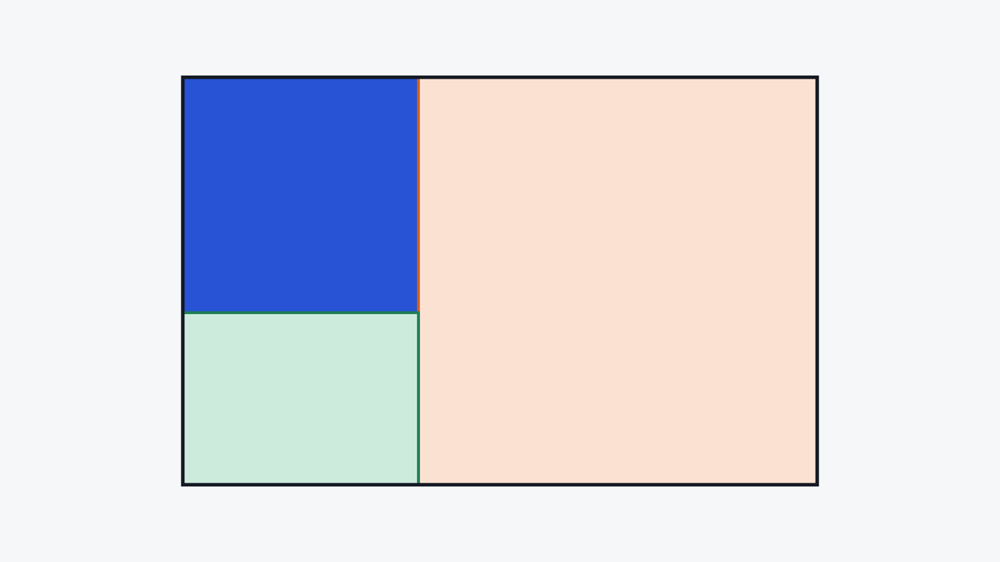

*박스를 위에서 본 모습입니다.  
구석에 큐브(진한 파랑)를 넣으면 남은 바닥은 직사각형 둘(주황, 초록)로 나뉩니다.  
여기에 큐브 위쪽의 공간이 하나 더 있어서, 남은 공간은 직육면체 셋입니다.*

```cpp
#include <bits/stdc++.h>
#define ibm514 ios::sync_with_stdio(0), cin.tie(0), cout.tie(0);
using namespace std;
typedef long long ll;

int n;
int cube[20];   // cube[i]: 한 변이 2^i인 큐브의 수
ll ans;
bool fail;

// l × w × h 크기의 빈 공간을 채운다
void fill(int l, int w, int h) {
    // 가장 긴 변을 l로 둔다. 이 방향으로는 재귀 대신 반복문으로 나아간다
    if (l < w) swap(l, w);
    if (l < h) swap(l, h);

    while (!fail && l > 0 && w > 0 && h > 0) {
        // 들어가는 큐브 중 가장 큰 것을 한쪽 구석에 넣는다
        int smallest = min({l, w, h});
        int k = -1;
        for (int i = 19; i >= 0; i--) {
            if (cube[i] > 0 && (1 << i) <= smallest) {
                k = i;
                break;
            }
        }
        if (k == -1) {
            fail = true;
            return;
        }
        cube[k]--;
        ans++;

        // 남은 공간은 직육면체 셋이다. 둘은 재귀로 채우고, 나머지 하나는 l을 줄여서 이어 간다
        int s = 1 << k;
        fill(s, w - s, h);
        fill(s, s, h - s);
        l -= s;
    }
}

void solve() {
    int l, w, h;
    cin >> l >> w >> h >> n;
    for (int i = 0; i < n; i++) {
        int a, b;
        cin >> a >> b;
        cube[a] = b;
    }

    fill(l, w, h);
    cout << (fail ? -1 : ans);
}

int main() {
    ibm514
    solve();
    return 0;
}
```

남은 세 조각 중 둘은 재귀로 채우고, 나머지 하나는 `l`을 줄여서 반복문으로 이어 갑니다.  
세 조각을 전부 재귀로 불러도 답은 같습니다.  
다만 길이가 100만인 박스에 한 변이 1인 큐브만 있으면 재귀가 100만 겹으로 깊어져서,  
가장 긴 방향은 반복문으로 돌렸습니다.

어떤 조각에서든 넣을 큐브가 없으면 전체를 채울 수 없으니 `fail`을 켭니다.

### 양쪽을 다 해 본다: 시철이가 사랑한 GCD

[BOJ 21870 시철이가 사랑한 GCD](https://www.acmicpc.net/problem/21870)입니다.  
배열에서 왼쪽 절반(개수는 내림) 또는 오른쪽 절반(개수는 올림)을 골라 그 수들의 최대공약수를 얻습니다.  
고르지 않은 쪽으로 같은 일을 반복하고, 원소가 하나 남으면 그 수를 얻습니다.  
얻은 값의 합의 최댓값을 구합니다. N은 20만까지입니다.

어느 쪽을 고르는 게 좋은지 미리 알 방법이 없습니다. 그러면 **둘 다 해 보면** 됩니다.

- 왼쪽을 고른다: (왼쪽의 최대공약수) + (오른쪽으로 계속했을 때의 최댓값)
- 오른쪽을 고른다: (오른쪽의 최대공약수) + (왼쪽으로 계속했을 때의 최댓값)

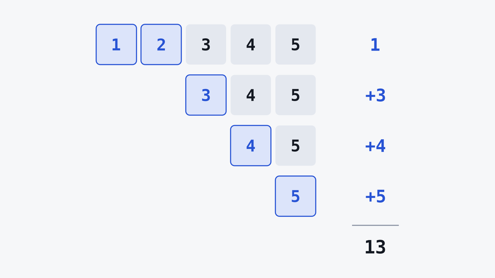

*예제 2번에서 가장 좋은 고르기입니다.  
처음에 왼쪽 (1, 2)를 골라 1을 얻고, 남은 (3, 4, 5)에서 3을,  
다시 남은 (4, 5)에서 4를 고른 뒤 마지막 5를 얻어 13입니다.*

```cpp
#include <bits/stdc++.h>
#define ibm514 ios::sync_with_stdio(0), cin.tie(0), cout.tie(0);
using namespace std;
typedef long long ll;

int n;
int a[200000];

int rangeGcd(int l, int r) {
    int g = 0;
    for (int i = l; i < r; i++) g = gcd(g, a[i]);
    return g;
}

// [l, r)에서 얻을 수 있는 최댓값
int best(int l, int r) {
    if (r - l == 1) return a[l];

    int mid = l + (r - l) / 2;   // 왼쪽은 절반을 내림한 개수
    // 왼쪽을 고르고 오른쪽을 계속하거나, 오른쪽을 고르고 왼쪽을 계속하거나
    return max(rangeGcd(l, mid) + best(mid, r), rangeGcd(mid, r) + best(l, mid));
}

void solve() {
    cin >> n;
    for (int i = 0; i < n; i++) cin >> a[i];
    cout << best(0, n);
}

int main() {
    ibm514
    solve();
    return 0;
}
```

두 가지를 다 해 보니 완전탐색인데, 그래도 빠릅니다.  
재귀를 부를 때마다 길이가 절반이 되니 깊이는 log N이고,  
한 깊이에서 하는 일을 다 합치면 배열 전체를 한 번 훑는 정도입니다.

“절반으로 줄어든다”는 조건이 있으면 선택지를 전부 해 봐도 감당이 됩니다.  
문제에서 반씩 나누라고 정해 줬다면, 겁먹지 말고 양쪽을 다 불러 보세요.

### 답을 만들어 낸다: 원숭이 스포츠

[BOJ 16438 원숭이 스포츠](https://www.acmicpc.net/problem/16438)입니다.  
원숭이 N마리가 7일 동안 하루에 한 번씩 A팀과 B팀으로 나뉘어 경기를 합니다.  
어떤 두 마리를 골라도 **적어도 하루는 서로 다른 팀**이 되도록 대진표를 만듭니다. N은 99까지입니다.

값을 구하는 게 아니라 조건에 맞는 답을 하나 만들어 내는 문제입니다.  
하필 7일인 이유를 생각해 보면 길이 보여요. 2를 일곱 번 곱하면 128이고, 99보다 큽니다.

첫날에 원숭이들을 반으로 갈라 A와 B로 보냅니다. 그러면 서로 다른 절반에 있던 쌍은 전부 해결됩니다.  
남은 건 같은 절반에 있는 쌍들이니, 둘째 날에는 **각 절반을 다시 반으로** 가릅니다.  
이걸 반복하면 묶음의 크기가 날마다 절반이 되고, 99마리는 7일이면 전부 한 마리씩으로 갈라집니다.

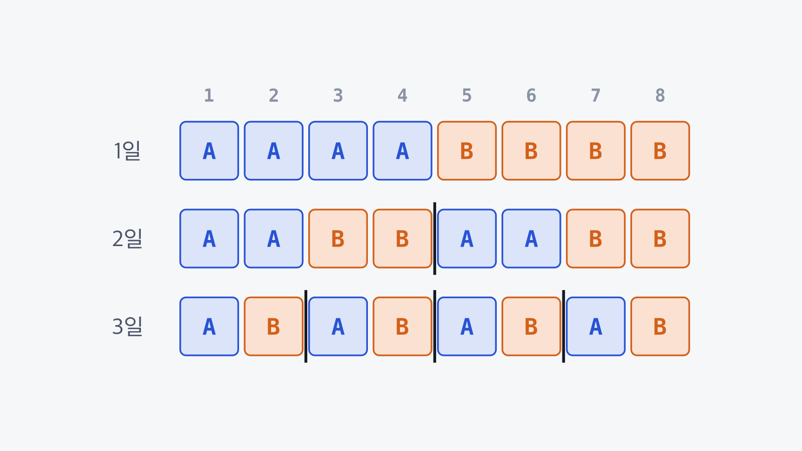

*원숭이가 8마리일 때입니다.  
굵은 선이 그날의 묶음이고, 묶음마다 앞쪽 절반이 A(파랑), 뒤쪽 절반이 B(주황)입니다.  
3일이면 모든 쌍이 한 번은 갈립니다.*

```cpp
#include <bits/stdc++.h>
#define ibm514 ios::sync_with_stdio(0), cin.tie(0), cout.tie(0);
using namespace std;
typedef long long ll;

int n;
char team[7][100];

// day번째 날, [l, r] 원숭이를 반으로 갈라 서로 다른 팀에 넣는다
void split(int l, int r, int day) {
    if (day == 7) return;
    int mid = (l + r) / 2;
    for (int i = l; i <= mid; i++) team[day][i] = 'A';
    for (int i = mid + 1; i <= r; i++) team[day][i] = 'B';
    split(l, mid, day + 1);
    split(mid + 1, r, day + 1);
}

void solve() {
    cin >> n;
    split(0, n - 1, 0);

    for (int d = 0; d < 7; d++) {
        // 더 가를 원숭이가 없는 날은 전부 A가 된다. 한 마리를 B로 옮겨 준다
        bool hasB = false;
        for (int i = 0; i < n; i++) {
            if (team[d][i] == 'B') hasB = true;
        }
        if (!hasB) team[d][n - 1] = 'B';

        for (int i = 0; i < n; i++) cout << team[d][i];
        cout << '\n';
    }
}

int main() {
    ibm514
    solve();
    return 0;
}
```

원숭이가 적으면 며칠 지나지 않아 더 가를 묶음이 없어집니다.  
그런 날은 모두 A가 되는데, 팀마다 한 마리는 있어야 하니 한 마리를 B로 옮겼습니다.  
이미 모든 쌍이 갈린 뒤라서 아무렇게나 옮겨도 됩니다.

답이 여러 개일 수 있는 문제라 예제 출력과 다르게 나옵니다. 조건만 지키면 정답이에요.

### 만들 수 없는 것을 센다: 수열

[BOJ 1588 수열](https://www.acmicpc.net/problem/1588)입니다.  
수 하나에서 시작해 1초마다 1은 132로, 2는 211로, 3은 232로 한꺼번에 바뀝니다.  
N초 뒤의 수열에서 Left번째부터 Right번째까지 1, 2, 3이 각각 몇 개인지 구합니다. N은 20까지입니다.

20초 뒤의 길이는 3의 20제곱, 34억쯤이라 만들 수 없습니다.  
하지만 구조는 알고 있어요.  
수 하나가 k초 뒤에 만드는 덩어리는,  
그 수가 바뀐 **세 수가 각각 k − 1초 뒤에 만드는 덩어리 셋**을 이어 붙인 것입니다.

덩어리 하나를 통째로 셀 수 있으면 편하겠죠.  
그래서 `cnt[k][c][x]`, “수 c가 k초 뒤에 만드는 덩어리에 x가 몇 개 있는가”를 미리 구해 둡니다.  
이건 한 단계 아래 덩어리 셋의 개수를 더하면 됩니다.

이제 구간을 셉니다. 덩어리와 구간의 관계는 셋 중 하나예요.

- 덩어리가 구간 밖에 있다: 아무것도 안 합니다.
- 덩어리가 구간에 **통째로 들어간다**: 미리 구해 둔 개수를 더하고 끝냅니다.
- 일부만 걸친다: 세 조각으로 쪼개서 각각 다시 봅니다.

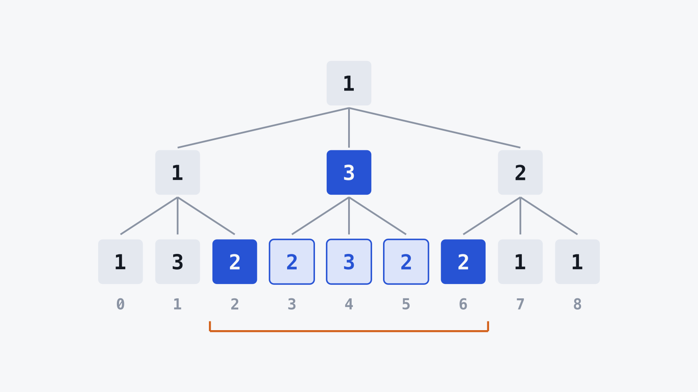

*1에서 시작해 2초 뒤입니다.  
구간 [2, 6](주황 선)을 셀 때, 가운데 덩어리(파랑)는 통째로 들어가서 더 내려가지 않고 개수만 더합니다.  
양옆 덩어리는 일부만 걸쳐서 한 단계 더 쪼갭니다.*

```cpp
#include <bits/stdc++.h>
#define ibm514 ios::sync_with_stdio(0), cin.tie(0), cout.tie(0);
using namespace std;
typedef long long ll;

int start, n;
ll L, R;
ll p3[21];        // p3[k]: 3의 k제곱
ll cnt[21][4][4]; // cnt[k][c][x]: 수 c 하나가 k초 뒤에 만드는 수열에 x가 몇 개 있는가
int nxt[4][3] = {{0, 0, 0}, {1, 3, 2}, {2, 1, 1}, {2, 3, 2}};
ll ans[4];

// 수 c 하나가 k초 뒤에 만드는 수열이 [lo, lo + 3^k - 1] 자리를 차지한다
void count(int c, int k, ll lo) {
    ll hi = lo + p3[k] - 1;
    if (hi < L || R < lo) return;
    if (L <= lo && hi <= R) {
        for (int x = 1; x <= 3; x++) ans[x] += cnt[k][c][x];
        return;
    }
    for (int i = 0; i < 3; i++) count(nxt[c][i], k - 1, lo + i * p3[k - 1]);
}

void solve() {
    cin >> start >> L >> R >> n;

    p3[0] = 1;
    for (int k = 1; k <= 20; k++) p3[k] = p3[k - 1] * 3;
    for (int c = 1; c <= 3; c++) cnt[0][c][c] = 1;
    for (int k = 1; k <= 20; k++) {
        for (int c = 1; c <= 3; c++) {
            for (int i = 0; i < 3; i++) {
                for (int x = 1; x <= 3; x++) cnt[k][c][x] += cnt[k - 1][nxt[c][i]][x];
            }
        }
    }

    count(start, n, 0);
    cout << ans[1] << ' ' << ans[2] << ' ' << ans[3];
}

int main() {
    ibm514
    solve();
    return 0;
}
```

일부만 걸치는 덩어리는 구간의 왼쪽 끝과 오른쪽 끝에서만 생겨서, 깊이마다 많아야 둘입니다.  
그래서 34억 칸짜리 수열을 다루면서도 함수는 백 번 남짓만 불립니다.

분할정복에 “미리 구해 둔 값”을 붙인 모양입니다.  
통째로 들어가는 조각은 꺼내 쓰고 걸친 조각만 쪼개는 이 방식은,  
나중에 세그먼트 트리를 배울 때 똑같이 다시 나옵니다.

## 고난도: Non-boring sequences

[BOJ 3408 Non-boring sequences](https://www.acmicpc.net/problem/3408)입니다. 지문은 영어지만 내용은 짧습니다.  
수열의 **모든 연속 구간**에, 그 구간 안에서 딱 한 번만 나오는 수가 있으면 지루하지 않은 수열입니다.  
수열이 지루하지 않은지 판단합니다. 길이는 20만까지입니다.

구간이 200억 개쯤이라 하나씩 확인할 수는 없습니다.

전체 수열에서 딱 한 번만 나오는 수를 하나 찾았다고 합시다.  
그 자리를 p라고 하면, **p를 포함하는 구간은 전부 통과**입니다. 그 수가 구간 안에서도 하나뿐이니까요.  
남은 건 p를 포함하지 않는 구간들이고, 그건 p의 왼쪽 조각 안에 있거나 오른쪽 조각 안에 있습니다.

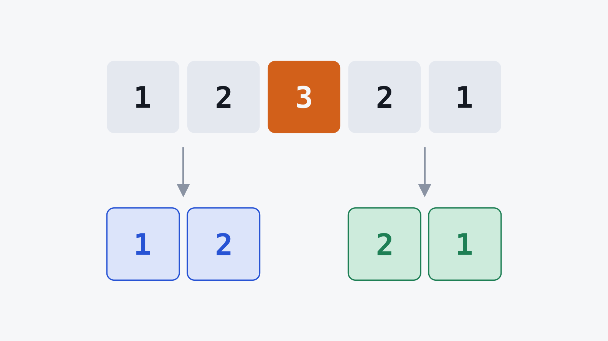

*1, 2, 3, 2, 1에서 하나뿐인 수는 3입니다(주황). 3을 포함하는 구간은 모두 통과이고,  
남은 왼쪽 조각 (1, 2)와 오른쪽 조각 (2, 1)을 각각 같은 방법으로 확인합니다.*

그래서 하나뿐인 수를 찾아 거기서 쪼개고, 양쪽 조각에 같은 일을 합니다.  
하나뿐인 수가 없는 조각이 나오면 그 조각 자체가 조건을 어긴 구간이라 지루한 수열입니다.

어떤 범위에서 하나뿐인지는 금방 확인됩니다.  
자리마다 **같은 값이 바로 앞에 나온 자리**와 **바로 뒤에 나오는 자리**를 적어 두면,  
그 둘이 모두 범위 밖일 때 하나뿐인 것입니다.

문제는 쪼개는 자리가 가운데라는 보장이 없다는 것입니다.  
왼쪽부터 훑어서 찾는데 그 자리가 매번 오른쪽 끝에 있으면,  
조각이 한 칸씩만 줄면서 매번 전체를 훑어 N²이 됩니다.

그래서 **양 끝에서 번갈아** 찾습니다. 왼쪽 끝 한 칸, 오른쪽 끝 한 칸, 다시 왼쪽에서 둘째 칸, 이런 식으로요.  
그러면 찾는 데 드는 시간은 쪼개진 두 조각 중 **작은 쪽의 크기** 정도입니다.

```cpp
#include <bits/stdc++.h>
#define ibm514 ios::sync_with_stdio(0), cin.tie(0), cout.tie(0);
using namespace std;
typedef long long ll;

int n;
int a[200001];
int prv[200001], nxt[200001];   // 같은 값이 바로 앞, 바로 뒤에 나오는 자리

// [l, r]의 모든 구간에 하나뿐인 수가 있는가
bool check(int l, int r) {
    if (l >= r) return true;

    // 양 끝에서 번갈아 보며, 이 범위에서 하나뿐인 수를 찾는다
    for (int i = l, j = r; i <= j; i++, j--) {
        if (prv[i] < l && nxt[i] > r) return check(l, i - 1) && check(i + 1, r);
        if (prv[j] < l && nxt[j] > r) return check(l, j - 1) && check(j + 1, r);
    }
    return false;
}

void run() {
    cin >> n;
    map<int, int> last;
    for (int i = 1; i <= n; i++) {
        cin >> a[i];
        prv[i] = last.count(a[i]) ? last[a[i]] : 0;
        nxt[i] = n + 1;
        if (prv[i] != 0) nxt[prv[i]] = i;
        last[a[i]] = i;
    }
    cout << (check(1, n) ? "non-boring" : "boring") << '\n';
}

void solve() {
    int t;
    cin >> t;
    while (t--) run();
}

int main() {
    ibm514
    solve();
    return 0;
}
```

이게 왜 빠른지는 원소 하나의 입장에서 보면 됩니다.  
어떤 원소가 훑어지는 건 자기가 속한 조각이 “작은 쪽”이 될 때인데, 작은 쪽은 원래 범위의 절반 이하입니다.  
그러니 한 원소가 훑어질 때마다 자기가 속한 범위가 절반 아래로 줄고,  
그런 일은 log N번밖에 못 일어납니다. 전체로 O(N log N)입니다.

히스토그램에서는 항상 가운데에서 쪼갰기 때문에 이런 걱정이 없었습니다.  
쪼개는 자리를 고를 수 없을 때는, **작은 조각의 크기만큼만 일하도록** 만들면 같은 속도가 나옵니다.

## 고난도: 김치

[BOJ 11001 김치](https://www.acmicpc.net/problem/11001)입니다.  
N일 동안의 온도 T와 장독대의 가치 V가 주어집니다.  
i일에 넣어 j일에 꺼낸 김치의 맛은 `(j − i) × T[j] + V[i]`입니다.  
숙성 기간 j − i가 D 이하일 때 가장 좋은 맛을 구합니다.  
온도는 날이 갈수록 같거나 낮아지고, N은 10만까지입니다.

넣는 날과 꺼내는 날을 전부 짝지어 보면 N²입니다.  
꺼내는 날 j마다 **가장 좋은 넣는 날**이 하나씩 있을 텐데, 그걸 `opt(j)`라고 부르겠습니다.  
이걸 빨리 찾는 게 목표예요.

넣는 날 두 개를 비교해 봅시다. 이른 날 a와 늦은 날 b가 있고, 같은 날 j에 꺼냅니다.  
두 맛의 차이는 이렇습니다.

`(a에 넣은 맛) − (b에 넣은 맛) = (b − a) × T[j] + V[a] − V[b]`

이 식에서 j에 따라 바뀌는 건 `T[j]`뿐이고, b − a는 양수입니다.  
온도는 날이 갈수록 낮아지니, 꺼내는 날이 늦어질수록 이 차이는 작아집니다.  
즉 **꺼내는 날이 늦어질수록 이른 날에 넣은 쪽이 점점 불리해집니다**.

그래서 꺼내는 날을 뒤로 미루면 가장 좋은 넣는 날도 뒤로 가거나 그대로이고,  
앞으로 당겨지는 일은 없습니다.  
숙성 기간 제한 D도 꺼내는 날과 함께 뒤로 밀리는 조건이라 이 성질을 깨지 않아요.

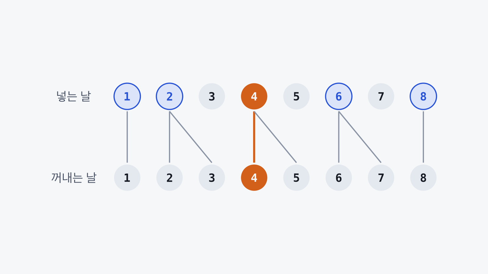

*아래 줄이 꺼내는 날, 위 줄이 그날 가장 좋은 넣는 날입니다. 선들이 서로 엇갈리지 않습니다.  
가운데 날(주황)의 답을 먼저 구하면, 그보다 앞선 날들은 그 왼쪽에서만,  
뒤의 날들은 그 오른쪽에서만 찾으면 됩니다.*

이 성질이 있으면 분할정복을 쓸 수 있습니다.

1. 꺼내는 날의 범위에서 가운데 날 mid를 잡고, 넣는 날의 후보를 전부 훑어 `opt(mid)`를 찾습니다.
2. mid보다 앞선 날들의 답은 `opt(mid)` 이하에만 있습니다. 후보를 거기까지로 줄여서 재귀합니다.
3. mid보다 뒤의 날들의 답은 `opt(mid)` 이상에만 있습니다. 마찬가지로 줄여서 재귀합니다.

```cpp
#include <bits/stdc++.h>
#define ibm514 ios::sync_with_stdio(0), cin.tie(0), cout.tie(0);
using namespace std;
typedef long long ll;

int n, d;
ll T[100001], V[100001];
ll ans;

// 꺼내는 날 [lo, hi]에 대해 답을 구한다. 넣는 날의 최적 위치는 [optL, optR] 안에 있다
void go(int lo, int hi, int optL, int optR) {
    if (lo > hi) return;
    int mid = (lo + hi) / 2;

    ll best = -1;
    int opt = optL;
    for (int i = max(optL, mid - d); i <= min(mid, optR); i++) {
        ll taste = (mid - i) * T[mid] + V[i];
        if (taste > best) {
            best = taste;
            opt = i;
        }
    }
    ans = max(ans, best);

    go(lo, mid - 1, optL, opt);
    go(mid + 1, hi, opt, optR);
}

void solve() {
    cin >> n >> d;
    for (int i = 1; i <= n; i++) cin >> T[i];
    for (int i = 1; i <= n; i++) cin >> V[i];
    go(1, n, 1, n);
    cout << ans;
}

int main() {
    ibm514
    solve();
    return 0;
}
```

꺼내는 날의 범위는 절반씩 줄어서 깊이가 log N입니다.  
같은 깊이에 있는 호출들은 넣는 날의 후보 범위가 끝에서만 맞닿으니, 다 합쳐도 N 정도만 훑습니다.  
전체 O(N log N)입니다.

맛은 최대 10만 × 10억이라 `long long`입니다.

지금까지의 문제와 쪼개는 대상이 다릅니다. 배열을 쪼갠 게 아니라 **답을 찾을 범위**를 쪼갰어요.  
“최적의 위치가 한 방향으로만 움직인다”는 성질이 보이면 이 방법을 쓸 수 있고,  
DP의 점화식을 빠르게 만드는 데 자주 쓰입니다. 대회에서는 분할정복 최적화라는 이름으로 부릅니다.

## 자주 하는 실수

- **구간의 끝을 섞어 쓴다.** `[l, r]`처럼 끝을 포함할지 `[l, r)`처럼 뺄지를 정하고,  
한 함수 안에서는 한 가지로만 씁니다.  
가운데를 구하는 식과 재귀에 넘기는 범위가 여기에 맞아야 합니다.
- **멈추는 조건이 범위를 못 줄인다.** 원소가 둘일 때 가운데가 어디로 잡히는지,  
재귀에 넘긴 범위가 정말 줄어드는지 확인하세요.  
안 줄어들면 끝없이 돕니다.
- **배열을 복사해서 넘긴다.** 조각마다 새 배열을 만들면 그것만으로 느려집니다. 양 끝 번호만 넘깁니다.
- **걸친 경우를 빼먹는다.** 양쪽을 재귀로 풀고 나서 큰 쪽을 답으로 내면, 가운데를 걸친 답을 놓칩니다.
- **합치는 단계가 느리다.** 합치는 데 구간 길이의 제곱이 걸리면 쪼갠 보람이 없습니다.  
구간 길이에 비례하는 시간 안에 끝나야 O(N log N)이 됩니다.
- **같은 값의 처리.** 버블 소트의 등호처럼,  
같은 값을 어느 쪽으로 보내느냐에 따라 답이 달라지는 문제가 있습니다.

## 마무리

1. 분할정복은 쪼개고, 조각을 풀고, 합치는 것입니다.  
조각을 푸는 건 재귀가 하니 쪼개는 법과 합치는 법만 정하면 됩니다.
2. 답이 한쪽 조각에만 있다면 그쪽만 내려갑니다.
3. 반으로 쪼갰을 때 답은 왼쪽에만, 오른쪽에만, 양쪽에 걸쳐서 셋 중 하나입니다.  
걸친 경우를 구간 길이만큼의 시간에 처리하는 것이 핵심입니다.
4. 그리디, 완전탐색, 미리 구해 둔 값과 섞어 쓸 수 있습니다.  
반씩 줄어든다는 것만으로 많은 것이 감당됩니다.
5. 가운데에서 쪼갤 수 없으면 작은 조각의 크기만큼만 일하게 만듭니다.
6. 최적의 위치가 한 방향으로만 움직이면, 답을 찾을 범위를 쪼갤 수 있습니다.

## 추천 문제

본문에서 본 유형을 그대로 연습할 수 있는 문제들입니다.

1. [BOJ 1780 종이의 개수](https://www.acmicpc.net/problem/1780): 넷이 아니라 아홉으로 쪼개기
2. [BOJ 17829 222-풀링](https://www.acmicpc.net/problem/17829): 네 조각의 답을 모아 하나를 고르기
3. [BOJ 18222 투에-모스 문자열](https://www.acmicpc.net/problem/18222): 만들지 않고 한쪽만 내려가기
4. [BOJ 4256 트리](https://www.acmicpc.net/problem/4256): 프리오더와 인오더로 포스트오더 구하기
5. [BOJ 10090 Counting Inversions](https://www.acmicpc.net/problem/10090): 합치면서 세기를 한 번 더

여기서부터는 도전 문제입니다. 아래로 갈수록 어려워집니다.

1. [BOJ 7578 공장](https://www.acmicpc.net/problem/7578): 번호를 바꿔 놓고 뒤집힌 쌍 세기
2. [BOJ 2104 부분배열 고르기](https://www.acmicpc.net/problem/2104): 히스토그램의 틀에 구간의 합 얹기
3. [BOJ 2339 석판 자르기](https://www.acmicpc.net/problem/2339): 자르는 방법을 전부 해 보며 경우의 수 세기
4. [BOJ 13261 탈옥](https://www.acmicpc.net/problem/13261): 김치의 방법을 DP에 쓰기
5. [BOJ 5820 경주](https://www.acmicpc.net/problem/5820): 트리를 쪼개는 분할정복
