# 누적합을 n번 만들고 있다면: IMOS

> rilog 발행 글: <https://www.rilog.kr/@iqed/posts/602> (2026-11-21)

안녕하세요 ~ 오늘 누적합 다음 이야기를 해보려고 합니다.

누적합은 다들 아실 거라 믿고 넘어가겠습니다. 문제는 그다음인데요,  
구간에 값을 더하는 업데이트가 계속 들어오면 어떻게 될까요?  
업데이트가 올 때마다 누적합을 다시 만들어야 합니다.  
업데이트가 n번이면 누적합도 n번이죠. 당연히 시간 초과가 납니다.

이럴 때 쓰는 게 **IMOS**입니다. 아이디어는 허무할 정도로 단순한데요,  
구간 전체를 고치지 말고 꼭짓점 근처 몇 칸에만 +와 −를 적어 두자는 겁니다.  
누적합은 맨 마지막에 딱 한 번만 돌리고요.

## 일단 1차원부터

문제부터 하나 보겠습니다. [BOJ 19951 태상이의 훈련소 생활](https://www.acmicpc.net/problem/19951)입니다.

연병장이 N칸 있고 칸마다 높이가 있습니다. 조교 M명이 각각 “a번 칸부터 b번 칸까지 높이를 k만큼 바꿔라”라고 지시합니다. 지시를 전부 수행한 뒤 각 칸의 높이를 출력하면 됩니다. N과 M은 10만까지입니다.

시키는 대로 매번 a부터 b까지 더하면 O(NM), 최악 100억 번입니다. 안 되겠죠.  
누적합을 들고 있어도 소용없습니다. 값이 하나 바뀌면 그 뒤가 전부 바뀌니까요.

그런데 잘 생각해 보면, 구간에 k를 더한다는 건 높이 k짜리 블록 하나를 얹는 겁니다.  
블록에서 중요한 건 올라가는 곳과 내려가는 곳, 딱 두 군데뿐이죠.  
그래서 `D[a] += k`, `D[b+1] -= k` 이렇게 두 칸에만 적어 둡니다.

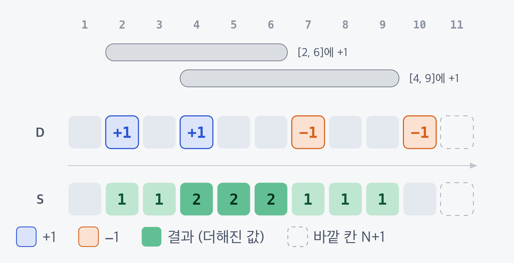

*지시 2개가 점 4개가 됐습니다. D를 왼쪽부터 한 번 누적하면 칸마다 더해진 값 S가 나옵니다.*

지시를 다 적고 나서 D의 누적합을 한 번 구하면 블록들이 전부 복원됩니다.  
기록은 지시마다 O(1), 누적합은 O(N) 한 번이라 전체 O(N + M)입니다. 100억 번이 20만 번으로 줄어드는 셈이죠.

```cpp
#include <bits/stdc++.h>
using namespace std;

int main() {
    ios::sync_with_stdio(false);
    cin.tie(nullptr);

    int n, m;
    cin >> n >> m;
    vector<long long> h(n + 1), d(n + 2, 0);  // d[b + 1]까지 쓰므로 n + 2칸
    for (int i = 1; i <= n; i++) cin >> h[i];

    while (m--) {
        int a, b, k;
        cin >> a >> b >> k;
        d[a] += k;        // 구간이 시작하는 칸에 +k
        d[b + 1] -= k;    // 구간이 끝난 다음 칸에 -k
    }

    long long run = 0;    // 누적합은 지시가 다 끝난 뒤 한 번만
    for (int i = 1; i <= n; i++) {
        run += d[i];
        cout << h[i] + run << (i == n ? '\n' : ' ');
    }
}
```

여기까지가 IMOS의 전부입니다. 이제부터는 모양만 바꿔 봅시다.

## 사각형이면 점이 몇 개 필요할까요?

이번에는 직사각형 `(r1, c1)–(r2, c2)`에 1을 더합니다.  
1차원에서는 양 끝 2개였는데, 사각형은 몇 개일까요?

네, 모서리 4개입니다.

- `D[r1][c1] += 1`
- `D[r1][c2+1] -= 1`
- `D[r2+1][c1] -= 1`
- `D[r2+1][c2+1] += 1`

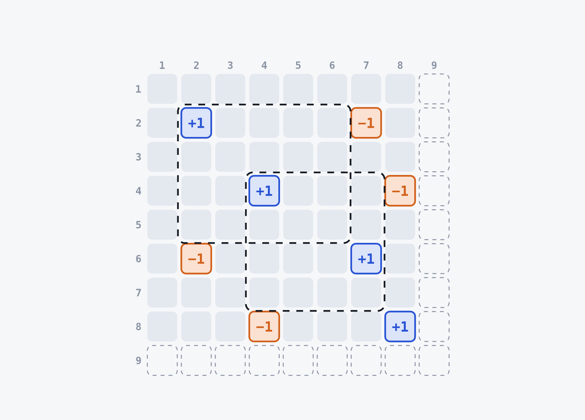

*① 직사각형 두 개. 각자 모서리 4곳에만 적습니다.*

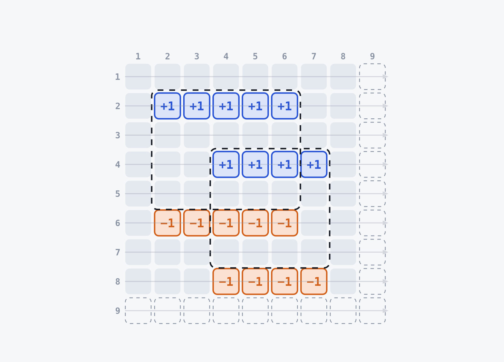

*② 가로로 한 번 누적하면 위 변과 아래 변이 띠로 나타납니다.*

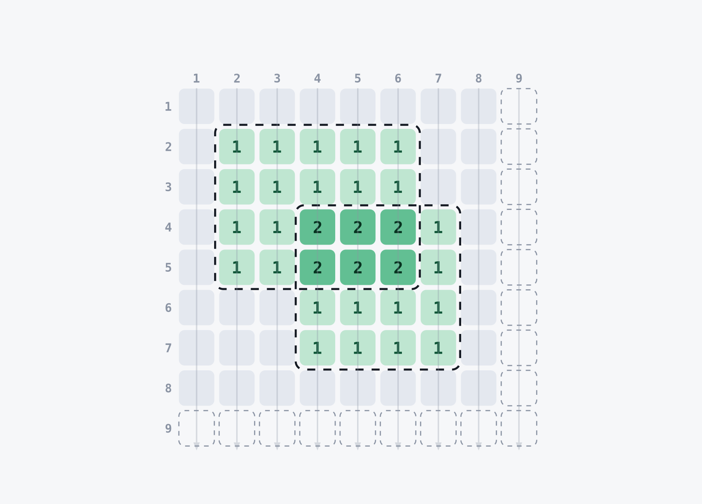

*③ 세로로 한 번 더. 띠 사이가 채워집니다. 겹친 곳은 2가 됐네요.*

변이 가로, 세로 두 방향이니까 누적합도 두 번입니다.  
이 규칙을 기억해 두세요. **변의 방향 수만큼 누적합을 돌립니다.**

## 삼각형은요?

여기서부터가 재밌습니다. 못이 삼각형 모양으로 박혀 있다고 해봅시다.  
a번째 줄에 못이 a개 있고, `(a, b)`는 a번째 줄의 b번째 못입니다.

배열로는 그냥 2차원 배열인데, 그림으로 보면 방향이 세 개입니다.  
→ `(a, b+1)`, ↙ `(a+1, b)`, ↘ `(a+1, b+1)`

### 잠깐, 방향을 벡터로 적어 두고 갑시다

여기서부터 대각선 누적이 나오면서 머리가 꼬이기 시작합니다.  
이럴 때는 방향을 화살표로 생각하지 말고 **벡터**로 적어 보세요.

누적 방향 하나는 벡터 `d = (da, db)` 하나입니다.  
그 방향으로 누적한다는 건 모든 칸 p에 대해 `S[p] += S[p − d]`를 한다는 뜻이고요. 이게 전부입니다.

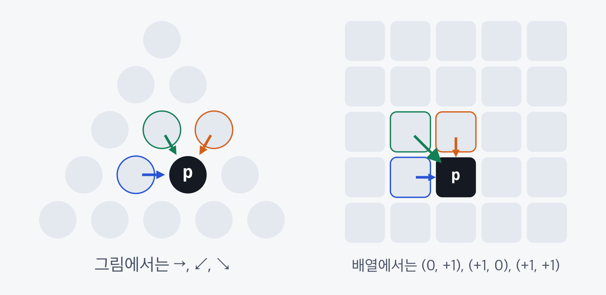

*삼각 격자의 세 방향을 배열에서 보면 (0, +1), (+1, 0), (+1, +1)입니다. ↘는 배열에서 그냥 대각선이죠.*

```cpp
// d = (da, db) 방향으로 누적: S[p] += S[p - d]
// S[p - d]가 S[p]보다 먼저 계산되는 순서로 돈다
void sweep(int da, int db) {
    for (int a = 1; a <= n; a++)
        for (int b = 1; b <= n; b++)
            S[a][b] += S[a - da][b - db];
}
```

방향이 바뀌어도 빼는 인덱스만 달라집니다. 주의할 건 순회 순서 하나인데요,  
`S[p − d]`가 `S[p]`보다 먼저 계산돼 있어야 합니다. da가 양수면 행을 위에서 아래로 돌기만 하면 됩니다.

방향이 더 이상해져도 똑같습니다. 추천 문제에 넣어 둔 [ABC 260 G](https://atcoder.jp/contests/abc260/tasks/abc260_g)는 `d = (+1, −2)`가 나옵니다.  
그냥 `S[i][j] += S[i−1][j+2]`로 쓰면 됩니다.  
인덱스가 배열 밖으로 나가지 않게 여유 칸만 챙겨 주세요.  
(d의 성분이 2면 그 방향으로 여유 칸도 2칸이 필요합니다. `d = (+1, +2)`였다면 열을 2부터 쓰는 2-indexed로 잡아야겠죠?)

앞으로 나오는 코드는 전부 이 `sweep`을 씁니다.

꼭짓점이 `(A, B)`, `(A+X, B)`, `(A+X, B+X)`인 정삼각형 안에 1을 더하고 싶습니다.  
변이 세 방향이니까 누적합도 세 번이겠죠? 그럼 점은 몇 개일까요.

6개입니다.

- `D[A][B] += 1`
- `D[A][B+1] -= 1`
- `D[A+X+1][B] -= 1`
- `D[A+X+2][B+1] += 1`
- `D[A+X+1][B+X+2] += 1`
- `D[A+X+2][B+X+2] -= 1`

이걸 외우려고 하면 머리가 아픕니다. 그림으로 한 단계씩 봐봅시다.

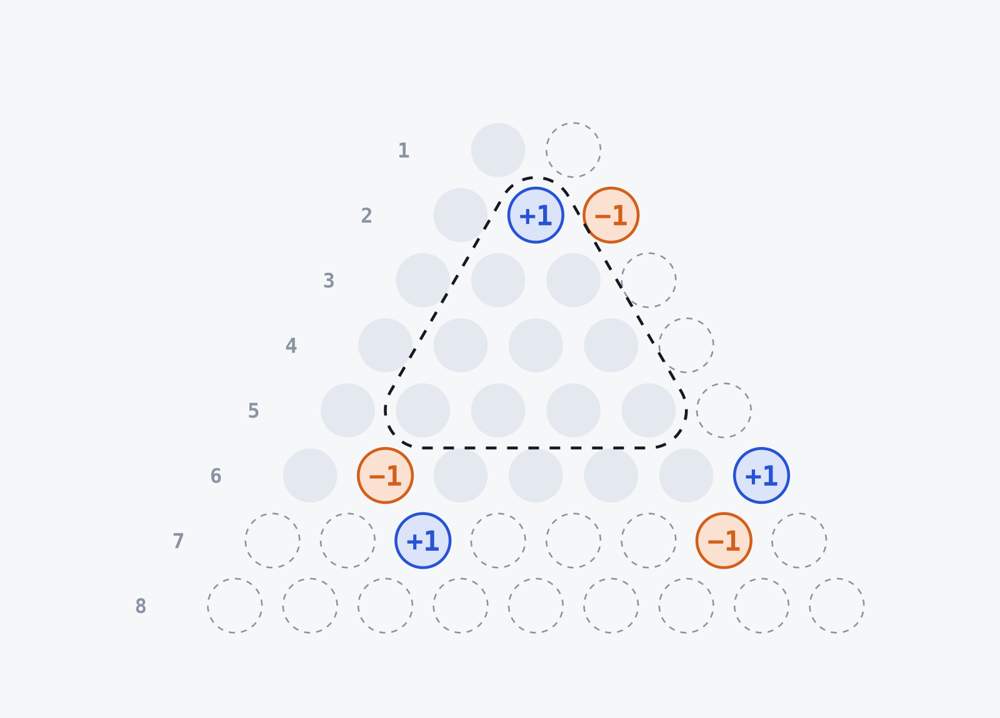

*① 점 6개.*

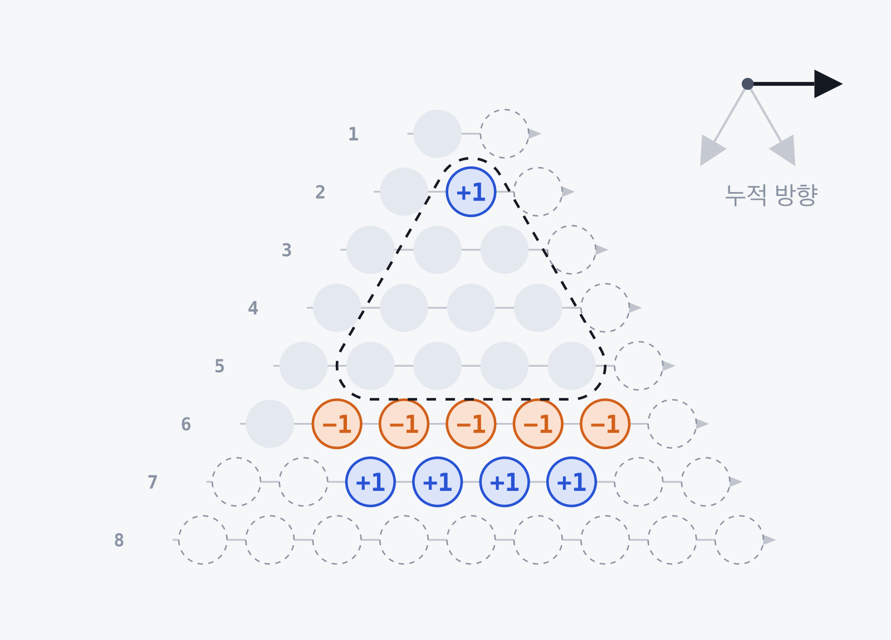

*② → 로 누적. 꼭대기 +1은 바로 옆 −1에 막혀서 한 칸만 남고, 밑변 아래에 띠 두 줄이 생깁니다.*

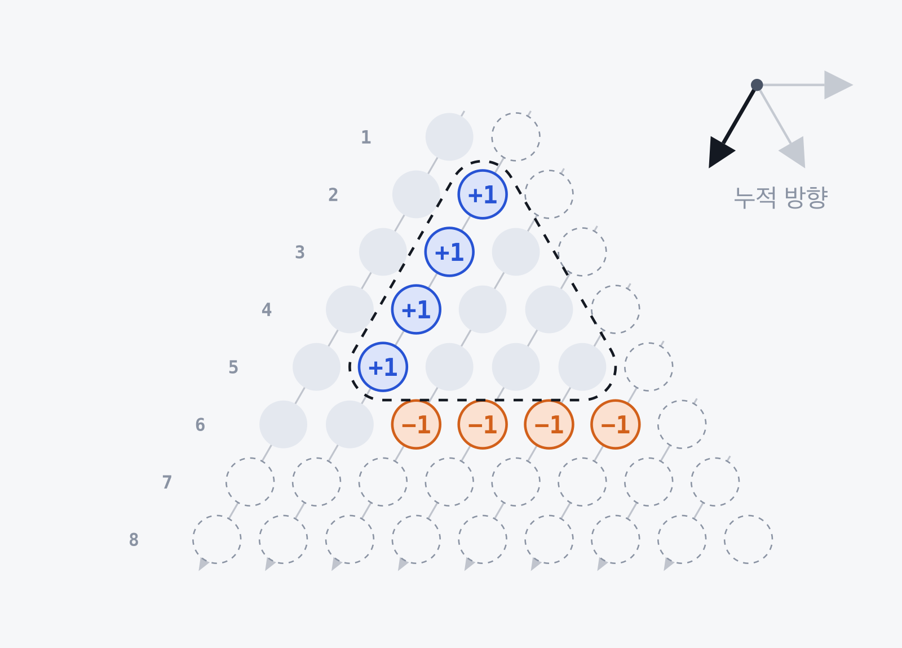

*③ ↙ 로 누적. 꼭대기 점이 왼쪽 변을 타고 내려옵니다. 띠 두 줄은 서로 지워져서 − 한 줄만 남았네요.*

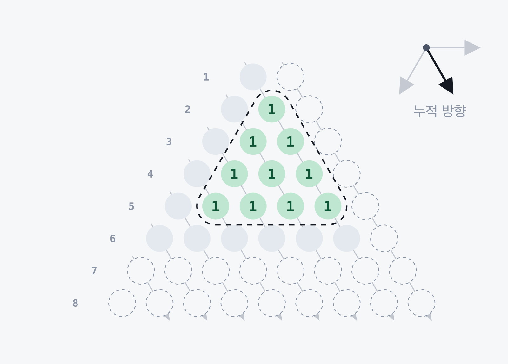

*④ ↘ 로 누적. 왼쪽 변이 번지면서 삼각형이 채워지고, 밑변을 넘어가려는 순간 − 띠가 막아 줍니다.*

마지막 그림에서 − 띠가 하는 일이 보이시나요?  
1차원에서 `D[r+1] -= 1`가 하던 일과 똑같습니다. 더 번지지 못하게 막는 역할이죠.

## BOJ 5541 釘

방금 그 삼각형이 그대로 문제로 나와 있습니다. [BOJ 5541 釘](https://www.acmicpc.net/problem/5541)입니다.

한 변에 못이 N개인 삼각형이 있고, 고무줄 M개가 각각 `(A, B, X)`로 주어집니다.  
고무줄에 한 번이라도 둘러싸인 못이 몇 개인지 세면 됩니다. N은 5000, M은 50만까지입니다.

고무줄 하나가 못을 1250만 개쯤 덮을 수 있는데 그게 50만 개입니다. 하나씩 세는 건 생각도 하지 맙시다.  
고무줄마다 점 6개만 찍고, 누적합 세 번 돌린 다음, 1 이상인 못을 세면 끝입니다.

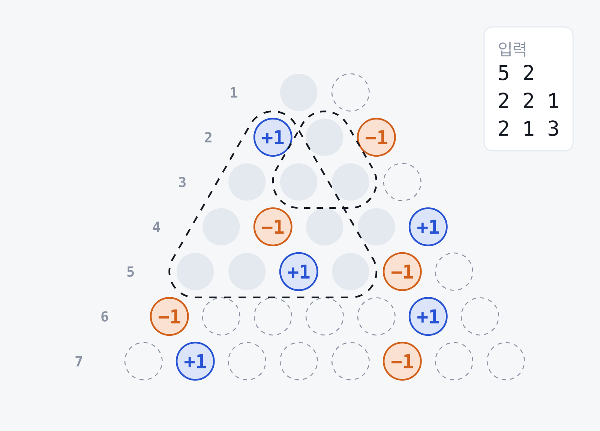

*예제 1의 기록. 고무줄 2개니까 점이 12개여야 하는데 10개만 보이죠? (2, 2)에서 +1과 −1이 만나서 사라졌습니다.*

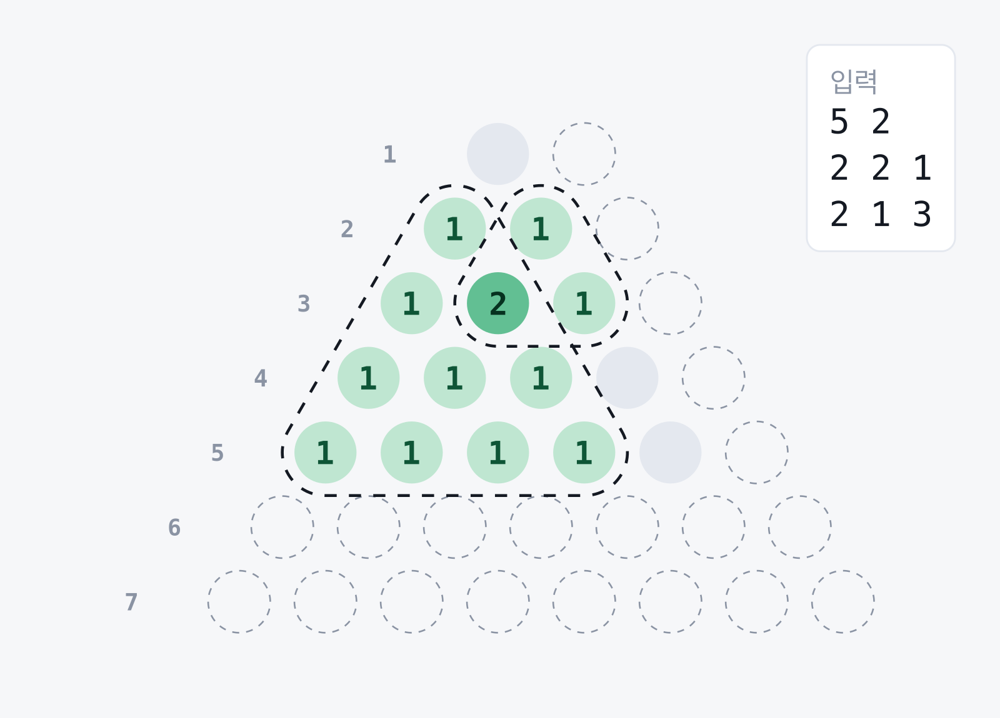

*누적합 세 번 뒤. 덮인 못 12개, 예제 출력도 12입니다.*

누적합 세 번은 방금 만든 `sweep`에 벡터만 바꿔 넘기면 됩니다.

```cpp
#include <bits/stdc++.h>
#define ibm514 ios::sync_with_stdio(0), cin.tie(0), cout.tie(0);
using namespace std;
typedef long long ll;
int n,m,ans, tri[5005][5005];

// d = (da, db) 방향으로 누적: tri[p] += tri[p - d]
void sweep(int da, int db) {
    for(int i=1;i<=n+2;++i) for(int j=1;j<=n+2;++j) tri[i][j]+=tri[i-da][j-db];
}

void solve() {
    cin>>n>>m;
    int x,y,len;
    for(int i=0;i<m;++i){
        cin>>x>>y>>len;
        // 고무줄 하나 = 6곳에 기록
        tri[x][y]++, tri[x][y+1]--, tri[x+len+1][y]--,
        tri[x+len+2][y+1]++, tri[x+len+1][y+len+2]++, tri[x+len+2][y+len+2]--;
    }

    sweep(0, 1);   // →
    sweep(1, 0);   // ↙
    sweep(1, 1);   // ↘

    // 한 번이라도 덮인 못 세기
    for(int i=1;i<=n;++i) for(int j=1;j<=i;++j) if(tri[i][j]>0) ans++;
    cout << ans;
}

int main() {
    ibm514
    solve();
    return 0;
}
```

## 육각형도 될까요?

됩니다. 사실 육각형 칸으로 된 판은 삼각형 격자와 인덱스가 똑같습니다.  
칸 `(a, b)`의 이웃이 `(a, b±1)`, `(a±1, b)`, `(a±1, b±1)` 여섯 개거든요.  
누적 방향도 그대로 →, ↙, ↘입니다.

중심에서 거리 k 이내인 칸 전부, 그러니까 정육각형 모양에 값을 더한다고 해봅시다.  
점이 몇 개 나올까요? 직접 차분해 보면 꼭짓점 6곳마다 2개씩, 12개입니다.

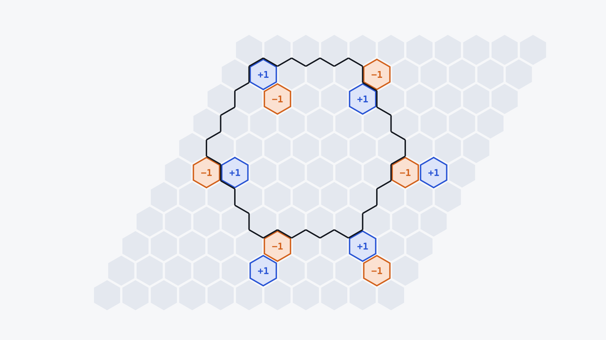

*① 꼭짓점마다 +1과 −1이 한 쌍씩.*

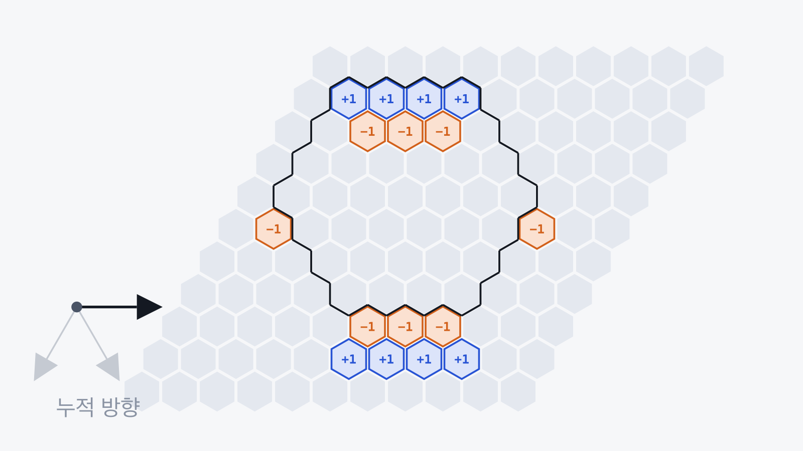

*② → 로 누적.*

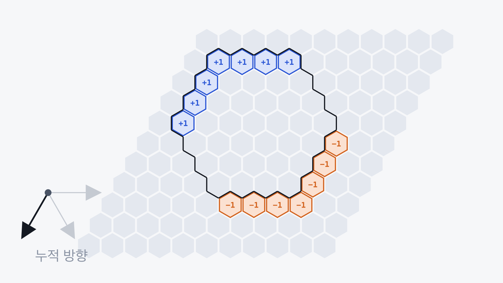

*③ ↙ 로 누적. 한쪽 경계에는 +, 반대쪽 경계 바로 바깥에는 −가 남습니다.*

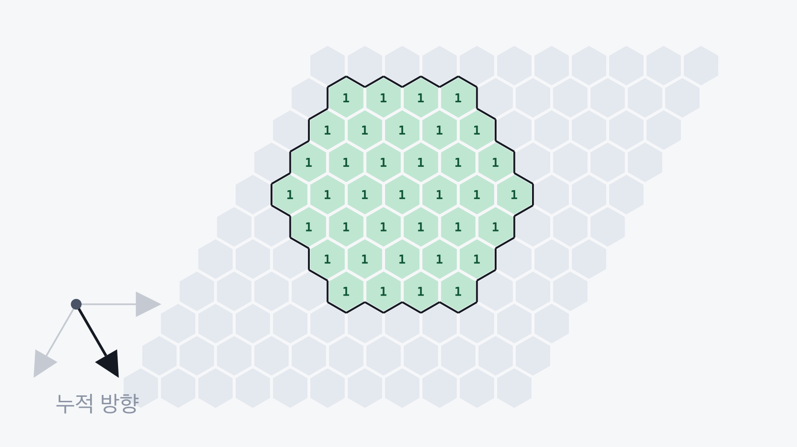

*④ ↘ 로 누적하면 그 사이가 채워집니다.*

누적은 삼각형과 똑같이 `sweep(0, 1)`, `sweep(1, 0)`, `sweep(1, 1)` 세 번입니다.

## 3차원

마지막으로 상자입니다. `(x1..x2) × (y1..y2) × (z1..z2)`에 1을 더합니다.  
변이 x, y, z 세 방향이니 누적합 세 번, 점은 꼭짓점 8개입니다.

부호는 어떻게 정할까요? “끝+1” 좌표를 몇 개 골랐는지 세면 됩니다. 짝수 개면 +, 홀수 개면 −입니다.

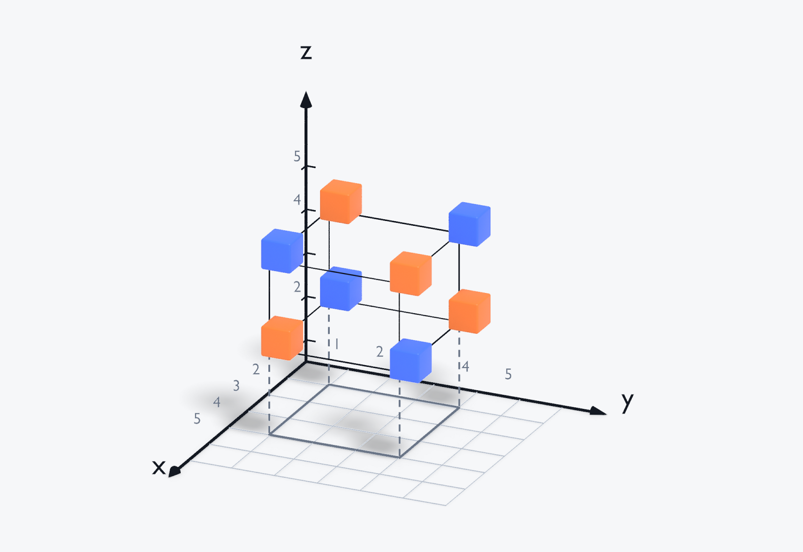

*① 꼭짓점 8곳. 검은 테두리가 더하려는 상자입니다.*

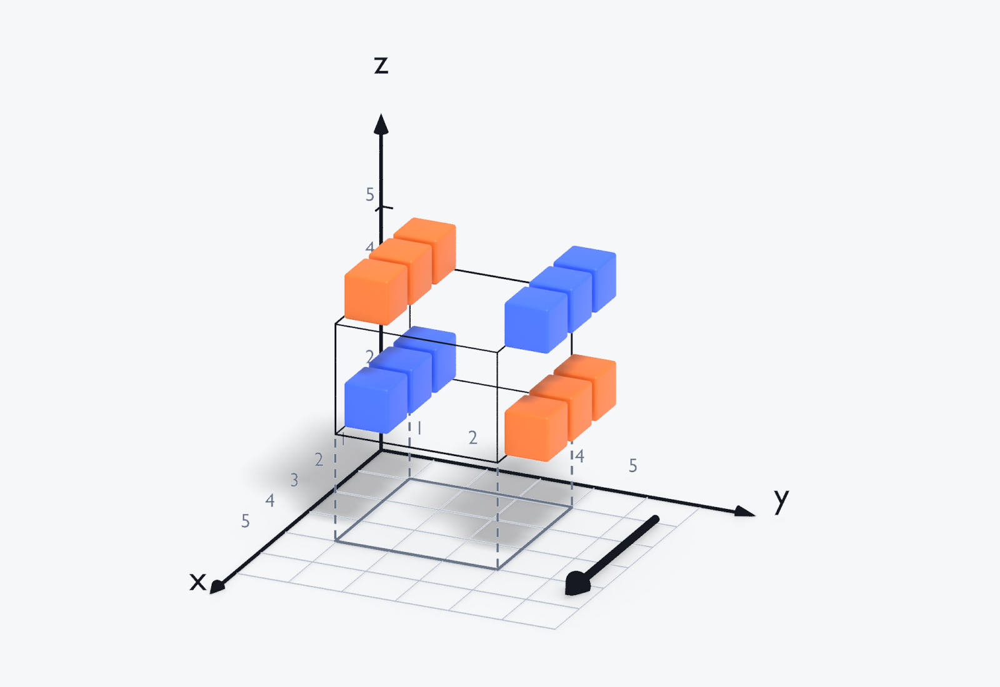

*② x로 누적하면 점 8개가 막대 4개가 됩니다.*

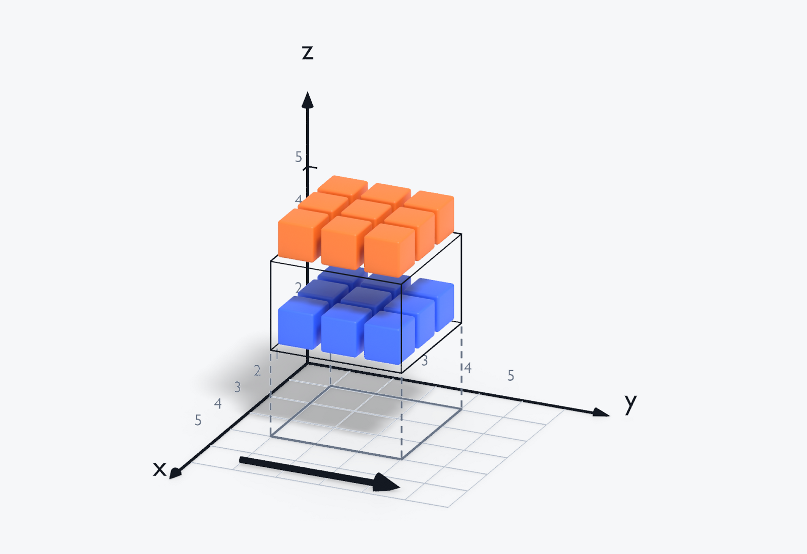

*③ y로 누적하면 막대가 판 2장이 됩니다. + 판은 상자 맨 아래층, − 판은 상자 바로 위층입니다.*

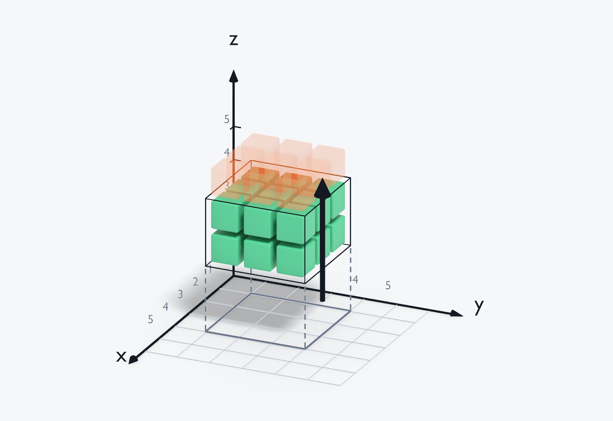

*④ z로 누적. + 판이 아래에서 위로 쌓이다가, − 판이 있던 층에서 0이 되면서 멈춥니다.*

③번 그림이 처음엔 좀 이상해 보일 수 있습니다. 왜 주황 판이 상자 밖에 있을까요? 누적은 항상 좌표가 커지는 쪽으로 번지기 때문입니다. 파란 판이 아래에서 위로 올라오다가 상자를 벗어나는 바로 그 층에서 −1을 만나 0이 되는 거죠. 삼각형의 − 띠와 같은 역할입니다.

## 그럼 점은 어떻게 찾나요?

점 6개가 어디서 나왔는지 궁금하셨을 겁니다. 외운 게 아닙니다.  
완성된 모습에서 출발해서 누적을 하나씩 거꾸로 되돌리면 나옵니다. 삼각형으로 해보죠.

**먼저 마지막 누적 직전을 상상합니다.**  
마지막에 ↘로 한 번 쓸면 삼각형이 완성돼야 합니다.  
그러려면 왼쪽 변에 +1이 한 줄로 서 있으면 됩니다.  
+1 하나하나가 ↘로 번지면서 한 줄씩 채워 주니까요.  
그런데 그냥 두면 밑변을 지나서도 계속 번집니다. 그래서 밑변 바로 아래 줄에 −1을 깔아서 막습니다.

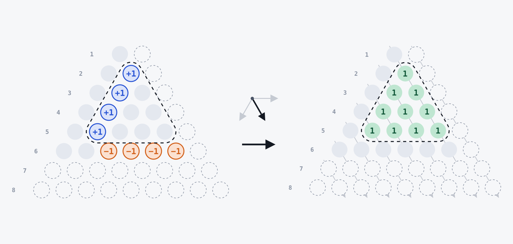

*왼쪽이 ↘ 누적 직전에 있어야 하는 모습, 오른쪽이 만들고 싶은 모습입니다.*

**이제 그 모습을 ↙ 누적으로 만들 방법을 생각합니다.**  
왼쪽 변은 ↙ 방향으로 뻗은 선입니다. 그러니 꼭대기에 +1 하나만 두면 ↙로 번지면서 알아서 변이 됩니다.  
이것도 밑변에서 멈춰야 하니 그 아래 칸에 −1이 필요한데,  
어차피 깔아야 하는 −1 줄을 왼쪽으로 한 칸 늘리면 해결됩니다.  
남은 문제는 −1 줄입니다. 이 줄은 ↙로 번지면 안 됩니다.  
그래서 바로 아래 줄에 +1을 깔아서 번지는 걸 지워 줍니다.

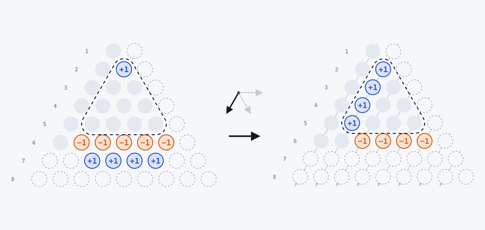

*꼭대기 +1 하나, 밑변 아래 −1 줄, 그 아래 +1 줄. 이걸 ↙로 쓸면 오른쪽이 됩니다.*

**마지막으로 그 모습을 → 누적으로 만듭니다.**  
이제 남은 건 가로로 뻗은 줄뿐이라 맨 처음에 본 1차원 IMOS입니다.  
줄이 시작하는 칸에 그 값을, 줄이 끝난 다음 칸에 반대 부호를 적으면 됩니다.  
꼭대기 +1은 한 칸짜리 줄이라 바로 옆에 −1, −1 줄은 시작에 −1과 끝 다음에 +1, +1 줄은 시작에 +1과 끝 다음에 −1. 세어 보면 6개입니다.

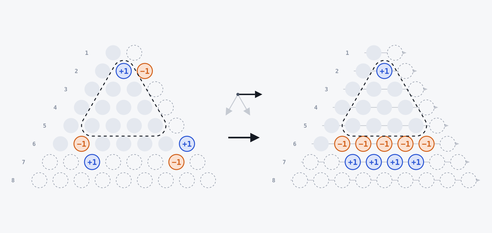

*줄 3개의 양 끝, 점 6개. 맨 처음에 본 그 6개입니다.*

정리하면 이렇습니다. 누적을 하나 되돌릴 때마다 “이 모습이 되려면 직전에 뭐가 있어야 하지?”를 묻습니다.  
번지기 시작할 곳에 값을 두고, 멈춰야 할 곳 바로 다음에 반대 부호를 둡니다.  
육각형 12점도 똑같은 방법으로 나옵니다.

손으로 하기 귀찮으면 계산시켜도 됩니다. `sweep`이 앞 칸 값을 더하는 거였으니, 거꾸로 앞 칸 값을 빼면 됩니다. 1차원으로 보면 쉽습니다. 완성된 모습이 `0 1 1 1 0`일 때 칸마다 앞 칸을 빼면 `0 +1 0 0 −1`이 됩니다. 값이 그대로인 칸은 0이 되고, 시작 칸과 끝난 다음 칸만 남죠.  
이 뺄셈을 방향마다 한 번씩 하면 기록할 점만 남습니다.

```cpp
// 완성된 도형에서 거꾸로 '기록할 점'을 찾는다
// sweep은 앞 칸 값을 더했다. 여기서는 반대로 앞 칸 값을 뺀다
int n = 20;
vector<vector<int>> f(n, vector<int>(n));

// 1) 완성된 모습을 그린다: 도형 안쪽 칸을 전부 1로
//    예) 꼭대기가 (5, 3)이고 X = 4인 삼각형
for (int a = 5; a <= 9; a++)
    for (int b = 3; b <= 3 + (a - 5); b++) f[a][b] = 1;

// 2) 나중에 sweep할 방향들
vector<pair<int, int>> dirs = {{0, 1}, {1, 0}, {1, 1}};   // →, ↙, ↘

// 3) 방향마다 한 번씩 되돌린다
for (auto [da, db] : dirs) {
    auto g = f;                   
    for (int a = 0; a < n; a++) for (int b = 0; b < n; b++) {
        int pa = a - da, pb = b - db; // d 방향으로 한 칸 앞
        if (pa < 0 || pb < 0 || pb >= n) continue;
        g[a][b] -= f[pa][pb];         // 앞 칸 값을 뺀다 (sweep의 반대)
    }
    f = g;
}

// 4) 0이 아닌 칸이 기록할 점이고, 그 값이 부호다
for (int a = 0; a < n; a++) for (int b = 0; b < n; b++)
    if (f[a][b]) printf("(%d, %d)에 %+d\n", a, b, f[a][b]);
//  출력: (5, 3)에 +1   (5, 4)에 -1   (10, 3)에 -1
//       (10, 9)에 +1  (11, 4)에 +1  (11, 9)에 -1
```

참고로 이 코드는 문제를 풀 때 돌리는 게 아닙니다.  
풀기 전에 점의 위치를 알아내려고 딱 한두 번 돌려 보는 도구입니다.  
작은 도형으로 돌려서 점이 어디에 찍히는지 보고, 크기를 바꿔 한 번 더 돌려서 어떤 좌표가 크기를 따라 움직이는지 확인합니다.

## 정리

주의할 점은 하나입니다. IMOS는 업데이트를 다 모은 다음에 읽는 방법입니다.  
업데이트와 질의가 번갈아 들어오면 읽을 때마다 누적합을 돌려야 해서 의미가 없어집니다.  
그때는 **펜윅 트리나 세그먼트 트리**를 쓰셔야 합니다.

## 추천 문제

1. [BOJ 19951 태상이의 훈련소 생활](https://www.acmicpc.net/problem/19951): 1차원 IMOS 그대로
2. [BOJ 3020 개똥벌레](https://www.acmicpc.net/problem/3020): 장애물 하나가 높이 축 위의 구간 하나
3. [BOJ 25826 2차원 배열 다중 업데이트 단일 합](https://www.acmicpc.net/problem/25826): 사각형 IMOS 그대로
4. [BOJ 5541 釘](https://www.acmicpc.net/problem/5541): 위에서 푼 문제
5. [AtCoder ABC 260 G Scalene Triangle Area](https://atcoder.jp/contests/abc260/tasks/abc260_g): 비스듬한 삼각형. 누적 방향을 직접 정해야함
6. [AtCoder ABC 366 D Cuboid Sum Query](https://atcoder.jp/contests/abc366/tasks/abc366_d): 3차원 누적합. 꼭짓점 8개의 부호를 익히기 좋음
7. [Luogu P8666 三体攻击](https://www.luogu.com.cn/problem/P8666): 3차원 IMOS에 이분 탐색을 얹기
