# 더한 거 어디 안 가: 누적합

> rilog 발행 글: <https://www.rilog.kr/@iqed/posts/628> (2026-11-26)

안녕하세요 ~ 오늘은 누적합 이야기를 해보려고 합니다.

“3번째부터 7번째까지의 합은?” 같은 질문이 한 번 오면 그냥 더하면 됩니다.  
그런데 이런 질문이 10만 번 오면, 매번 처음부터 더하다가 시간 초과가 납니다.

누적합은 질문이 오기 전에 미리 더해 두는 방법입니다.  
앞에서부터 차례로 더한 값을 적어 두면, 어떤 구간의 합이든 뺄셈 한 번으로 나옵니다.

방법 자체는 금방 끝납니다. 그래서 이 글도 뒤로 갈수록 “이걸 어디에 쓰는가”가 중심입니다.  
기본형을 보고, 구간을 세거나 고르는 문제로 넘어간 다음,  
정렬·이분탐색·BFS·DP와 섞이는 문제까지 보겠습니다.

## 미리 더해 두기: 구간 합 구하기 4

[BOJ 11659 구간 합 구하기 4](https://www.acmicpc.net/problem/11659)입니다.  
수 N개가 주어지고, “i번째부터 j번째까지의 합”을 묻는 질문이 M개 옵니다. N과 M은 10만까지입니다.

질문마다 직접 더하면 한 번에 최대 10만 번, 전부 합쳐 100억 번입니다.  
대신 `S[i]`를 “앞에서부터 i개의 합”으로 두고 미리 구해 둡니다.  
그러면 l번째부터 r번째까지의 합은 r개의 합에서 앞의 l − 1개의 합을 뺀 것입니다.

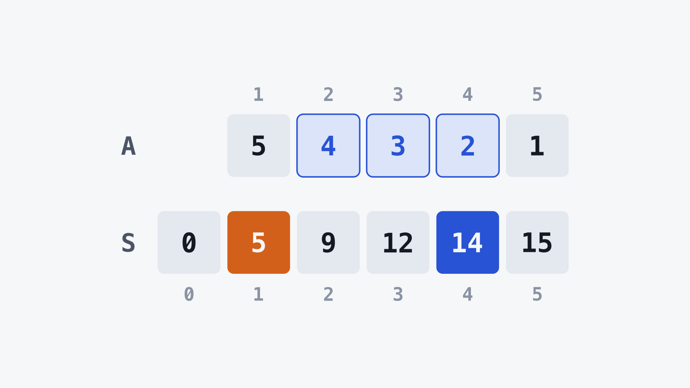

*A = 5 4 3 2 1의 누적합 S입니다. 2번째부터 4번째까지의 합(파랑)은 S[4] − S[1] = 14 − 5 = 9입니다.*

```cpp
#include <bits/stdc++.h>
#define ibm514 ios::sync_with_stdio(0), cin.tie(0), cout.tie(0);
using namespace std;
typedef long long ll;

int n, m;
ll S[100001];   // S[i]: 앞에서부터 i개의 합. S[0] = 0

void solve() {
    cin >> n >> m;
    for (int i = 1; i <= n; i++) {
        int x;
        cin >> x;
        S[i] = S[i - 1] + x;
    }

    while (m--) {
        int l, r;
        cin >> l >> r;
        cout << S[r] - S[l - 1] << '\n';
    }
}

int main() {
    ibm514
    solve();
    return 0;
}
```

신경 쓸 곳은 `S[0] = 0`입니다.  
배열을 1번부터 쓰고 0번 칸을 0으로 비워 두면,  
1번째부터 시작하는 구간도 `S[r] - S[0]`으로 똑같이 처리됩니다.  
0번부터 쓰면 l이 0일 때만 따로 처리해야 해서 실수하기 쉬워요.

만드는 데 O(N), 질문 하나에 O(1)이라 전체 O(N + M)입니다.

한 가지 조건이 있습니다. 누적합은 **배열이 바뀌지 않을 때** 쓰는 방법입니다.  
값이 하나 바뀌면 그 뒤의 누적합을 전부 다시 구해야 하니까요.

## 2차원으로: 구간 합 구하기 5

[BOJ 11660 구간 합 구하기 5](https://www.acmicpc.net/problem/11660)입니다.  
N×N 표에서 (x1, y1)부터 (x2, y2)까지 직사각형 안의 합을 묻는 질문이 M개 옵니다.

`S[i][j]`를 “맨 왼쪽 위 칸부터 (i, j)까지 직사각형의 합”으로 둡니다.  
구하려는 직사각형은 큰 직사각형에서 위쪽과 왼쪽을 잘라 낸 것인데,  
그러면 왼쪽 위 모서리가 두 번 빠집니다.  
그래서 한 번 다시 더해 줍니다.

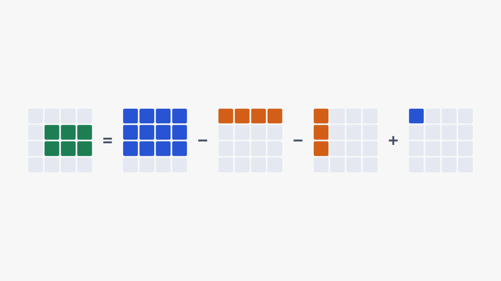

*초록이 구하려는 직사각형입니다.  
큰 직사각형(파랑)에서 위쪽과 왼쪽(주황)을 빼고, 두 번 빠진 모서리(파랑)를 다시 더합니다.*

```cpp
#include <bits/stdc++.h>
#define ibm514 ios::sync_with_stdio(0), cin.tie(0), cout.tie(0);
using namespace std;
typedef long long ll;

int n, m;
ll S[1025][1025];   // S[i][j]: (1, 1)부터 (i, j)까지 직사각형의 합

void solve() {
    cin >> n >> m;
    for (int i = 1; i <= n; i++) {
        for (int j = 1; j <= n; j++) {
            int x;
            cin >> x;
            S[i][j] = S[i - 1][j] + S[i][j - 1] - S[i - 1][j - 1] + x;
        }
    }

    while (m--) {
        int x1, y1, x2, y2;
        cin >> x1 >> y1 >> x2 >> y2;
        cout << S[x2][y2] - S[x1 - 1][y2] - S[x2][y1 - 1] + S[x1 - 1][y1 - 1] << '\n';
    }
}

int main() {
    ibm514
    solve();
    return 0;
}
```

표를 만들 때도 같은 생각을 거꾸로 씁니다.  
위쪽 `S[i-1][j]`와 왼쪽 `S[i][j-1]`을 더하면 왼쪽 위 `S[i-1][j-1]`이 두 번 들어가니 한 번 빼고,  
자기 칸의 값을 더합니다.

식 두 개를 외우려고 하면 부호가 헷갈립니다.  
그림을 떠올리고 “두 번 센 것은 빼고, 두 번 뺀 것은 더한다”만 기억하면 그때그때 만들 수 있어요.  
여기서도 0번 행과 0번 열을 0으로 비워 둔 덕분에 가장자리를 따로 처리하지 않습니다.

## 합이 아닌 것을 합으로: 체스판 다시 칠하기 2

[BOJ 25682 체스판 다시 칠하기 2](https://www.acmicpc.net/problem/25682)입니다.  
검은색과 흰색으로 칠해진 N×M 보드에서 K×K 크기를 잘라 체스판으로 만들려고 합니다.  
어디를 잘라야 다시 칠하는 칸이 가장 적은지, 그 칸 수를 구합니다. N과 M은 2,000까지입니다.

문제에 합이라는 말은 없습니다. 하지만 “다시 칠해야 하는 칸의 수”는 개수이고, 개수는 1을 더한 것입니다.

맨 왼쪽 위가 검은색인 체스판을 기준으로 잡고,  
보드의 각 칸이 그 체스판과 **색이 다르면 1, 같으면 0**을 적습니다.  
이 표의 2차원 누적합을 만들어 두면, 어떤 K×K 구역이든 다시 칠할 칸의 수가 바로 나옵니다.

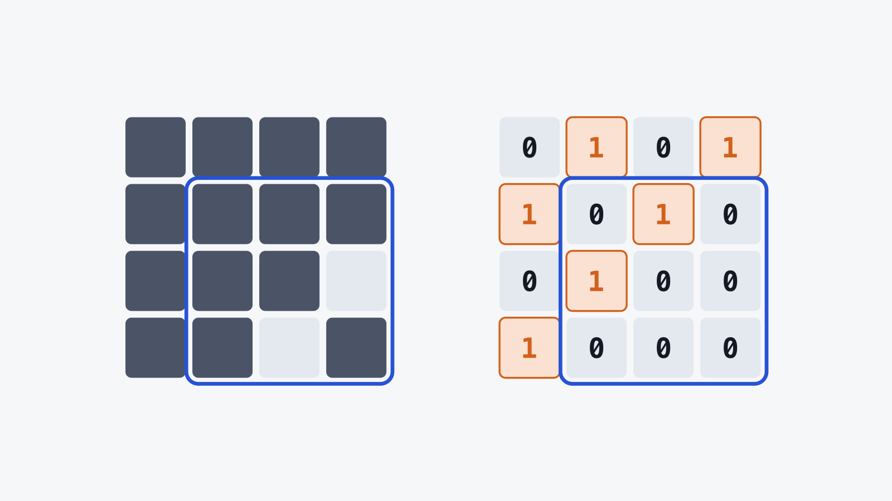

*왼쪽은 예제 1번 보드입니다. 오른쪽은 맨 왼쪽 위가 검은색인 체스판과 색이 다른 칸에 1을 적은 것입니다.  
파란 테두리 안의 합이 그 구역에서 다시 칠할 칸의 수입니다.*

```cpp
#include <bits/stdc++.h>
#define ibm514 ios::sync_with_stdio(0), cin.tie(0), cout.tie(0);
using namespace std;
typedef long long ll;

int n, m, k;
string board[2001];
int S[2001][2001];   // 맨 왼쪽 위가 검은색인 체스판과 색이 다른 칸의 수

void solve() {
    cin >> n >> m >> k;
    for (int i = 1; i <= n; i++) {
        cin >> board[i];
        for (int j = 1; j <= m; j++) {
            char want = (i + j) % 2 == 0 ? 'B' : 'W';
            int diff = board[i][j - 1] != want;
            S[i][j] = S[i - 1][j] + S[i][j - 1] - S[i - 1][j - 1] + diff;
        }
    }

    int ans = k * k;
    for (int i = k; i <= n; i++) {
        for (int j = k; j <= m; j++) {
            int cnt = S[i][j] - S[i - k][j] - S[i][j - k] + S[i - k][j - k];
            // 반대로 칠하는 체스판과는 나머지 칸이 전부 다르다
            ans = min({ans, cnt, k * k - cnt});
        }
    }
    cout << ans;
}

int main() {
    ibm514
    solve();
    return 0;
}
```

맨 왼쪽 위가 흰색인 체스판은 따로 계산하지 않습니다.  
두 체스판은 모든 칸의 색이 반대라서,  
한쪽과 다른 칸이 `cnt`개면 다른 쪽과 다른 칸은 `k * k - cnt`개입니다.

조건에 맞는 칸을 세는 문제는 이렇게 0과 1로 바꾸면 누적합 문제가 됩니다.  
글자 종류별로 세는 문제라면 종류마다 0과 1짜리 표를 따로 만들면 되고요.

## 구간을 세고 고르기

여기까지는 구간이 주어지고 합을 구했습니다.  
이제 반대로, 조건에 맞는 **구간을 찾는** 문제들입니다.

구간 (i, j]의 합은 `S[j] - S[i]`입니다.  
그래서 구간에 대한 조건은 전부 **누적합 두 개에 대한 조건**으로 바꿔 쓸 수 있습니다.  
이 절의 문제들은 모두 이 한 줄에서 나옵니다.

### 같은 값끼리 짝짓기: 수들의 합 4

[BOJ 2015 수들의 합 4](https://www.acmicpc.net/problem/2015)입니다.  
수 N개가 주어질 때, 합이 K인 연속 구간의 개수를 구합니다. N은 20만까지이고 수는 음수일 수도 있습니다.

수가 전부 양수라면 양 끝을 움직이는 투 포인터로 풀 수 있는데,  
음수가 섞이면 구간을 늘렸을 때 합이 커진다는 보장이 없어서 쓸 수 없습니다.

누적합으로 바꿔 씁니다. 구간의 합이 K라는 건 `S[j] - S[i] = K`, 즉 `S[i] = S[j] - K`입니다.  
그러니 j를 하나 정하면, 그 앞에 있는 누적합 중에서 값이 `S[j] - K`인 것의 개수만큼 구간이 있습니다.  
앞에서부터 가면서 지금까지 나온 누적합의 개수를 맵에 적어 두면 됩니다.

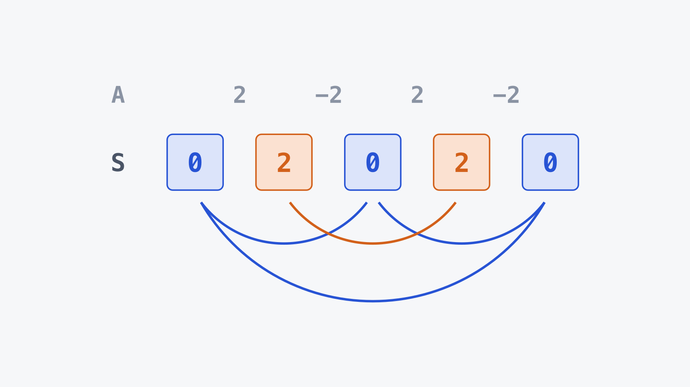

*2, −2, 2, −2의 누적합은 0, 2, 0, 2, 0입니다.  
K가 0이면 값이 같은 누적합 두 개가 구간 하나가 됩니다. 0끼리 세 쌍, 2끼리 한 쌍이라 답은 4입니다.*

```cpp
#include <bits/stdc++.h>
#define ibm514 ios::sync_with_stdio(0), cin.tie(0), cout.tie(0);
using namespace std;
typedef long long ll;

int n, k;
map<ll, ll> cnt;   // cnt[s]: 지금까지 나온 누적합 중 값이 s인 것의 수

void solve() {
    cin >> n >> k;

    ll sum = 0, ans = 0;
    cnt[0] = 1;
    for (int i = 0; i < n; i++) {
        int x;
        cin >> x;
        sum += x;
        // 여기서 끝나는 구간의 합이 k이려면, 앞쪽 누적합이 sum - k여야 한다
        if (cnt.count(sum - k)) ans += cnt[sum - k];
        cnt[sum]++;
    }
    cout << ans;
}

int main() {
    ibm514
    solve();
    return 0;
}
```

- `cnt[0] = 1`로 시작합니다.  
아무것도 더하지 않은 `S[0]`이 있어야 맨 앞에서 시작하는 구간을 셀 수 있습니다.
- 먼저 세고 나서 넣습니다. 순서를 바꾸면 K가 0일 때 길이가 0인 구간까지 세게 됩니다.
- 답은 `int`를 넘습니다. 구간의 수는 최대 N(N + 1) / 2로 200억쯤입니다.

[PS 수학 기본편](https://www.rilog.kr/@iqed/posts/623)의 나머지 합도 같은 방법이었습니다.  
거기서는 “누적합을 M으로 나눈 나머지가 같은 것끼리” 짝을 지었죠.

### 값을 바꿔서 세기: 부분 수열의 중앙값

[BOJ 3013 부분 수열의 중앙값](https://www.acmicpc.net/problem/3013)입니다.  
1부터 N까지의 수가 한 번씩 나오는 수열이 있습니다.  
길이가 홀수이고 중앙값이 B인 연속 구간의 개수를 구합니다.

중앙값을 구하려면 정렬해야 하는데, 구간마다 정렬할 수는 없습니다.  
대신 중앙값이 B라는 말을 풀어 씁니다.  
구간에 B가 들어 있고, **B보다 큰 수와 작은 수의 개수가 같다**는 뜻이에요.

그래서 B보다 큰 수는 +1, 작은 수는 −1로 바꿉니다.  
그러면 “큰 수와 작은 수의 개수가 같다”가 “합이 0이다”가 됩니다.  
개수가 같으면 B까지 합쳐서 길이는 저절로 홀수고요.

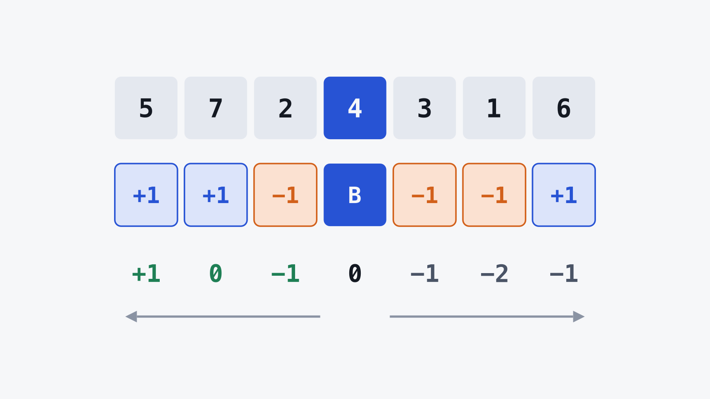

*예제 1번이고 B는 4입니다.  
둘째 줄은 +1과 −1로 바꾼 것이고, 셋째 줄은 B에서 양쪽으로 뻗어 가며 더한 값입니다.  
왼쪽의 값과 오른쪽의 값을 더해 0이 되는 짝이 구간 하나입니다.*

구간은 반드시 B를 포함해야 하니, B를 기준으로 왼쪽으로 뻗는 부분과 오른쪽으로 뻗는 부분으로 나눕니다.  
왼쪽으로 뻗으며 나오는 합들의 개수를 적어 두고,  
오른쪽으로 뻗으며 합이 s가 나올 때마다 왼쪽에서 −s가 나온 횟수를 더합니다.

```cpp
#include <bits/stdc++.h>
#define ibm514 ios::sync_with_stdio(0), cin.tie(0), cout.tie(0);
using namespace std;
typedef long long ll;

int n, b;
int a[100001];
int cnt[200001];   // cnt[s + n]: B의 왼쪽으로 뻗은 구간 중 합이 s인 것의 수

void solve() {
    cin >> n >> b;
    int pos = 0;
    for (int i = 1; i <= n; i++) {
        cin >> a[i];
        if (a[i] == b) pos = i;
    }

    // B보다 크면 +1, 작으면 -1. 합이 0이면 B가 한가운데다
    int sum = 0;
    cnt[n] = 1;
    for (int i = pos - 1; i >= 1; i--) {
        sum += a[i] > b ? 1 : -1;
        cnt[sum + n]++;
    }

    ll ans = cnt[n];
    sum = 0;
    for (int i = pos + 1; i <= n; i++) {
        sum += a[i] > b ? 1 : -1;
        ans += cnt[-sum + n];
    }
    cout << ans;
}

int main() {
    ibm514
    solve();
    return 0;
}
```

합은 −N부터 N까지 나올 수 있어서, 배열에 N을 더한 자리에 적었습니다.  
`cnt[n] = 1`은 왼쪽으로 하나도 뻗지 않은 경우입니다.

수들의 합 4와 같은 틀입니다. 세기 좋은 모양이 될 때까지 값을 바꿔 준 것만 달라요.

### 앞쪽의 최솟값을 뺀다: 보석 줍기

[BOJ 2208 보석 줍기](https://www.acmicpc.net/problem/2208)입니다.  
보석 N개가 한 줄로 놓여 있고 가치는 음수일 수도 있습니다.  
줍기 시작하면 **M개 이상을 연속으로** 주워야 할 때, 주운 보석의 가치 합의 최댓값을 구합니다.

길이가 M 이상인 구간 중 합이 가장 큰 것을 찾는 문제입니다.  
구간의 끝 j를 정하면 합은 `S[j] - S[i]`이고, 길이가 M 이상이려면 i는 j − M 이하여야 합니다.  
`S[j]`는 정해져 있으니, 고를 수 있는 `S[i]` 중 **가장 작은 것**을 빼면 됩니다.

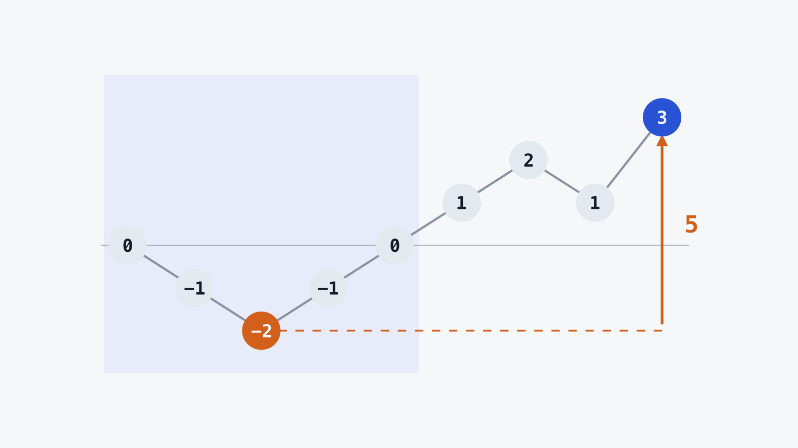

*예제의 누적합을 점으로 찍었습니다.  
M이 4일 때 S[8]에서 뺄 수 있는 것은 S[0]부터 S[4]까지(파란 띠)이고, 그중 가장 낮은 −2를 빼면 5입니다.*

j가 한 칸 늘면 고를 수 있는 i도 한 칸 늘 뿐입니다.  
그래서 최솟값을 매번 다시 찾지 않고, 새로 들어온 `S[j - m]` 하나만 비교하면서 들고 갑니다.

```cpp
#include <bits/stdc++.h>
#define ibm514 ios::sync_with_stdio(0), cin.tie(0), cout.tie(0);
using namespace std;
typedef long long ll;

int n, m;
int S[100001];

void solve() {
    cin >> n >> m;
    for (int i = 1; i <= n; i++) {
        int x;
        cin >> x;
        S[i] = S[i - 1] + x;
    }

    int ans = 0;
    int low = INT_MAX;   // S[0]부터 S[j - m]까지 중 가장 작은 값
    for (int j = m; j <= n; j++) {
        low = min(low, S[j - m]);
        ans = max(ans, S[j] - low);
    }
    cout << ans;
}

int main() {
    ibm514
    solve();
    return 0;
}
```

`ans`를 0에서 시작한 건 하나도 줍지 않는 경우를 넣은 것입니다.  
전부 음수라면 안 줍는 게 낫다고 봤습니다.

M이 1이면 길이 제한이 없는 “가장 큰 구간 합”이 됩니다.  
흔히 DP로 푸는 문제인데, 누적합으로 보면 “지금 누적합에서 지금까지의 가장 낮은 누적합을 뺀 것”입니다. 바로 다음 문제에서 이걸 씁니다.

### 2차원을 1차원으로 누르기: 점수따먹기

[BOJ 1749 점수따먹기](https://www.acmicpc.net/problem/1749)입니다.  
N×M 행렬에서 합이 가장 큰 부분 행렬의 합을 구합니다.  
N과 M은 200보다 작고 값은 음수일 수도 있습니다.

2차원 누적합이 있으니 부분 행렬 하나의 합은 바로 나옵니다.  
하지만 부분 행렬의 수가 위아래 두 줄, 좌우 두 줄을 고르는 만큼이라 16억 개쯤 됩니다. 전부 보기엔 많아요.

위아래 두 줄만 정하고 나머지는 다른 방법으로 풉니다.  
위 행과 아래 행을 정하면, 그 사이를 열마다 더해서 **한 줄짜리 배열**로 누를 수 있습니다.  
그러면 남은 일은 그 한 줄에서 가장 큰 구간 합을 찾는 것이고, 방금 본 방법으로 한 번 훑으면 끝납니다.

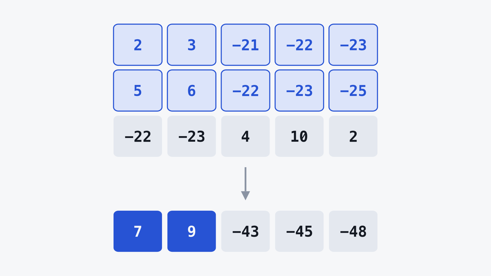

*예제의 위 두 행을 열마다 더해 한 줄로 눌렀습니다.  
이 줄에서 가장 큰 구간 합은 7 + 9 = 16이고, 이게 예제의 답입니다.*

```cpp
#include <bits/stdc++.h>
#define ibm514 ios::sync_with_stdio(0), cin.tie(0), cout.tie(0);
using namespace std;
typedef long long ll;

int n, m;
int col[201][201];   // col[i][j]: j번 열에서 위에서부터 i칸의 합

void solve() {
    cin >> n >> m;
    for (int i = 1; i <= n; i++) {
        for (int j = 1; j <= m; j++) {
            int x;
            cin >> x;
            col[i][j] = col[i - 1][j] + x;
        }
    }

    int ans = INT_MIN;
    for (int top = 1; top <= n; top++) {
        for (int bot = top; bot <= n; bot++) {
            // top행부터 bot행까지를 한 줄로 눌러 놓고, 1차원에서 가장 큰 구간 합을 찾는다
            int sum = 0, low = 0;
            for (int j = 1; j <= m; j++) {
                sum += col[bot][j] - col[top - 1][j];
                ans = max(ans, sum - low);
                low = min(low, sum);
            }
        }
    }
    cout << ans;
}

int main() {
    ibm514
    solve();
    return 0;
}
```

`col`은 열마다 위에서 아래로 쌓은 누적합입니다.  
덕분에 위아래 두 줄 사이의 열 합이 뺄셈 한 번으로 나옵니다.

보석 줍기와 다르게 `ans`를 아주 작은 값에서 시작하고, `low`를 고치기 전에 답부터 고칩니다.  
이 문제는 칸을 적어도 하나는 골라야 해서, 길이가 0인 구간이 답이 되면 안 되거든요.

위아래 두 줄을 고르는 데 N², 한 줄을 훑는 데 M이라 O(N²M)입니다. 800만 번쯤이에요.

## 더하기가 아니어도 될까

누적합이 통하는 이유를 다시 보면, 더한 것을 **빼서 되돌릴 수 있기** 때문입니다.  
`S[r]`에서 앞부분 `S[l - 1]`을 빼면 깔끔하게 뒷부분만 남죠.  
그러면 되돌릴 수 있는 다른 연산도 같은 식으로 쓸 수 있습니다.

### 되돌릴 수 있는 연산: Generic Queries

[BOJ 16713 Generic Queries](https://www.acmicpc.net/problem/16713)입니다.  
수열에서 s번째부터 e번째까지를 전부 XOR한 값을 묻는 질문이 Q개 옵니다.  
모든 답을 다시 XOR한 값 하나를 출력합니다.

XOR은 같은 값을 두 번 하면 사라집니다. 그래서 자기 자신이 곧 되돌리는 연산이에요.  
앞에서부터 XOR한 값을 `X[i]`에 적어 두면, 구간의 XOR은 `X[e] ^ X[s - 1]`입니다.  
앞부분이 두 번 들어가서 지워지는 거죠.

```cpp
#include <bits/stdc++.h>
#define ibm514 ios::sync_with_stdio(0), cin.tie(0), cout.tie(0);
using namespace std;
typedef long long ll;

int n, q;
int X[1000001];   // X[i]: 앞에서부터 i개를 XOR한 값

void solve() {
    cin >> n >> q;
    for (int i = 1; i <= n; i++) {
        int x;
        cin >> x;
        X[i] = X[i - 1] ^ x;
    }

    int ans = 0;
    while (q--) {
        int s, e;
        cin >> s >> e;
        ans ^= X[e] ^ X[s - 1];
    }
    cout << ans;
}

int main() {
    ibm514
    solve();
    return 0;
}
```

곱셈도 나눗셈으로 되돌릴 수 있으니 됩니다(0이 섞이면 따로 처리해야 하지만요).  
반면 최댓값, 최솟값, 최대공약수는 안 됩니다.  
앞에서 5개의 최댓값이 9이고 앞에서 2개의 최댓값도 9일 때,  
3번째부터 5번째까지의 최댓값은 알 수가 없어요.

### 되돌릴 수 없으면 양쪽에서: 최대공약수 하나 빼기

[BOJ 14476 최대공약수 하나 빼기](https://www.acmicpc.net/problem/14476)입니다.  
수 N개 중 하나를 뺐을 때 나머지의 최대공약수가 가장 커지게 하려고 합니다.  
단, 그 최대공약수가 뺀 수의 약수면 안 됩니다. N은 100만까지입니다.

수를 하나씩 빼 보면서 나머지의 최대공약수를 구해야 하는데, 매번 다시 구하면 N²입니다.  
전체의 최대공약수에서 하나를 “빼는” 건 방금 말한 대로 안 되고요.

그런데 여기서 필요한 건 아무 구간이 아닙니다.  
**하나만 뺀 나머지**, 그러니까 맨 앞에서 시작하는 덩어리와 맨 끝에서 끝나는 덩어리 두 개뿐이에요.  
그래서 앞에서부터 누적한 것과 뒤에서부터 누적한 것을 하나씩 만들어 두고, 둘을 합칩니다.

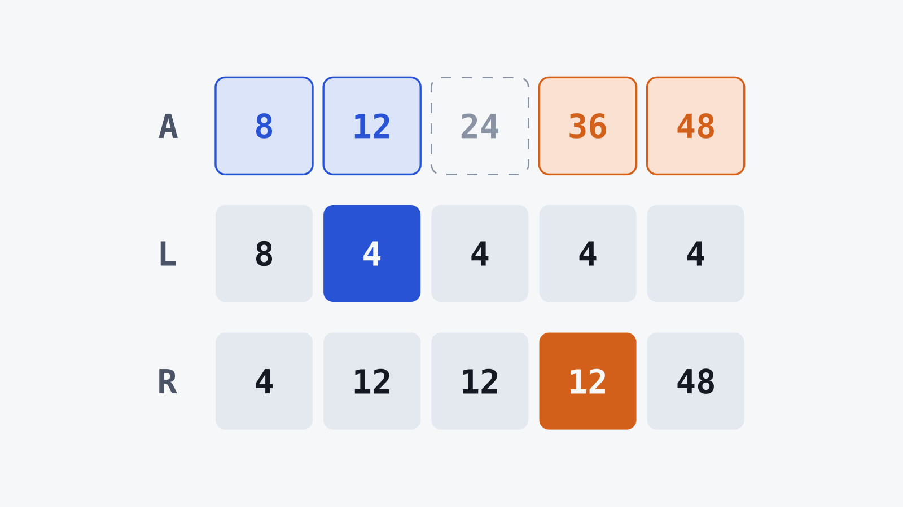

*L은 앞에서부터, R은 뒤에서부터 구한 최대공약수입니다.  
24를 뺀 나머지의 최대공약수는 왼쪽 덩어리의 4와 오른쪽 덩어리의 12를 합친 4입니다.*

```cpp
#include <bits/stdc++.h>
#define ibm514 ios::sync_with_stdio(0), cin.tie(0), cout.tie(0);
using namespace std;
typedef long long ll;

int n;
int a[1000002];
int L[1000002];   // L[i]: a[1]부터 a[i]까지의 최대공약수
int R[1000002];   // R[i]: a[i]부터 a[n]까지의 최대공약수

void solve() {
    cin >> n;
    for (int i = 1; i <= n; i++) cin >> a[i];
    for (int i = 1; i <= n; i++) L[i] = gcd(L[i - 1], a[i]);
    for (int i = n; i >= 1; i--) R[i] = gcd(R[i + 1], a[i]);

    int best = -1, removed = 0;
    for (int i = 1; i <= n; i++) {
        int g = gcd(L[i - 1], R[i + 1]);   // a[i]만 뺀 나머지의 최대공약수
        if (a[i] % g != 0 && g > best) {
            best = g;
            removed = a[i];
        }
    }

    if (best == -1) cout << -1;
    else cout << best << ' ' << removed;
}

int main() {
    ibm514
    solve();
    return 0;
}
```

배열의 양 끝을 0으로 비워 두었습니다.  
어떤 수와 0의 최대공약수는 그 수 자신이라서, 맨 앞이나 맨 뒤의 수를 뺄 때도 같은 식으로 계산됩니다.

되돌릴 수 없는 연산이라도 “한 칸만 빼고 전부” 같은 모양이면 앞뒤 누적 두 개로 풀립니다.  
최댓값이나 최솟값으로도 같은 방법을 쓸 수 있어요.

## 다른 방법과 섞기

이제 누적합이 주인공이 아니라 부품으로 들어가는 문제들입니다.  
어디에 끼워 넣는지를 중심으로 보면 됩니다.

### 정렬하고 나서 누적: 컬러볼

[BOJ 10800 컬러볼](https://www.acmicpc.net/problem/10800)입니다.  
공마다 색과 크기가 있고, 자기보다 **크기가 작고 색이 다른** 공을 잡아 그 크기만큼 점수를 얻습니다.  
공마다 얻을 수 있는 점수의 합을 구합니다. 공은 20만 개까지입니다.

누적합은 “앞에 있는 것들의 합”인데, 꼭 입력된 순서일 필요는 없습니다.  
크기순으로 정렬하면 “나보다 작은 공들”이 전부 내 앞에 오니,  
앞에서부터 더해 온 값이 곧 나보다 작은 공들의 크기 합입니다.

거기서 색이 같은 공은 빼야 합니다.  
색마다 따로 합을 들고 가다가, **전체 합에서 내 색의 합을 뺍니다**.

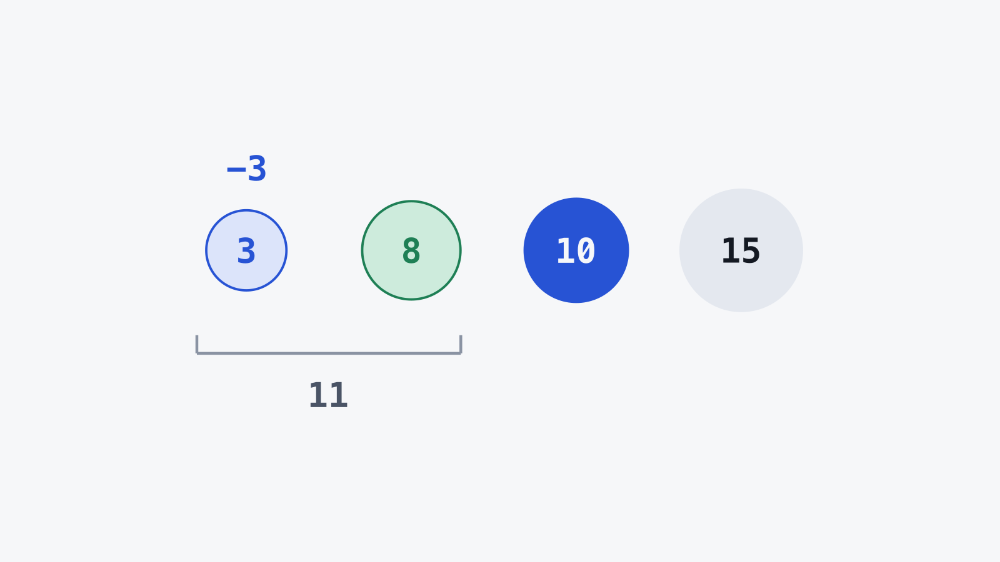

*예제 1번의 공을 크기순으로 놓았습니다.  
크기 10인 공(진한 파랑) 앞에는 3과 8이 있어 합이 11이고, 그중 같은 색인 3을 빼면 8점입니다.*

```cpp
#include <bits/stdc++.h>
#define ibm514 ios::sync_with_stdio(0), cin.tie(0), cout.tie(0);
using namespace std;
typedef long long ll;

int n;
array<int, 3> ball[200001];   // (크기, 색, 번호)
int byColor[200001];        // byColor[c]: 지금까지 본 공 중 색이 c인 것의 크기 합
int ans[200001];

void solve() {
    cin >> n;
    for (int i = 0; i < n; i++) {
        int c, s;
        cin >> c >> s;
        ball[i] = {s, c, i};
    }
    sort(ball, ball + n);

    int total = 0;   // 지금까지 본 공의 크기 합
    for (int i = 0, j = 0; i < n; i = j) {
        // 크기가 같은 공들은 서로 잡을 수 없으니, 답부터 구하고 나서 한꺼번에 더한다
        while (j < n && ball[j][0] == ball[i][0]) j++;
        for (int k = i; k < j; k++) ans[ball[k][2]] = total - byColor[ball[k][1]];
        for (int k = i; k < j; k++) {
            total += ball[k][0];
            byColor[ball[k][1]] += ball[k][0];
        }
    }

    for (int i = 0; i < n; i++) cout << ans[i] << '\n';
}

int main() {
    ibm514
    solve();
    return 0;
}
```

조심할 곳은 크기가 같은 공들입니다.  
크기가 같으면 서로 잡을 수 없으니, 같은 크기의 공들은 **답을 전부 구한 다음에** 한꺼번에 더합니다.  
하나씩 답을 구하고 바로 더하면, 뒤의 공이 크기가 같은 앞의 공을 잡은 것으로 계산됩니다.

### 이분탐색으로 자리를 찾고: 누적 거리

[BOJ 22345 누적 거리](https://www.acmicpc.net/problem/22345)입니다.  
수직선 위에 마을 N개가 있고 마을마다 사는 사람 수가 있습니다.  
모임 장소 x가 주어질 때마다 모든 사람이 x까지 이동하는 거리의 합을 구합니다. 질문은 Q개입니다.

거리는 `|마을 위치 − x|`인데, 절댓값이 있어서 식이 한 덩어리로 묶이지 않습니다.  
절댓값을 풀려면 x의 왼쪽 마을과 오른쪽 마을로 나누면 됩니다.

- 왼쪽 마을은 거리가 `x − 위치`입니다.  
사람 수를 곱해 다 더하면 `x × (사람 수의 합) − (사람 수 × 위치의 합)`입니다.
- 오른쪽 마을은 거리가 `위치 − x`입니다.  
다 더하면 `(사람 수 × 위치의 합) − x × (사람 수의 합)`입니다.

그러니 마을을 위치순으로 정렬하고, **사람 수의 누적합**과 **사람 수 × 위치의 누적합** 두 개를 만들어 둡니다.  
x가 주어지면 이분탐색으로 x가 몇 번째 마을 뒤에 오는지 찾고,  
그 자리를 기준으로 누적합을 잘라 쓰면 됩니다.

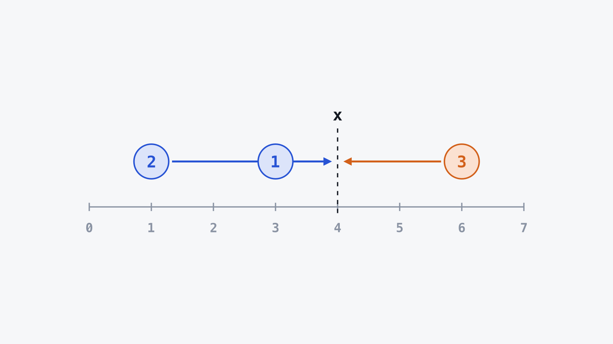

*예제 1번입니다. 원 안의 수는 사람 수예요.  
x가 4일 때 왼쪽 마을(파랑)은 4 × 3 − (2 × 1 + 1 × 3) = 7,  
오른쪽 마을(주황)은 3 × 6 − 4 × 3 = 6이라 합이 13입니다.*

```cpp
#include <bits/stdc++.h>
#define ibm514 ios::sync_with_stdio(0), cin.tie(0), cout.tie(0);
using namespace std;
typedef long long ll;

int n, q;
pair<ll, ll> town[200001];   // (위치, 사람 수)
ll P[200001];    // P[i]: 왼쪽부터 i개 마을의 사람 수 합
ll PX[200001];   // PX[i]: 왼쪽부터 i개 마을의 (사람 수 × 위치) 합

void solve() {
    cin >> n >> q;
    for (int i = 1; i <= n; i++) cin >> town[i].second >> town[i].first;
    sort(town + 1, town + n + 1);
    for (int i = 1; i <= n; i++) {
        P[i] = P[i - 1] + town[i].second;
        PX[i] = PX[i - 1] + town[i].second * town[i].first;
    }

    while (q--) {
        ll x;
        cin >> x;
        // 왼쪽부터 k개 마을이 x 이하에 있다
        int k = upper_bound(town + 1, town + n + 1, make_pair(x, LLONG_MAX)) - (town + 1);
        ll left = x * P[k] - PX[k];
        ll right = (PX[n] - PX[k]) - x * (P[n] - P[k]);
        cout << left + right << '\n';
    }
}

int main() {
    ibm514
    solve();
    return 0;
}
```

질문 하나가 이분탐색 한 번이라 전체 O((N + Q) log N)입니다.

식에 절댓값이나 `max`가 있어서 한 번에 안 묶일 때,  
정렬해서 경계를 기준으로 나누면 양쪽이 각각 누적합으로 풀리는 경우가 많습니다.

### BFS의 검사를 한 번에: 직사각형 탈출

[BOJ 16973 직사각형 탈출](https://www.acmicpc.net/problem/16973)입니다.  
N×M 격자에 H×W 크기의 직사각형이 놓여 있습니다.  
한 번에 상하좌우로 한 칸씩 움직일 수 있고, 벽과 겹치거나 격자를 벗어나면 안 됩니다.  
직사각형의 왼쪽 위 칸을 목적지까지 옮기는 최소 이동 횟수를 구합니다. N과 M은 1,000까지입니다.

[BFS 글](https://www.rilog.kr/@iqed/posts/620)에서 본 그대로, 직사각형의 왼쪽 위 칸의 좌표를 상태로 두고 BFS를 돌리면 됩니다.  
문제는 “여기에 놓을 수 있는가”를 확인하는 부분이에요.  
직사각형이 덮는 칸을 전부 보면 한 번에 H × W이고, 상태가 100만 개라 감당이 안 됩니다.

놓을 수 있다는 건 덮는 구역에 벽이 하나도 없다는 것, 곧 **구역 안의 벽의 수가 0**이라는 것입니다.  
벽을 1로 둔 2차원 누적합을 만들어 두면 이 확인이 뺄셈 몇 번으로 끝납니다.

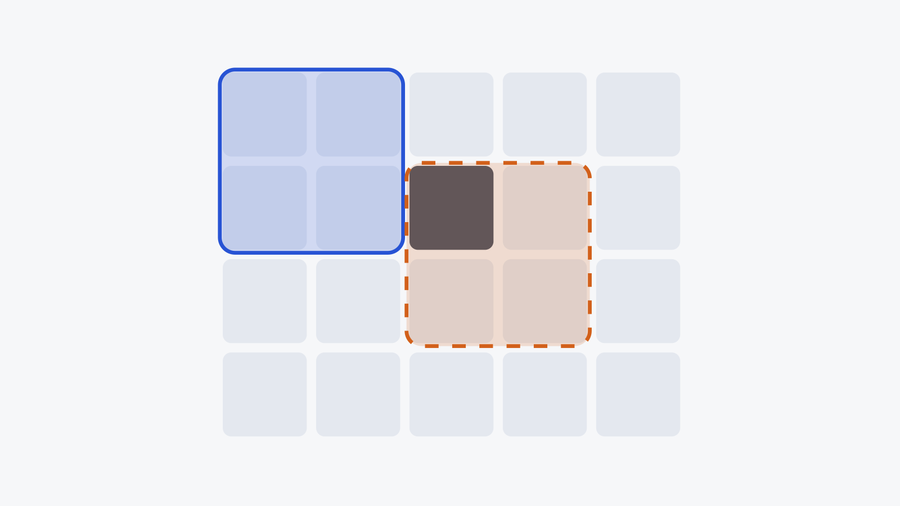

*예제 1번입니다. 파란 자리는 벽이 없어서 놓을 수 있고,  
주황 점선 자리는 벽(진한 칸)을 덮어서 놓을 수 없습니다.  
구역 안의 벽의 수를 누적합으로 세면 바로 알 수 있습니다.*

```cpp
#include <bits/stdc++.h>
#define ibm514 ios::sync_with_stdio(0), cin.tie(0), cout.tie(0);
using namespace std;
typedef long long ll;

int n, m, h, w, sr, sc, fr, fc;
int S[1001][1001];   // 벽의 수를 센 2차원 누적합
int dist[1001][1001];
int dr[4] = {-1, 1, 0, 0}, dc[4] = {0, 0, -1, 1};

// 왼쪽 위 칸이 (r, c)일 때 직사각형을 놓을 수 있는가
bool canPut(int r, int c) {
    if (r < 1 || c < 1 || r + h - 1 > n || c + w - 1 > m) return false;
    int r2 = r + h - 1, c2 = c + w - 1;
    return S[r2][c2] - S[r - 1][c2] - S[r2][c - 1] + S[r - 1][c - 1] == 0;
}

void solve() {
    cin >> n >> m;
    for (int i = 1; i <= n; i++) {
        for (int j = 1; j <= m; j++) {
            int x;
            cin >> x;
            S[i][j] = S[i - 1][j] + S[i][j - 1] - S[i - 1][j - 1] + x;
            dist[i][j] = -1;
        }
    }
    cin >> h >> w >> sr >> sc >> fr >> fc;

    queue<pair<int, int>> q;
    dist[sr][sc] = 0;
    q.push({sr, sc});
    while (!q.empty()) {
        auto [r, c] = q.front();
        q.pop();
        for (int d = 0; d < 4; d++) {
            int nr = r + dr[d], nc = c + dc[d];
            if (!canPut(nr, nc) || dist[nr][nc] != -1) continue;
            dist[nr][nc] = dist[r][c] + 1;
            q.push({nr, nc});
        }
    }
    cout << dist[fr][fc];
}

int main() {
    ibm514
    solve();
    return 0;
}
```

BFS 부분은 평소와 똑같고, 이동할 수 있는지 묻는 함수 하나만 누적합으로 바뀌었습니다.  
탐색의 한 걸음마다 넓은 구역을 검사해야 하는 문제라면 이 조합을 떠올려 볼 만합니다.

### DP의 재료로 쓰기: 소형기관차

[BOJ 2616 소형기관차](https://www.acmicpc.net/problem/2616)입니다.  
객차가 한 줄로 이어져 있고 객차마다 손님 수가 있습니다.  
소형 기관차 3대가 각각 **연속한 K칸 이하**를 끌 수 있을 때, 옮길 수 있는 손님의 최대 수를 구합니다.

손님 수는 음수가 없으니 각 기관차는 K칸을 꽉 채워 끄는 게 좋습니다.  
그러면 겹치지 않는 길이 K짜리 구간 3개를 고르는 문제가 됩니다.

`dp[t][i]`를 “앞에서 i칸까지만 보고 기관차 t대를 썼을 때 가장 많은 손님”이라고 두면,  
i번 칸에 대해 고를 것은 둘입니다.

- i번 칸을 끌지 않는다. `dp[t][i - 1]`과 같습니다.
- i번 칸에서 끝나는 K칸을 t번째 기관차가 끈다.  
그 앞의 `dp[t - 1][i - k]`에 이 K칸의 손님 수를 더합니다.

둘째 경우에 필요한 “K칸의 손님 수”가 구간의 합이고, 여기에 누적합이 들어갑니다.

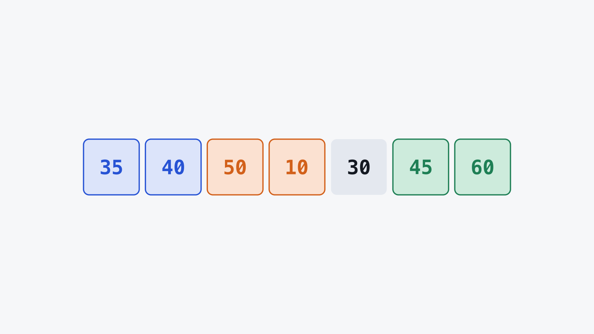

*예제입니다. K가 2일 때 35 + 40, 50 + 10, 45 + 60을 고르면 240명으로 가장 많습니다.*

```cpp
#include <bits/stdc++.h>
#define ibm514 ios::sync_with_stdio(0), cin.tie(0), cout.tie(0);
using namespace std;
typedef long long ll;

int n, k;
int S[50001];
int dp[4][50001]; // dp[t][i]: 앞에서 i칸까지 보고 기관차 t대를 썼을 때 가장 많은 손님

void solve() {
    cin >> n;
    for (int i = 1; i <= n; i++) {
        int x;
        cin >> x;
        S[i] = S[i - 1] + x;
    }
    cin >> k;

    for (int t = 1; t <= 3; t++) {
        for (int i = t * k; i <= n; i++) {
            // i번 칸을 끌지 않거나, i번 칸에서 끝나는 k칸을 끌거나
            dp[t][i] = max(dp[t][i - 1], dp[t - 1][i - k] + S[i] - S[i - k]);
        }
    }
    cout << dp[3][n];
}

int main() {
    ibm514
    solve();
    return 0;
}
```

DP의 점화식에 구간의 합이 들어가는 문제는 아주 많습니다.  
그때마다 반복문으로 더하면 차원이 하나 늘어나니, 누적합을 먼저 만들어 두는 게 습관이 되면 좋습니다.

### DP 표를 누적하기: 짚신벌레

[BOJ 2560 짚신벌레](https://www.acmicpc.net/problem/2560)입니다.  
짚신벌레는 태어난 지 a일째부터 b일째 전날까지 매일 한 마리씩 새끼를 낳고, d일째에 죽습니다.  
한 마리를 넣고 N일째에 살아 있는 수를 1000으로 나눈 나머지를 구합니다. N은 100만까지입니다.

방금은 입력 배열의 누적합을 DP에 썼는데, 이번에는 **DP로 구한 값들의 누적합**이 필요합니다.

`born[i]`를 i일째에 태어난 수라고 합시다.  
i일째에 새끼를 낳는 건 나이가 a 이상 b 미만인 개체들이니,  
태어난 날이 i − b + 1부터 i − a까지인 개체들입니다.  
그러니 `born[i]`는 그 구간의 `born`을 전부 더한 값입니다.

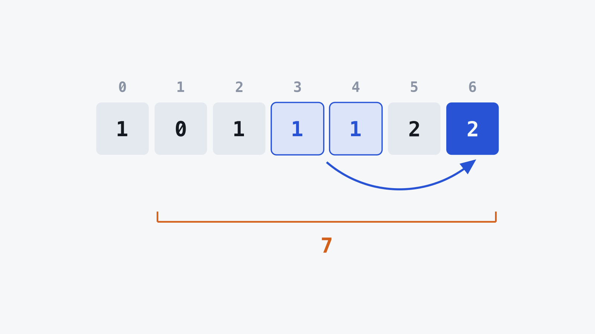

*a = 2, b = 4, d = 6일 때 날마다 태어난 수입니다.  
6일째에 태어나는 수(진한 파랑)는 3일째와 4일째에 태어난 수(파랑)의 합입니다.  
6일째에 살아 있는 것은 1일째부터 6일째까지 태어난 개체들이라 7마리입니다.*

구간의 길이가 최대 1만이라 매번 더하면 100억 번입니다.  
`born`의 누적합 `P`를 **채우면서 동시에** 만들어 가면, 구간의 합이 뺄셈 한 번이 됩니다.

```cpp
#include <bits/stdc++.h>
#define ibm514 ios::sync_with_stdio(0), cin.tie(0), cout.tie(0);
using namespace std;
typedef long long ll;

const int MOD = 1000;
int a, b, d, n;
int P[1000001];   // P[i]: 0일째부터 i일째까지 태어난 개체 수의 합

// 음수 날짜는 아무도 태어나지 않은 것으로 본다
int get(int i) {
    return i < 0 ? 0 : P[i];
}

void solve() {
    cin >> a >> b >> d >> n;

    P[0] = 1;
    for (int i = 1; i <= n; i++) {
        // 오늘 새끼를 낳는 것은 태어난 지 a일 이상 b일 미만인 개체들이다
        int born = (get(i - a) - get(i - b) + MOD) % MOD;
        P[i] = (P[i - 1] + born) % MOD;
    }

    // 살아 있는 것은 태어난 지 d일 미만인 개체들이다
    cout << (get(n) - get(n - d) + MOD) % MOD;
}

int main() {
    ibm514
    solve();
    return 0;
}
```

`born` 배열은 따로 두지 않았습니다. 필요한 건 구간의 합뿐이라 누적합만 있으면 됩니다.

마지막 답도 구간의 합입니다.  
N일째에 살아 있는 건 나이가 d 미만인 개체들, 곧 최근 d일 동안 태어난 개체들이니까요.

나머지를 구한 값끼리 빼면 음수가 될 수 있어서 `MOD`를 한 번 더해 줍니다.

DP의 점화식이 “앞의 값 여러 개의 합”이라면 이 방법으로 차원을 하나 줄일 수 있습니다.  
경우의 수를 세는 DP에서 자주 나오는 모양이에요.

## 고난도: 귀농

[BOJ 1184 귀농](https://www.acmicpc.net/problem/1184)입니다.  
N×N 땅의 칸마다 수익이 적혀 있고, 음수일 수도 있습니다.  
직사각형 모양의 땅 두 개를 고르는데, 두 땅의 수익 합이 같아야 하고 **꼭짓점 하나에서만** 만나야 합니다.  
고르는 방법의 수를 구합니다. N은 50까지입니다.

직사각형 하나가 100만 개쯤 있으니 두 개를 짝지어 보는 건 불가능합니다.  
조건을 이용해서 짝을 좁혀야 해요.

두 땅은 꼭짓점 하나에서 만납니다. 그러면 **그 꼭짓점을 먼저 정하면** 됩니다.  
꼭짓점을 정하면 두 땅의 모양은 두 가지뿐입니다.


*꼭짓점(검은 점)을 정했을 때 두 땅이 놓이는 두 가지 모양입니다.  
왼쪽 위와 오른쪽 아래로 놓이거나, 오른쪽 위와 왼쪽 아래로 놓입니다.*

왼쪽 위 땅은 꼭짓점을 오른쪽 아래 모서리로 하는 직사각형이라, 반대쪽 모서리만 고르면 정해집니다.  
많아야 2,500개예요.  
오른쪽 아래 땅도 마찬가지고요.

이제 수들의 합 4와 같은 일을 합니다.  
왼쪽 위 땅들의 합을 전부 구해서 값마다 개수를 적어 두고,  
오른쪽 아래 땅마다 **합이 같은 왼쪽 위 땅의 수**를 더합니다.

```cpp
#include <bits/stdc++.h>
#define ibm514 ios::sync_with_stdio(0), cin.tie(0), cout.tie(0);
using namespace std;
typedef long long ll;

const int OFFSET = 2500000;
int n;
int S[51][51];
int cnt[2 * OFFSET + 1];   // cnt[s + OFFSET]: 합이 s인 직사각형의 수

int rect(int r1, int c1, int r2, int c2) {
    return S[r2][c2] - S[r1 - 1][c2] - S[r2][c1 - 1] + S[r1 - 1][c1 - 1];
}

void solve() {
    cin >> n;
    for (int i = 1; i <= n; i++) {
        for (int j = 1; j <= n; j++) {
            int x;
            cin >> x;
            S[i][j] = S[i - 1][j] + S[i][j - 1] - S[i - 1][j - 1] + x;
        }
    }

    ll ans = 0;
    // 두 땅이 만나는 꼭짓점: i행과 i+1행 사이, j열과 j+1열 사이
    for (int i = 1; i < n; i++) {
        for (int j = 1; j < n; j++) {
            // 왼쪽 위 땅과 오른쪽 아래 땅
            for (int r = 1; r <= i; r++)
                for (int c = 1; c <= j; c++) cnt[rect(r, c, i, j) + OFFSET]++;
            for (int r = i + 1; r <= n; r++)
                for (int c = j + 1; c <= n; c++) ans += cnt[rect(i + 1, j + 1, r, c) + OFFSET];
            for (int r = 1; r <= i; r++)
                for (int c = 1; c <= j; c++) cnt[rect(r, c, i, j) + OFFSET]--;

            // 오른쪽 위 땅과 왼쪽 아래 땅
            for (int r = 1; r <= i; r++)
                for (int c = j + 1; c <= n; c++) cnt[rect(r, j + 1, i, c) + OFFSET]++;
            for (int r = i + 1; r <= n; r++)
                for (int c = 1; c <= j; c++) ans += cnt[rect(i + 1, c, r, j) + OFFSET];
            for (int r = 1; r <= i; r++)
                for (int c = j + 1; c <= n; c++) cnt[rect(r, j + 1, i, c) + OFFSET]--;
        }
    }
    cout << ans;
}

int main() {
    ibm514
    solve();
    return 0;
}
```

- 합은 −250만부터 250만 사이라서, 맵 대신 배열에 250만을 더한 자리에 적었습니다.  
맵보다 훨씬 빠릅니다.
- 꼭짓점 하나를 끝내면 적어 둔 개수를 다시 빼서 지웁니다.  
배열 전체를 0으로 채우면 그것만으로 시간이 다 갑니다.
- 꼭짓점은 칸과 칸 사이의 점입니다. 코드에서는 i행과 i + 1행 사이, j열과 j + 1열 사이로 잡았습니다.

꼭짓점이 2,500개쯤이고 꼭짓점마다 직사각형을 5,000개쯤 보니 1,000만 번 남짓입니다.

“무엇을 먼저 고정할까”가 이 문제의 전부입니다.  
고정하고 나면 2차원 누적합으로 합을 구하고, 같은 값끼리 세는 익숙한 일만 남습니다.

## 고난도: 다이아몬드 광산

[BOJ 1028 다이아몬드 광산](https://www.acmicpc.net/problem/1028)입니다.  
0과 1로 된 R×C 배열에서, 1로 이루어진 가장 큰 다이아몬드의 크기를 구합니다.  
다이아몬드는 정사각형의 테두리를 45도 돌린 모양입니다. R과 C는 750까지입니다.

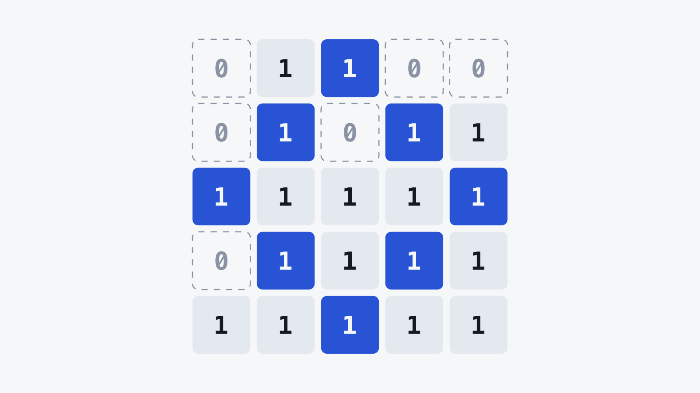

*예제 1번에서 가장 큰 다이아몬드입니다(파랑).  
크기는 한 변에 놓인 칸의 수인 3이고, 네 변이 모두 대각선으로 이어진 1입니다.*

꼭짓점 하나와 크기를 정하면 다이아몬드가 하나 정해집니다.  
그런데 그게 전부 1인지 확인하려면 네 변을 따라가야 해서, 그대로 하면 너무 느립니다.

네 변은 전부 **대각선 방향으로 이어진 1**입니다.  
지금까지는 가로와 세로로만 누적했는데, 이번에는 대각선으로 쌓습니다.  
칸마다 “여기서 왼쪽 아래로 1이 몇 개 이어지는가”와 “오른쪽 아래로 몇 개 이어지는가”를 적어 둡니다.

맨 위 꼭짓점이 (i, j)이고 크기가 k인 다이아몬드는 조건 네 개로 확인됩니다.

- 맨 위 꼭짓점에서 왼쪽 아래로 k개 이상 이어진다.
- 맨 위 꼭짓점에서 오른쪽 아래로 k개 이상 이어진다.
- 왼쪽 꼭짓점에서 오른쪽 아래로 k개 이상 이어진다.
- 오른쪽 꼭짓점에서 왼쪽 아래로 k개 이상 이어진다.

```cpp
#include <bits/stdc++.h>
#define ibm514 ios::sync_with_stdio(0), cin.tie(0), cout.tie(0);
using namespace std;
typedef long long ll;

int R, C;
string g[750];
int dl[752][752];   // dl[i][j]: (i, j)에서 왼쪽 아래로 이어지는 1의 수
int dr[752][752];   // dr[i][j]: (i, j)에서 오른쪽 아래로 이어지는 1의 수

void solve() {
    cin >> R >> C;
    for (int i = 0; i < R; i++) cin >> g[i];

    // 아래 줄부터 채운다. 배열은 한 칸씩 밀어서 가장자리 검사를 없앴다
    for (int i = R; i >= 1; i--) {
        for (int j = 1; j <= C; j++) {
            if (g[i - 1][j - 1] == '0') continue;
            dl[i][j] = dl[i + 1][j - 1] + 1;
            dr[i][j] = dr[i + 1][j + 1] + 1;
        }
    }

    int ans = 0;
    for (int i = 1; i <= R; i++) {
        for (int j = 1; j <= C; j++) {
            // (i, j)를 맨 위 꼭짓점으로 하는 크기 k짜리 다이아몬드
            for (int k = min(dl[i][j], dr[i][j]); k > ans; k--) {
                int left = j - k + 1, right = j + k - 1, mid = i + k - 1;
                if (dr[mid][left] >= k && dl[mid][right] >= k) {
                    ans = k;
                    break;
                }
            }
        }
    }
    cout << ans;
}

int main() {
    ibm514
    solve();
    return 0;
}
```

`dl`과 `dr`은 아래 줄의 값에 1을 더해서 만드니, 아래 줄부터 채웁니다.

크기는 큰 것부터 줄여 가며 확인하고, 지금까지의 답보다 작아지면 그만둡니다.  
답을 키울 수 없는 크기는 볼 필요가 없으니까요. 이 가지치기가 없으면 시간이 빠듯합니다.

엄밀히는 합이 아니라 “이어진 개수”를 쌓은 것이지만, 생각은 같습니다.  
**한 방향으로 미리 훑어서 적어 두고, 물어볼 때는 꺼내 쓰기만 한다**는 것이죠.  
방향은 가로세로가 아니어도 됩니다.

## 자주 하는 실수

- **0번 칸을 비워 두지 않는다.** 배열을 1번부터 쓰고 0번 행과 열을 0으로 두면  
가장자리를 따로 처리할 일이 없습니다.
- `l - 1`**을 **`l`**로 쓴다.** l번째부터의 합이니 빼는 것은 l − 1번째까지의 합입니다.
- `S[0]`**을 빼먹는다.** 맨 앞에서 시작하는 구간은 아무것도 더하지 않은 누적합 0과 짝이 됩니다.
- **나머지를 구한 값끼리 빼고 그대로 쓴다.** 음수가 될 수 있으니 나누는 수를 한 번 더해 줍니다.
- **배열이 바뀌는데 누적합을 쓴다.** 값이 중간에 바뀌는 문제라면 다른 방법을 찾아야 합니다.

## 마무리

1. 앞에서부터 더한 값을 적어 두면 구간의 합은 뺄셈 한 번입니다.  
2차원에서는 두 번 뺀 모서리를 다시 더합니다.
2. 조건에 맞는 칸의 수를 세는 문제는 0과 1로 바꾸면 누적합 문제가 됩니다.
3. 구간에 대한 조건은 누적합 두 개에 대한 조건으로 바꿔 쓸 수 있습니다.  
같은 값끼리 세거나, 앞쪽의 최솟값을 빼거나 합니다.
4. 되돌릴 수 있는 연산이면 더하기가 아니어도 됩니다. 되돌릴 수 없으면 앞뒤에서 하나씩 누적합니다.
5. 정렬, 이분탐색, BFS, DP 안에서 “구간의 합”이 필요한 순간에 부품으로 들어갑니다.  
DP로 구한 값 자체를 누적하기도 합니다.

누적합은 배열이 바뀌지 않을 때 쓰는 방법이라고 했습니다.  
반대로 **구간에 값을 더하는 일이 잔뜩 있고 질문은 마지막에 한 번**이라면,  
누적합을 거꾸로 쓰는 방법이 있습니다.  
그 이야기는 [IMOS 글](https://www.rilog.kr/@iqed/posts/602)에 있습니다.

## 추천 문제

본문에서 본 유형을 그대로 연습할 수 있는 문제들입니다.

1. [BOJ 16139 인간-컴퓨터 상호작용](https://www.acmicpc.net/problem/16139): 글자 종류마다 누적합을 따로 만들기
2. [BOJ 5549 행성 탐사](https://www.acmicpc.net/problem/5549): 같은 것을 2차원에서
3. [BOJ 21318 피아노 체조](https://www.acmicpc.net/problem/21318): 이웃한 두 칸에 대한 조건을 0과 1로 바꾸기
4. [BOJ 19566 수열의 구간 평균](https://www.acmicpc.net/problem/19566): 평균이 K인 구간을 합이 0인 구간으로 바꿔 세기
5. [BOJ 2143 두 배열의 합](https://www.acmicpc.net/problem/2143): 구간의 합을 전부 만들어 놓고 짝 세기
6. [BOJ 20002 사과나무](https://www.acmicpc.net/problem/20002): 2차원 누적합으로 모든 정사각형 보기

여기서부터는 도전 문제입니다. 아래로 갈수록 어려워집니다.

1. [BOJ 21758 꿀 따기](https://www.acmicpc.net/problem/21758): 벌통과 벌의 자리를 경우로 나누고 누적합으로 계산하기
2. [BOJ 1451 직사각형으로 나누기](https://www.acmicpc.net/problem/1451): 나누는 모양 여섯 가지를 전부 보기
3. [BOJ 17232 생명 게임](https://www.acmicpc.net/problem/17232): 주위의 살아 있는 칸을 2차원 누적합으로 세기
4. [BOJ 11066 파일 합치기](https://www.acmicpc.net/problem/11066): 구간을 합치는 DP에서 구간의 합 쓰기
5. [BOJ 21757 나누기](https://www.acmicpc.net/problem/21757): 누적합이 같은 지점을 따라가며 세는 DP
