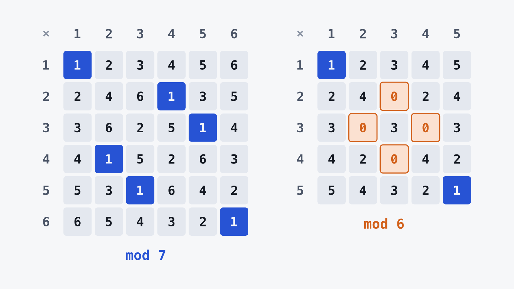
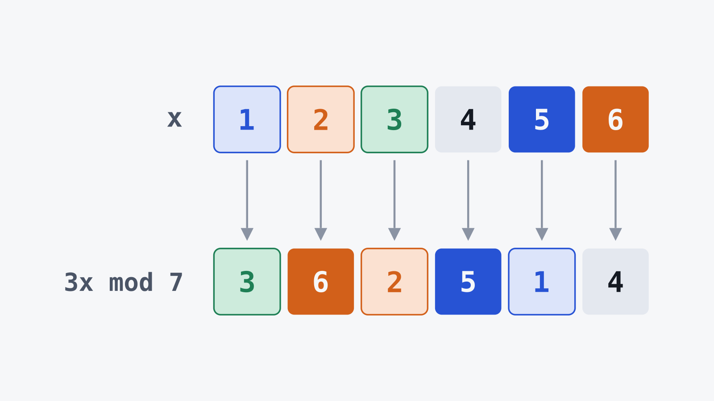
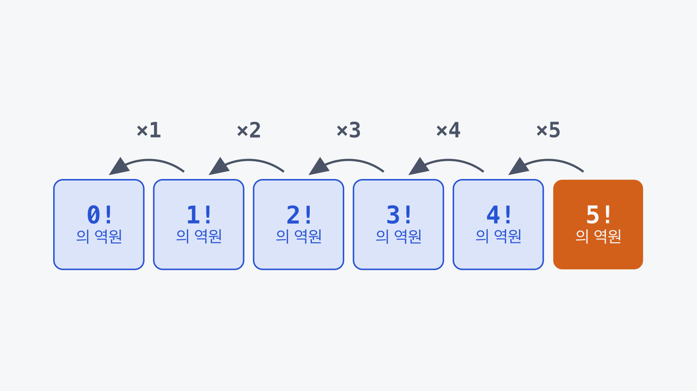
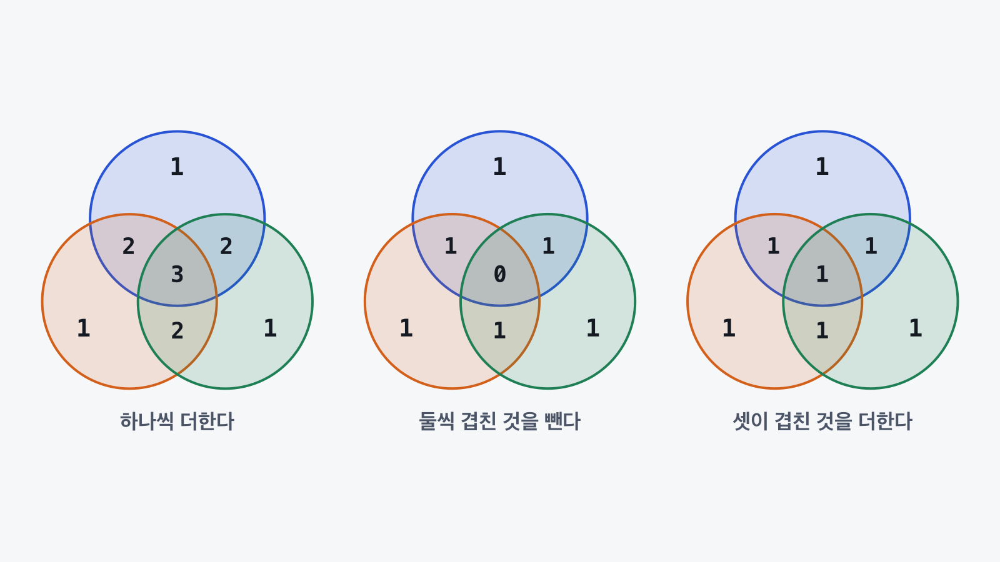
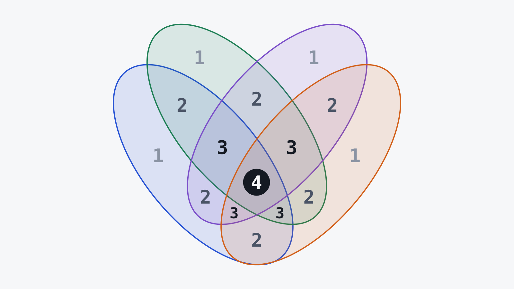
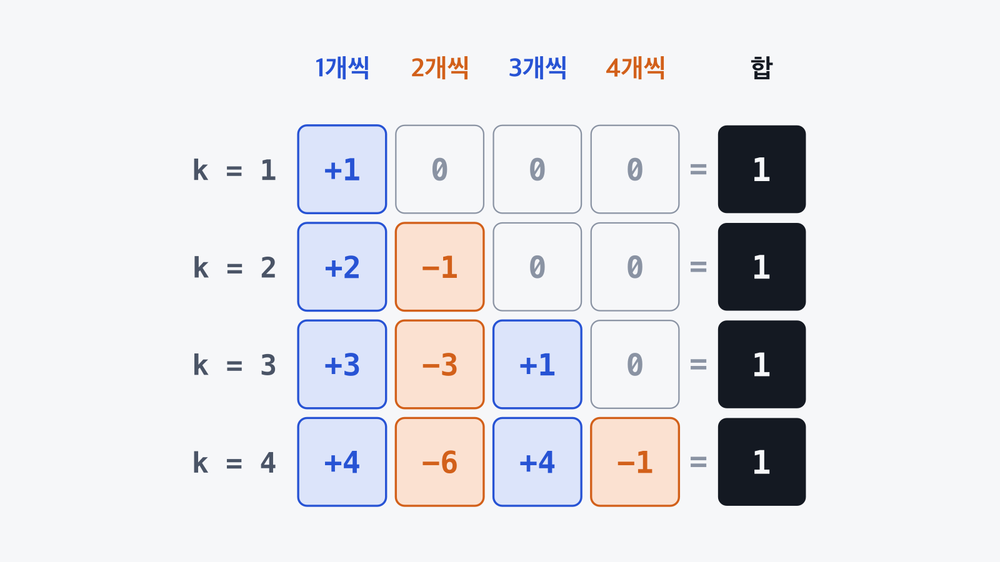
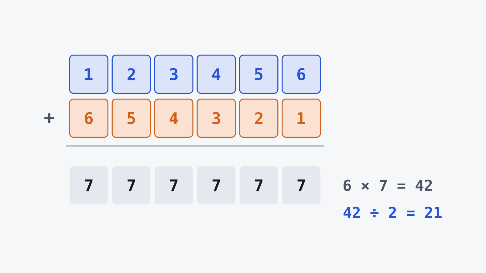
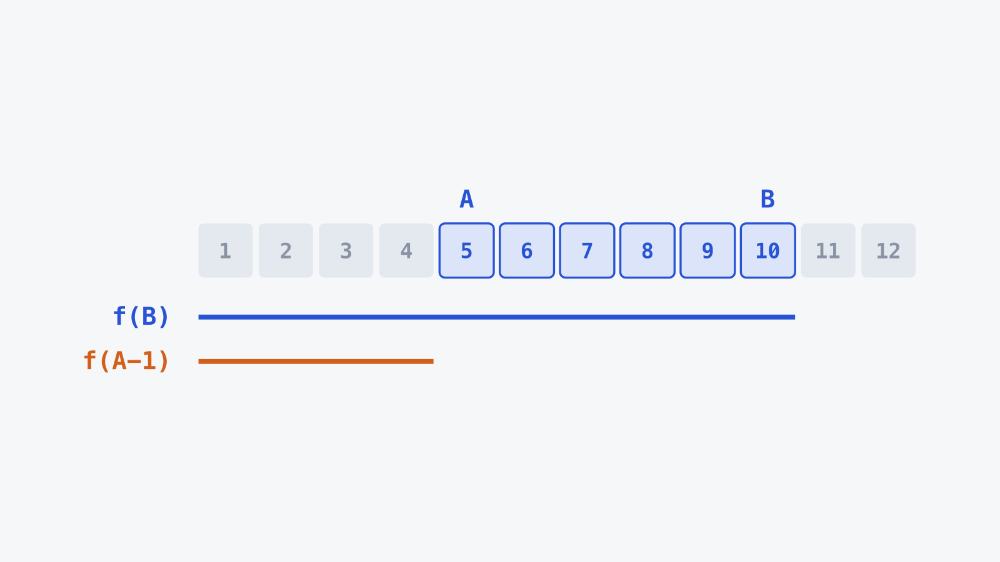

# PS 수학: 심화편

> rilog 발행 글: <https://www.rilog.kr/@iqed/posts/624> (2026-11-25)

안녕하세요 ~ 지난 글에 이어서 PS 수학 이야기를 조금 더 해보려고 합니다.

기본편에서는 나머지 연산의 더하기, 빼기, 곱하기까지 봤습니다.  
그리고 나눗셈은 “그렇게 할 수 없다”고만 하고 넘어갔죠.  
이번 글은 그 나눗셈에서 시작합니다.

이번 글에서는 역원과 포함배제를 다룹니다.  
역원은 나머지에서 나눗셈을 하는 방법이고, 그 뒤에 페르마의 소정리와 유클리드 호제법이 있습니다.  
포함배제는 겹쳐 센 것을 빼고 더해서 바로잡는 방법이에요.

## 나눗셈과 역원

### 나눗셈은 안 된다: Σ

[BOJ 13172 Σ](https://www.acmicpc.net/problem/13172)입니다.  
분수 여러 개를 더한 값을 1,000,000,007로 나눈 나머지로 나타내라는 문제입니다.

기본편에서 더하기, 빼기, 곱하기는 중간에 나머지를 구해도 된다는 걸 봤습니다. 나누기도 될까요?  
`20 ÷ 4 = 5`인데, 7로 나눈 나머지를 먼저 구하면 20은 6이 되고 `6 ÷ 4`는 정수가 아닙니다. 안 되네요.

그래서 나누기를 곱하기로 바꿉니다.  
보통의 수에서 4로 나누는 건 ¼을 곱하는 것과 같죠. ¼은 4와 곱해서 1이 되는 수입니다.  
나머지의 세계에서도 **4와 곱해서 나머지가 1이 되는 수**를 찾아서, 나누는 대신 그걸 곱하면 됩니다.  
이 수를 4의 **역원**이라고 부릅니다.

7로 나눈 나머지에서 4의 역원은 2입니다. `4 × 2 = 8`이고 8의 나머지가 1이니까요.  
확인해 봅시다. 20의 나머지 6에 2를 곱하면 12, 그 나머지는 5입니다. `20 ÷ 4 = 5`와 같죠.

이 문제를 풀려면 역원을 구할 줄 알아야 합니다.  
코드는 한 줄이면 되는데, 그 한 줄이 왜 맞는지를 이번에는 끝까지 따져 보려고 해요.  
조금 길지만 여기를 넘기면 나머지 연산은 더 무서울 게 없습니다.

### 역원은 언제 있을까

역원이 항상 있는 건 아닙니다. 곱셈표를 그려 보면 한눈에 보여요.



*왼쪽은 7로 나눈 나머지의 곱셈표, 오른쪽은 6으로 나눈 나머지의 곱셈표입니다.  
1이 나온 칸을 파랗게 칠했습니다.  
왼쪽은 줄마다 1이 하나씩 있는데, 오른쪽은 2, 3, 4의 줄에 1이 없고 대신 0이 나옵니다.*

왼쪽 표에서 3의 줄을 보면 5의 칸에 1이 있습니다.  
`3 × 5 = 15`이고 15의 나머지가 1이니, 3의 역원은 5입니다.  
7로 나눈 나머지에서는 1부터 6까지 모든 수에 역원이 있어요.

오른쪽 표는 다릅니다. 2의 줄은 2, 4, 0, 2, 4로, 1이 한 번도 안 나옵니다.  
이유는 간단해요. 2에 뭘 곱하든 짝수이고, 6도 짝수라서 6으로 나눈 나머지도 짝수입니다.  
홀수인 1이 나올 수가 없죠.

일반적으로 이렇게 말할 수 있습니다.  
**a와 m이 1보다 큰 공약수를 가지면, a의 역원은 없습니다.**

1. a와 m이 둘 다 d의 배수라고 합시다(d는 1보다 큽니다).
2. `a × x`를 m으로 나눈 몫을 q, 나머지를 r이라고 하면 `r = a × x − q × m`입니다.
3. 오른쪽의 `a × x`도 `q × m`도 d의 배수이니, r도 d의 배수입니다.
4. 1은 d의 배수가 아니니까 r은 1이 될 수 없습니다.

반대로, a와 m의 공약수가 1뿐이면 역원이 **항상** 있습니다. 이건 조금 뒤에서 증명할게요.  
일단 이 사실을 받아들이면, 소수가 왜 특별한지가 보입니다.  
소수 p는 약수가 1과 자기 자신뿐이라, 1부터 p − 1까지의 어떤 수와도 공약수가 1뿐입니다.  
그러니 **소수로 나눈 나머지에서는 0이 아닌 모든 수에 역원이 있습니다.**  
문제들이 1,000,000,007 같은 소수로 나누라고 하는 이유가 이것입니다.

하나 더, 역원은 있다면 **하나뿐**입니다.  
x도 y도 a의 역원이라고 해 봅시다. 그러면 `x × a × y`를 두 가지로 묶을 수 있어요.  
`(x × a) × y`로 묶으면 `1 × y = y`이고, `x × (a × y)`로 묶으면 `x × 1 = x`입니다.  
같은 값을 계산한 것이니 x와 y는 나머지가 같습니다. 곱셈표에서 줄마다 1이 딱 한 번씩만 나오는 이유죠.

### 페르마의 소정리

역원이 있다는 건 알았는데, 곱셈표를 다 그려서 찾을 수는 없습니다. p가 10억쯤 되니까요.  
여기서 페르마의 소정리가 등장합니다.

**p가 소수이고 a가 p의 배수가 아니면, a를 p − 1번 곱한 수를 p로 나눈 나머지는 1이다.**

p = 7, a = 3으로 따라가 보겠습니다. 3을 6번 곱한 729를 7로 나눈 나머지가 1이라는 주장입니다.



*곱셈표에서 3의 줄만 떼어 냈습니다. 1부터 6까지에 3을 곱하고 7로 나눈 나머지를 구하면,  
아래 줄에도 1부터 6까지가 순서만 바뀌어 한 번씩 나옵니다.*

**첫 번째 단계. 아래 줄에는 같은 수가 두 번 나오지 않습니다.**

만약 `3 × x`와 `3 × y`의 나머지가 같다고 해 봅시다(x가 더 크다고 하죠).  
나머지가 같으면 차가 7의 배수입니다. 그러니 `3 × (x − y)`가 7의 배수예요.  
여기서 소수의 성질을 하나 씁니다.

**곱이 소수의 배수이면, 곱한 두 수 중 하나는 그 소수의 배수입니다.** (이것도 뒤에서 증명합니다.)  
3은 7의 배수가 아니니 `x − y`가 7의 배수여야 하죠.  
그런데 x와 y는 1부터 6 사이의 수라서 차이가 0부터 5 사이입니다.  
그중 7의 배수는 0뿐이니 x와 y는 같은 수입니다.

곧, x가 다르면 `3 × x`의 나머지도 반드시 다릅니다.  
0이 나올 수도 없습니다. `3 × x`가 7의 배수가 되려면 3이나 x가 7의 배수여야 하는데 둘 다 아니니까요.  
1부터 6까지 여섯 칸에 서로 다른 값 여섯 개가 들어가니,  
아래 줄은 1부터 6까지를 섞어 놓은 것일 수밖에 없습니다.

**두 번째 단계. 양쪽 줄을 전부 곱합니다.**

아래 줄을 전부 곱하면 `(3×1) × (3×2) × … × (3×6) = 3⁶ × 6!`입니다.  
그런데 아래 줄은 나머지로 보면 1부터 6까지를 섞은 것이니,  
전부 곱한 것의 나머지는 `6!`의 나머지와 같습니다.  
그러니 `3⁶ × 6!`과 `6!`은 7로 나눈 나머지가 같습니다.

**세 번째 단계. 양쪽에서 6!을 지웁니다.**

나머지가 같으니 차인 `(3⁶ − 1) × 6!`이 7의 배수입니다.  
`6!`은 1부터 6까지의 곱인데, 그중 7의 배수는 하나도 없으니 `6!`도 7의 배수가 아닙니다.  
같은 성질을 한 번 더 쓰면 `3⁶ − 1`이 7의 배수여야 하죠.  
곧 `3⁶`**을 7로 나눈 나머지는 1**입니다. 실제로 `3⁶ = 729 = 104 × 7 + 1`이에요.

7과 3 대신 아무 소수 p와 p의 배수가 아닌 a를 넣어도 위의 세 단계는 한 글자도 바뀌지 않습니다.  
표의 칸이 6개에서 p − 1개로 늘어날 뿐이에요.  
그래서 일반적으로 `a`를 `p − 1`번 곱하면 나머지가 1이 됩니다.

**네 번째 단계. 역원을 읽어 냅니다.**

`a`를 `p − 1`번 곱한 것은 `a × (a를 p − 2번 곱한 것)`입니다.  
a에 뭔가를 곱했더니 나머지가 1이 됐네요. 그 뭔가가 바로 a의 역원입니다.

**p가 소수이면, a의 역원은 a를 p − 2번 곱한 것이다.**

문제의 지문에 나오는 예로 확인해 볼까요. 11로 나눈 나머지에서 3의 역원이 4라고 되어 있습니다.  
`3⁹ = 19683 = 1789 × 11 + 4`이니 3을 9번 곱한 것의 나머지가 정말 4입니다.  
`3 × 4 = 12`의 나머지도 1이고요.

`p − 2`가 10억쯤 되어도 걱정 없습니다. 기본편에서 만든 빠른 거듭제곱으로 30번 남짓 곱하면 끝나니까요.

### 분수를 나머지로 바꿔도 덧셈이 맞을까

이제 분수 `a / b`를 `a × (b의 역원)`이라는 수 하나로 바꿀 수 있습니다.  
그런데 이 문제는 분수 여러 개를 **더한** 값을 묻습니다.  
분수를 하나씩 수로 바꿔서 더한 것과, 분수끼리 먼저 통분해서 더한 뒤에 수로 바꾼 것이 같을까요?

7로 나눈 나머지에서 `1/2 + 1/3`을 해 봅시다.  
2의 역원은 4, 3의 역원은 5이니 하나씩 바꾸면 `4 + 5 = 9`, 나머지는 2입니다.  
통분하면 `1/2 + 1/3 = 5/6`이고, 6의 역원은 6이니 `5 × 6 = 30`, 나머지는 2입니다. 같네요.

항상 같다는 것도 보일 수 있습니다.  
`a/b + c/d = (a×d + b×c) / (b×d)`이니, 보여야 할 건 이것입니다.

`a × (b의 역원) + c × (d의 역원)`과 `(a×d + b×c) × (b×d의 역원)`은 나머지가 같다.

1. 양쪽에 `b × d`를 곱해 봅니다.
2. 왼쪽은 `a × d × (b × b의 역원) + c × b × (d × d의 역원)`이 됩니다.  
괄호 안은 둘 다 1이니 `a × d + b × c`가 남습니다.
3. 오른쪽은 `(a×d + b×c) × (b×d의 역원 × b×d)`이고,  
역시 괄호 안이 1이라 `a × d + b × c`가 남습니다.
4. `b × d`를 곱한 결과가 같습니다.  
이제 양쪽에 `b × d`의 역원을 곱해 원래대로 돌리면, 처음의 두 값도 나머지가 같습니다.

약분을 안 해도 된다는 것도 같은 식으로 확인됩니다.  
`2/4`를 바꾸면 `2 × (4의 역원)`인데,  
4의 역원은 `(2의 역원) × (2의 역원)`이라 2가 하나 지워지고 `1 × (2의 역원)`,  
곧 `1/2`을 바꾼 것과 같아집니다.  
그래서 기약분수로 만들 필요 없이, 분수를 하나씩 바꿔서 더하기만 하면 됩니다.

```cpp
#include <bits/stdc++.h>
#define ibm514 ios::sync_with_stdio(0), cin.tie(0), cout.tie(0);
using namespace std;
typedef long long ll;
const ll MOD = 1e9 + 7;

ll power(ll a, ll b) {
    ll res = 1;
    a %= MOD;
    while (b > 0) {
        if (b & 1) res = res * a % MOD;
        a = a * a % MOD;
        b >>= 1;
    }
    return res;
}

// x로 나누는 대신 곱할 수
ll inv(ll x) { return power(x, MOD - 2); }

void solve() {
    int m;
    cin >> m;
    ll ans = 0;
    while (m--) {
        ll n, s;
        cin >> n >> s;
        ans = (ans + s % MOD * inv(n)) % MOD;   // s / n 대신 s × inv(n)
    }
    cout << ans;
}

int main() {
    ibm514
    solve();
    return 0;
}
```

`s / n`을 `s × inv(n)`으로 바꾼 것이 코드의 전부입니다.  
짧지만, 이 한 줄 뒤에 지금까지의 이야기가 전부 들어 있는 거죠.

### 소수가 아닐 때: 역원(Inverse) 구하기

[BOJ 14565 역원(Inverse) 구하기](https://www.acmicpc.net/problem/14565)입니다.  
N과 A가 주어집니다.  
N으로 나눈 나머지에서 A의 덧셈 역원(더해서 0이 되는 수)과 곱셈 역원(곱해서 1이 되는 수)을 구합니다.  
곱셈 역원이 없으면 -1을 출력합니다.  
N은 10¹²까지이고, **소수라는 보장이 없습니다.**

덧셈 역원은 `N − A`입니다. 더하면 N이 되고 나머지가 0이니까요.  
문제는 곱셈 역원입니다. N이 소수가 아니면 페르마의 소정리를 쓸 수 없어요.  
여기서 쓰는 것이 유클리드 호제법입니다.  
그리고 이걸 따라가다 보면, 앞에서 “뒤에서 증명한다”고 미뤄 둔 것들이 한꺼번에 풀립니다.

기본편의 검문 문제에서 본 유클리드 호제법을 다시 꺼냅니다.  
a와 b의 최대공약수는, b와 (a를 b로 나눈 나머지)의 최대공약수와 같았죠.

예제의 26과 11로 해 보면 이렇습니다. 나머지가 0이 될 때까지 되풀이해요.

- `26 = 2 × 11 + 4`
- `11 = 2 × 4 + 3`
- `4 = 1 × 3 + 1`
- `3 = 3 × 1 + 0`

마지막으로 나눈 수 1이 최대공약수입니다. 26과 11은 공약수가 1뿐이네요.

**이제 이 식들을 거꾸로 올라갑니다.**

세 번째 줄을 1에 대해 풀면 `1 = 4 − 1 × 3`입니다.  
여기 나온 3은 두 번째 줄에서 `3 = 11 − 2 × 4`였죠.  
넣으면 `1 = 4 − (11 − 2 × 4) = 3 × 4 − 11`입니다.  
여기 나온 4는 첫 번째 줄에서 `4 = 26 − 2 × 11`이었습니다.  
넣으면 `1 = 3 × (26 − 2 × 11) − 11 = 3 × 26 − 7 × 11`입니다.

`11 × (−7) + 26 × 3 = 1`이 나왔습니다.  
`26 × 3`은 26의 배수라 나머지에 영향이 없으니, `11 × (−7)`**을 26으로 나눈 나머지가 1**입니다.  
−7이 11의 역원이에요. 0 이상으로 맞추려고 26을 더하면 19이고, 예제의 답과 같습니다.  
실제로 `11 × 19 = 209 = 8 × 26 + 1`이죠.

이 과정은 어떤 두 수로 해도 똑같이 됩니다.  
나머지는 항상 “앞의 두 수를 몇 배씩 해서 뺀 것”이니,  
거꾸로 올라가면 맨 마지막의 최대공약수를 처음 두 수로 나타낼 수 있어요.

**어떤 a와 b에 대해서도, **`a × x + b × y = (a와 b의 최대공약수)`**가 되는 정수 x와 y가 있다.**

이걸 찾아 주는 것이 확장 유클리드 호제법입니다. 그리고 여기서 미뤄 둔 세 가지가 바로 나옵니다.

**미뤄 둔 것 하나. 공약수는 전부 최대공약수의 약수다.**

d가 a와 b의 공약수라면 `a × x`도 `b × y`도 d의 배수입니다.  
둘을 더한 것이 최대공약수이니, 최대공약수도 d의 배수입니다.  
기본편의 검문에서 빌려 쓴 사실이 이것이었죠.

**미뤄 둔 것 둘. 공약수가 1뿐이면 역원은 항상 있다.**

a와 m의 최대공약수가 1이면 `a × x + m × y = 1`인 x와 y가 있습니다.  
`m × y`는 m의 배수이니, `a × x`를 m으로 나눈 나머지가 1입니다. x가 a의 역원이죠.  
m이 소수든 아니든 상관없습니다.

**미뤄 둔 것 셋. 곱 **`a × b`**가 소수 p의 배수이면, a나 b 중 하나는 p의 배수다.**

1. a가 p의 배수가 아니라고 합시다. b가 p의 배수임을 보이면 됩니다.
2. p는 소수라서 약수가 1과 p뿐입니다. a가 p의 배수가 아니니, a와 p의 최대공약수는 1입니다.
3. 그러면 `a × x + p × y = 1`인 x와 y가 있습니다.
4. 양쪽에 b를 곱하면 `a × b × x + p × b × y = b`입니다.
5. 왼쪽의 첫 항은 `a × b`가 p의 배수이니 p의 배수이고, 둘째 항은 p가 곱해져 있으니 p의 배수입니다.
6. p의 배수 둘을 더한 것이 b이니, b는 p의 배수입니다.

이걸로 기본편의 검문과 페르마의 소정리 증명에서 빌려 쓴 것까지 다 갚았습니다.  
처음부터 끝까지 쓴 건 `a = q × m + r`이라는 나눗셈의 식 하나뿐이에요.

```cpp
#include <bits/stdc++.h>
#define ibm514 ios::sync_with_stdio(0), cin.tie(0), cout.tie(0);
using namespace std;
typedef long long ll;

// a × x + b × y = g 가 되는 x, y를 찾고, g(a와 b의 최대공약수)를 돌려준다
ll egcd(ll a, ll b, ll &x, ll &y) {
    if (b == 0) {
        x = 1, y = 0;                  // a × 1 + 0 × 0 = a
        return a;
    }
    ll x1, y1;
    ll g = egcd(b, a % b, x1, y1);     // b × x1 + (a % b) × y1 = g
    x = y1;              // a % b = a - (a / b) × b 를 넣고 a와 b로 묶은 결과
    y = x1 - a / b * y1;
    return g;
}

void solve() {
    ll n, a;
    cin >> n >> a;
    ll x, y;
    ll g = egcd(a, n, x, y);           // a × x + n × y = g
    cout << n - a << ' ';
    if (g != 1) cout << -1;            // 공약수가 있으면 역원이 없다
    else cout << (x % n + n) % n;      // x가 음수일 수 있어서 0 이상으로 맞춘다
}

int main() {
    ibm514
    solve();
    return 0;
}
```

재귀가 하는 일은 방금 손으로 한 “거꾸로 올라가기”입니다.  
안쪽 호출이 `b × x1 + (a % b) × y1 = g`를 만들어 오면,  
`a % b` 자리에 `a − (a / b) × b`를 넣고 a와 b끼리 묶습니다.  
그러면 `a × y1 + b × (x1 − (a / b) × y1) = g`가 되어,  
a 앞의 수는 `y1`, b 앞의 수는 `x1 − (a / b) × y1`이 됩니다.

두 방법을 나란히 놓으면 이렇습니다.

- **페르마의 소정리**: 나누는 수가 소수일 때만 쓸 수 있습니다.  
거듭제곱 함수만 있으면 되니 코드가 짧습니다.
- **확장 유클리드**: 나누는 수가 소수가 아니어도 됩니다.  
최대공약수가 1이 아니면 역원이 없다는 것까지 알려 줍니다.

대부분의 문제는 소수로 나누라고 하니 페르마 쪽을 쓰면 되고,  
소수가 아닌 수가 나오면 확장 유클리드를 꺼내면 됩니다.

### 미리 구해 두기: 이항 계수 3

[BOJ 11401 이항 계수 3](https://www.acmicpc.net/problem/11401)입니다.  
N개 중에서 K개를 고르는 경우의 수를 1,000,000,007로 나눈 나머지를 구합니다. N은 400만까지입니다.

고르는 경우의 수는 `N! ÷ (K! × (N − K)!)`입니다.  
나눗셈이 있으니 방금 배운 대로 역원을 곱하면 되죠.  
`N! × (K!의 역원) × ((N − K)!의 역원)`입니다.

이 문제는 한 번만 구하면 되지만, 실전에서는 조합을 수천 번씩 구해야 할 때가 많습니다.  
그때마다 거듭제곱으로 역원을 구하면 느리니, **모든 팩토리얼의 역원을 미리 표로 만들어 둡니다.**  
그러면 조합 하나가 곱셈 두 번으로 끝나요.

역원 표를 채울 때도 거듭제곱은 한 번이면 됩니다.  
`N!`의 역원만 거듭제곱으로 구하고, 나머지는 곱셈으로 내려옵니다.



*5!의 역원(주황) 하나만 거듭제곱으로 구합니다.  
거기에 5를 곱하면 4!의 역원, 다시 4를 곱하면 3!의 역원이 됩니다.*

왜 `i!의 역원`에 i를 곱하면 `(i − 1)!의 역원`이 될까요?

1. `i!`에 그 역원을 곱하면 나머지가 1입니다. 역원의 뜻이 그거니까요.
2. `i! = (i − 1)! × i`이니, `(i − 1)! × i × (i!의 역원)`의 나머지가 1입니다.
3. 묶는 순서를 바꾸면 `(i − 1)! × (i × (i!의 역원))`입니다.  
`(i − 1)!`에 괄호 안의 수를 곱했더니 1이 됐네요.
4. 곱해서 1이 되는 수가 역원이니, `i × (i!의 역원)`이 바로 `(i − 1)!`의 역원입니다.

```cpp
#include <bits/stdc++.h>
#define ibm514 ios::sync_with_stdio(0), cin.tie(0), cout.tie(0);
using namespace std;
typedef long long ll;
const ll MOD = 1e9 + 7;
const int MX = 4000001;
ll fact[MX], ifact[MX];   // fact[i] = i!, ifact[i] = i!의 역원

ll power(ll a, ll b) {
    ll res = 1;
    a %= MOD;
    while (b > 0) {
        if (b & 1) res = res * a % MOD;
        a = a * a % MOD;
        b >>= 1;
    }
    return res;
}

void solve() {
    int n, k;
    cin >> n >> k;
    fact[0] = 1;
    for (int i = 1; i <= n; ++i) fact[i] = fact[i - 1] * i % MOD;
    // 역원은 맨 끝에서 한 번만 구하고
    ifact[n] = power(fact[n], MOD - 2);                                
    // 거꾸로 내려오면서 채운다
    for (int i = n; i >= 1; --i) ifact[i - 1] = ifact[i] * i % MOD;    
    cout << fact[n] * ifact[k] % MOD * ifact[n - k] % MOD;
}

int main() {
    ibm514
    solve();
    return 0;
}
```

`fact`는 앞에서부터, `ifact`는 뒤에서부터 채웁니다.  
조합이 여러 번 필요한 문제를 만나면 이 두 배열부터 만들어 놓고 시작하면 됩니다.

## 포함배제

### 겹친 것을 빼고 더하기: 소수의 배수

[BOJ 17436 소수의 배수](https://www.acmicpc.net/problem/17436)입니다.  
소수 N개가 주어집니다.  
1부터 M까지의 수 중에서 이 소수들 중 적어도 하나로 나누어떨어지는 수가 몇 개인지 셉니다.  
M은 10¹²까지입니다.

소수가 2와 3 두 개이고 M이 100이라고 해 봅시다.  
2의 배수는 50개, 3의 배수는 33개입니다. 더하면 83개인데, 이건 틀렸어요.  
6이나 12처럼 **둘 다의 배수**인 수를 두 번 셌기 때문입니다.  
6의 배수는 16개이니 한 번 빼 주면 `50 + 33 − 16 = 67`개가 됩니다.

두 개일 때는 쉽습니다. 세 개부터가 헷갈려요.

**원이 세 개일 때**

소수가 2, 3, 5이고 M이 30이라고 합시다.  
원 하나가 한 소수의 배수들입니다. 영역마다 “지금까지 몇 번 세어졌는지”를 적어 가며 따라가 볼게요.



*원 세 개가 2, 3, 5의 배수입니다. 영역에 적힌 수는 그 영역의 수들이 지금까지 세어진 횟수예요.  
하나씩 더하면 겹친 곳이 2번, 3번 세어지고(왼쪽), 둘씩 겹친 것을 빼면 가운데가 0번이 되고(가운데),  
셋이 겹친 것을 더하면 전부 1번이 됩니다(오른쪽).*

1. **하나씩 더합니다.** 2의 배수 15개, 3의 배수 10개, 5의 배수 6개를 더해 31입니다.  
이때 두 원이 겹친 곳은 2번, 세 원이 겹친 가운데는 3번 세어졌습니다.
2. **둘씩 겹친 것을 뺍니다.** 6의 배수 5개, 10의 배수 3개, 15의 배수 2개를 빼서 21입니다.  
두 원이 겹친 곳은 1번으로 맞춰졌는데, 가운데는 세 번이나 빠져서 0번이 됐어요.  
가운데는 세 쌍 모두에. 들어 있으니까요.
3. **셋이 겹친 것을 더합니다.** 30의 배수 1개를 더해 22입니다. 이제 모든 영역이 정확히 1번입니다.

답은 22개입니다. 30 이하에서 2, 3, 5 어느 것으로도 안 나누어지는 수는  
1, 7, 11, 13, 17, 19, 23, 29의 8개이니, `30 − 8 = 22`로 맞습니다.

**네 개일 때**

하나 더 늘려서 2, 3, 5, 7이라고 합시다.  
원 네 개로는 모든 겹침을 그릴 수 없어서 길쭉한 타원을 씁니다.



*집합 네 개를 타원으로 그렸습니다.  
영역은 모두 15개이고, 적힌 수는 그 영역이 몇 개의 집합에 속하는지입니다.  
가운데 검은 칸이 네 집합 모두에 속하는 곳이에요.*

영역이 15개나 되니 그림 위에서 횟수를 세어 가며 따라가기는 어렵습니다.  
그런데 잘 보면 영역의 **위치는 중요하지 않습니다.** 중요한 건 그 영역이 집합 몇 개에 속하느냐뿐이에요.  
집합 k개에 속한 영역은, 그 k개 중에서 고른 묶음에만 등장합니다.  
그러니 k별로 표를 만들면 됩니다.



*k개의 집합에 속한 수가 단계마다 몇 번 더해지고 빠지는지입니다.  
예를 들어 세 집합에 속한 수(k = 3)는 1개씩 볼 때 3번 더해지고, 2개씩 볼 때 3번 빠지고,  
3개씩 볼 때 1번 더해집니다. 어느 줄이든 합은 1입니다.*

표의 칸은 “k개 중에서 j개를 고르는 방법의 수”입니다.  
k = 4인 줄을 보면, 네 집합 모두에 속한 수는 1개씩 볼 때 4번,  
2개씩 볼 때 6번, 3개씩 볼 때 4번, 4개씩 볼 때 1번 등장합니다.  
`4 − 6 + 4 − 1 = 1`. 역시 한 번이네요.

실제 수로도 확인해 봅시다. M을 210으로 잡으면 이렇습니다.

- 1개씩: `105 + 70 + 42 + 30 = 247`
- 2개씩: `35 + 21 + 15 + 14 + 10 + 6 = 101`
- 3개씩: `7 + 5 + 3 + 2 = 17`
- 4개씩: `1`

`247 − 101 + 17 − 1 = 162`개입니다.

규칙이 보이죠. **홀수 개를 골라 겹친 것은 더하고, 짝수 개를 골라 겹친 것은 뺍니다.**  
이게 포함배제의 원리입니다.

**집합이 몇 개든 되는 이유**

표의 모든 줄이 1이 된다는 건 네 개까지만 확인했습니다.  
다섯 개, 열 개일 때도 그럴까요? 표를 계속 그릴 수는 없으니 한 번에 보여야 합니다.

집합 k개에 속한 수가 세어지는 횟수는 이렇게 쓸 수 있습니다.

`(1개 고르기) − (2개 고르기) + (3개 고르기) − … (k개 고르기까지)`

이게 항상 1이라는 것은 `(1 − 1)`을 k번 곱해 보면 알 수 있습니다.

`(1 − 1) × (1 − 1) × … × (1 − 1)`을 전개한다는 건,  
괄호마다 1과 −1 중 하나를 골라 곱한 것을 전부 더한다는 뜻입니다.  
−1을 고른 괄호가 j개면 그 항은 j가 짝수일 때 +1,  
홀수일 때 −1이고, 그런 항은 k개 중 j개를 고르는 방법의 수만큼 있습니다.  
그러니 전개한 결과는 이렇게 됩니다.

`(0개 고르기) − (1개 고르기) + (2개 고르기) − (3개 고르기) + …`

그런데 `(1 − 1)`은 0이니 이 값 전체가 0입니다.  
0개를 고르는 방법은 딱 한 가지이니, 그 항만 남기고 나머지를 반대편으로 넘기면 이렇게 됩니다.

`(1개 고르기) − (2개 고르기) + (3개 고르기) − … = 1`

왼쪽이 바로 우리가 그 수를 센 횟수입니다. 그러니 k가 몇이든 정확히 한 번 세어집니다.  
표의 k = 4인 줄로 보면 `1 − 4 + 6 − 4 + 1 = 0`이고,  
맨 앞의 1을 넘기면 `4 − 6 + 4 − 1 = 1`이 되는 거예요.

이제 코드로 옮기면 됩니다.  
“소수를 하나 이상 고르는 모든 방법”은 N자리 2진법 수로 셉니다. 기본편의 진법에서 본 방법이고,  
비트가 1이면 그 소수를 고른 거예요.  
고른 소수들 모두의 배수는 그 **곱의 배수**이고(서로 다른 소수들이니까요),  
1부터 M까지에 `M ÷ 곱`개 있습니다.

```cpp
#include <bits/stdc++.h>
#define ibm514 ios::sync_with_stdio(0), cin.tie(0), cout.tie(0);
using namespace std;
typedef long long ll;
int n;
ll m, p[10];

void solve() {
    cin >> n >> m;
    for (int i = 0; i < n; ++i) cin >> p[i];
    ll ans = 0;
    // 소수를 하나 이상 고르는 모든 방법
    for (int mask = 1; mask < (1 << n); ++mask) {   
        ll prod = 1;
        int cnt = 0;
        for (int i = 0; i < n; ++i) {
            if (!(mask >> i & 1)) continue;
            ++cnt;
            prod *= p[i];
            if (prod > m) break;               // 더 곱해 봐야 배수가 하나도 없다
        }
        ll mul = prod > m ? 0 : m / prod;      // 고른 소수 모두의 배수의 개수
        if (cnt % 2 == 1) ans += mul;          // 홀수 개를 골랐으면 더하고
        else ans -= mul;                       // 짝수 개를 골랐으면 뺀다
    }
    cout << ans;
}

int main() {
    ibm514
    solve();
    return 0;
}
```

소수 10개를 다 곱하면 `long long`도 넘칠 수 있습니다.  
그래서 곱이 M을 넘는 순간 멈췄어요. 그런 곱의 배수는 M 이하에 하나도 없으니 0으로 치면 됩니다.

### 개수 대신 합: 준석이의 수학 숙제

[BOJ 17206 준석이의 수학 숙제](https://www.acmicpc.net/problem/17206)입니다.  
N 이하의 수 중에서 3 또는 7의 배수를 **모두 더한 값**을 구합니다. 이런 질문이 10만 개까지 들어옵니다.

개수가 아니라 합이지만 포함배제는 그대로 통합니다.  
3의 배수의 합과 7의 배수의 합을 더하면, 21의 배수가 두 번 더해집니다. 한 번 빼 주면 되죠.  
세는 것이든 더하는 것이든 “두 번 들어간 것을 한 번 뺀다”는 건 똑같으니까요.

남은 건 “N 이하의 d의 배수의 합”을 빨리 구하는 것입니다.  
d의 배수는 `d, 2d, 3d, …, kd`이고 k는 `N ÷ d`입니다. d로 묶으면 `d × (1 + 2 + … + k)`예요.  
1부터 k까지의 합은 `k × (k + 1) ÷ 2`입니다.



*1부터 6까지를 한 번은 그대로, 한 번은 거꾸로 써서 위아래로 더하면 칸마다 7이 됩니다.  
여섯 칸이니 42이고, 같은 것을 두 번 더했으니 절반인 21이 구하는 합입니다.*

공식의 이유는 그림 그대로입니다.  
1부터 k까지를 거꾸로 뒤집어 한 번 더 쓰면, 위아래로 짝지은 합이 전부 `k + 1`입니다.  
그런 칸이 k개이니 `k × (k + 1)`이고, 같은 수열을 두 번 더한 것이니 2로 나눕니다.

```cpp
#include <bits/stdc++.h>
#define ibm514 ios::sync_with_stdio(0), cin.tie(0), cout.tie(0);
using namespace std;
typedef long long ll;

// n 이하의 d의 배수를 모두 더한 값
ll sumMul(ll n, ll d) {
    ll k = n / d;                  // 배수의 개수: d, 2d, ..., kd
    return d * (k * (k + 1) / 2);  // d × (1 + 2 + ... + k)
}

void solve() {
    int T;
    cin >> T;
    while (T--) {
        ll n;
        cin >> n;
        // 두 번 더한 21의 배수를 한 번 뺀다
        cout << sumMul(n, 3) + sumMul(n, 7) - sumMul(n, 21) << '\n';  
    }
}

int main() {
    ibm514
    solve();
    return 0;
}
```

이 공식을 쓸 때 조심할 곳이 두 군데 있습니다.

- **곱이 넘칩니다.** `k × (k + 1)`은 k가 30억쯤만 되어도 `long long`을 넘습니다.  
k가 `int`라면 5만 근처에서 벌써 넘쳐요. 곱하기 전에 자료형부터 확인해야 합니다.
- **나머지와 같이 쓸 때 2로 나눌 수 없습니다.** 나머지를 구한 뒤에는 나눗셈이 안 된다고 했죠.  
`k`와 `k + 1` 중 짝수인 쪽을 먼저 2로 나눈 다음에 곱하거나, 2의 역원을 곱해야 합니다.

### 고난도: 서로소

[BOJ 9359 서로소](https://www.acmicpc.net/problem/9359)입니다. 골드 1 문제예요.  
A 이상 B 이하의 수 중에서 N과 서로소인 수가 몇 개인지 구합니다.  
서로소는 공통된 약수가 1뿐이라는 뜻입니다.  
B는 10¹⁵까지, N은 10⁹까지입니다.

하나씩 최대공약수를 구해 볼 수는 없는 크기입니다.  
지금까지 배운 것 세 가지를 차례로 써서 풉니다.

**첫째, 서로소를 배수 문제로 바꿉니다.**

어떤 수가 N과 서로소가 아니라는 건, N과 공통된 소인수가 있다는 뜻입니다.  
곧 N의 소인수 중 하나로 나누어떨어진다는 거죠.  
그러니 “N의 소인수 중 적어도 하나의 배수인 수”를 세서 전체에서 빼면 됩니다.  
기본편에서 본 거꾸로 세기이고, 빼는 쪽은 소수의 배수 문제와 똑같아요.

**둘째, N을 소인수분해합니다.**

2부터 차례로 나눠 보되, `d × d`가 N 이하일 때까지만 봅니다.  
나누어떨어지는 d를 만나면 소인수로 적고, 더 안 나눠질 때까지 N을 d로 나눕니다.

반복이 끝나고 N이 1보다 크게 남았다면 그 수도 소인수입니다.  
만약 남은 수가 소수가 아니라면 `x × y`로 쪼개질 텐데, 둘 중 작은 쪽은 남은 수의 제곱근 이하입니다.  
그런 약수가 있었다면 반복 중에 이미 발견해서 나눴을 테니, 남은 수는 더 쪼개지지 않는 소수예요.

N이 10⁹ 이하이면 서로 다른 소인수는 많아야 9개입니다.  
가장 작은 소수 9개의 곱이 `2 × 3 × 5 × 7 × 11 × 13 × 17 × 19 × 23 = 223,092,870`인데,  
여기에 다음 소수 29를 곱하면 10⁹를 넘거든요.  
그러니 포함배제에서 볼 묶음은 많아야 `2⁹ = 512`개입니다.

**셋째, 구간을 두 개의 차로 바꿉니다.**



*A부터 B까지의 개수는, 1부터 B까지의 개수(파랑)에서 1부터 A − 1까지의 개수(주황)를 뺀 것입니다.*

“x 이하의 d의 배수”는 `x ÷ d`개로 바로 나오지만, “A 이상 B 이하의 d의 배수”는 바로 나오지 않습니다.  
그래서 1부터 x까지에서 세는 함수 `f(x)`를 만들고 `f(B) − f(A − 1)`로 구합니다.  
누적합에서 구간의 합을 구하던 것과 같은 생각이에요.

```cpp
#include <bits/stdc++.h>
#define ibm514 ios::sync_with_stdio(0), cin.tie(0), cout.tie(0);
using namespace std;
typedef long long ll;
vector<ll> primes;   // N의 서로 다른 소인수

// 1부터 x까지의 수 중 N과 서로소인 것의 개수
ll coprime(ll x) {
    int k = primes.size();
    ll bad = 0;      // 소인수 중 하나 이상으로 나누어떨어지는 수의 개수
    for (int mask = 1; mask < (1 << k); ++mask) {
        ll prod = 1;
        int cnt = 0;
        for (int i = 0; i < k; ++i)
            if (mask >> i & 1) prod *= primes[i], ++cnt;
        if (cnt % 2 == 1) bad += x / prod;
        else bad -= x / prod;
    }
    return x - bad;
}

void solve() {
    int T;
    cin >> T;
    for (int tc = 1; tc <= T; ++tc) {
        ll a, b, n;
        cin >> a >> b >> n;
        primes.clear();
        for (ll d = 2; d * d <= n; ++d) {
            if (n % d) continue;
            primes.push_back(d);
            while (n % d == 0) n /= d;
        }
        if (n > 1) primes.push_back(n);   // 남은 수가 있으면 그것도 소인수
        cout << "Case #" << tc << ": " << coprime(b) - coprime(a - 1) << '\n';
    }
}

int main() {
    ibm514
    solve();
    return 0;
}
```

`coprime`의 반복문은 소수의 배수 문제의 코드 그대로입니다.  
새로 한 일은 소인수분해로 소수를 직접 찾아낸 것과, 구간을 두 번의 호출로 나눈 것뿐이죠.

어려운 수학 문제는 대개 이런 식입니다.  
새로운 공식이 필요한 게 아니라, 문제를 **이미 아는 모양으로 바꾸는 단계**가 몇 번 끼어 있을 뿐이에요.

## 자주 하는 실수

- **나머지 상태에서 나눈다.** 나눗셈은 역원을 곱하는 것으로 바꿉니다.
- **소수가 아닌데 **`p − 2`**제곱을 쓴다.** 페르마의 소정리는 나누는 수가 소수일 때만 맞습니다.  
소수가 아니면 확장 유클리드를 씁니다.
- **역원이 없는 수의 역원을 구한다.** 나누는 수와 공약수가 있으면 역원이 없습니다.
- **확장 유클리드의 결과가 음수인 걸 그대로 쓴다.** `(x % m + m) % m`으로 0 이상으로 맞춥니다.
- **포함배제에서 곱이 넘친다.** 곱이 범위를 넘으면 그 묶음의 개수는 0입니다.
- **합 공식의 곱이 넘친다.** `k × (k + 1)`은 곱하기 전에 자료형부터 확인합니다.
- **경계에서 0이 들어가는 걸 확인하지 않는다.** `f(A − 1)`은 A가 1이면 `f(0)`이 됩니다.  
0을 넣어도 0이 나오는지 한 번 따져 봅니다.

## 마무리

글이 길었는데, 정리하면 이 정도입니다.

1. 나머지에서 나눗셈은 역원을 곱하는 것으로 바꿉니다.
2. 역원은 나누는 수와 공약수가 1뿐일 때만 있고, 있다면 하나뿐입니다.  
소수로 나누라고 하는 이유가 이것입니다.
3. p가 소수면 a를 `p − 1`번 곱한 것의 나머지가 1이고, 그래서 a의 역원은 a의 `p − 2`제곱입니다.
4. 소수가 아니면 확장 유클리드로 `a × x + m × y = 1`인 x를 찾습니다.
5. 조합이 여러 번 필요하면 팩토리얼과 그 역원을 표로 미리 만들어 둡니다.
6. 겹쳐 센 것은 홀수 개 묶음은 더하고 짝수 개 묶음은 빼서 바로잡습니다. 개수뿐 아니라 합에도 통합니다.
7. 구간에 대한 질문은 `f(B) − f(A − 1)`로 바꿉니다.

## 추천 문제

아래로 갈수록 어려워집니다.

1. [BOJ 13977 이항 계수와 쿼리](https://www.acmicpc.net/problem/13977): 팩토리얼과 역원 표로 질문 10만 개에 답하기
2. [BOJ 16565 N포커](https://www.acmicpc.net/problem/16565): 조합과 포함배제를 같이 쓰기
3. [BOJ 1557 제곱 ㄴㄴ](https://www.acmicpc.net/problem/1557): 포함배제에 이분탐색을 얹기
