# PS 수학: 기본편

> rilog 발행 글: <https://www.rilog.kr/@iqed/posts/623> (2026-11-25)

안녕하세요 ~ 오늘은 PS에서 알아 두면 좋은 수학을 하나씩 풀어 보려고 합니다.

“답을 1,000,000,007로 나눈 나머지를 출력한다.”  
이런 문장이 보이면 겁부터 나는 분들 있죠?

어려울 것 없습니다.  
PS에서 쓰는 수학은 생각보다 몇 가지 안 되고, 전부 중학교 수학으로 따라갈 수 있어요.  
이번 글에서는 자주 쓰는 것들을 골라서 **왜 그렇게 되는지**까지 같이 봅니다.  
숫자를 넣어서 먼저 확인한 다음에 일반적인 경우로 넘어가니,  
천천히 따라오시면 PS에서 수학 때문에 애먹을 일은 없을 거예요.

## 나머지 연산

### 왜 나머지를 구하라고 할까

경우의 수를 세다 보면 답이 금방 커집니다.  
`long long`에 담을 수 있는 수는 9 뒤에 0이 18개쯤 붙은 정도인데, 20!만 해도 그 근처까지 가거든요.  
그래서 문제는 “답 전체는 됐고, 어떤 수로 나눈 나머지만 알려 달라”고 합니다.

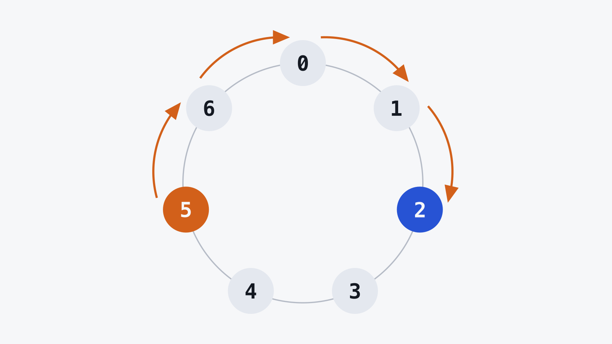

*7로 나눈 나머지는 0부터 6까지 일곱 칸을 빙빙 도는 것과 같습니다.  
5에서 네 칸을 가면 9가 아니라 2에 도착합니다.*

나머지의 세계는 시계와 같습니다.  
수가 아무리 커져도 0부터 m − 1까지의 칸 안에서 돌 뿐이죠.

### 중간에 나머지를 구해도 될까

문제는 계산 도중입니다.  
마지막에 한 번만 나머지를 구하려고 하면, 그 전에 이미 수가 넘쳐 버려요.  
그래서 더하거나 곱할 때마다 나머지를 구하는데, 그래도 답이 같을까요?

7로 나눈 나머지로 확인해 봅시다.  
`12 × 10 = 120`이고, 120을 7로 나누면 나머지가 1입니다.  
이번에는 먼저 나머지를 구해 볼게요. 12의 나머지는 5, 10의 나머지는 3이고, `5 × 3 = 15`를 7로 나누면 나머지가 1입니다. 같네요.

우연이 아닙니다. 이유는 이렇습니다.

1. 어떤 수 a를 m으로 나눈 몫을 q, 나머지를 r이라고 하면 `a = q × m + r`입니다. 12는 `1 × 7 + 5`죠.
2. b도 마찬가지로 `b = s × m + t`라고 씁시다.
3. 둘을 더하면 `a + b = (q + s) × m + (r + t)`입니다.  
앞부분은 m의 배수라서 나머지에 아무 영향이 없습니다.  
그러니 `a + b`의 나머지는 `r + t`의 나머지와 같습니다.
4. 둘을 곱하면 `a × b = (q × s × m + q × t + s × r) × m + r × t`입니다.  
이번에도 앞부분은 통째로 m의 배수입니다. 그러니 `a × b`의 나머지는 `r × t`의 나머지와 같습니다.

정리하면, **m의 배수는 더하든 곱하든 나머지를 바꾸지 못합니다.**  
이 한 줄이 나머지 연산의 전부라고 해도 됩니다. 뒤에 나오는 내용도 전부 여기서 출발해요.

### 곱셈과 나머지: 곱셈

[BOJ 1629 곱셈](https://www.acmicpc.net/problem/1629)입니다.  
A를 B번 곱한 수를 C로 나눈 나머지를 구합니다. 세 수 모두 21억까지 될 수 있습니다.

곱할 때마다 나머지를 구하면 넘치는 건 막을 수 있습니다.  
남은 문제는 B가 21억이라 21억 번 곱할 수는 없다는 거예요.

여기서 지수를 2진법으로 봅니다.  
13은 2진법으로 1101, 그러니까 `8 + 4 + 1`입니다.  
그러면 `a¹³ = a⁸ × a⁴ × a¹`이죠. 지수끼리 더하는 건 밑을 곱하는 것과 같으니까요.

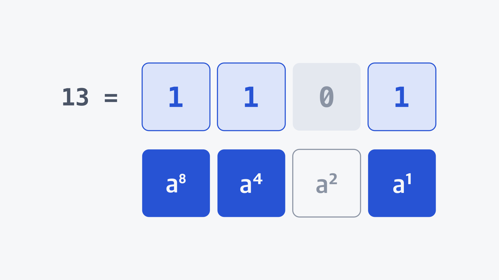

*13은 2진법으로 1101입니다.  
a를 계속 제곱해서 a¹, a², a⁴, a⁸을 만들고, 비트가 1인 자리의 것만 골라 곱합니다.*

`a¹, a², a⁴, a⁸`은 앞의 것을 제곱하면 바로 나옵니다.  
지수가 21억이어도 2진법으로는 31자리밖에 안 되니, 제곱을 31번만 하면 끝나요.

```cpp
#include <bits/stdc++.h>
#define ibm514 ios::sync_with_stdio(0), cin.tie(0), cout.tie(0);
using namespace std;
typedef long long ll;

// a를 b번 곱한 값을 m으로 나눈 나머지
ll power(ll a, ll b, ll m) {
    ll res = 1;
    a %= m;
    while (b > 0) {
        if (b & 1) res = res * a % m; // b의 맨 아래 비트가 1이면 지금의 a를 곱한다
        a = a * a % m;                // a, a^2, a^4, a^8, ... 로 키워 간다
        b >>= 1;
    }
    return res;
}

void solve() {
    ll a, b, c;
    cin >> a >> b >> c;
    cout << power(a, b, c);
}

int main() {
    ibm514
    solve();
    return 0;
}
```

`b & 1`은 b의 맨 아래 비트가 1인지 보는 것이고,  
`b >>= 1`은 그 비트를 버리고 다음 자리로 넘어가는 것입니다.  
그 사이에 `a`는 한 번씩 제곱됩니다.

`res * a`가 넘치지는 않을까요?  
둘 다 C보다 작으니 21억보다 작고, 21억의 제곱은 `long long`의 한계인 약 9.2 × 10¹⁸보다 작습니다.  
나누는 수가 이보다 더 크면 곱하는 순간 넘치니까, 나머지를 구하라는 수가 얼마인지 꼭 확인하세요.

### 곱하는 것만 바꾸면: 피보나치 수 6

[BOJ 11444 피보나치 수 6](https://www.acmicpc.net/problem/11444)입니다.  
n번째 피보나치 수를 1,000,000,007로 나눈 나머지를 구합니다. n은 10¹⁸까지입니다.

앞의 두 수를 더해 가며 하나씩 구하면 10¹⁸번을 돌아야 하니 불가능합니다.  
방금 만든 빠른 거듭제곱을 여기에 쓸 수 있을까요? 피보나치는 곱셈이 아니라 덧셈인데요.

피보나치 수 두 개를 묶어서 봅시다.  
(8, 5)를 알면 다음 묶음 (13, 8)을 만들 수 있습니다.  
새 첫째 수는 `8 + 5`이고, 새 둘째 수는 원래의 첫째 수 8이죠.  
이 “두 수를 섞어서 다음 두 수를 만드는 규칙”을 표로 적은 것이 행렬입니다.

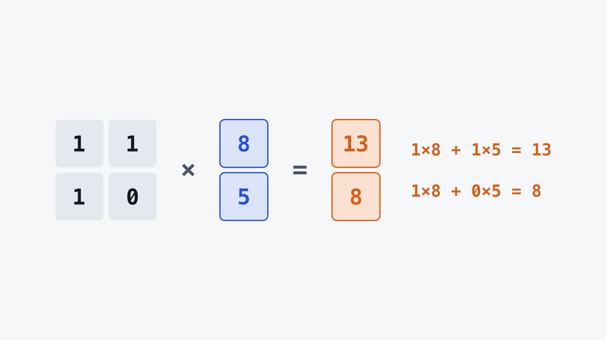

*왼쪽 표의 첫 줄 (1, 1)은 “첫째 수 1개와 둘째 수 1개를 더하라”는 뜻이고,  
둘째 줄 (1, 0)은 “첫째 수만 그대로 가져오라”는 뜻입니다. (8, 5)에 적용하면 (13, 8)이 됩니다.*

이 규칙을 한 번 적용하면 피보나치 수가 한 칸 앞으로 갑니다. n번 적용하면 n칸 가겠죠.  
그런데 규칙을 두 번 적용하는 것은, **두 규칙을 미리 합쳐 놓은 규칙**을 한 번 적용하는 것과 같습니다.  
규칙끼리 합치는 계산이 행렬의 곱셈입니다.

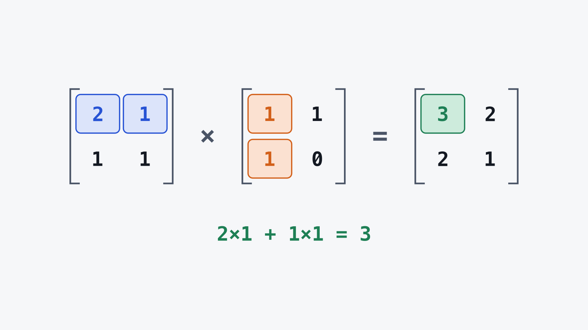

*행렬끼리 곱하는 방법입니다. 결과의 왼쪽 위 칸(초록)은 앞 행렬의 첫 가로줄(파랑)과  
뒤 행렬의 첫 세로줄(주황)을 짝지어 곱해서 더한 값입니다. 2×1 + 1×1 = 3이죠.  
나머지 세 칸도 같은 방법으로 구합니다.*

그러니 문제는 이 행렬을 n번 곱하는 것이 됩니다.  
같은 것을 n번 곱하는 일이라면 이미 풀었죠. 지수를 2진법으로 보고 제곱을 거듭하면 됩니다.

이 행렬을 M이라고 부릅시다.  
M을 직접 몇 번 곱해 보면 이렇게 됩니다.

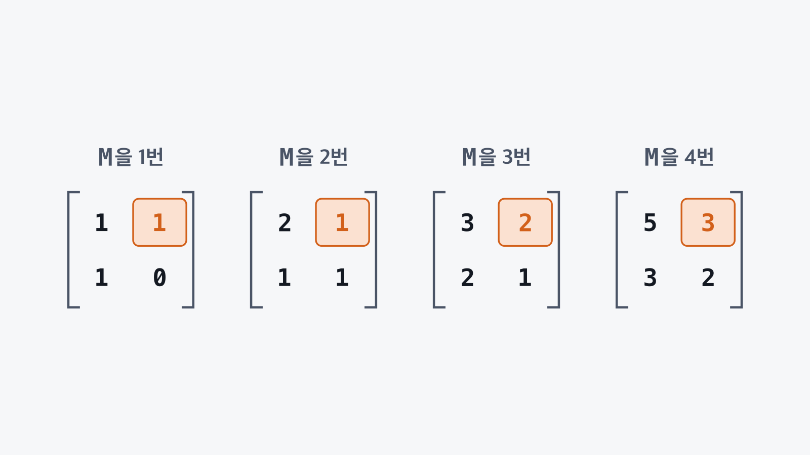

*M을 한 번, 두 번, 세 번, 네 번 곱한 결과입니다.  
오른쪽 위 칸(주황)을 따라 읽으면 1, 1, 2, 3으로 피보나치 수가 차례로 나옵니다.*

오른쪽 위 칸만 그런 게 아닙니다.  
네 칸 모두 피보나치 수이고, 한 번 곱할 때마다 전부 다음 수로 한 칸씩 넘어갑니다.  
n번째 피보나치 수를 `F(n)`이라고 쓰면, M을 n번 곱한 행렬은 왼쪽 위가 `F(n+1)`,  
오른쪽 위와 왼쪽 아래가 `F(n)`, 오른쪽 아래가 `F(n−1)`입니다.

네 번까지만 해 봤으니, 계속 곱해도 이 모양이 유지되는지 확인해야겠죠.  
이 모양인 행렬에 M을 한 번 더 곱해 봅니다.

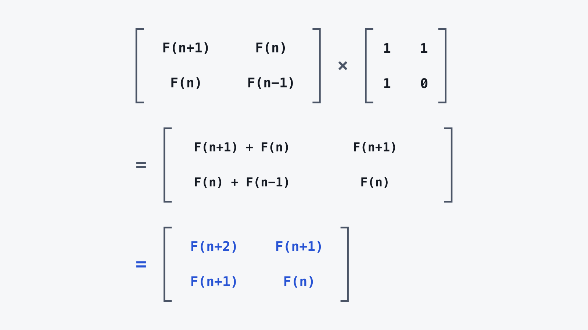

*맨 위는 n번 곱한 행렬에 M을 한 번 더 곱하는 식입니다.  
곱셈을 하면 가운데 줄이 되고, 이웃한 두 피보나치 수를 더하면 다음 피보나치 수이니 맨 아래 줄이 됩니다.  
모든 칸의 번호가 1씩 올라갔습니다.*

n번 곱한 것이 이 모양이면 n + 1번 곱한 것도 같은 모양이라는 뜻입니다.  
한 번 곱했을 때 맞았으니 두 번도 맞고, 두 번이 맞으니 세 번도 맞고, 이렇게 끝없이 이어집니다.

그래서 M을 n번 곱한 행렬의 오른쪽 위 칸이 답입니다.

```cpp
#include <bits/stdc++.h>
#define ibm514 ios::sync_with_stdio(0), cin.tie(0), cout.tie(0);
using namespace std;
typedef long long ll;
const ll MOD = 1e9 + 7;
typedef array<array<ll, 2>, 2> Mat;

Mat mul(const Mat &a, const Mat &b) {
    Mat c{};
    for (int i = 0; i < 2; ++i)
        for (int j = 0; j < 2; ++j)
            for (int k = 0; k < 2; ++k) c[i][j] = (c[i][j] + a[i][k] * b[k][j]) % MOD;
    return c;
}

// 곱셈 문제의 power와 같은 모양이다. 수의 곱셈이 행렬의 곱셈으로 바뀌었을 뿐
Mat power(Mat a, ll b) {
    Mat res = {{{1, 0}, {0, 1}}}; // 곱해도 아무것도 바꾸지 않는 행렬 (수로 치면 1)
    while (b > 0) {
        if (b & 1) res = mul(res, a);
        a = mul(a, a);
        b >>= 1;
    }
    return res;
}

void solve() {
    ll n;
    cin >> n;
    Mat m = {{{1, 1}, {1, 0}}};
    cout << power(m, n)[0][1];    // m을 n번 곱하면 오른쪽 위 칸이 n번째 피보나치 수
}

int main() {
    ibm514
    solve();
    return 0;
}
```

곱셈 문제의 `power`와 나란히 놓고 보세요. 달라진 건 두 가지뿐입니다.  
처음 값 1이 “곱해도 아무것도 바꾸지 않는 행렬”로 바뀌었고, `*`가 `mul`로 바뀌었습니다.

빠른 거듭제곱에 필요한 조건은 딱 하나, **묶는 순서를 바꿔도 결과가 같은 곱셈**이라는 것뿐입니다.  
`a⁸ × a⁴ × a¹`처럼 쪼개서 곱해도 되려면 그게 필요하거든요.  
행렬의 곱셈도 이 성질을 가지고 있어서(증명은 생략합니다) 같은 코드가 그대로 통합니다.

### 뺄셈과 나머지: 나머지 합

[BOJ 10986 나머지 합](https://www.acmicpc.net/problem/10986)입니다.  
수열에서 연속한 구간을 골랐을 때, 그 합이 M으로 나누어떨어지는 구간이 몇 개인지 셉니다.

구간의 합은 누적합 두 개의 차입니다.  
i번째까지의 합을 `S[i]`라고 하면, i + 1번째부터 j번째까지의 합은 `S[j] − S[i]`죠.  
그러니 문제는 “차가 M의 배수인 누적합의 쌍”을 세는 것이 됩니다.

여기서 쓰는 사실은 이것입니다.  
**두 수의 차가 M의 배수라는 것과, 두 수를 M으로 나눈 나머지가 같다는 것은 같은 말입니다.**

1. `S[j] = q × M + r`, `S[i] = s × M + t`라고 씁시다. r과 t는 0 이상 M 미만입니다.
2. 빼면 `S[j] − S[i] = (q − s) × M + (r − t)`입니다.
3. 앞부분은 M의 배수이니, 전체가 M의 배수가 되려면 `r − t`가 M의 배수여야 합니다.
4. 그런데 r과 t는 둘 다 0 이상 M 미만이라, 차이는 −M보다 크고 M보다 작습니다.  
그 사이에 있는 M의 배수는 0뿐이죠.
5. 그러니 `r − t = 0`, 곧 나머지가 같습니다.  
반대로 나머지가 같으면 `r − t = 0`이라 차는 당연히 M의 배수입니다.

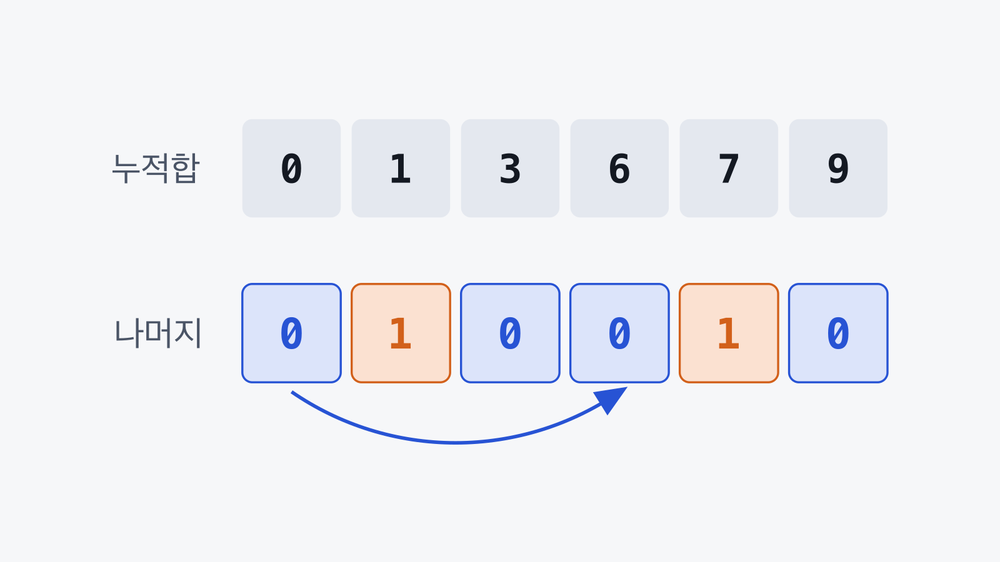

*예제의 누적합과, 그것을 3으로 나눈 나머지입니다. 나머지가 0인 것이 네 개, 1인 것이 두 개예요.  
같은 나머지끼리 짝을 지으면(화살표) 그 사이 구간의 합이 3의 배수가 됩니다.*

이제 나머지별로 개수만 세면 됩니다.  
누적합을 하나씩 만들 때마다 “나와 나머지가 같은 누적합이 앞에 몇 개 있었지?”를 답에 더합니다.

```cpp
#include <bits/stdc++.h>
#define ibm514 ios::sync_with_stdio(0), cin.tie(0), cout.tie(0);
using namespace std;
typedef long long ll;
int n, m;
ll cnt[1000];   // cnt[r] = 나머지가 r인 누적합의 개수

void solve() {
    cin >> n >> m;
    ll sum = 0, ans = 0;
    cnt[0] = 1;            // 아무것도 더하지 않은 누적합 0
    for (int i = 0; i < n; ++i) {
        int x;
        cin >> x;
        sum = (sum + x) % m;
        ans += cnt[sum];   // 앞에서 나온 같은 나머지 하나하나와 짝이 된다
        ++cnt[sum];
    }
    cout << ans;
}

int main() {
    ibm514
    solve();
    return 0;
}
```

`cnt[0] = 1`로 시작하는 건 아무것도 더하지 않은 누적합 0 때문입니다.  
이게 있어야 맨 앞에서 시작하는 구간도 셀 수 있어요.

뺄셈에는 조심할 점이 하나 있습니다.  
C++에서 음수를 나눈 나머지는 음수로 나옵니다. `-3 % 7`은 4가 아니라 -3이에요.  
그래서 나머지끼리 뺄 때는 `(a - b + m) % m`처럼 m을 한 번 더해 줍니다.  
m의 배수를 더해도 나머지는 그대로니까 답은 달라지지 않습니다.

### 차의 공약수: 검문

[BOJ 2981 검문](https://www.acmicpc.net/problem/2981)입니다.  
수 N개가 주어집니다. 이 수들을 M으로 나눈 나머지가 **모두 같아지는** M을 전부 찾습니다.  
M은 1보다 커야 합니다.

방금 증명한 사실을 그대로 씁니다.  
두 수의 나머지가 같다는 건 차가 M의 배수라는 것이었죠.  
그러니 M은 **모든 두 수의 차를 나누는 수**여야 합니다.

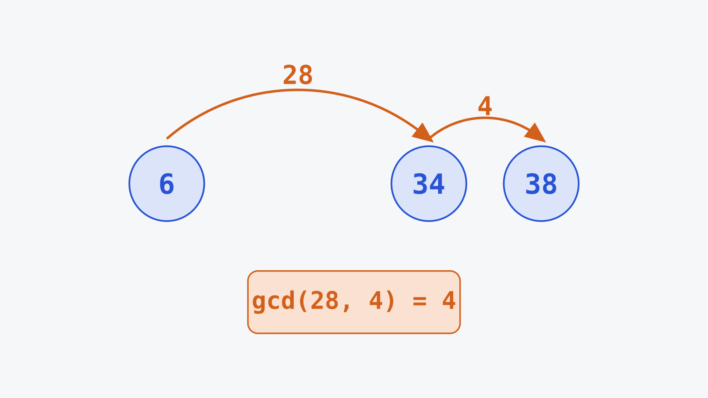

*예제의 6, 34, 38입니다. 이웃한 수의 차는 28과 4이고, M은 둘 다를 나눠야 합니다.  
둘의 최대공약수가 4이니, 가능한 M은 4의 약수인 2와 4입니다.*

모든 쌍을 볼 필요는 없습니다. 정렬해서 **이웃한 수의 차**만 보면 돼요.  
6과 38의 차 32는 `28 + 4`입니다. M이 28과 4를 나누면 그 합인 32도 당연히 나누죠.

이웃한 차들을 전부 나누는 수는 그 차들의 **공약수**입니다.  
그리고 공약수는 전부 최대공약수의 약수입니다(이유는 심화편에서 증명합니다).  
그러니 차들의 최대공약수를 구하고, 그 약수 중 1보다 큰 것을 출력하면 됩니다.

최대공약수는 유클리드 호제법으로 구합니다.

**a와 b의 최대공약수는, b와 (a를 b로 나눈 나머지)의 최대공약수와 같다.**

1. a를 b로 나눈 몫을 q, 나머지를 r이라고 하면 `a = q × b + r`입니다.
2. d가 a와 b의 공약수라면, `r = a − q × b`도 d의 배수입니다.  
그러니 d는 b와 r의 공약수이기도 합니다.
3. 거꾸로 d가 b와 r의 공약수라면, `a = q × b + r`도 d의 배수입니다.  
그러니 d는 a와 b의 공약수이기도 합니다.
4. (a, b)의 공약수와 (b, r)의 공약수가 완전히 같은 목록이니, 그중 가장 큰 것도 같습니다.

이번에도 쓴 것은 “b의 배수는 빼도 상관없다”는 것뿐입니다. 나머지 연산의 그 한 줄이 여기서도 나오네요.  
나머지는 b보다 작으니 수가 금방 줄어들고, 나머지가 0이 되는 순간 그때의 나누는 수가 답입니다.

```cpp
#include <bits/stdc++.h>
#define ibm514 ios::sync_with_stdio(0), cin.tie(0), cout.tie(0);
using namespace std;
typedef long long ll;

// 유클리드 호제법: (a, b)의 최대공약수는 (b, a를 b로 나눈 나머지)의 최대공약수와 같다
ll gcd(ll a, ll b) {
    while (b != 0) {
        ll r = a % b;
        a = b, b = r;
    }
    return a;
}

void solve() {
    int n;
    cin >> n;
    vector<ll> a(n);
    for (ll &x : a) cin >> x;
    sort(a.begin(), a.end());
    ll g = 0;
    // 이웃한 수의 차를 전부 묶는다
    for (int i = 1; i < n; ++i) g = gcd(g, a[i] - a[i - 1]);  
    vector<ll> ans;
    // g의 약수를 짝지어 찾는다
    for (ll d = 1; d * d <= g; ++d) {                           
        if (g % d) continue;
        if (d > 1) ans.push_back(d);
        if (d != g / d) ans.push_back(g / d);
    }
    sort(ans.begin(), ans.end());
    for (ll x : ans) cout << x << ' ';
}

int main() {
    ibm514
    solve();
    return 0;
}
```

약수를 찾을 때는 `d × d`가 g 이하인 동안만 봅니다.  
d가 g의 약수이면 `g / d`도 약수라서, 작은 쪽만 찾으면 큰 쪽은 짝으로 따라 나오거든요.

C++17부터는 `std::gcd`와 `std::lcm`이 있어서 직접 짜지 않아도 됩니다.  
최소공배수를 직접 구할 때는 `a * b / g`가 아니라 `a / g * b`로 쓰세요. 먼저 곱하면 넘칠 수 있습니다.

## 배열 회전

[BOJ 16935 배열 돌리기 3](https://www.acmicpc.net/problem/16935)입니다.  
배열에 여섯 가지 연산을 순서대로 적용합니다. 상하 반전, 좌우 반전, 오른쪽으로 90도, 왼쪽으로 90도,  
그리고 배열을 네 조각으로 나눠 시계 방향이나 반시계 방향으로 한 칸씩 옮기는 연산입니다.

오른쪽으로 90도 돌리는 공식을 검색하면 `b[j][n - 1 - i] = a[i][j]` 같은 식이 나옵니다.  
외워서 쓰다 보면 `n - 1 - i`가 왼쪽에 붙는지 오른쪽에 붙는지 매번 헷갈려요.  
외우지 말고 **읽는 방향**으로 생각해 봅시다.

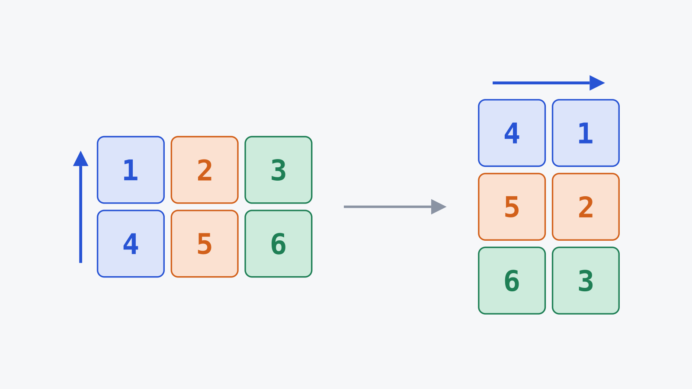

*2행 3열 배열을 오른쪽으로 90도 돌렸습니다.  
새 배열의 첫 행(4, 1)은 원래 배열의 첫 열을 아래에서 위로 읽은 것입니다. 색이 같은 칸끼리 짝입니다.*

종이를 오른쪽으로 돌리면 왼쪽 세로줄이 맨 위 가로줄로 올라옵니다.  
이때 아래에 있던 것이 앞쪽에 오죠.  
그래서 이렇게 말할 수 있습니다.

**새 배열의 i번 행은, 원래 배열의 i번 열을 아래에서 위로 읽은 것이다.**

이 문장을 그대로 코드로 옮기면 됩니다.  
새 배열의 `(i, j)`는 i번 행의 j번째 칸입니다.  
원래 배열의 i번 열을 아래에서부터 j번째로 읽으면,  
행 번호는 맨 아래인 `n − 1`에서 j만큼 올라온 `n − 1 − j`이고 열 번호는 i입니다.  
그러니 `b[i][j] = a[n - 1 - j][i]`가 됩니다.

나머지 연산도 같은 방법으로 한 문장씩 써 보면 이렇습니다.

- **상하 반전**: 새 배열의 i번 행은 원래의 아래에서 i번째 행이다. `b[i][j] = a[n - 1 - i][j]`
- **좌우 반전**: 새 배열의 j번 열은 원래의 오른쪽에서 j번째 열이다. `b[i][j] = a[i][m - 1 - j]`
- **오른쪽 90도**: 새 배열의 i번 행은 원래의 i번 열을 아래에서 위로 읽은 것이다.  
`b[i][j] = a[n - 1 - j][i]`
- **왼쪽 90도**: 새 배열의 i번 행은 원래의 오른쪽에서 i번째 열을 위에서 아래로 읽은 것이다.  
`b[i][j] = a[j][m - 1 - i]`

요령은 항상 **새 배열을 기준으로** 쓰는 것입니다.  
“원래 칸이 어디로 가는가”가 아니라 “이 칸에 올 값이 어디에 있었는가”를 쓰면,  
새 배열을 처음부터 끝까지 차례로 채우기만 하면 되거든요.  
“거꾸로 읽는다”는 말이 나오면 `끝 − 번호`가 붙는다고 기억하면 됩니다.

```cpp
#include <bits/stdc++.h>
#define ibm514 ios::sync_with_stdio(0), cin.tie(0), cout.tie(0);
using namespace std;
typedef long long ll;
typedef vector<vector<int>> Board;

// 새 배열의 (i, j)에 원래 배열의 어느 칸이 오는지만 정하면 된다
Board convert(const Board &a, int op) {
    int n = a.size(), m = a[0].size();
    bool turn = op == 3 || op == 4;         // 회전하면 가로와 세로가 바뀐다
    int h = turn ? m : n, w = turn ? n : m;
    Board b(h, vector<int>(w));
    for (int i = 0; i < h; ++i)
        for (int j = 0; j < w; ++j) {
            if (op == 1) b[i][j] = a[n - 1 - i][j];     // 아래 행부터 읽는다
            if (op == 2) b[i][j] = a[i][m - 1 - j];     // 오른쪽 열부터 읽는다
            if (op == 3) b[i][j] = a[n - 1 - j][i];     // i번 열을 아래에서 위로 읽는다
            if (op == 4) b[i][j] = a[j][m - 1 - i];     // 오른쪽 끝 열부터, 위에서 아래로 읽는다
            if (op == 5 || op == 6) {
                int hn = n / 2, hm = m / 2;
                bool top = i < hn, left = j < hm;
                // 이 칸에 올 값이 있던 조각이 어느 쪽에 있었는지
                int di, dj;
                if (op == 5) { // 시계 방향으로 한 칸: 왼쪽 위에는 왼쪽 아래 조각이 온다
                    if (top && left) di = hn, dj = 0;
                    else if (top) di = 0, dj = -hm;
                    else if (!left) di = -hn, dj = 0;
                    else di = 0, dj = hm;
                } else {  // 반시계 방향으로 한 칸: 왼쪽 위에는 오른쪽 위 조각이 온다
                    if (top && left) di = 0, dj = hm;
                    else if (top) di = hn, dj = 0;
                    else if (!left) di = 0, dj = -hm;
                    else di = -hn, dj = 0;
                }
                b[i][j] = a[i + di][j + dj];
            }
        }
    return b;
}

void solve() {
    int n, m, r;
    cin >> n >> m >> r;
    Board a(n, vector<int>(m));
    for (auto &row : a)
        for (int &x : row) cin >> x;
    while (r--) {
        int op;
        cin >> op;
        a = convert(a, op);
    }
    for (auto &row : a) {
        for (int x : row) cout << x << ' ';
        cout << '\n';
    }
}

int main() {
    ibm514
    solve();
    return 0;
}
```

네 조각을 옮기는 5번과 6번도 생각하는 방법은 같습니다.  
시계 방향으로 한 칸씩 옮기면 왼쪽 위 자리에는 왼쪽 아래에 있던 조각이 옵니다.  
그러니 왼쪽 위의 칸 `(i, j)`에는 그보다 반 뼘 아래에 있던 `a[i + n/2][j]`가 오는 거죠.

회전하면 가로와 세로의 길이가 바뀐다는 것도 잊지 마세요.  
정사각형이 아니면 새 배열의 크기를 `m × n`으로 잡아야 합니다.

## 진법

### 나누면 자릿수가 나온다

우리가 쓰는 10진법에서 472는 `4 × 100 + 7 × 10 + 2`입니다.  
여기서 맨 끝자리 2를 꺼내려면 10으로 나눈 나머지를 구하면 되죠. `472 % 10 = 2`.  
그리고 10으로 나누면 `472 / 10 = 47`로, 끝자리가 떨어져 나갑니다.

이게 왜 되는지도 앞에서 본 것과 같습니다.  
`4 × 100 + 7 × 10`은 10의 배수라서 나머지에 영향을 주지 못하고,  
10보다 작은 2만 나머지로 남는 거예요.

10이 아니어도 똑같습니다.  
N진법의 수는 `… + d₂ × N² + d₁ × N + d₀`이고 각 자리 d는 0부터 N − 1 사이입니다.  
`d₀` 앞의 것은 전부 N의 배수이니,  
**N으로 나눈 나머지가 맨 끝자리**이고 **N으로 나눈 몫이 끝자리를 뗀 나머지 부분**입니다.  
이걸 되풀이하면 자릿수가 뒤에서부터 하나씩 나옵니다.

PS에서 진법을 쓰는 곳은 크게 두 군데입니다.  
하나는 **모든 경우를 빠짐없이 세는 것**이고, 다른 하나는 **여러 값을 수 하나에 눌러 담는 것**입니다.

### 3진법으로 모든 경우 세기: 0 만들기

[BOJ 7490 0 만들기](https://www.acmicpc.net/problem/7490)입니다.  
1부터 N까지의 수를 차례로 쓰고, 그 사이사이에 `+`, `-`, 공백 중 하나를 넣습니다.  
공백은 두 수를 이어 붙인다는 뜻입니다.  
계산 결과가 0이 되는 식을 전부 출력합니다.

사이가 N − 1군데이고 군데마다 세 가지를 고를 수 있습니다.  
재귀로 짜도 되지만, 이렇게 볼 수도 있어요.  
공백을 0, `+`를 1, `-`를 2라고 하면, 식 하나가 **N − 1자리 3진법 수 하나**가 됩니다.

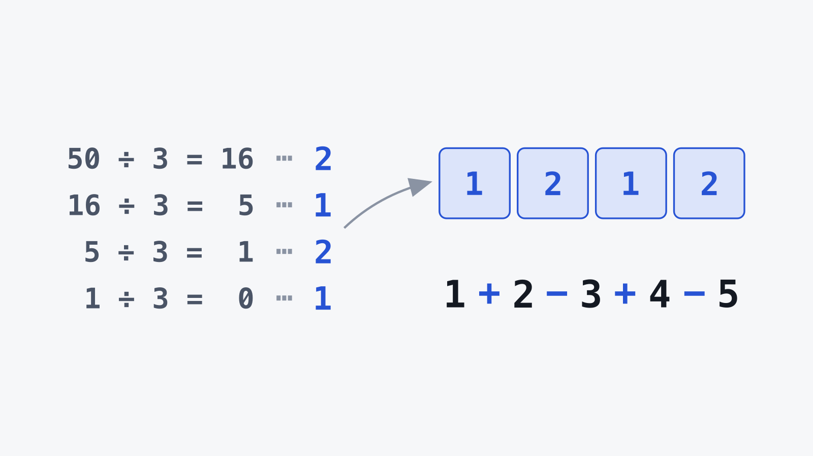

*50을 3으로 나누면서 나머지를 꺼내면 뒤에서부터 2, 1, 2, 1이 나옵니다.  
앞에서부터 읽으면 1, 2, 1, 2이고, 기호로 바꾸면 1+2−3+4−5가 됩니다.*

N − 1자리 3진법 수는 0부터 `3^(N−1) − 1`까지 있습니다.  
자동차의 주행 거리계처럼 맨 끝자리부터 0, 1, 2로 돌고, 넘치면 앞자리가 하나 올라가죠.  
그러니 0부터 차례로 세기만 하면 **모든 조합이 빠짐없이, 겹치지 않게 한 번씩** 나옵니다.

```cpp
#include <bits/stdc++.h>
#define ibm514 ios::sync_with_stdio(0), cin.tie(0), cout.tie(0);
using namespace std;
typedef long long ll;
const char sym[] = {' ', '+', '-'};   // 0, 1, 2에 대응하는 기호 (아스키 순서)

void solve() {
    int T;
    cin >> T;
    while (T--) {
        int n;
        cin >> n;
        int total = 1;
        for (int i = 0; i < n - 1; ++i) total *= 3; // 3^(n-1)가지
        for (int code = 0; code < total; ++code) {
            // code를 3진법으로 풀어서 숫자 사이의 기호 n - 1개를 얻는다
            vector<int> op(n - 1);
            int x = code;
            for (int i = n - 2; i >= 0; --i) op[i] = x % 3, x /= 3;

            ll sum = 0, cur = 1, sign = 1;   // cur = 지금 이어 붙이고 있는 수
            for (int i = 0; i < n - 1; ++i) {
                if (op[i] == 0) cur = cur * 10 + (i + 2);
                else {
                    sum += sign * cur;
                    sign = op[i] == 1 ? 1 : -1;
                    cur = i + 2;
                }
            }
            sum += sign * cur;
            if (sum != 0) continue;
            cout << 1;
            for (int i = 0; i < n - 1; ++i) cout << sym[op[i]] << i + 2;
            cout << '\n';
        }
        cout << '\n';
    }
}

int main() {
    ibm514
    solve();
    return 0;
}
```

`op[i] = x % 3, x /= 3`이 자릿수를 꺼내는 부분입니다.  
뒤에서부터 나오니까 배열도 뒤에서부터 채웠어요.

문제는 아스키 순서로 출력하라고 합니다. 공백, `+`, `-` 순서죠.  
기호에 붙인 번호가 0, 1, 2로 그 순서와 같고, 맨 앞자리가 식의 맨 앞 기호라서,  
수를 작은 것부터 세면 저절로 아스키 순서가 됩니다.

### 4진법과 회전: 2048 (Easy)

[BOJ 12100 2048 (Easy)](https://www.acmicpc.net/problem/12100)입니다.  2048 게임에서 판을 상하좌우 중 한쪽으로 미는 동작을 최대 다섯 번 해서 만들 수 있는 가장 큰 블록을 구합니다.

방향이 네 가지이고 다섯 번이니 `4⁵ = 1024`가지입니다. 전부 해 보면 됩니다.  
방금과 똑같이, 0부터 1023까지의 수 하나를 **다섯 자리 4진법 수**로 읽으면 한 자리가 한 번의 이동이 됩니다.

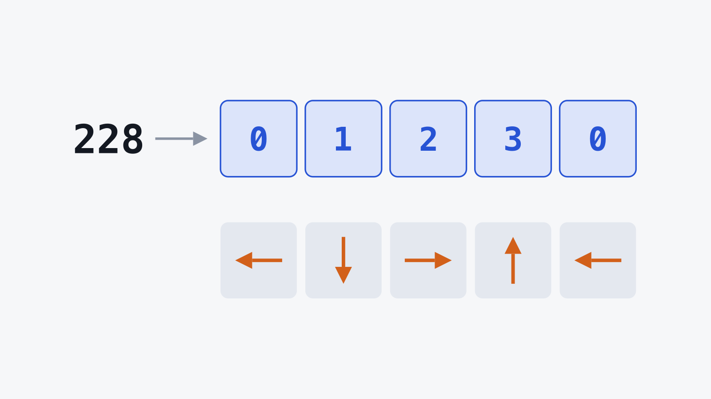

*228을 4로 나누며 나머지를 꺼내면 0, 1, 2, 3, 0이 차례로 나옵니다. 한 자리가 한 번의 이동 방향입니다.*

이 문제의 진짜 귀찮은 부분은 미는 동작을 방향마다 따로 짜야 한다는 것입니다.  
왼쪽으로 미는 것과 위로 미는 것은 반복문의 방향이 전부 달라서,  
네 번 복사해서 고치다 보면 한 군데쯤은 틀리거든요.

여기서 앞에서 배운 회전을 씁니다.  
**판을 돌려놓고 항상 왼쪽으로만 밀면 됩니다.**  
오른쪽으로 한 번 돌린 판에서 왼쪽으로 미는 것은, 돌리기 전 판에서 아래로 미는 것과 같으니까요.  
0번 돌리면 왼쪽, 1번이면 아래, 2번이면 오른쪽, 3번이면 위가 됩니다.

```cpp
#include <bits/stdc++.h>
#define ibm514 ios::sync_with_stdio(0), cin.tie(0), cout.tie(0);
using namespace std;
typedef long long ll;
typedef vector<vector<int>> Board;
int n;

// 오른쪽으로 90도 회전: 새 배열의 i번 행은 원래 배열의 i번 열을 아래에서 위로 읽은 것
Board rotate(const Board &a) {
    Board b(n, vector<int>(n));
    for (int i = 0; i < n; ++i)
        for (int j = 0; j < n; ++j) b[i][j] = a[n - 1 - j][i];
    return b;
}

// 모든 블록을 왼쪽으로 민다
void pushLeft(Board &a) {
    for (auto &row : a) {
        vector<int> res;
        bool merged = false;   // 맨 끝 블록이 방금 합쳐진 것인가
        for (int x : row) {
            if (x == 0) continue;
            if (!res.empty() && res.back() == x && !merged) res.back() *= 2, merged = true;
            else res.push_back(x), merged = false;
        }
        res.resize(n, 0);
        row = res;
    }
}

void solve() {
    cin >> n;
    Board init(n, vector<int>(n));
    for (auto &row : init)
        for (int &x : row) cin >> x;
    int ans = 0;
    for (int code = 0; code < 1024; ++code) {   // 4^5 = 1024가지
        Board a = init;
        int x = code;
        for (int step = 0; step < 5; ++step) {
            // 4진법의 한 자리 = 이번에 밀 방향
            int dir = x % 4;                     
            x /= 4;
            // 밀 방향이 왼쪽을 보도록 돌려놓고
            for (int k = 0; k < dir; ++k) a = rotate(a);   
            // 항상 왼쪽으로만 민다
            pushLeft(a);                                   
        }
        for (auto &row : a)
            for (int v : row) ans = max(ans, v);
    }
    cout << ans;
}

int main() {
    ibm514
    solve();
    return 0;
}
```

`rotate`는 배열 돌리기 3에서 쓴 문장 그대로입니다.  
`pushLeft`는 한 방향만 생각하면 되니 짧고, 틀릴 곳도 줄어듭니다.

밀고 난 뒤에 판을 다시 원래 방향으로 돌려놓지는 않았습니다.  
그러면 다음 자릿수는 “지금 돌아가 있는 판을 기준으로 한 방향”이 되는데, 그래도 괜찮아요.  
어차피 네 방향을 전부 시도하는 것이고,  
구하는 건 가장 큰 블록의 값이라 판이 어느 쪽을 보고 있든 상관없으니까요.

### 여러 값을 수 하나에 담기: 퍼즐

[BOJ 1525 퍼즐](https://www.acmicpc.net/problem/1525)입니다.  
3×3 판에 1부터 8까지의 수와 빈 칸 하나가 있습니다.  
빈 칸 옆의 수를 빈 칸으로 옮기는 것이 한 번의 이동입니다.  
수들이 순서대로 놓인 상태를 만드는 최소 이동 횟수를 구합니다.

최소 이동 횟수니까 BFS입니다. [BFS 글](https://www.rilog.kr/@iqed/posts/620)에서 본 것처럼 상태마다 거리를 적어 둬야 하죠.  
그런데 이번에는 상태가 좌표가 아니라 **판 전체**입니다.  
판 전체를 배열의 번호로 쓸 수는 없으니, 수 하나로 바꿔야 합니다.

아홉 칸에 0부터 8까지의 값이 들어 있습니다.  
값이 아홉 가지이니, 칸 하나를 **9진법의 한 자리**로 보면 판 전체가 아홉 자리 9진법 수 하나가 됩니다.

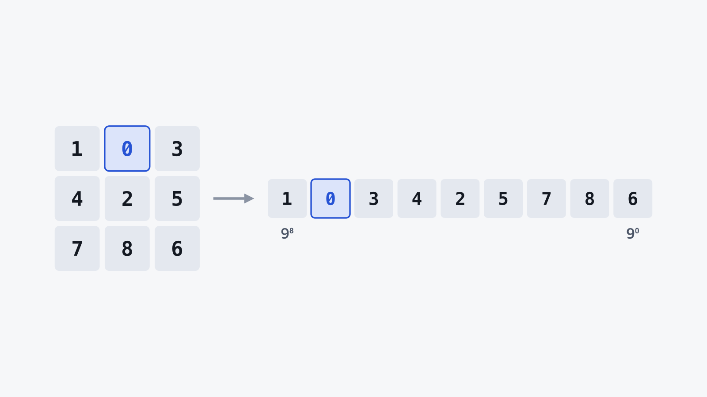

*판을 왼쪽 위부터 차례로 읽어 한 줄로 늘어놓습니다. 맨 앞 칸이 9⁸의 자리, 맨 뒤 칸이 9⁰의 자리입니다.*

만드는 방법은 간단합니다.  
지금까지 만든 수에 9를 곱해서 한 자리 밀어 올리고, 새 칸의 값을 더합니다.  
10진법에서 47 뒤에 2를 붙이려면 `47 × 10 + 2`를 하는 것과 같은 이치예요.

되살리는 건 앞에서 본 대로입니다. 9로 나눈 나머지가 맨 끝 칸이고, 9로 나누면 그 칸이 떨어져 나갑니다.

```cpp
#include <bits/stdc++.h>
#define ibm514 ios::sync_with_stdio(0), cin.tie(0), cout.tie(0);
using namespace std;
typedef long long ll;
const int dr[] = {-1, 1, 0, 0}, dc[] = {0, 0, -1, 1};

// 판 9칸을 9진법 수 하나로
int encode(int b[9]) {
    int s = 0;
    for (int i = 0; i < 9; ++i) s = s * 9 + b[i];
    return s;
}

// 9진법 수에서 판 9칸을 되살린다
void decode(int s, int b[9]) {
    for (int i = 8; i >= 0; --i) b[i] = s % 9, s /= 9;
}

void solve() {
    int b[9], goal[9] = {1, 2, 3, 4, 5, 6, 7, 8, 0};
    for (int i = 0; i < 9; ++i) cin >> b[i];
    int target = encode(goal);
    unordered_map<int, int> dist;   // 상태(정수) → 이동 횟수
    queue<int> q;
    dist[encode(b)] = 0;
    q.push(encode(b));
    while (!q.empty()) {
        int s = q.front();
        q.pop();
        if (s == target) { cout << dist[s]; return; }
        decode(s, b);
        int z = find(b, b + 9, 0) - b;   // 빈 칸의 위치
        for (int d = 0; d < 4; ++d) {
            int nr = z / 3 + dr[d], nc = z % 3 + dc[d];
            if (nr < 0 || nr >= 3 || nc < 0 || nc >= 3) continue;
            swap(b[z], b[nr * 3 + nc]);
            int ns = encode(b);
            if (!dist.count(ns)) dist[ns] = dist[s] + 1, q.push(ns);
            swap(b[z], b[nr * 3 + nc]);   // 다음 방향을 위해 되돌린다
        }
    }
    cout << -1;
}

int main() {
    ibm514
    solve();
    return 0;
}
```

아홉 자리 9진법 수의 최댓값은 `9⁹ − 1 = 387,420,488`이라 `int`에 들어갑니다.  
이 문제는 메모리 제한이 32MB로 빡빡해서,  
판을 문자열로 들고 다니는 것보다 정수 하나로 들고 다니는 편이 유리합니다.

수 하나에 몇 칸까지 담을 수 있는지는 미리 따져 봐야 합니다.  
`long long`은 약 9.2 × 10¹⁸까지 담을 수 있으니,  
값이 N가지인 칸 k개를 담으려면 `N^k`이 그보다 작아야 해요.  
2진법이면 62칸, 4진법이면 31칸, 10진법이면 18칸까지입니다.

값의 가짓수가 2, 4, 8, 16처럼 2의 거듭제곱이면 곱하기와 나누기 대신 비트 연산을 쓸 수 있습니다.  
4진법이라면 `x * 4`는 `x << 2`, `x % 4`는 `x & 3`, `x / 4`는 `x >> 2`입니다.  
하는 일은 완전히 같고 조금 빠를 뿐이에요.

## 큰 수

`long long`에 담을 수 있는 수는 19자리 정도입니다.  
지금까지는 답이 그보다 커지면 문제가 “나머지를 출력하라”고 해 줬죠.  
그런데 가끔은 나머지가 아니라 **수 전체를 정확히** 출력하라는 문제가 나옵니다.  
1만 자리짜리 수를 더하라거나, 100번 곱하라거나요.

방법은 방금 본 진법 그대로입니다.  
수는 결국 자릿수를 늘어놓은 것이니, **배열의 한 칸에 한 자리씩** 담으면 됩니다.  
계산은 초등학교 때 배운 세로셈을 그대로 코드로 옮기면 되고요.

### 세로셈으로 더하기: 큰 수 A+B

[BOJ 10757 큰 수 A+B](https://www.acmicpc.net/problem/10757)입니다.  
두 수 A와 B를 더합니다. 다만 두 수가 1만 자리까지 될 수 있습니다.

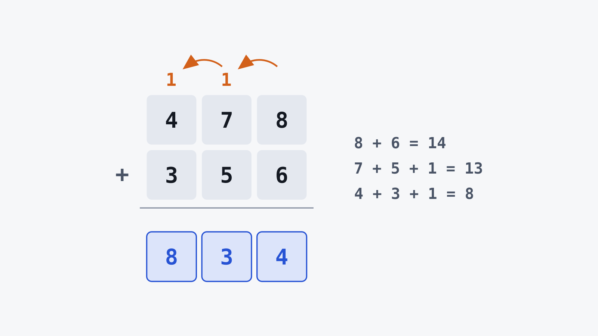

*478 + 356을 세로셈으로 더했습니다.  
일의 자리부터 더하고, 합이 10을 넘으면 넘친 1을 윗자리로 올립니다(주황).*

세로셈은 일의 자리부터 시작합니다.  
그래서 수를 **뒤집어서** 저장합니다. 일의 자리가 0번 칸, 십의 자리가 1번 칸이 되도록요.  
이러면 두 수의 길이가 달라도 같은 번호의 칸끼리 더하면 되고,  
맨 위에서 자리가 하나 늘어날 때도 배열 뒤에 붙이기만 하면 됩니다.

올리는 값은 많아야 1입니다.  
한 칸에서 더하는 것이 가장 클 때가 `9 + 9`에 아래에서 올라온 1을 더한 19이고,  
19에서 윗자리로 가는 것은 1이니까요.

```cpp
#include <bits/stdc++.h>
#define ibm514 ios::sync_with_stdio(0), cin.tie(0), cout.tie(0);
using namespace std;
typedef long long ll;

void solve() {
    string a, b;
    cin >> a >> b;
    reverse(a.begin(), a.end());   // 일의 자리가 맨 앞에 오도록 뒤집는다
    reverse(b.begin(), b.end());
    string res;
    int carry = 0;                 // 아랫자리에서 올라온 값
    for (int i = 0; i < (int)max(a.size(), b.size()) || carry; ++i) {
        int sum = carry;
        if (i < (int)a.size()) sum += a[i] - '0';
        if (i < (int)b.size()) sum += b[i] - '0';
        res += char('0' + sum % 10);   // 이 자리에 남는 값
        carry = sum / 10;              // 윗자리로 올리는 값
    }
    reverse(res.begin(), res.end());
    cout << res;
}

int main() {
    ibm514
    solve();
    return 0;
}
```

`sum % 10`이 그 자리에 남는 값이고 `sum / 10`이 윗자리로 올리는 값입니다.  
진법에서 본 “나머지가 끝자리, 몫이 나머지 부분”과 같은 식이죠.

반복 조건에 `|| carry`가 붙어 있는 걸 눈여겨보세요.  
두 수를 끝까지 다 더한 뒤에도 올림이 남아 있으면 한 칸을 더 써야 합니다.  
`999 + 1`이 네 자리가 되는 경우예요.

### 세로셈으로 곱하기: a^b

[BOJ 10827 a^b](https://www.acmicpc.net/problem/10827)입니다.  
소수점이 있는 수 a를 b번 곱한 값을 **정확하게** 출력합니다.  
a는 100보다 작고 소수점 아래 9자리까지, b는 100까지입니다.

`double`로는 턱도 없으니 직접 곱해야 합니다.  
곱셈도 세로셈인데, 코드로 옮기기 전에 자릿값을 한 번 따져 봅시다.

123은 `1 × 100 + 2 × 10 + 3`이고 45는 `4 × 10 + 5`입니다.  
둘을 곱해서 전개하면 `(자릿수 하나) × (자릿수 하나) × (10의 거듭제곱)` 꼴의 항이 여섯 개 나옵니다.  
앞의 수의 i번 자리는 `10ⁱ`짜리이고 뒤의 수의 j번 자리는 `10ʲ`짜리이니, 둘을 곱한 것은 `10ⁱ⁺ʲ`짜리입니다.

**i번 자리와 j번 자리를 곱한 값은 i + j번 자리에 더한다.**

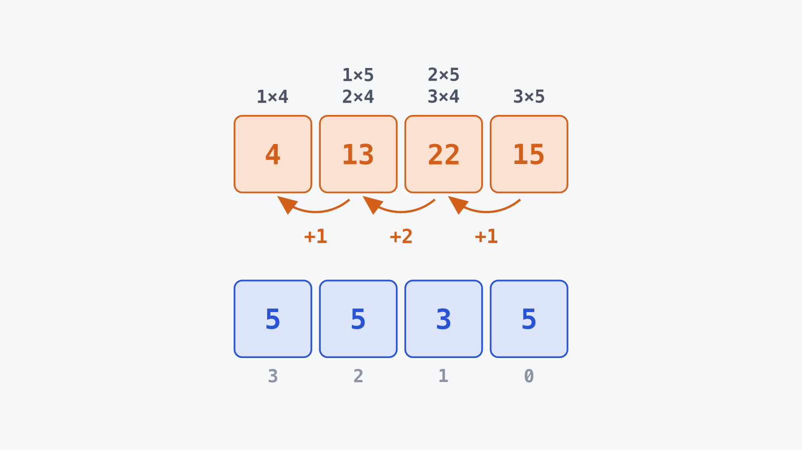

*123 × 45입니다. 윗줄은 자리별로 곱을 모은 것이에요.  
0번 자리에는 3×5, 1번 자리에는 2×5와 3×4가 들어갑니다.  
아직 한 칸에 10이 넘는 값이 있지만 괜찮습니다.  
오른쪽부터 넘친 만큼 왼쪽으로 올리면(주황) 5535가 됩니다.*

그림에서 중요한 점은 **올림을 마지막에 한꺼번에** 했다는 것입니다.  
칸에 22가 들어 있어도 “10짜리가 22개”라는 뜻은 그대로라서 수 자체는 달라지지 않아요.  
다 모은 뒤에 한 번만 정리하면 되니 코드가 훨씬 단순해집니다.

결과의 길이는 두 수의 길이를 더한 것을 넘지 않습니다.  
세 자리 수는 1000보다 작고 두 자리 수는 100보다 작으니, 곱은 100000보다 작아서 많아야 다섯 자리죠.

소수점은 따로 처리합니다.  
3.14는 `314 ÷ 100`이니, 소수점을 빼고 314를 정수로 곱한 다음 마지막에 소수점을 다시 찍으면 됩니다.  
한 번 곱할 때마다 소수점 아래 자릿수가 더해지니,  
b번 곱하면 `(a의 소수점 아래 자릿수) × b`자리가 됩니다.

```cpp
#include <bits/stdc++.h>
#define ibm514 ios::sync_with_stdio(0), cin.tie(0), cout.tie(0);
using namespace std;
typedef long long ll;
typedef vector<int> Big;   // 일의 자리부터 한 칸에 한 자리씩

Big mul(const Big &a, const Big &b) {
    Big c(a.size() + b.size(), 0);
    for (int i = 0; i < (int)a.size(); ++i)
        // i번 자리 × j번 자리는 i + j번 자리로 간다
        for (int j = 0; j < (int)b.size(); ++j) c[i + j] += a[i] * b[j];   
    // 올림은 마지막에 한꺼번에
    for (int i = 0; i + 1 < (int)c.size(); ++i) {                          
        c[i + 1] += c[i] / 10;
        c[i] %= 10;
    }
    while (c.size() > 1 && c.back() == 0) c.pop_back();
    return c;
}

void solve() {
    string s;
    int b;
    cin >> s >> b;
    int dot = s.find('.');
    int frac = s.size() - dot - 1;     // 소수점 아래 자릿수
    s.erase(dot, 1);                   // 소수점을 빼고 정수처럼 다룬다
    Big base;
    for (int i = s.size() - 1; i >= 0; --i) base.push_back(s[i] - '0');
    while (base.size() > 1 && base.back() == 0) base.pop_back();
    Big res = {1};
    for (int i = 0; i < b; ++i) res = mul(res, base);
    int f = frac * b;                 // 곱할 때마다 소수점 아래 자릿수가 더해진다
    while ((int)res.size() <= f) res.push_back(0); // 정수 부분이 없으면 0을 채운다
    for (int i = res.size() - 1; i >= 0; --i) {
        cout << res[i];
        if (i == f) cout << '.';
    }
}

int main() {
    ibm514
    solve();
    return 0;
}
```

한 칸에 쌓이는 값은 `9 × 9`가 자릿수만큼이라, 수천 자리까지는 `int`로 충분합니다.

이 곱셈은 두 수의 길이를 곱한 만큼 시간이 걸립니다.  
1000자리끼리는 문제없지만, 수십만 자리끼리 곱해야 한다면 훨씬 빠른 방법이 따로 필요해요.  
그건 이 글의 범위를 넘어갑니다.

### 36진법의 큰 수: 36진수

[BOJ 1036 36진수](https://www.acmicpc.net/problem/1036)입니다. 골드 1 문제예요.  
0~9와 A~Z를 숫자로 쓰는 36진법 수가 N개 있습니다.  
숫자 K종류를 골라서 그 숫자를 전부 Z(가장 큰 숫자인 35)로 바꾼 다음 모두 더할 때,  
합의 최댓값을 36진법으로 출력합니다.  
수의 길이가 50까지라서 `long long`에는 담을 수 없습니다.

10진법에서 한 일을 36진법에서 하면 됩니다.  
달라지는 건 올리는 기준이 10에서 36으로 바뀌는 것뿐이에요.

풀이는 이렇게 생각합니다.  
어떤 수의 i번 자리에 있는 숫자 d를 Z로 바꾸면, 그 수는 `(35 − d) × 36ⁱ`만큼 커집니다.  
숫자 d가 여러 군데 있으면 그만큼씩 전부 더해지죠. 이 합을 숫자 d의 **이득**이라고 합시다.

바꾼 뒤의 전체 합은 `원래의 합 + 고른 숫자들의 이득`입니다.  
어떤 숫자를 바꾸든 다른 숫자의 이득에는 영향이 없으니, 이득이 큰 순서로 K개를 고르면 됩니다.

이득도 큰 수라서 배열로 들고 있어야 하고, 크기를 비교할 줄도 알아야 합니다.  
비교는 쉽습니다. 길이를 맞춰 놓고 **가장 큰 자리부터** 보다가 처음 다른 칸에서 결정하면 돼요.

```cpp
#include <bits/stdc++.h>
#define ibm514 ios::sync_with_stdio(0), cin.tie(0), cout.tie(0);
using namespace std;
typedef long long ll;
const int LEN = 60;
typedef array<ll, LEN> Big;   // 36진법 수. 일의 자리부터 한 칸에 한 자리씩

int val(char c) { return isdigit(c) ? c - '0' : c - 'A' + 10; }
char sym(int v) { return v < 10 ? '0' + v : 'A' + v - 10; }

// 칸마다 쌓인 값을 0부터 35 사이로 정리한다
void normalize(Big &a) {
    for (int i = 0; i + 1 < LEN; ++i) {
        a[i + 1] += a[i] / 36;
        a[i] %= 36;
    }
}

void solve() {
    int n, k;
    cin >> n;
    Big total{};      // 원래 수들의 합
    Big gain[36]{};   // gain[d] = 숫자 d를 전부 Z로 바꿨을 때 합이 늘어나는 양
    while (n--) {
        string s;
        cin >> s;
        reverse(s.begin(), s.end());
        for (int i = 0; i < (int)s.size(); ++i) {
            int d = val(s[i]);
            total[i] += d;
            gain[d][i] += 35 - d;   // 이 자리에서 d가 35가 되니 35 - d만큼 는다
        }
    }
    cin >> k;
    for (auto &g : gain) normalize(g);
    // 큰 자리부터 비교해서 이득이 큰 순서로 정렬한다
    sort(gain, gain + 36, [](const Big &a, const Big &b) {
        for (int i = LEN - 1; i >= 0; --i)
            if (a[i] != b[i]) return a[i] > b[i];
        return false;
    });
    for (int j = 0; j < k; ++j)
        for (int i = 0; i < LEN; ++i) total[i] += gain[j][i];
    normalize(total);
    int top = LEN - 1;
    while (top > 0 && total[top] == 0) --top;
    for (int i = top; i >= 0; --i) cout << sym(total[i]);
}

int main() {
    ibm514
    solve();
    return 0;
}
```

곱셈에서 쓴 요령을 여기서도 썼습니다.  
자리마다 일단 값을 쌓아 두고, `normalize`로 한 번에 정리합니다.  
한 칸에 쌓이는 값은 많아야 `35 × 50`이라 넘칠 걱정도 없어요.

참고로 파이썬은 정수의 크기에 제한이 없고, 자바에는 `BigInteger`가 있습니다.  
C++에는 그런 게 없어서 이렇게 직접 만들어야 하는데,  
한 번 만들어 보면 다른 언어의 큰 수가 안에서 무슨 일을 하는지도 알게 됩니다.

## 경우의 수

경우의 수 문제는 공식을 얼마나 아느냐보다 **어떻게 세는지**가 중요합니다.  
자주 쓰는 방법 세 가지를 보겠습니다.

### 거꾸로 세기

주사위를 세 번 던졌을 때 6이 **적어도 한 번** 나오는 경우는 몇 가지일까요?  
한 번 나오는 경우, 두 번 나오는 경우, 세 번 나오는 경우를 따로 세어 더해도 되지만 번거롭습니다.

반대쪽을 세면 한 줄입니다.  
전체는 `6 × 6 × 6 = 216`가지이고,  
6이 **한 번도 안** 나오는 경우는 매번 다섯 가지 중에 고르니 `5 × 5 × 5 = 125`가지입니다.  
그러니 `216 − 125 = 91`가지예요.

“적어도 하나”라는 말이 보이면 **전체에서 “하나도 없는 경우”를 빼는 것**부터 떠올리세요.  
심화편에서 다룰 포함배제도 결국 이 생각을 여러 조건으로 넓힌 것입니다.

### 칸막이로 세기: 합분해

[BOJ 2225 합분해](https://www.acmicpc.net/problem/2225)입니다.  
0 이상의 정수 K개를 더해서 N을 만드는 방법의 수를 구합니다. 순서가 다르면 다른 방법으로 셉니다.  
답은 1,000,000,000으로 나눈 나머지로 출력합니다.

DP로도 풀 수 있지만, 그림 하나로 식이 바로 나옵니다.  
N = 6, K = 4라고 합시다. 동그라미 6개를 한 줄로 놓고, 그 사이에 **막대 3개**를 꽂아 네 칸으로 나눕니다.

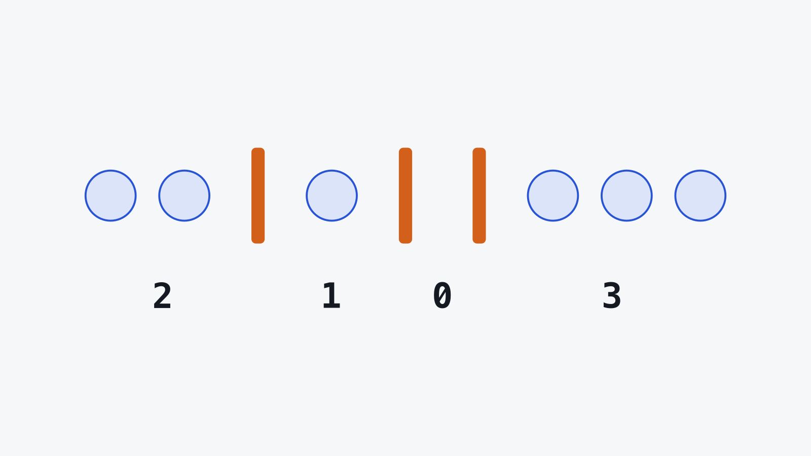

*동그라미 6개와 막대 3개를 한 줄로 늘어놓았습니다.  
막대로 나뉜 네 칸의 동그라미 수를 읽으면 2, 1, 0, 3이고, 이건 2 + 1 + 0 + 3 = 6이라는 분해입니다.*

막대가 붙어 있으면 그 사이 칸은 0입니다.  
이렇게 보면 **늘어놓는 방법 하나가 분해 하나**와 정확히 짝이 됩니다.  
늘어놓는 방법이 다르면 어느 칸인가의 동그라미 수가 달라지고,  
거꾸로 어떤 분해든 그대로 그려서 늘어놓을 수 있으니까요.

그러니 늘어놓는 방법의 수를 세면 됩니다.  
자리는 모두 `N + K − 1`개이고,  
그중 막대가 들어갈 `K − 1`자리만 고르면 나머지는 자동으로 동그라미입니다.  
답은 `N + K − 1`**개 중에서 **`K − 1`**개를 고르는 경우의 수**예요.  
예제로 확인하면, N = 6, K = 4일 때 9개 중 3개를 고르는 84가지로 맞습니다.

이게 흔히 말하는 중복조합입니다.  
공식을 외우는 대신 “동그라미와 막대를 늘어놓는다”만 기억하면, 필요할 때 다시 만들어 낼 수 있어요.

### 덧셈만으로 조합 구하기

이제 조합을 구해야 합니다.  
고르는 경우의 수의 공식은 `n! ÷ (r! × (n − r)!)`인데, 여기에는 **나눗셈**이 들어 있어요.  
앞에서 더하기, 빼기, 곱하기는 중간에 나머지를 구해도 된다고 했는데, 나눗셈 이야기는 하지 않았죠.  
나눗셈은 그렇게 할 수 없습니다.  
`20 ÷ 4 = 5`인데, 7로 나눈 나머지를 먼저 구하면 20은 6이 되고 `6 ÷ 4`는 정수조차 아니니까요.

나눗셈이 문제라면 나눗셈을 안 쓰면 됩니다.  
조합은 덧셈만으로도 구할 수 있어요.

**n개 중 r개를 고르는 방법의 수 = (n − 1개 중 r − 1개를 고르는 수) + (n − 1개 중 r개를 고르는 수)**

1. n개 중에서 하나를 정해 “철수”라고 부릅시다.
2. r개를 고르는 방법은 철수를 **넣는** 경우와 **빼는** 경우로 나뉩니다.  
둘은 겹치지 않고, 둘을 합치면 전부입니다.
3. 철수를 넣는다면, 나머지 n − 1개 중에서 r − 1개를 더 고르면 됩니다.
4. 철수를 뺀다면, 나머지 n − 1개 중에서 r개를 전부 골라야 합니다.
5. 두 경우를 더한 것이 전체입니다.

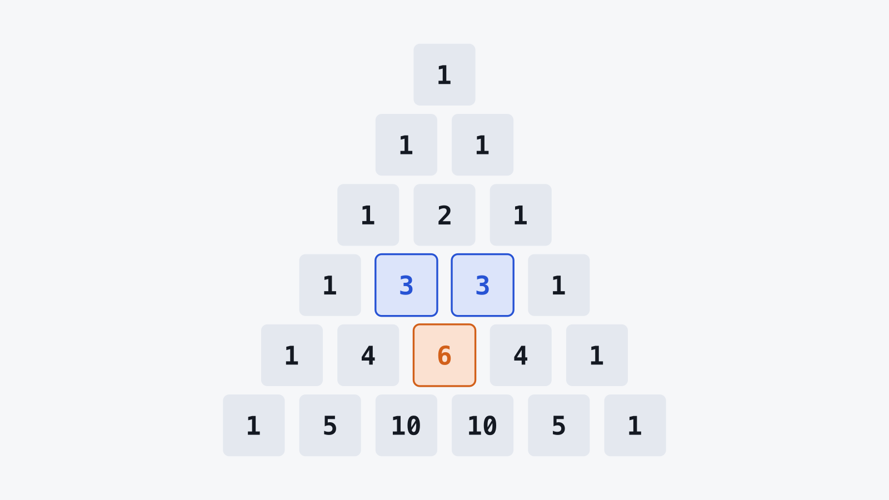

*위에서부터 n = 0, 1, 2, …인 줄입니다. 각 칸은 바로 위의 두 칸을 더한 값이에요.  
6(주황)은 위의 3과 3(파랑)을 더한 것입니다.*

이 표를 파스칼의 삼각형이라고 부릅니다.  
덧셈만 쓰니까 더할 때마다 나머지를 구하면 되고, 나누는 수가 소수든 아니든 상관없습니다.

```cpp
#include <bits/stdc++.h>
#define ibm514 ios::sync_with_stdio(0), cin.tie(0), cout.tie(0);
using namespace std;
typedef long long ll;
const int MOD = 1e9;
int C[400][400];   // C[n][r] = n개 중에서 r개를 고르는 경우의 수

void solve() {
    int n, k;
    cin >> n >> k;
    int m = n + k - 1;
    for (int i = 0; i <= m; ++i) {
        C[i][0] = 1;
        // 파스칼의 삼각형
        for (int j = 1; j <= i; ++j) C[i][j] = (C[i - 1][j - 1] + C[i - 1][j]) % MOD;   
    }
    cout << C[m][k - 1];   // 동그라미 n개와 막대 k - 1개를 한 줄로 늘어놓는 방법
}

int main() {
    ibm514
    solve();
    return 0;
}
```

조합을 구하는 방법이 두 가지가 됐습니다. 언제 무엇을 쓸지는 이렇게 정하면 됩니다.

- **파스칼의 삼각형**: n이 수천 이하로 작을 때. 표의 크기가 n × n이라 큰 n에는 못 씁니다.  
대신 나누는 수가 무엇이든 됩니다.
- **팩토리얼과 역원**: n이 수백만까지 클 때. 나머지에서 나눗셈을 하는 방법이 필요한데,  
이건 심화편에서 다룹니다.

## 자주 하는 실수

- **곱한 뒤에 나머지를 구한다.** 세 수를 한꺼번에 곱하면 넘칩니다.  
두 수를 곱할 때마다 나머지를 구해야 합니다.
- **음수 나머지를 그대로 쓴다.** 뺄셈 뒤에는 `(a - b + m) % m`처럼 m을 더해 줍니다.
- **나머지 상태에서 나눈다.** 더하기, 빼기, 곱하기와 달리 나눗셈은 중간에 나머지를 구하면 안 됩니다.
- **최소공배수를 구할 때 먼저 곱한다.** `a * b / g`는 곱하는 순간 넘칠 수 있습니다.  
`a / g * b`로 씁니다.
- **회전에서 원래 배열 기준으로 식을 쓴다.** 새 배열의 칸을 기준으로 “어디서 왔는가”를  
쓰면 헷갈리지 않습니다.
- **자릿수를 꺼내는 순서를 착각한다.** 나머지로 꺼내면 맨 끝자리부터 나옵니다.
- **수 하나에 담을 수 있는 양을 넘긴다.** `N^k`이 자료형의 한계보다 작은지 먼저 확인합니다.
- **큰 수를 앞자리부터 저장한다.** 일의 자리가 0번 칸에 오도록 뒤집어야 올림과 길이 처리가 쉬워집니다.
- **큰 수의 맨 윗자리 올림을 빼먹는다.** 다 더한 뒤에도 올림이 남으면 한 칸을 더 씁니다.

## 마무리

글이 길었는데, 정리하면 이 정도입니다.

1. m의 배수는 나머지를 바꾸지 못합니다. 그래서 더하기, 빼기, 곱하기는 중간에 나머지를 구해도 됩니다.
2. 거듭제곱은 지수를 2진법으로 보고 제곱을 거듭해서 구합니다. 수 대신 행렬을 넣어도 똑같이 됩니다.
3. 차가 m의 배수라는 것과 나머지가 같다는 것은 같은 말입니다.  
그래서 나머지가 같아지는 수는 차들의 공약수입니다.
4. 최대공약수는 큰 수를 작은 수로 나눈 나머지로 바꿔 가며 구합니다.
5. 배열을 돌릴 때는 새 배열의 각 행이 원래 배열의 어느 줄을 어느 방향으로 읽은 것인지를 씁니다.
6. N으로 나눈 나머지가 N진법의 끝자리입니다. 이걸로 모든 경우를 세고, 여러 값을 수 하나에 담습니다.
7. 자료형에 안 담기는 수는 배열에 한 자리씩 담고 세로셈으로 계산합니다.  
곱셈은 i번 자리와 j번 자리의 곱을 i + j번 자리에 모읍니다.
8. “적어도 하나”는 전체에서 빼고, 나눠 담는 방법은 동그라미와 막대로 세고,  
조합은 덧셈만으로도 구할 수 있습니다.

심화편에서는 여기서 남겨 둔 나눗셈을 다룹니다.  
역원이 무엇이고 왜 소수로 나누라고 하는지, 그리고 겹쳐 센 것을 바로잡는 포함배제까지 이어집니다.

## 추천 문제

본문에서 본 내용을 그대로 연습할 수 있는 문제들입니다.

1. [BOJ 1850 최대공약수](https://www.acmicpc.net/problem/1850): 1로만 이루어진 두 수의 최대공약수를 길이로 구하기
2. [BOJ 14391 종이 조각](https://www.acmicpc.net/problem/14391): 칸마다 가로인지 세로인지를 2진법으로 세기
3. [BOJ 18808 스티커 붙이기](https://www.acmicpc.net/problem/18808): 돌려 가며 맞는 자리 찾기
4. [BOJ 10826 피보나치 수 4](https://www.acmicpc.net/problem/10826): 큰 수의 덧셈을 만 번 되풀이하기

여기서부터는 도전 문제입니다. 아래로 갈수록 어려워집니다.

1. [BOJ 15824 너 봄에는 캡사이신이 맛있단다](https://www.acmicpc.net/problem/15824): 정렬한 뒤 2의 거듭제곱을 나머지로 다루기
2. [BOJ 10830 행렬 제곱](https://www.acmicpc.net/problem/10830): 행렬의 빠른 거듭제곱을 크기 N으로 넓히기
3. [BOJ 17425 약수의 합](https://www.acmicpc.net/problem/17425): 배수 쪽에서 세어서 미리 구해 두기
