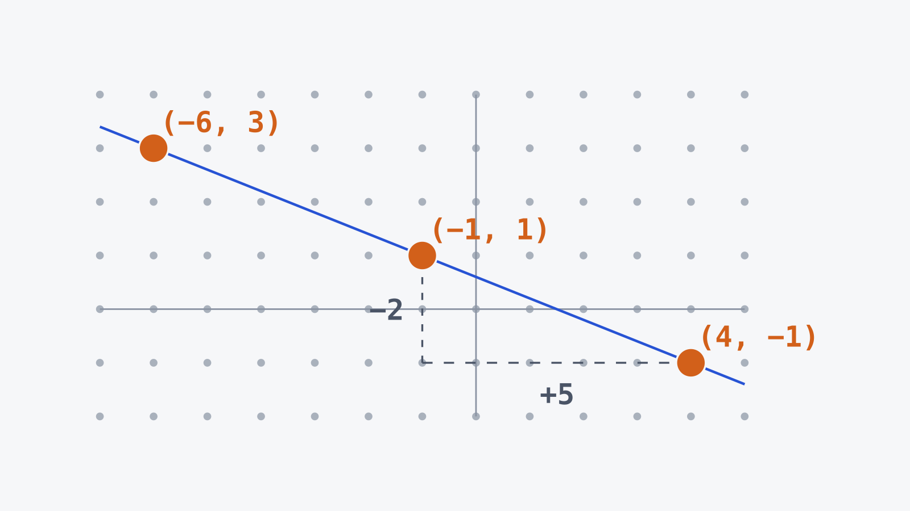
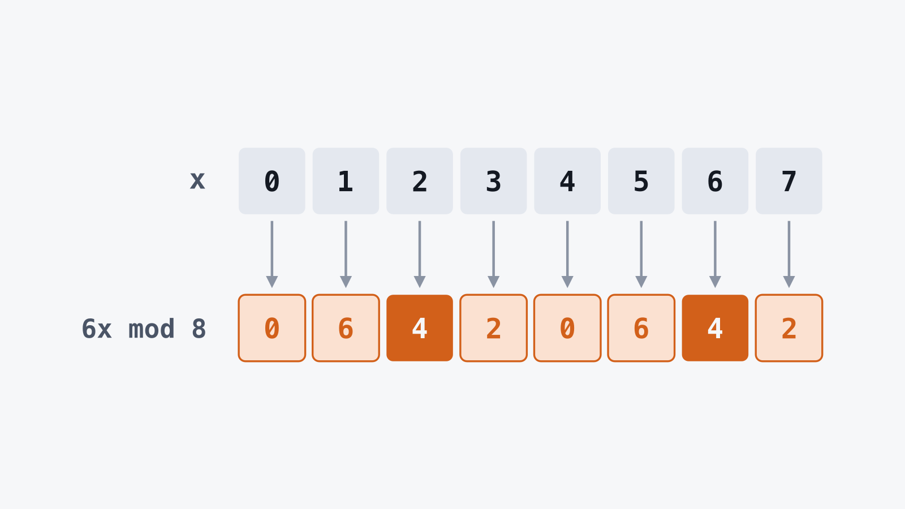
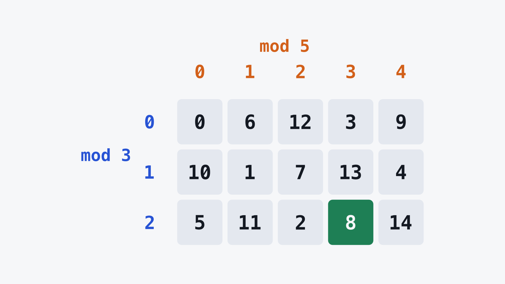
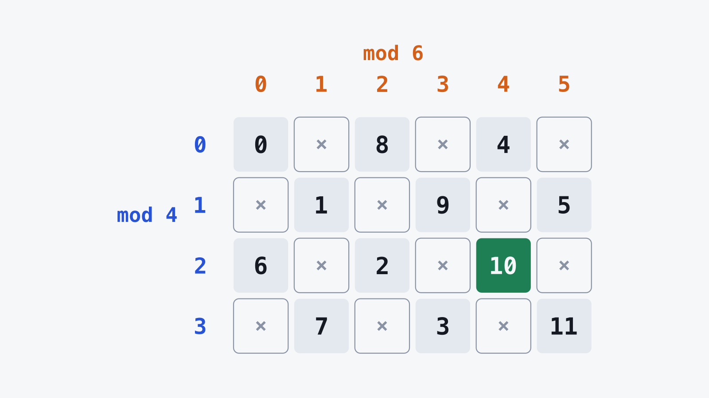
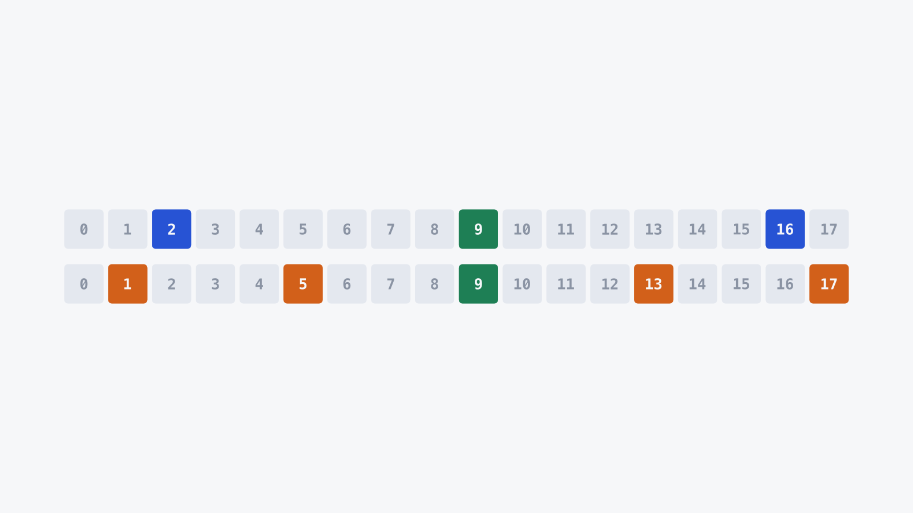
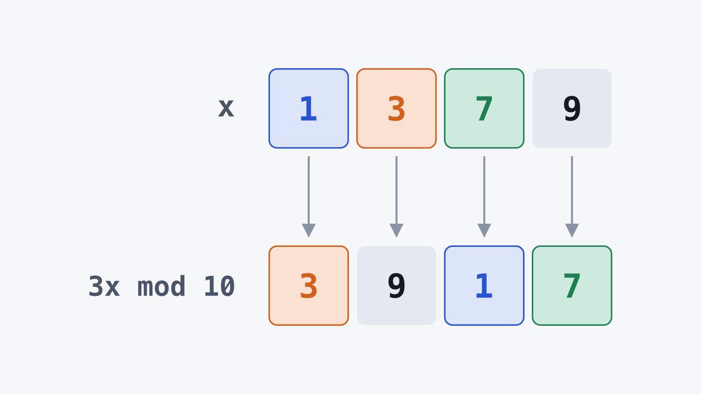
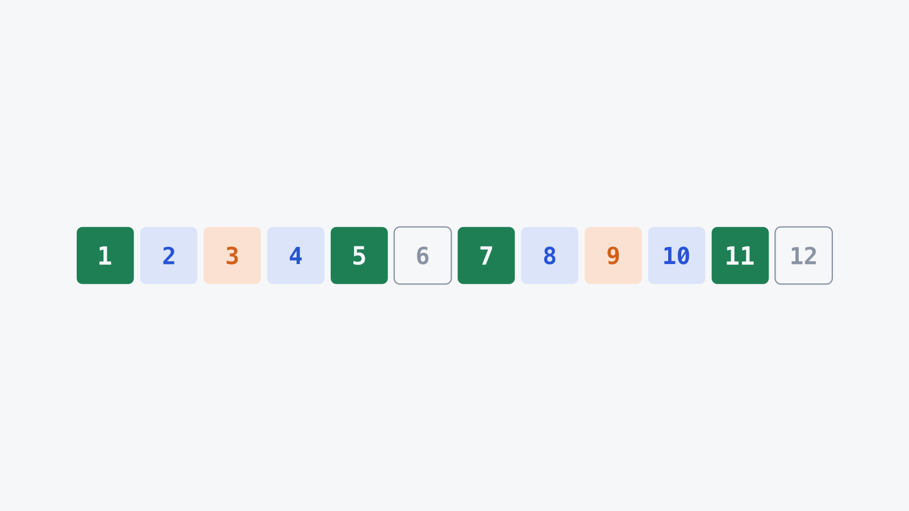
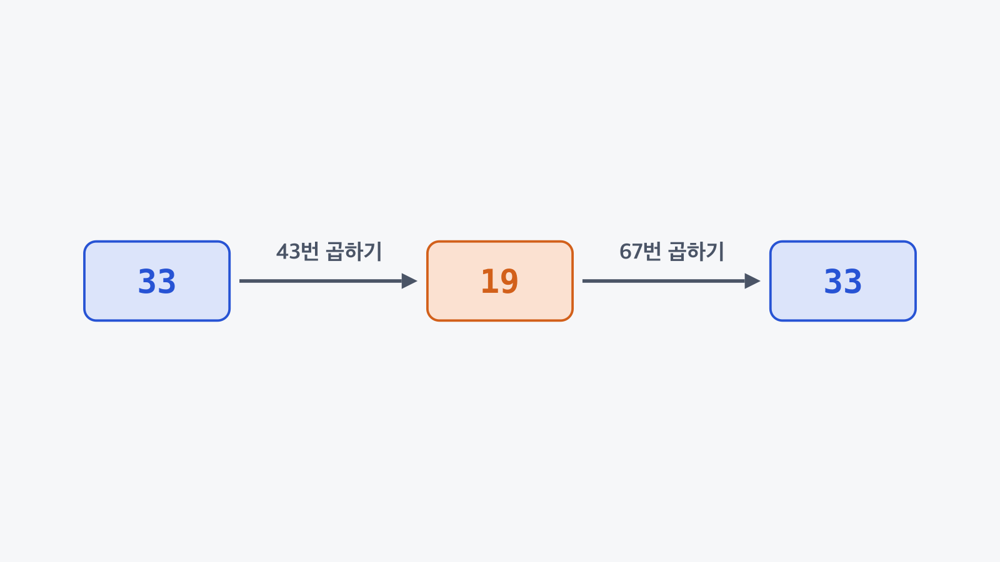

# PS 수학: 대회편

> rilog 발행 글: <https://www.rilog.kr/@iqed/posts/625> (2026-11-25)

안녕하세요 ~ PS 수학 이야기의 세 번째, 마지막 편입니다.

기본편에서는 나머지 연산의 더하기, 빼기, 곱하기를 봤고, 심화편에서는 역원으로 나눗셈까지 했습니다.  
이번 편에서는 한 걸음 더 나가서 **나머지로 쓴 방정식**을 풉니다.  
“3으로 나누면 2가 남고 5로 나누면 3이 남는 수는?” 같은 질문에 답하는 방법이에요.

다루는 것은 세 가지입니다.  
확장 유클리드 호제법으로 푸는 방정식, 중국인의 나머지 정리, 오일러의 정리입니다.  
  
코딩테스트에는 나오지 않고 대회에서 만나는 내용이라 이름을 대회편이라고 붙였습니다.

## 앞의 두 편에서 가져올 것

이번 글에서 계속 쓰는 사실들을 먼저 적어 둡니다.  
“나머지가 같다”는 말은 전부 같은 수로 나눈 나머지를 말합니다.

1. **두 수의 차가 m의 배수라는 것과, 두 수를 m으로 나눈 나머지가 같다는 것은 같은 말이다.**
2. **확장 유클리드.** 어떤 a와 b에 대해서도 `a × x + b × y = (a와 b의 최대공약수)`가 되는 정수 x, y가 있고, 심화편에서 만든 `egcd` 함수가 이걸 찾아 줍니다.
3. **역원.** a와 m의 공약수가 1뿐이면, a와 곱해서 m으로 나눈 나머지가 1이 되는 수가 있습니다.
4. **빠른 거듭제곱.** 지수가 아무리 커도 곱셈 수십 번이면 됩니다.

하나만 새로 준비하겠습니다. 뒤에서 여러 번 쓰는 성질이에요.

**a와 m의 공약수가 1뿐이고 **`a × b`**가 m의 배수이면, b가 m의 배수다.**

1. a와 m의 최대공약수가 1이니 `a × x + m × y = 1`인 x와 y가 있습니다.
2. 양쪽에 b를 곱하면 `a × b × x + m × b × y = b`입니다.
3. 왼쪽의 첫 항은 `a × b`가 m의 배수이니 m의 배수이고, 둘째 항에는 m이 곱해져 있습니다.
4. m의 배수 둘을 더한 것이 b이니, b는 m의 배수입니다.

심화편에서 소수에 대해 증명한 것과 같은 방법입니다.  
소수가 아니어도 “공약수가 1뿐”이기만 하면 된다는 점이 다릅니다.  
아래에서는 이걸 **지우기 규칙**이라고 부르겠습니다. 곱에서 a를 지워도 된다는 뜻이에요.

## 정수 해를 찾는 방정식

### 해가 있는지부터

`6 × x + 15 × y = 9`를 만족하는 **정수** x와 y가 있을까요?  
x = −1, y = 1을 넣으면 `−6 + 15 = 9`로 맞습니다.  
그럼 `6 × x + 15 × y = 10`은 어떨까요? 이건 아무리 찾아도 없습니다.

이유는 왼쪽을 보면 알 수 있습니다.  
6도 15도 3의 배수이니, x와 y에 어떤 정수를 넣어도 왼쪽은 3의 배수입니다.  
10은 3의 배수가 아니니 같아질 수가 없죠.

`A × x + B × y = C`**에 정수 해가 있는 것은, C가 A와 B의 최대공약수 g의 배수일 때뿐이다.**

1. A와 B가 모두 g의 배수이니, 왼쪽은 x와 y가 무엇이든 g의 배수입니다.  
C가 g의 배수가 아니면 해가 없습니다.
2. 거꾸로 C가 g의 배수라고 합시다. 확장 유클리드로 `A × x + B × y = g`인 x와 y를 찾을 수 있습니다.
3. 양쪽에 `C ÷ g`를 곱하면 `A × (x × C/g) + B × (y × C/g) = C`입니다. 해를 하나 찾았습니다.

6과 15로 해 보면, 확장 유클리드가 `6 × (−2) + 15 × 1 = 3`을 찾아 줍니다.  
양쪽에 3을 곱하면 `6 × (−6) + 15 × 3 = 9`이니, x = −6, y = 3도 해입니다.  
아까 찾은 (−1, 1)과는 다른 해네요. 해가 하나가 아니라는 뜻입니다.

### 해는 하나가 아니다

방정식의 양쪽을 최대공약수 3으로 나누면 `2 × x + 5 × y = 3`이 됩니다. 해는 그대로예요.  
이 식의 정수 해를 좌표에 찍어 보면 규칙이 보입니다.



*직선 2x + 5y = 3 위에 있는 정수 점들입니다.  
(−6, 3), (−1, 1), (4, −1)처럼, x가 5 늘 때마다 y가 2 줄어듭니다.*

x를 5 늘리면 `2 × x`가 10 늘고, y를 2 줄이면 `5 × y`가 10 줄어서 합이 그대로입니다.  
그래서 해 하나에서 x에 5를 더하고 y에서 2를 빼면 또 해가 됩니다.

**해 하나 (x₀, y₀)를 알면, 모든 해는 **`x = x₀ + k × (B/g)`**, **`y = y₀ − k × (A/g)`**이다. k는 아무 정수.**

이 모양이 해가 된다는 건 방금 본 대로입니다. 넣어 보면 늘어난 만큼 줄어서 상쇄되죠.  
중요한 건 **이것 말고 다른 해는 없다**는 쪽입니다.

1. 양쪽을 g로 나눈 식을 `a × x + b × y = c`라고 합시다. a와 b는 공약수가 1뿐입니다.
2. (x₀, y₀)와 (x, y)가 둘 다 해라면, 두 식을 빼서 `a × (x − x₀) + b × (y − y₀) = 0`입니다.
3. 넘기면 `a × (x − x₀) = −b × (y − y₀)`이니, `a × (x − x₀)`는 b의 배수입니다.
4. a와 b의 공약수가 1뿐이니, 지우기 규칙으로 `x − x₀`가 b의 배수입니다.  
`x = x₀ + k × b`라고 쓸 수 있습니다.
5. 이걸 3번에 넣으면 `a × k × b = −b × (y − y₀)`이고, b로 나누면 `y = y₀ − k × a`입니다.

PS에서 중요한 건 이 일반적인 모양 쪽입니다.  
문제는 보통 “x는 1 이상”, “y는 10억 이하” 같은 조건을 붙이는데,  
확장 유클리드가 준 해가 그 범위에 있으리란 보장이 없거든요.  
그럴 때 k를 움직여서 범위 안으로 옮깁니다.

### 범위에 맞는 해 고르기: 캔디 분배

[BOJ 3955 캔디 분배](https://www.acmicpc.net/problem/3955)입니다.  
아이 K명에게 사탕을 X개씩 나눠 주고 하나가 남도록, 한 봉지에 C개 든 사탕을 Y봉지 삽니다.  
X는 1 이상이어야 하고 Y는 10억 이하여야 합니다. 가능한 Y를 하나 구합니다.

식으로 쓰면 `K × X + 1 = C × Y`, 곧 `C × Y − K × X = 1`입니다.  
오른쪽이 1이니, 해가 있으려면 C와 K의 최대공약수가 1이어야 합니다. 아니면 바로 불가능이죠.

해가 있다면 Y의 모양은 `Y = y₀ + k × K`입니다.  
K를 주기로 되풀이되니, 일단 0 이상 K 미만으로 옮겨 놓고 조건을 따집니다.

- X가 1 이상이어야 합니다. `C × Y = K × X + 1`이니 `C × Y`가 K보다 커야 합니다.  
모자라면 Y에 K를 더합니다.
- 그렇게 구한 가장 작은 Y가 10억을 넘으면 불가능입니다.

```cpp
#include <bits/stdc++.h>
#define ibm514 ios::sync_with_stdio(0), cin.tie(0), cout.tie(0);
using namespace std;
typedef long long ll;

// a × x + b × y = g 가 되는 x, y를 찾고, g(a와 b의 최대공약수)를 돌려준다
ll egcd(ll a, ll b, ll &x, ll &y) {
    if (b == 0) {
        x = 1, y = 0;
        return a;
    }
    ll x1, y1;
    ll g = egcd(b, a % b, x1, y1);
    x = y1;
    y = x1 - a / b * y1;
    return g;
}

void solve() {
    int T;
    cin >> T;
    while (T--) {
        ll k, c;
        cin >> k >> c;
        // k × X + 1 = c × Y, 곧 c × Y - k × X = 1 을 푼다
        ll y, x;
        ll g = egcd(c, k, y, x);       // c × y + k × x = g
        if (g != 1) { cout << "IMPOSSIBLE\n"; continue; }
        y = (y % k + k) % k;           // Y의 해는 k를 주기로 되풀이된다
        while (c * y <= k) y += k;     // X가 1 이상이려면 c × Y > k 여야 한다
        if (y > 1000000000) cout << "IMPOSSIBLE\n";
        else cout << y << '\n';
    }
}

int main() {
    ibm514
    solve();
    return 0;
}
```

예제의 `10 7`로 따라가 봅시다.  
확장 유클리드가 `7 × 3 + 10 × (−2) = 1`을 찾아 주니 Y는 3입니다.  
`7 × 3 = 21 = 10 × 2 + 1`이라 한 명에게 2개씩 주고 하나가 남습니다.

`while`이 오래 돌 것 같지만 많아야 두 번입니다.  
Y가 0일 때(K가 1인 경우) 한 번, 그리고 C가 1이라 사탕이 모자랄 때 한 번이에요.

## 나머지로 쓴 방정식

### 곱해서 나머지가 b가 되는 수

이번에는 이런 질문입니다.  
“6에 어떤 수 x를 곱해서 8로 나눈 나머지가 4가 되게 하려면?”  
역원을 구할 때는 나머지가 1이 되는 수를 찾았는데, 이번에는 1이 아니라 아무 값 b입니다.



*x에 6을 곱하고 8로 나눈 나머지입니다.  
아래 줄에는 0, 2, 4, 6만 나오고, 같은 값이 두 번씩 나옵니다. 나머지가 4가 되는 x는 2와 6입니다.*

표에서 두 가지가 보입니다.  
홀수는 한 번도 안 나옵니다. 그러니 나머지가 3이 되게 하는 x는 없습니다.  
그리고 나오는 값은 두 번씩 나옵니다. x = 2와 x = 6이 둘 다 답이에요.

이 질문은 사실 앞에서 푼 방정식과 같은 것입니다.  
“`6 × x`를 8로 나눈 나머지가 4”라는 건 “`6 × x`에서 8의 배수를 빼면 4”라는 뜻이니,  
`6 × x + 8 × y = 4`인 정수 x, y를 찾는 문제죠.  
그래서 앞의 결과가 그대로 넘어옵니다.

`a × x`**를 m으로 나눈 나머지가 b가 되는 x가 있는 것은, b가 a와 m의 최대공약수 g의 배수일 때뿐이다. **  
**그때 해는 **`m ÷ g`**를 주기로 되풀이된다.**

- 해가 있을 조건은 방정식 `a × x + m × y = b`의 조건 그대로입니다.
- x의 모양은 `x = x₀ + k × (m/g)`였습니다.  
그러니 `m/g`마다 해가 하나씩 있고, 0 이상 m 미만에는 g개가 있습니다.

6과 8의 최대공약수는 2입니다.  
4는 2의 배수이니 해가 있고, 주기는 `8 ÷ 2 = 4`입니다.  
표에서 x = 2와 x = 6이 4 간격인 것과 맞죠.

구하는 순서는 이렇습니다.

1. 확장 유클리드로 `a × x + m × y = g`인 x를 구합니다.
2. b가 g의 배수가 아니면 해가 없습니다.
3. x에 `b ÷ g`를 곱하고, `m ÷ g`로 나눈 나머지를 구하면 가장 작은 해입니다.

### 끝나지 않는 반복문: C Looooops

[BOJ 6670 C Looooops](https://www.acmicpc.net/problem/6670)입니다.  
`for (v = A; v != B; v += C)`라는 반복문이 몇 번 도는지 구합니다.  
변수 v는 k비트짜리라서 `2ᵏ`으로 나눈 나머지만 남습니다.  
끝나지 않으면 FOREVER를 출력합니다. k는 32까지입니다.

x번 돌고 나면 v는 `A + C × x`를 `2ᵏ`으로 나눈 나머지입니다.  
이게 B와 같아지는 가장 작은 x를 찾으면 되죠.  
`C × x`를 `2ᵏ`으로 나눈 나머지가 `B − A`가 되는 x, 방금 본 모양 그대로입니다.

나누는 수 `2ᵏ`은 소수가 아니고, C가 짝수면 공약수까지 있습니다.  
페르마의 소정리도 못 쓰고 역원도 없을 수 있는 상황이라, 지금까지 만든 것 중에는 이 방법만 통합니다.

```cpp
#include <bits/stdc++.h>
#define ibm514 ios::sync_with_stdio(0), cin.tie(0), cout.tie(0);
using namespace std;
typedef long long ll;

// a × x + b × y = g 가 되는 x, y를 찾고, g(a와 b의 최대공약수)를 돌려준다
ll egcd(ll a, ll b, ll &x, ll &y) {
    if (b == 0) {
        x = 1, y = 0;
        return a;
    }
    ll x1, y1;
    ll g = egcd(b, a % b, x1, y1);
    x = y1;
    y = x1 - a / b * y1;
    return g;
}

// a × x 를 m으로 나눈 나머지가 b가 되는 가장 작은 0 이상의 x. 없으면 -1
ll congruence(ll a, ll b, ll m) {
    ll x, y;
    ll g = egcd(a, m, x, y);                 // a × x + m × y = g
    if (b % g != 0) return -1;               // b가 g의 배수가 아니면 해가 없다
    ll mg = m / g;                           // 해는 m / g 를 주기로 되풀이된다
    x = (x % mg + mg) % mg;
    return (ll)((__int128)x * ((b / g) % mg) % mg);
}

void solve() {
    ll a, b, c, k;
    while (cin >> a >> b >> c >> k && (a || b || c || k)) {
        ll m = 1LL << k;
        // a + c × x 를 m으로 나눈 나머지가 b가 되는 가장 작은 x
        ll x = congruence(c, ((b - a) % m + m) % m, m);
        if (x == -1) cout << "FOREVER\n";
        else cout << x << '\n';
    }
}

int main() {
    ibm514
    solve();
    return 0;
}
```

`congruence`가 위의 세 단계를 그대로 옮긴 함수입니다.  
예제의 `3 7 2 16`은 `2 × x`를 65536으로 나눈 나머지가 4가 되는 x를 찾는 것이고, 답은 2입니다.  
`3 4 2 16`은 나머지가 1이 되어야 하는데 1은 2의 배수가 아니라 FOREVER입니다.  
2씩 더해서는 홀짝이 영영 안 바뀌니까요.

곱셈 한 군데에 `__int128`을 썼습니다.  
나누는 수가 `2³²`까지라 두 수를 곱하면 `2⁶⁴` 근처가 되어 `long long`을 넘거든요.  
이 함수는 뒤에서 계속 쓰는데, 거기서는 나누는 수가 더 커지니 이렇게 해 두는 편이 안전합니다.

## 중국인의 나머지 정리

### 나머지 두 개로 수 하나 찾기

“3으로 나누면 2가 남고, 5로 나누면 3이 남는 수는?”  
옛 중국의 수학책에 실린 문제에서 이름이 붙은 정리입니다.  
답부터 말하면 8이고, 그다음은 23, 38, …로 15마다 하나씩 있습니다.



*0부터 14까지의 수를, 3으로 나눈 나머지(세로)와 5로 나눈 나머지(가로)가 만나는 칸에 적었습니다.  
열다섯 칸이 하나도 겹치지 않고 전부 찹니다. 나머지가 (2, 3)인 칸에는 8이 있습니다.*

표를 보면 열다섯 칸에 0부터 14까지가 **하나씩** 들어가 있습니다.  
어떤 나머지 조합을 고르든 그 조합이 되는 수가 15 미만에 딱 하나 있다는 뜻이에요.

**m과 n의 공약수가 1뿐이면, **  
**m으로 나눈 나머지가 a이고 n으로 나눈 나머지가 b인 수가 0 이상 **`m × n`** 미만에 정확히 하나 있다.**

“있다”와 “하나뿐이다”를 따로 보입니다.

**있다.** 해를 직접 만들어 보이면 됩니다.

1. m으로 나눈 나머지가 a인 수는 `x = a + m × t` 모양입니다. t만 잘 고르면 됩니다.
2. 이 x를 n으로 나눈 나머지가 b여야 하니, `m × t`를 n으로 나눈 나머지가 `b − a`여야 합니다.
3. 방금 배운 “곱해서 나머지가 정해진 값이 되는 수” 찾기입니다.  
m과 n의 최대공약수가 1이니 `b − a`가 무엇이든 해가 있습니다.
4. 그 t를 넣은 `a + m × t`가 답입니다.

3과 5로 해 보면, `x = 2 + 3 × t`이고 `3 × t`를 5로 나눈 나머지가 `3 − 2 = 1`이어야 합니다.  
t = 2이면 6이라 맞죠. 그러니 `x = 2 + 6 = 8`입니다.  
이 증명이 곧 구하는 방법이기도 합니다. 뒤의 코드가 이 네 줄을 그대로 옮긴 거예요.

**하나뿐이다.**

1. x와 x′가 둘 다 답이라고 합시다. 둘은 m으로 나눈 나머지도 같고 n으로 나눈 나머지도 같습니다.
2. 그러니 차 `x − x′`는 m의 배수이면서 n의 배수입니다.
3. m의 배수이니 `x − x′ = m × s`라고 쓰면, `m × s`가 n의 배수입니다.  
m과 n의 공약수가 1뿐이니 지우기 규칙으로 s가 n의 배수입니다.
4. 그러니 `x − x′`는 `m × n`의 배수입니다.
5. 둘 다 0 이상 `m × n` 미만이면 차이가 `m × n`보다 작으니, 차는 0일 수밖에 없습니다.

“하나뿐이다”는 덤처럼 보이지만 쓸모가 많습니다.  
거꾸로 읽으면 **m과 n으로 나눈 나머지가 각각 같은 두 수는 **`m × n`**으로 나눈 나머지도 같다**는 뜻이거든요.  
큰 수로 나눈 나머지를 다루기 어려울 때, 작은 수 여러 개로 쪼개서 따로 본 뒤 합쳐도 된다는 보증서입니다. 마지막 문제에서 이걸 씁니다.

### 공약수가 있으면

문제는 대개 여기서 한 번 꼽니다. m과 n이 서로 공약수를 가지는 경우예요.  
4와 6으로 같은 표를 그려 봅시다.



*4로 나눈 나머지(세로)와 6으로 나눈 나머지(가로)입니다.  
0부터 11까지만 서로 다른 칸에 들어가고, 스물네 칸 중 절반은 비어 있습니다(×).*

달라진 점이 두 가지입니다.  
**빈 칸이 생겼습니다.** 4로 나눈 나머지가 1이면서 6으로 나눈 나머지가 0인 수는 없어요.  
앞의 조건은 홀수라는 뜻이고 뒤의 조건은 짝수라는 뜻이라 서로 부딪칩니다.  
**주기가 줄었습니다.** `4 × 6 = 24`가 아니라 12마다 같은 칸으로 돌아옵니다. 12는 4와 6의 최소공배수죠.

**m으로 나눈 나머지가 a이고 n으로 나눈 나머지가 b인 수가 있는 것은,**  
`b − a`**가 m과 n의 최대공약수 g의 배수일 때뿐이다. 그때 해는 m과 n의 최소공배수마다 하나씩 있다.**

증명은 앞의 것을 조금만 고치면 됩니다.

- **있을 조건.** `x = a + m × t`로 놓고 `m × t`를 n으로 나눈 나머지가 `b − a`가 되게 하는 것까지는 똑같습니다. 이런 t가 있는 것은 `b − a`가 g의 배수일 때뿐이라고 앞에서 증명했죠.
- **주기.** 두 해의 차는 m의 배수이면서 n의 배수입니다. `x − x′ = m × s`로 쓰면 `m × s`가 n의 배수이고, 양쪽을 g로 나누면 `(m/g) × s`가 `n/g`의 배수입니다. `m/g`와 `n/g`는 공약수가 1뿐이니 s가 `n/g`의 배수이고, 차는 `m × n/g`, 곧 최소공배수의 배수입니다.

표에서 확인해 보면, 4와 6의 최대공약수는 2이고,  
숫자가 적힌 칸은 정확히 세로 번호와 가로 번호의 차가 짝수인 칸들입니다.

### 소인수별로 쪼개서 보기

공약수가 있는 경우를 보는 방법이 하나 더 있습니다. 부딪치는 이유가 더 잘 보이는 방법이에요.

방금 증명한 정리를 거꾸로 쓰면 식 하나를 여러 개로 쪼갤 수 있습니다.  
“12로 나눈 나머지가 5”는 “4로 나눈 나머지가 1이고 3으로 나눈 나머지가 2”와 완전히 같은 말입니다.  
4와 3은 공약수가 1뿐이고 곱이 12이니까요.  
이런 식으로 나누는 수를 **소수의 거듭제곱들**로 쪼갭니다.

예를 하나 들어 봅시다. “12로 나눈 나머지가 5이고, 10으로 나눈 나머지가 3인 수”를 찾습니다.

- 앞의 식은 “4로 나눈 나머지 1”과 “3으로 나눈 나머지 2”로 쪼개집니다.
- 뒤의 식은 “2로 나눈 나머지 1”과 “5로 나눈 나머지 3”으로 쪼개집니다.

이제 같은 소수끼리 모읍니다. 소수 2에 대한 식이 두 개 있네요.  
“4로 나눈 나머지 1”과 “2로 나눈 나머지 1”.  
4로 나눈 나머지가 1인 수는 홀수이니 2로 나눈 나머지가 1입니다. 두 식이 서로 맞습니다.  
맞는다면 **더 큰 쪽만 남기면 됩니다.** 4에 대한 식이 2에 대한 식의 내용을 이미 담고 있으니까요.

남은 식은 “4로 나눈 나머지 1”, “3으로 나눈 나머지 2”, “5로 나눈 나머지 3”입니다.  
이제 나누는 수들끼리 공약수가 없으니 처음 본 정리대로 풀면 되고, 답은 53입니다.  
`53 = 4 × 12 + 5 = 5 × 10 + 3`이죠.

반대로 같은 소수에 대한 식끼리 **안 맞으면** 해가 없습니다.  
“8로 나눈 나머지가 4”와 “4로 나눈 나머지가 2”를 봅시다.  
8로 나눈 나머지가 4인 수는 4의 배수라서 4로 나눈 나머지가 0입니다. 2가 될 수 없죠.

이렇게 보면 부딪침은 **같은 소수 안에서만** 일어난다는 걸 알 수 있습니다.  
서로 다른 소수끼리는 절대 부딪치지 않아요.  
그리고 이 확인은 앞에서 본 조건 “`b − a`가 최대공약수의 배수”와 같은 내용입니다.  
12와 10의 최대공약수는 2이고, `3 − 5 = −2`는 2의 배수라서 해가 있었던 거죠.

실제 코드에서는 소인수분해를 하지 않고 최대공약수 조건으로 확인하는 쪽이 간단합니다.  
쪼개서 보는 방법은 “왜 안 되는지”를 이해하거나, 손으로 따져 볼 때 쓰면 좋습니다.

### 식 두 개 합치기: 카잉 달력

[BOJ 6064 카잉 달력](https://www.acmicpc.net/problem/6064)입니다.  
해를 `<x:y>`로 나타내는 달력이 있습니다.  
첫 해는 `<1:1>`이고, 해가 바뀔 때마다 x와 y가 1씩 늘다가 x는 M을, y는 N을 넘으면 1로 돌아갑니다.  
`<x:y>`가 몇 번째 해인지 구합니다. 그런 해가 없으면 -1입니다.

k번째 해의 앞자리는 k를 M으로 나눈 나머지이고,  
뒷자리는 k를 N으로 나눈 나머지입니다(나머지가 0이면 M이나 N으로 읽습니다).  
나머지 두 개로 수를 찾는 문제 그대로입니다. M과 N에 공약수가 있을 수 있어서 “없는 해”도 생기고요.

M과 N이 4만 이하라 하나씩 세어도 풀리지만, 여기서는 식 두 개를 합치는 함수를 만들어서 풉니다.  
다음 문제부터 이 함수를 계속 쓸 거예요.

```cpp
#include <bits/stdc++.h>
#define ibm514 ios::sync_with_stdio(0), cin.tie(0), cout.tie(0);
using namespace std;
typedef long long ll;

// a × x + b × y = g 가 되는 x, y를 찾고, g(a와 b의 최대공약수)를 돌려준다
ll egcd(ll a, ll b, ll &x, ll &y) {
    if (b == 0) {
        x = 1, y = 0;
        return a;
    }
    ll x1, y1;
    ll g = egcd(b, a % b, x1, y1);
    x = y1;
    y = x1 - a / b * y1;
    return g;
}

// a × x 를 m으로 나눈 나머지가 b가 되는 가장 작은 0 이상의 x. 없으면 -1
ll congruence(ll a, ll b, ll m) {
    ll x, y;
    ll g = egcd(a, m, x, y);                 // a × x + m × y = g
    if (b % g != 0) return -1;               // b가 g의 배수가 아니면 해가 없다
    ll mg = m / g;                           // 해는 m / g 를 주기로 되풀이된다
    x = (x % mg + mg) % mg;
    return (ll)((__int128)x * ((b / g) % mg) % mg);
}

// x를 m1으로 나눈 나머지가 a1, m2로 나눈 나머지가 a2인 식 두 개를 하나로 합친다
// 합친 결과는 a1과 m1에 담긴다. 해가 없으면 false
bool merge(ll &a1, ll &m1, ll a2, ll m2) {
    // x = a1 + m1 × t 로 놓으면, m1 × t 를 m2로 나눈 나머지가 a2 - a1 이어야 한다
    ll diff = ((a2 - a1) % m2 + m2) % m2;
    ll t = congruence(m1 % m2, diff, m2);
    if (t == -1) return false;
    ll g = gcd(m1, m2);
    a1 += m1 * t;
    m1 = m1 / g * m2;                    // 두 주기의 최소공배수
    return true;
}

void solve() {
    int T;
    cin >> T;
    while (T--) {
        ll m, n, x, y;
        cin >> m >> n >> x >> y;
        // k번째 해를 m으로 나눈 나머지가 x, n으로 나눈 나머지가 y (나머지 0은 m, n을 뜻한다)
        ll a = x % m, mod = m;
        if (!merge(a, mod, y % n, n)) { cout << -1 << '\n'; continue; }
        cout << (a == 0 ? mod : a) << '\n'; // 0번째 해는 없으니 한 주기 뒤로 민다
    }
}

int main() {
    ibm514
    solve();
    return 0;
}
```

`merge`는 증명에서 한 일을 순서대로 합니다.  
`x = a1 + m1 × t`로 놓고,  
`m1 × t`를 m2로 나눈 나머지가 `a2 − a1`이 되는 t를 `congruence`로 찾습니다.  
찾으면 `a1 + m1 × t`가 새 나머지가 되고, 최소공배수가 새 주기가 됩니다.

눈여겨볼 점은 **식 두 개를 합친 결과가 다시 식 하나**라는 것입니다.  
“M으로 나눈 나머지가 x이고 N으로 나눈 나머지가 y”가 “최소공배수로 나눈 나머지가 얼마”라는 한 줄로 바뀌죠.  
그래서 식이 몇 개든 하나씩 합쳐 나갈 수 있습니다.

예제의 `10 12 3 9`를 따라가면, `k = 3 + 10 × t`이고 `10 × t`를 12로 나눈 나머지가 6이어야 합니다. t = 3이면 30이라 맞고, `k = 33`입니다.

### 식이 여러 개일 때: 백남이의 여행 준비의 준비

[BOJ 23062 백남이의 여행 준비의 준비](https://www.acmicpc.net/problem/23062)입니다. 플래티넘 4 문제예요.  
금화의 개수를 A, B, C로 나눈 나머지 a, b, c가 주어집니다.  
가능한 금화의 개수 중 가장 작은 것을 구하고, 없으면 -1을 출력합니다.  
A, B, C는 100만 이하이고 공약수가 있을 수 있습니다. 테스트 케이스는 100만 개입니다.

식이 세 개이고, 나누는 수끼리 공약수가 있고, 부딪치면 -1입니다. 앞에서 본 것이 전부 나오는 문제죠.  
하지만 `merge`가 있으니 할 일은 간단합니다.  
첫 식에 둘째 식을 합치고, 그 결과에 셋째 식을 합칩니다. 어느 단계에서든 실패하면 -1이에요.

```cpp
void solve() {
    int T;
    cin >> T;
    while (T--) {
        ll A, B, C, a, b, c;
        cin >> A >> B >> C >> a >> b >> c;
        ll x = a, mod = A;        // 지금까지 합친 식: x를 mod로 나눈 나머지
        if (!merge(x, mod, b, B) || !merge(x, mod, c, C)) cout << -1 << '\n';
        else cout << x << '\n';
    }
}
```

`egcd`, `congruence`, `merge`는 카잉 달력의 것과 같아서 생략했습니다.

예제의 둘째 줄 `8 4 2 4 2 1`은 답이 -1입니다.  
“8로 나눈 나머지 4”와 “4로 나눈 나머지 2”를 합치려면  
`2 − 4 = −2`가 8과 4의 최대공약수 4의 배수여야 하는데 아니죠.  
소인수별로 쪼개서 보기에서 예로 든 바로 그 경우입니다.

세 수의 최소공배수는 10¹⁸까지 커질 수 있습니다.  
`congruence` 안의 곱셈에 `__int128`을 써 둔 덕분에 여기서도 넘치지 않습니다.

### 숨어 있는 나머지: DVD

[BOJ 17354 DVD](https://www.acmicpc.net/problem/17354)입니다.  
화면 안에서 DVD 로고가 대각선으로 움직이다가 벽에 닿으면 튕깁니다.  
로고가 화면의 **꼭짓점**에 정확히 닿는 가장 빠른 시각을 구합니다. 영영 안 닿으면 -1입니다.

나머지라는 말은 지문 어디에도 없습니다. 이런 문제가 진짜 꼬아서 낸 문제예요.  
시뮬레이션을 하자니 화면이 100만 × 100만이라 꼭짓점에 닿을 때까지 너무 오래 걸릴 수 있습니다.

가로와 세로를 따로 봅시다.  
로고의 왼쪽 위 꼭짓점이 움직일 수 있는 가로 폭을 P라고 하면,  
로고는 P초마다 한 번씩 세로 벽(왼쪽 또는 오른쪽)에 닿습니다.  
튕겨서 방향이 바뀌어도 반대편 벽까지 가는 데 걸리는 시간은 똑같이 P초니까요.  
처음 닿는 시각만 다릅니다. 그걸 tx라고 하면, 세로 벽에 닿는 시각은 `tx, tx + P, tx + 2P, …`입니다.

세로 방향도 마찬가지로, 가로 벽에 닿는 시각은 `ty, ty + Q, ty + 2Q, …`입니다.  
꼭짓점에 닿는다는 건 **두 종류의 벽에 동시에 닿는다**는 것이죠.



*예제 1번입니다. 윗줄은 세로 벽에 닿는 시각(2초부터 7초마다),  
아랫줄은 가로 벽에 닿는 시각(1초부터 4초마다)입니다. 둘이 겹치는 9초(초록)가 답입니다.*

그러니 구하는 시각 t는 **P로 나눈 나머지가 tx이고, Q로 나눈 나머지가 ty인 가장 작은 수**입니다.  
어느 쪽 벽인지, 어느 꼭짓점인지는 따질 필요가 없어요.

```cpp
void solve() {
    ll w, h, W, H, x, y, vx, vy;
    cin >> w >> h >> W >> H >> x >> y >> vx >> vy;
    ll P = W - w, Q = H - h;      // 왼쪽 위 꼭짓점이 움직일 수 있는 폭과 높이
    ll tx = vx == 1 ? P - x : x;  // 세로 벽에 처음 닿는 시각. 그 뒤로는 P초마다 닿는다
    ll ty = vy == 1 ? Q - y : y;  // 가로 벽에 처음 닿는 시각. 그 뒤로는 Q초마다 닿는다
    ll t = tx % P, mod = P;
    if (!merge(t, mod, ty % Q, Q)) cout << -1;
    else cout << t;
}
```

여기서도 `egcd`, `congruence`, `merge`는 그대로입니다.  
문제에서 한 일은 P, Q, tx, ty를 읽어 낸 것뿐이죠.

예제 3번은 P와 Q가 둘 다 4이고 tx = 3, ty = 1입니다.  
`1 − 3 = −2`가 4의 배수가 아니라서 답이 -1입니다.  
가로 벽과 세로 벽에 닿는 박자가 영원히 어긋나는 거예요.

주기가 다른 두 가지 일이 **동시에 일어나는 때**를 묻는 문제를 보면 이 정리를 떠올리면 됩니다.  
톱니바퀴, 신호등, 행성의 공전처럼 겉모습은 제각각이지만 속은 전부 같습니다.

## 오일러의 정리

### 소수가 아닐 때의 페르마

심화편에서 본 페르마의 소정리는 이랬습니다.  
“p가 소수이고 a가 p의 배수가 아니면, a를 `p − 1`번 곱한 것을 p로 나눈 나머지는 1이다.”  
나누는 수가 소수가 아니면 이게 깨집니다.  
예를 들어 3을 9번 곱한 19683을 10으로 나눈 나머지는 3이지 1이 아니에요.

그런데 지수를 9가 아니라 4로 바꾸면 다시 맞습니다.  
`3⁴ = 81`이고 나머지가 1이죠. 4는 어디서 나온 수일까요?  
**1부터 10까지의 수 중 10과 공약수가 1뿐인 수의 개수**입니다. 1, 3, 7, 9, 네 개예요.  
이 개수를 `φ(m)`이라고 쓰고 “파이”라고 읽습니다.

**a와 m의 공약수가 1뿐이면, a를 **`φ(m)`**번 곱한 것을 m으로 나눈 나머지는 1이다.**

이게 오일러의 정리입니다.  
증명은 페르마의 소정리 때와 똑같은 세 단계인데,  
“1부터 p − 1까지”가 “m과 공약수가 1뿐인 수들”로 바뀔 뿐입니다.



*10과 공약수가 1뿐인 1, 3, 7, 9에 3을 곱하고 10으로 나눈 나머지를 구했습니다.  
아래 줄에도 같은 네 수가 순서만 바뀌어 한 번씩 나옵니다.*

**첫 번째 단계. 아래 줄은 윗줄을 섞은 것입니다.**

- 같은 수가 두 번 나오지 않습니다.  
`3 × x`와 `3 × y`의 나머지가 같으면 `3 × (x − y)`가 10의 배수이고,  
3과 10은 공약수가 1뿐이니 지우기 규칙으로 `x − y`가 10의 배수입니다.  
x와 y는 10보다 작으니 같은 수입니다.
- 아래 줄의 수도 10과 공약수가 1뿐입니다. 3도 x도 2나 5로 안 나누어지니,  
곱한 것도 2나 5로 안 나누어집니다.
- 네 칸에 서로 다른 값 네 개가 들어가고, 들어갈 수 있는 값이 1, 3, 7, 9 넷뿐이니,  
아래 줄은 그 넷을 섞은 것입니다.

**두 번째 단계. 양쪽 줄을 전부 곱합니다.**

아래 줄의 곱은 `3⁴ × (1 × 3 × 7 × 9)`이고, 나머지로 보면 윗줄의 곱 `1 × 3 × 7 × 9`와 같습니다.

**세 번째 단계. 양쪽에서 **`1 × 3 × 7 × 9`**를 지웁니다.**

차인 `(3⁴ − 1) × (1 × 3 × 7 × 9)`가 10의 배수입니다.  
`1 × 3 × 7 × 9`는 10과 공약수가 1뿐이니, 지우기 규칙으로 `3⁴ − 1`이 10의 배수입니다.  
곧 `3⁴`의 나머지가 1이에요.

m이 소수 p이면 1부터 p − 1까지가 전부 p와 공약수가 1뿐이라 `φ(p) = p − 1`입니다.  
그래서 페르마의 소정리는 오일러의 정리에서 m이 소수인 경우입니다.

이 정리가 PS에서 쓰이는 곳은 주로 **지수 줄이기**입니다.  
a를 `φ(m)`번 곱하면 1이 되니, 지수에서 `φ(m)`의 배수는 얼마든지 덜어 내도 됩니다.  
`7²²²`을 10으로 나눈 나머지를 구한다면, 222를 4로 나눈 나머지가 2이니 `7²`만 구하면 됩니다.  
49이고, 나머지는 9입니다.

### 공약수가 1뿐인 수 세기: GCD(n, k) = 1

[BOJ 11689 GCD(n, k) = 1](https://www.acmicpc.net/problem/11689)입니다.  
1부터 n까지의 수 중에서 n과의 최대공약수가 1인 수의 개수를 구합니다.  
바로 `φ(n)`이고, n은 10¹²까지입니다.

심화편의 서로소 문제에서 한 것과 같은 일입니다.  
n의 소인수 중 어느 것으로도 안 나누어지는 수를 세면 되죠.  
12로 해 보면 소인수는 2와 3이고, 포함배제로 `12 − 6 − 4 + 2 = 4`개입니다.



*1부터 12까지에서 2의 배수(파랑)와 3의 배수(주황)를 지우면 1, 5, 7, 11(초록) 네 개가 남습니다.  
6과 12는 둘 다의 배수입니다.*

그런데 범위가 딱 1부터 n까지이고 n이 모든 소인수의 배수라서, 포함배제의 식이 깔끔하게 묶입니다.  
`12 − 12/2 − 12/3 + 12/6`은 `12 × (1 − 1/2) × (1 − 1/3)`을 전개한 것과 같아요.  
실제로 `12 × 1/2 × 2/3 = 4`입니다.

`φ(n) = n × (1 − 1/p₁) × (1 − 1/p₂) × …`** (p들은 n의 서로 다른 소인수)**

괄호를 전개하면 `1/p`을 하나도 안 고른 항, 하나 고른 항, 둘 고른 항, …이 번갈아 더해지고 빠지는데,  
이게 포함배제의 “홀수 개는 빼고 짝수 개는 더한다”와 정확히 같은 모양입니다.  
뜻으로 읽어도 됩니다. n개 중에서 2의 배수가 아닌 것이 절반,  
그중에서 3의 배수가 아닌 것이 3분의 2, 이런 식으로 걸러 내는 거예요.

```cpp
#include <bits/stdc++.h>
#define ibm514 ios::sync_with_stdio(0), cin.tie(0), cout.tie(0);
using namespace std;
typedef long long ll;

void solve() {
    ll n;
    cin >> n;
    ll phi = n;
    for (ll p = 2; p * p <= n; ++p) {
        if (n % p) continue;
        phi = phi / p * (p - 1);    // p의 배수를 걸러 낸다: phi × (1 - 1/p)
        while (n % p == 0) n /= p;
    }
    if (n > 1) phi = phi / n * (n - 1);// 남은 수도 소인수
    cout << phi;
}

int main() {
    ibm514
    solve();
    return 0;
}
```

`phi / p * (p - 1)`은 `phi × (1 − 1/p)`를 정수로 계산한 것입니다.  
먼저 나누고 나중에 곱해야 넘치지 않고, phi는 항상 p의 배수라서 나누어떨어집니다.

### 고난도: RSA

[BOJ 13618 RSA](https://www.acmicpc.net/problem/13618)입니다. 플래티넘 5 문제이고 지문은 포르투갈어입니다.  
지금도 쓰이는 암호 방식인 RSA를 직접 깨 보는 문제예요. 지문의 내용은 이렇습니다.

- 홀수인 소수 P와 Q를 골라 `N = P × Q`를 만듭니다.
- `φ(N) = (P − 1) × (Q − 1)`이고, 이것과 공약수가 1뿐인 E를 고릅니다.
- `E × D`를 `φ(N)`으로 나눈 나머지가 1이 되는 D를 구합니다. D는 E의 역원입니다.
- 메시지 M을 암호로 바꿀 때는 M을 E번 곱해서 N으로 나눈 나머지 C를 만듭니다.
- 암호를 풀 때는 C를 D번 곱해서 N으로 나눈 나머지를 구하면 M이 나옵니다.

N, E, C가 주어질 때 원래 메시지 M을 구합니다. N은 10⁹ 이하입니다.



*예제 2번입니다. N은 91, E는 43이에요.  
메시지 33을 43번 곱하면 19가 되고, 19를 67번 곱하면 다시 33으로 돌아옵니다. 67이 43의 역원입니다.*

D만 알면 풀립니다. 그리고 D를 구하려면 `φ(N)`이 필요하고, 그러려면 N을 P와 Q로 쪼개야 하죠.  
실제 RSA가 안전한 이유는 N이 수백 자리라서 쪼갤 수 없기 때문인데,  
이 문제는 N이 10억 이하라 3부터 나눠 보면 금방 찾습니다.

풀이는 지금까지 만든 것을 하나씩 꺼내 쓰는 것입니다.

1. N을 나누는 가장 작은 홀수를 찾아 P와 Q를 구합니다.
2. `φ(N) = (P − 1) × (Q − 1)`을 계산합니다.
3. E의 역원 D를 구합니다.  
나누는 수 `φ(N)`이 소수가 아니라서 페르마의 소정리는 못 쓰고, 확장 유클리드를 씁니다.
4. C를 D번 곱한 것을 빠른 거듭제곱으로 구합니다.

```cpp
#include <bits/stdc++.h>
#define ibm514 ios::sync_with_stdio(0), cin.tie(0), cout.tie(0);
using namespace std;
typedef long long ll;

// a × x + b × y = g 가 되는 x, y를 찾고, g(a와 b의 최대공약수)를 돌려준다
ll egcd(ll a, ll b, ll &x, ll &y) {
    if (b == 0) {
        x = 1, y = 0;
        return a;
    }
    ll x1, y1;
    ll g = egcd(b, a % b, x1, y1);
    x = y1;
    y = x1 - a / b * y1;
    return g;
}

ll power(ll a, ll b, ll m) {
    ll res = 1;
    a %= m;
    while (b > 0) {
        if (b & 1) res = res * a % m;
        a = a * a % m;
        b >>= 1;
    }
    return res;
}

void solve() {
    ll n, e, c;
    cin >> n >> e >> c;
    ll p = 3;
    while (n % p) p += 2;          // n = p × q 에서 작은 쪽 소수를 찾는다
    ll q = n / p;
    ll phi = (p - 1) * (q - 1);
    ll d, tmp;
    egcd(e, phi, d, tmp);          // e × d + phi × tmp = 1 이니 d가 e의 역원
    d = (d % phi + phi) % phi;
    cout << power(c, d, n);        // c를 d번 곱하면 원래 메시지가 나온다
}

int main() {
    ibm514
    solve();
    return 0;
}
```

예제 2번으로 따라가 보면 `91 = 7 × 13`이고 `φ = 6 × 12 = 72`입니다.  
43의 역원은 67입니다(`43 × 67 = 2881 = 40 × 72 + 1`).  
19를 67번 곱해 91로 나눈 나머지가 33이에요.

**그런데 왜 D번 곱하면 원래대로 돌아올까요?**

M을 E번 곱한 것을 다시 D번 곱했으니, 결국 M을 `E × D`번 곱한 것입니다.  
`E × D`는 `φ(N)`으로 나눈 나머지가 1이니  
`E × D = 1 + k × (P − 1) × (Q − 1)`이라고 쓸 수 있습니다.  
보여야 할 것은 **M을 이만큼 곱한 것과 M이, N으로 나눈 나머지가 같다**는 것입니다.

N으로 나눈 나머지를 직접 다루지 않고, P와 Q로 쪼개서 봅니다.

1. **P로 나눈 나머지.** M이 P의 배수이면 양쪽 다 나머지가 0이라 같습니다.
2. M이 P의 배수가 아니면 페르마의 소정리로 M을 `P − 1`번 곱한 것의 나머지가 1입니다.  
지수 `1 + k × (P − 1) × (Q − 1)`에서 `P − 1`의 배수 부분은 전부 1이 되어 사라지고,  
M 하나만 남습니다.
3. **Q로 나눈 나머지.** P와 Q의 자리만 바꾸면 똑같이 됩니다.
4. 두 수가 P로 나눈 나머지도 같고 Q로 나눈 나머지도 같습니다.  
P와 Q는 서로 다른 소수라 공약수가 1뿐이니,  
중국인의 나머지 정리의 “하나뿐이다”에 의해 `P × Q = N`으로 나눈 나머지도 같습니다.

이 글에서 다룬 것이 여기에 전부 들어 있습니다.  
역원을 구하는 확장 유클리드, 지수를 줄여 주는 페르마와 오일러의 정리,  
그리고 쪼개서 본 것을 다시 합쳐 주는 중국인의 나머지 정리까지요.  
세 편에 걸쳐 본 나머지 연산이 실제로 쓰이는 곳이 바로 이런 데입니다.

## 자주 하는 실수

- **해가 있는지 확인하지 않는다.** 오른쪽 값이 최대공약수의 배수가 아니면 해가 없습니다.
- **확장 유클리드가 준 해를 그대로 답으로 낸다.** 음수이거나 범위 밖일 수 있습니다.  
주기만큼 옮겨서 범위에 맞춥니다.
- **주기를 m으로 잡는다.** 공약수가 있으면 주기는 `m ÷ g`입니다.
- **나누는 수끼리 공약수가 없다고 가정한다.** 공약수가 있으면 해가 없을 수 있고,  
합친 주기는 곱이 아니라 최소공배수입니다.
- **곱셈이 넘친다.** 나누는 수가 10⁹를 넘으면 두 수의 곱이 `long long`을 넘습니다. `__int128`을 씁니다.
- **소수가 아닌데 지수에서 **`m − 1`**을 덜어 낸다.** 덜어 낼 수 있는 것은 `φ(m)`의 배수이고,  
그것도 a와 m의 공약수가 1뿐일 때만입니다.

## 마무리

세 편이 다 끝났습니다. 이번 편을 정리하면 이 정도입니다.

1. `A × x + B × y = C`는 C가 최대공약수의 배수일 때만 정수 해가 있고,  
해는 일정한 간격으로 줄지어 있습니다.
2. “곱해서 나머지가 b”는 위 방정식과 같은 문제입니다.  
해는 `m ÷ g`를 주기로 되풀이됩니다.
3. 나머지 두 개가 주어지면,  
차가 최대공약수의 배수일 때만 그런 수가 있고 최소공배수마다 하나씩 있습니다.
4. 식 두 개를 합치면 다시 식 하나가 됩니다. 그래서 몇 개든 하나씩 합쳐 나갈 수 있습니다.
5. 주기가 다른 일이 동시에 일어나는 때를 묻는다면, 겉모습이 어떻든 나머지 문제입니다.
6. a와 m의 공약수가 1뿐이면 a를 `φ(m)`번 곱한 것의 나머지는 1입니다.  
지수는 `φ(m)`의 배수만큼 덜어 낼 수 있습니다.

돌아보면 세 편 내내 쓴 것은 `a = q × m + r`, 나눗셈의 식 하나였습니다.  
m의 배수는 나머지를 바꾸지 못한다는 데서 시작해서 역원, 페르마, 중국인의 나머지 정리, RSA까지 왔네요.  
공식을 외우는 것보다 이 한 줄에서 어떻게 나오는지를 한 번 따라가 본 것이,  
다음에 처음 보는 문제를 만났을 때 더 도움이 될 거라고 생각합니다.

## 추천 문제

아래로 갈수록 어려워집니다.

1. [BOJ 4355 서로소](https://www.acmicpc.net/problem/4355): φ를 한 번 더 구해 보기
2. [BOJ 17859 Remainder Reminder](https://www.acmicpc.net/problem/17859): 나머지 세 개로 수 하나 찾기
3. [BOJ 11661 해의 개수](https://www.acmicpc.net/problem/11661): 범위 안에 있는 정수 해의 개수 세기
4. [BOJ 11402 이항 계수 4](https://www.acmicpc.net/problem/11402): 작은 소수로 나눈 조합을 진법으로 쪼개서 구하기
5. [BOJ 15718 돌아온 떡파이어](https://www.acmicpc.net/problem/15718): 소수 두 개로 쪼개서 구한 뒤 합치기
