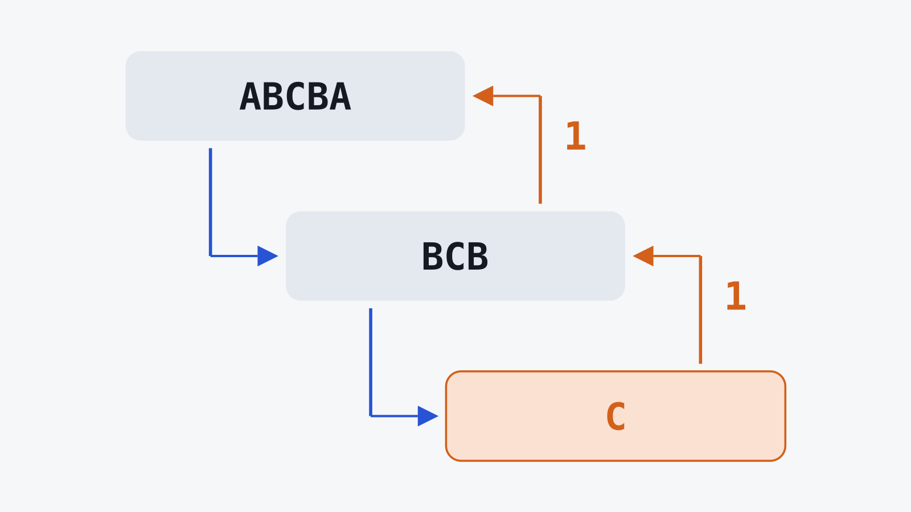
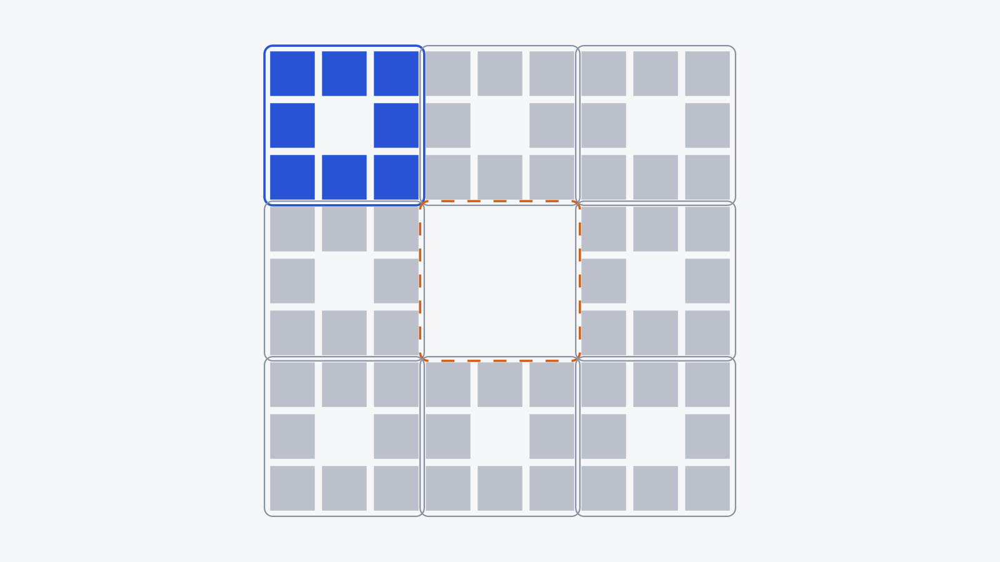
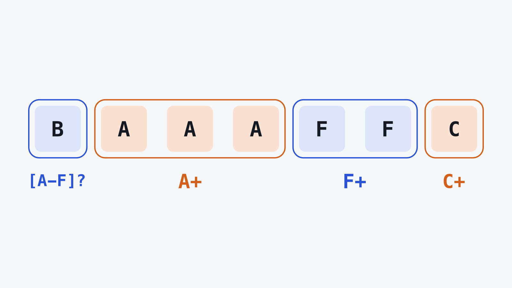
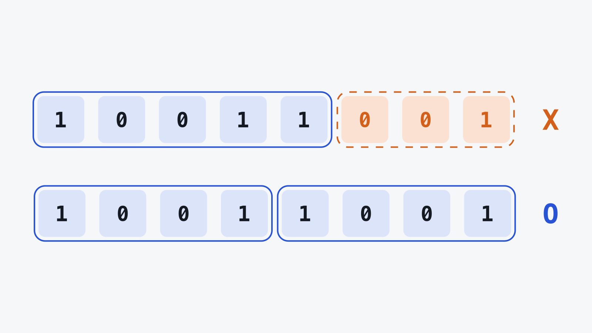
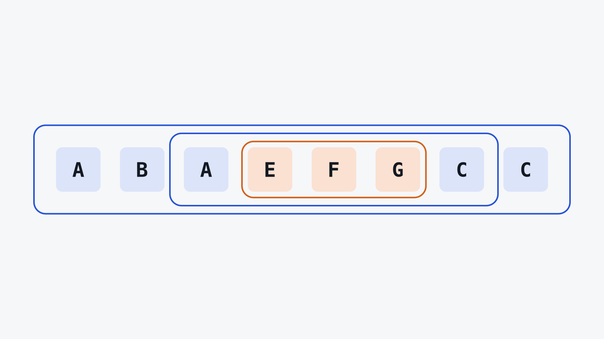

# 재귀 좀 쳐?: 정규표현식

> rilog 발행 글: <https://www.rilog.kr/@iqed/posts/615> (2026-11-24)

안녕하세요 ~ 오늘은 재귀 이야기를 해보려고 합니다.

재귀는 처음 배울 때 유독 많이들 막히는 부분이죠.  
코드는 몇 줄 안 되는데,  
함수가 자기 자신을 부르기 시작하면 그걸 머릿속으로 따라가다가 어느 순간 길을 잃게 됩니다.

그래서 이번 글에서는 눈에 보이는 문제부터 시작하려고 합니다.  
별 찍기나 프랙탈처럼 결과가 그림으로 나오는 문제로 먼저 감을 잡고,  
그다음에 정규표현식 문제로 넘어가서 조금 더 까다로운 재귀를 짜 볼 거예요.  
마지막에는 직접 풀어 볼 문제들과 정답 코드도 준비해 두었습니다.

미리 말씀드리면, 이 글에서 하려는 이야기는 사실 하나입니다.  
재귀 함수는 일을 전부 하지 않습니다. 자기 몫만 조금 하고, 남은 일은 같은 함수를 다시 불러서 넘겨 버려요.  
이게 무슨 말인지는 문제를 보면서 천천히 이야기해 보겠습니다.

## 재귀 함수의 기본 구조

[BOJ 25501 재귀의 귀재](https://www.acmicpc.net/problem/25501)부터 봅시다.  
문자열이 팰린드롬인지를 재귀 함수로 판별하고, 그 함수가 몇 번 불렸는지도 같이 출력하는 문제입니다.  
팰린드롬은 ABCBA처럼 앞에서 읽으나 뒤에서 읽으나 같은 문자열이죠.

팰린드롬인지 확인하려면 문자열 전체를 봐야 할 것 같지만, 함수 하나가 하는 일은 훨씬 적습니다.  
양 끝의 두 글자만 비교하는 거예요.  
둘이 다르면 그 자리에서 팰린드롬이 아니라고 답하면 되고,  
같으면 양 끝을 뗀 안쪽 문자열이 팰린드롬인지만 알면 됩니다.  
그런데 그건 지금 풀고 있는 문제와 똑같은 문제잖아요? 그러니 같은 함수를 다시 불러서 넘깁니다.

```cpp
#include <bits/stdc++.h>
#define ibm514 ios::sync_with_stdio(0), cin.tie(0), cout.tie(0);
using namespace std;
typedef long long ll;
int cnt;

int recursion(const string &s, int l, int r) {
    ++cnt;
    if (l >= r) return 1;                // 가운데까지 왔으면 팰린드롬
    if (s[l] != s[r]) return 0;          // 양 끝이 다르면 여기서 끝
    return recursion(s, l + 1, r - 1);   // 양 끝은 확인했으니 안쪽은 넘긴다
}

void solve() {
    int t;
    cin >> t;
    while (t--) {
        string s;
        cin >> s;
        cnt = 0;
        int res = recursion(s, 0, s.size() - 1);
        cout << res << ' ' << cnt << '\n';
    }
}

int main() {
    ibm514
    solve();
    return 0;
}
```

`recursion` 안의 세 줄이 각각 하는 일이 다릅니다.

- `l >= r`이면 더 비교할 글자가 없으니 1을 돌려줍니다.  
이렇게 더 넘기지 않고 바로 답하는 부분을 기저 사례(base case)라고 부릅니다.
- 양 끝이 다르면 0을 돌려줍니다. 이것도 더 넘기지 않고 끝나는 경우예요.
- 둘 다 아니면 범위를 한 칸씩 좁혀서 같은 함수를 부르고, 거기서 돌아온 값을 그대로 돌려줍니다.



*ABCBA를 넣으면 호출이 세 번 이어집니다(파랑).  
가장 안쪽에서 1을 돌려주면, 그 값이 불렀던 순서의 반대로 전달됩니다(주황).*

호출이 안쪽으로 계속 들어가다가, 기저 사례를 만나는 순간부터는 거꾸로 돌아 나옵니다.  
함수를 부른 쪽은 그동안 멈춰서 기다리고 있다가, 값이 돌아오면 그 아래 코드를 이어서 실행하는 거죠.  
기저 사례가 없으면 돌아 나올 계기가 없어서, 함수가 영원히 자기 자신만 부르게 됩니다.

넘길 때마다 범위가 줄어든다는 것도 봐 두세요. 줄어들지 않으면 기저 사례에 닿을 수가 없습니다.

## 프랙탈 그리기

재귀가 제일 자연스럽게 들어맞는 건, 큰 모양 안에 똑같은 모양이 작게 들어 있는 경우입니다.  
프랙탈이 바로 그런 그림이라, 재귀를 연습하기에는 이만한 게 없어요.

### 칸토어 집합

[BOJ 4779 칸토어 집합](https://www.acmicpc.net/problem/4779)입니다.  
`-`가 3의 N제곱 개 있는 문자열에서 시작해서, 3등분한 다음 가운데 부분을 공백으로 바꿉니다.  
그러면 선이 두 개 남는데, 그 두 선에도 같은 일을 합니다. 이걸 선의 길이가 1이 될 때까지 계속하면 돼요.


*길이 27에서 시작한 모습입니다.  
한 줄 내려갈 때마다 모든 선의 가운데가 지워집니다.*

전체를 한 번에 그리려고 하면 어디를 지워야 할지 계산부터 막막합니다.  
그런데 선 하나만 놓고 보면 할 일이 딱 하나예요. 가운데를 지우는 겁니다.  
그러고 나면 왼쪽 선과 오른쪽 선이 남는데, 얘네한테 할 일이 방금 하려던 일과 완전히 똑같죠?  
그러니까 그냥 같은 함수를 부르면 됩니다.

`go(l, len)` = l번째 칸부터 len칸을 칸토어 집합으로 만든다

```cpp
#include <bits/stdc++.h>
#define ibm514 ios::sync_with_stdio(0), cin.tie(0), cout.tie(0);
using namespace std;
typedef long long ll;
string s;

// go(l, len) = s의 l번째 칸부터 len칸을 칸토어 집합으로 만든다
void go(int l, int len) {
    if (len == 1) return;
    int t = len / 3;
    for (int i = l + t; i < l + 2 * t; ++i) s[i] = ' ';   // 가운데를 지우고
    go(l, t);                                             // 왼쪽과
    go(l + 2 * t, t);                                     // 오른쪽은 넘긴다
}

void solve() {
    int n;
    while (cin >> n) {
        int len = 1;
        for (int i = 0; i < n; ++i) len *= 3;
        s.assign(len, '-');
        go(0, len);
        cout << s << '\n';
    }
}

int main() {
    ibm514
    solve();
    return 0;
}
```

`go`가 직접 하는 일은 가운데를 지우는 for문 한 줄입니다.  
그 아래 두 줄은 왼쪽 선과 오른쪽 선을 넘기는 거고요.  
길이가 1이 되면 더 나눌 게 없으니 아무것도 안 하고 돌아옵니다.

### 별 찍기 - 10

[BOJ 2447 별 찍기 - 10](https://www.acmicpc.net/problem/2447)입니다. 재귀 하면 빠지지 않고 나오는 문제죠.  
크기 N의 패턴은 N × N 정사각형인데,  
가운데 (N/3) × (N/3)칸은 비어 있고 나머지 여덟 칸은 크기 N/3의 패턴으로 채워집니다.



*크기 9의 패턴입니다.  
아홉 칸 중 가운데(점선)만 비우고, 나머지 여덟 칸에는 크기 3의 패턴(파랑)이 똑같이 들어갑니다.*

잘 보면 칸토어 집합이랑 하는 일이 거의 같습니다.  
선이 정사각형으로 바뀌고, 3등분이 9등분으로 바뀌었을 뿐이에요.

`go(r, c, n)` = (r, c)를 왼쪽 위로 하는 n × n 칸에 패턴을 그린다

```cpp
#include <bits/stdc++.h>
#define ibm514 ios::sync_with_stdio(0), cin.tie(0), cout.tie(0);
using namespace std;
typedef long long ll;
const int MX = 2187;
char a[MX][MX + 1];

// go(r, c, n) = (r, c)를 왼쪽 위로 하는 n × n 칸에 패턴을 그린다
void go(int r, int c, int n) {
    if (n == 1) {
        a[r][c] = '*';
        return;
    }
    int t = n / 3;
    for (int i = 0; i < 3; ++i) {
        for (int j = 0; j < 3; ++j) {
            if (i == 1 && j == 1) continue;   // 가운데는 비워 둔다
            go(r + i * t, c + j * t, t);
        }
    }
}

void solve() {
    int n;
    cin >> n;
    for (int i = 0; i < n; ++i) fill(a[i], a[i] + n, ' ');
    go(0, 0, n);
    for (int i = 0; i < n; ++i) cout << a[i] << '\n';
}

int main() {
    ibm514
    solve();
    return 0;
}
```

이번에는 직접 하는 일이 더 없습니다. 가운데 칸을 건너뛰고 나머지 여덟 칸을 넘기는 게 끝이에요.  
실제로 별을 찍는 건 크기가 1까지 줄어들었을 때뿐입니다.

참고로 이런 출력 문제는 바로바로 `cout`으로 찍으려고 하면 꽤 골치 아픕니다.  
배열을 하나 만들어서 거기에 먼저 그려 놓고, 다 끝난 뒤에 한꺼번에 출력하는 쪽이 훨씬 편해요.

여기까지 세 문제를 봤는데, 매번 같은 순서로 풀었다는 걸 눈치채셨을 겁니다.

1. 이 함수가 무슨 일을 하는 함수인지 한 문장으로 적어 봅니다.
2. 더 나눌 수 없는 가장 작은 경우에 뭘 할지 정합니다.
3. 그게 아니라면 자기 몫만 조금 하고, 나머지는 크기를 줄여서 같은 함수에 넘깁니다.

그리고 이게 제일 중요한데, 넘긴 함수가 안에서 어떻게 돌아가는지는 따라가지 않아도 됩니다.  
1번에서 적은 문장대로 알아서 해 줄 거라고 믿고 넘어가는 거죠.  
재귀가 어렵게 느껴지는 건 대부분 이걸 머릿속으로 끝까지 따라가려고 해서입니다.

## 정규표현식 문제

자, 이제 본론입니다.  
프랙탈은 어디를 어떻게 나눌지가 그림에 그대로 보여서 편했습니다.  
문자열 문제는 그런 게 안 보여요.  
뭘 직접 하고 뭘 넘길지를 스스로 정해야 하는데, 그래서 재귀 연습으로는 이쪽이 훨씬 좋습니다.

그중에서도 정규표현식 문제를 골랐습니다.  
`A+F+C+`나 `(100+1+|01)+` 같은 규칙이 주어지고, 문자열이 거기에 맞는지 판별하는 문제들이에요.  
사실 라이브러리를 쓰면 한 줄이면 끝나는데, 오늘은 재귀 연습이 목적이니까 직접 짜 보겠습니다.

문자열에서도 방식은 같습니다.  
앞쪽 몇 글자만 직접 확인하고, 그 뒤의 나머지 문자열은 같은 함수에 넘기는 거죠.

### 염색체

[BOJ 9342 염색체](https://www.acmicpc.net/problem/9342)입니다.  
문자열이 정해진 순서를 지키는지 검사하는 문제인데요,  
정규표현식으로 쓰면 `[A-F]?A+F+C+[A-F]?`입니다.  

풀어서 말하면 A~F 중 하나가 있거나 없고, 그다음 A가 한 개 이상, F가 한 개 이상, C가 한 개 이상 나온 뒤, 마지막에 A~F 중 하나가 있거나 없어야 합니다.

규칙이 다섯 조각으로 나뉘어 있으니까, 함수도 지금 몇 번째 조각을 보고 있는지 들고 다니게 하겠습니다.

`go(i, k)` = i번째 글자부터가 k번 조각부터의 규칙에 맞는가

조각은 두 종류뿐이라, 각각 어떻게 넘길지만 정하면 됩니다.

- **있거나 없거나(`?`).** 일단 없다고 치고 다음 조각으로 넘겨 봅니다.  
그게 안 되면 한 글자를 받고 다음 조각으로 넘깁니다.
- **한 개 이상(`+`).** 한 글자는 무조건 받아야 합니다.  
그 뒤에는 같은 조각을 한 번 더 보거나, 다음 조각으로 넘어갑니다.



*BAAAFFC를 조각 순서대로 나눈 모습입니다.  
마지막 조각은 0개로 끝났습니다.*

```cpp
#include <bits/stdc++.h>
#define ibm514 ios::sync_with_stdio(0), cin.tie(0), cout.tie(0);
using namespace std;
typedef long long ll;
string s;
int n;

bool in(char c) { return 'A' <= c && c <= 'F'; }

// go(i, k) = s의 i번째 글자부터가 k번 조각부터의 규칙에 맞는가
// 조각: 0 = [A-F] 0~1개, 1 = A 1개 이상, 2 = F 1개 이상, 3 = C 1개 이상, 4 = [A-F] 0~1개
bool go(int i, int k) {
    if (k == 5) return i == n;           // 조각을 다 썼으면 글자도 다 써야 한다
    if (k == 0 || k == 4) {
        if (go(i, k + 1)) return true;                   // 0개인 경우
        return i < n && in(s[i]) && go(i + 1, k + 1);    // 1개인 경우
    }
    if (i == n || s[i] != "?AFC"[k]) return false;
    // 한 글자를 받은 뒤, 같은 조각에 머물거나 다음 조각으로 넘어간다
    return go(i + 1, k) || go(i + 1, k + 1);
}

void solve() {
    int t;
    cin >> t;
    while (t--) {
        cin >> s;
        n = s.size();
        cout << (go(0, 0) ? "Infected!" : "Good") << '\n';
    }
}

int main() {
    ibm514
    solve();
    return 0;
}
```

`go`의 마지막 줄을 한번 보세요.  
`+` 같은 반복은 보통 while문으로 짜잖아요?  
그런데 여기서는 “같은 조각을 한 번 더”가 `go(i + 1, k)`라는 재귀 호출로 들어가 있습니다.  
반복문도 결국 “하나 처리하고 나머지는 넘긴다”로 바꿔 쓸 수 있다는 얘기죠.

하나 조심할 건, 조각을 다 썼는데 글자가 남아 있으면 안 된다는 점입니다.  
`k == 5`일 때 `i == n`인지 확인하는 게 그래서예요.

### Contact

[BOJ 1013 Contact](https://www.acmicpc.net/problem/1013)입니다. 꽤 유명한 문제죠.  
0과 1로 된 문자열이 `(100+1+|01)+` 패턴인지 판별합니다.  
쉽게 말해 `100+1+` 덩어리와 `01` 덩어리를 마음대로 이어 붙여서 만들 수 있는 문자열이냐는 거죠.

앞에서부터 덩어리를 하나씩 떼어 내면 될 것 같죠? 그런데 직접 해 보면 한 군데에서 막힙니다.  
`100+1+`의 맨 끝에 있는 `1+`가 1을 몇 개까지 가져가야 하는지 알 수가 없거든요.



*10011001입니다. 첫 덩어리가 1을 두 개 가져가면 남은 001은 어느 덩어리도 아닙니다.  
하나만 가져가야 뒤가 맞습니다.*

그렇다고 무조건 하나만 가져가면 또 다른 입력에서 틀립니다. 뒤에 뭐가 오느냐에 따라 답이 달라지니까요.  
이럴 때 재귀가 정말 편합니다. 어느 쪽이 맞을지 고민할 필요 없이 **전부 해 보면** 되거든요.

`go(i)` = i번째 글자부터를 덩어리들로 남김없이 자를 수 있는가

```cpp
#include <bits/stdc++.h>
#define ibm514 ios::sync_with_stdio(0), cin.tie(0), cout.tie(0);
using namespace std;
typedef long long ll;
string s;
int n;

// go(i) = s의 i번째 글자부터를 100+1+ 또는 01로 남김없이 자를 수 있는가
bool go(int i) {
    if (i == n) return true;
    if (s[i] == '0') return i + 1 < n && s[i + 1] == '1' && go(i + 2); // 01

    // 100+1+
    if (i + 2 >= n || s[i + 1] != '0' || s[i + 2] != '0') return false;
    int j = i + 3;
    while (j < n && s[j] == '0') ++j;
    // 1을 몇 개까지 가져갈지는 알 수 없으니 전부 해 본다
    for (; j < n && s[j] == '1'; ++j) {
        if (go(j + 1)) return true;
    }
    return false;
}

void solve() {
    int t;
    cin >> t;
    while (t--) {
        cin >> s;
        n = s.size();
        cout << (go(0) ? "YES" : "NO") << '\n';
    }
}

int main() {
    ibm514
    solve();
    return 0;
}
```

for문 안에 있는 `go(j + 1)`이 그 부분입니다.  
1을 하나 가져가고 나머지를 넘겨 보고, 실패해서 돌아오면 이번에는 두 개 가져가고 넘겨 봅니다.  
그러다 한 번이라도 끝까지 가면 성공이에요.

이렇게 다 해 보면 느리지 않을까 걱정될 수도 있는데, 이 문제는 괜찮습니다.  
1을 잘못 가져가면 바로 다음 덩어리에서 실패하고 돌아오기 때문에 헛걸음이 길어지지 않아요.  
헛걸음이 길어지는 문제라면 같은 `i`를 여러 번 풀게 되는데, 그럴 땐 [메모이제이션](https://www.rilog.kr/@iqed/posts/608)을 붙이면 됩니다.

## 연습 문제

설명은 여기까지고, 이제 직접 짜 볼 차례입니다.  
일곱 문제를 쉬운 것부터 골라 봤어요.  
앞의 다섯 개는 프랙탈 쪽이고, 뒤의 두 개는 정규표현식 쪽입니다.  
코드부터 치지 말고, 함수가 무슨 일을 하는지 한 문장으로 먼저 적어 보는 걸 추천합니다.  
정답 코드는 맨 아래에 있어요.

**1. ****[BOJ 10994 별 찍기 - 19](https://www.acmicpc.net/problem/10994)**  
예제만 보고 규칙을 찾아야 하는 문제입니다. 사각형 안에 사각형이 계속 들어 있어요.  
힌트: 가장 바깥 테두리만 직접 그린다면, 안쪽 사각형은 어디서부터 시작할까요?

**2. ****[BOJ 2448 별 찍기 - 11](https://www.acmicpc.net/problem/2448)**  
작은 삼각형 세 개가 모여서 큰 삼각형이 됩니다.  
힌트: 가장 작은 삼각형은 높이가 3입니다. 함수가 꼭대기 위치를 받도록 하면 편해요.

**3. ****[BOJ 1992 쿼드트리](https://www.acmicpc.net/problem/1992)**  
영상이 한 가지 숫자로만 되어 있으면 그 숫자를 출력하고, 아니면 넷으로 나눠서 괄호로 묶어 출력합니다.  
힌트: 여는 괄호와 닫는 괄호는 각각 언제 출력해야 할까요? 재귀 호출의 앞과 뒤를 생각해 보세요.

**4. ****[BOJ 1074 Z](https://www.acmicpc.net/problem/1074)**  
한 변이 2의 N제곱인 배열을 Z 모양으로 방문할 때, r행 c열을 몇 번째로 방문하는지 구합니다.  
힌트: N이 15면 칸이 10억 개라서 전부 방문할 수는 없습니다. 네 구역 중 한 곳만 들어가면 돼요.

**5. ****[BOJ 11729 하노이 탑 이동 순서](https://www.acmicpc.net/problem/11729)**  
원판 N개를 1번 장대에서 3번 장대로 옮기는 순서를 출력합니다. 재귀의 고전이죠.  
힌트: 가장 큰 원판을 옮기려면, 그 위의 N - 1개는 어디에 가 있어야 할까요?

**6. ****[BOJ 9996 한국이 그리울 땐 서버에 접속하지](https://www.acmicpc.net/problem/9996)**  
별표가 하나 들어 있는 패턴과 파일 이름이 일치하는지 판별합니다.  
별표는 빈 문자열을 포함해서 어떤 문자열로든 바뀔 수 있습니다.  
힌트: 별표가 몇 글자를 가져갈지 모릅니다. Contact의 `1+`와 같은 상황이죠.

**7. ****[BOJ 14906 스러피](https://www.acmicpc.net/problem/14906)**  
마지막 문제는 규칙이 좀 깁니다. 주어진 문자열이 스러피인지 판별하면 돼요.

- **스럼프**: `D` 또는 `E` → `F` 한 개 이상 → `G` 또는 또 다른 스럼프
- **스림프**: `AH`이거나, `A` + `B` + 스림프 + `C`이거나, `A` + 스럼프 + `C`
- **스러피**: 스림프 + 스럼프



*ABAEFGCC는 스림프입니다.  
스림프(파랑) 안에 스림프가 있고, 그 안에 스럼프 EFG(주황)가 들어 있습니다.*

규칙을 설명하는데 그 안에 자기 자신이 또 나오죠?  
규칙이 이미 재귀로 적혀 있는 거라, 함수도 그대로 옮겨 적으면 됩니다.  
힌트: 스림프가 끝난 자리에서 스럼프가 이어져야 합니다. 함수가 참·거짓 대신 뭘 돌려주면 좋을까요?

## 정답 코드

충분히 고민해 본 다음에 열어 보세요.  
제 코드와 다르게 짰더라도 맞았다면 그걸로 된 겁니다.

<details>
<summary>1. 별 찍기 - 19</summary>

`go(s, n)` = (s, s)에서 시작하는 n겹짜리 사각형을 그린다  
한 변의 길이는 4n - 3이고, 안쪽 사각형은 두 칸 들어간 (s + 2, s + 2)에서 시작합니다.

```cpp
#include <bits/stdc++.h>
#define ibm514 ios::sync_with_stdio(0), cin.tie(0), cout.tie(0);
using namespace std;
typedef long long ll;
const int MX = 400;
char a[MX][MX];

// go(s, n) = (s, s)에서 시작하는 n겹짜리 사각형을 그린다
void go(int s, int n) {
    int len = 4 * n - 3;
    for (int i = 0; i < len; ++i) {       // 가장 바깥 테두리만 직접 그리고
        a[s][s + i] = a[s + len - 1][s + i] = '*';
        a[s + i][s] = a[s + i][s + len - 1] = '*';
    }
    if (n == 1) return;
    go(s + 2, n - 1);                     // 안쪽은 넘긴다
}

void solve() {
    int n;
    cin >> n;
    int len = 4 * n - 3;
    for (int i = 0; i < len; ++i) fill(a[i], a[i] + len, ' ');
    go(0, n);
    for (int i = 0; i < len; ++i) {
        for (int j = 0; j < len; ++j) cout << a[i][j];
        cout << '\n';
    }
}

int main() {
    ibm514
    solve();
    return 0;
}
```

</details>

<details>
<summary>2. 별 찍기 - 11</summary>

`go(r, c, n)` = 꼭대기가 (r, c)인 높이 n짜리 삼각형을 그린다  
높이 n짜리 삼각형은 높이 n/2짜리 세 개로 만들어집니다.  
위에 하나, 아래 왼쪽과 오른쪽에 하나씩이에요.

```cpp
#include <bits/stdc++.h>
#define ibm514 ios::sync_with_stdio(0), cin.tie(0), cout.tie(0);
using namespace std;
typedef long long ll;
const int MX = 3072;
char a[MX][2 * MX];

// go(r, c, n) = 꼭대기가 (r, c)인 높이 n짜리 삼각형을 그린다
void go(int r, int c, int n) {
    if (n == 3) {
        a[r][c] = '*';
        a[r + 1][c - 1] = a[r + 1][c + 1] = '*';
        for (int i = -2; i <= 2; ++i) a[r + 2][c + i] = '*';
        return;
    }
    int t = n / 2;
    go(r, c, t);             // 위
    go(r + t, c - t, t);     // 왼쪽 아래
    go(r + t, c + t, t);     // 오른쪽 아래
}

void solve() {
    int n;
    cin >> n;
    for (int i = 0; i < n; ++i) fill(a[i], a[i] + 2 * n - 1, ' ');
    go(0, n - 1, n);
    for (int i = 0; i < n; ++i) {
        for (int j = 0; j < 2 * n - 1; ++j) cout << a[i][j];
        cout << '\n';
    }
}

int main() {
    ibm514
    solve();
    return 0;
}
```

</details>

<details>
<summary>3. 쿼드트리</summary>

`go(r, c, n)` = (r, c)를 왼쪽 위로 하는 n × n 영상을 압축해서 출력한다  
여는 괄호는 네 구역을 넘기기 전에, 닫는 괄호는 넘긴 일이 전부 끝나고 돌아온 뒤에 출력합니다.

```cpp
#include <bits/stdc++.h>
#define ibm514 ios::sync_with_stdio(0), cin.tie(0), cout.tie(0);
using namespace std;
typedef long long ll;
int n;
string a[64];

// go(r, c, n) = (r, c)를 왼쪽 위로 하는 n × n 영상을 압축해서 출력한다
void go(int r, int c, int n) {
    bool same = true;
    for (int i = r; i < r + n; ++i) {
        for (int j = c; j < c + n; ++j) {
            if (a[i][j] != a[r][c]) same = false;
        }
    }
    if (same) {
        cout << a[r][c];
        return;
    }
    int t = n / 2;
    cout << '(';
    go(r, c, t);
    go(r, c + t, t);
    go(r + t, c, t);
    go(r + t, c + t, t);
    cout << ')';
}

void solve() {
    cin >> n;
    for (int i = 0; i < n; ++i) cin >> a[i];
    go(0, 0, n);
    cout << '\n';
}

int main() {
    ibm514
    solve();
    return 0;
}
```

</details>

<details>
<summary>4. Z</summary>

`go(n, r, c)` = 한 변이 2의 n제곱인 배열에서 (r, c)를 몇 번째로 방문하는가  
앞선 구역의 칸 수는 계산으로 더해 버리고, (r, c)가 들어 있는 구역 하나만 들어갑니다.  
호출이 N번이면 끝나요.

```cpp
#include <bits/stdc++.h>
#define ibm514 ios::sync_with_stdio(0), cin.tie(0), cout.tie(0);
using namespace std;
typedef long long ll;
// go(n, r, c) = 한 변이 2^n인 배열에서 (r, c)를 몇 번째로 방문하는가
int go(int n, int r, int c) {
    if (n == 0) return 0;
    int half = 1 << (n - 1);
    int quad = (r >= half) * 2 + (c >= half);   // (r, c)가 들어 있는 사분면
    // 앞선 사분면의 칸 수를 더하고, 그 사분면 안에서의 순서는 넘긴다
    return quad * half * half + go(n - 1, r % half, c % half);
}

void solve() {
    int n, r, c;
    cin >> n >> r >> c;
    cout << go(n, r, c) << '\n';
}

int main() {
    ibm514
    solve();
    return 0;
}
```

</details>

<details>
<summary>5. 하노이 탑 이동 순서</summary>

`go(n, from, to, via)` = 원판 n개를 from에서 to로 옮긴다  
위의 n - 1개를 남는 장대로 비켜 두고, 가장 큰 원판을 옮긴 다음, 비켜 둔 것들을 다시 그 위로 옮깁니다.  
n - 1개를 어떻게 옮길지는 고민하지 않아도 됩니다. 그건 넘겨받은 함수가 할 일이니까요.

```cpp
#include <bits/stdc++.h>
#define ibm514 ios::sync_with_stdio(0), cin.tie(0), cout.tie(0);
using namespace std;
typedef long long ll;
// go(n, from, to, via) = 원판 n개를 from에서 to로 옮긴다
void go(int n, int from, int to, int via) {
    if (n == 0) return;
    go(n - 1, from, via, to);            // 위의 n - 1개를 잠깐 비켜 두고
    cout << from << ' ' << to << '\n';   // 가장 큰 원판을 옮긴 뒤
    go(n - 1, via, to, from);            // 비켜 둔 n - 1개를 그 위로 옮긴다
}

void solve() {
    int n;
    cin >> n;
    cout << (1 << n) - 1 << '\n';
    go(n, 1, 3, 2);
}

int main() {
    ibm514
    solve();
    return 0;
}
```

</details>

<details>
<summary>6. 한국이 그리울 땐 서버에 접속하지</summary>

`go(i, j)` = 패턴의 i번째 글자부터와 파일 이름의 j번째 글자부터가 일치하는가  
별표를 만나면 두 갈래로 나뉩니다. 별표가 여기서 끝나는 경우와, 한 글자를 더 가져가는 경우예요.

```cpp
#include <bits/stdc++.h>
#define ibm514 ios::sync_with_stdio(0), cin.tie(0), cout.tie(0);
using namespace std;
typedef long long ll;
string p, s;

// go(i, j) = 패턴의 i번째 글자부터와 파일 이름의 j번째 글자부터가 일치하는가
bool go(int i, int j) {
    if (i == (int)p.size()) return j == (int)s.size();
    if (p[i] == '*') {
        // 별표가 여기서 끝나는 경우
        if (go(i + 1, j)) return true;
        // 별표가 한 글자를 더 가져가는 경우             
        return j < (int)s.size() && go(i, j + 1);  
    }
    return j < (int)s.size() && p[i] == s[j] && go(i + 1, j + 1);
}

void solve() {
    int n;
    cin >> n >> p;
    while (n--) {
        cin >> s;
        cout << (go(0, 0) ? "DA" : "NE") << '\n';
    }
}

int main() {
    ibm514
    solve();
    return 0;
}
```

</details>

<details>
<summary>7. 스러피</summary>

`slump(i)`, `slimp(i)` = i번째 글자에서 시작해 읽고 난 바로 다음 위치, 규칙에 맞지 않으면 -1  
읽은 위치를 돌려주면, 안쪽 스림프가 몇 글자인지 몰라도 그 뒤에 `C`가 오는지 바로 확인할 수 있습니다.

```cpp
#include <bits/stdc++.h>
#define ibm514 ios::sync_with_stdio(0), cin.tie(0), cout.tie(0);
using namespace std;
typedef long long ll;
string s;
int n;

// slump(i) = i번째 글자에서 시작하는 스럼프가 끝난 바로 다음 위치, 스럼프가 아니면 -1
int slump(int i) {
    if (i >= n || (s[i] != 'D' && s[i] != 'E')) return -1;
    ++i;
    if (i >= n || s[i] != 'F') return -1;
    while (i < n && s[i] == 'F') ++i;
    if (i < n && s[i] == 'G') return i + 1;
    return slump(i);            // G가 아니면 또 다른 스럼프여야 한다
}

// slimp(i) = i번째 글자에서 시작하는 스림프가 끝난 바로 다음 위치, 스림프가 아니면 -1
int slimp(int i) {
    if (i + 1 >= n || s[i] != 'A') return -1;
    if (s[i + 1] == 'H') return i + 2;
    // A B 스림프 C 이거나 A 스럼프 C
    int j = s[i + 1] == 'B' ? slimp(i + 2) : slump(i + 1);
    if (j == -1 || j >= n || s[j] != 'C') return -1;
    return j + 1;
}

void solve() {
    int t;
    cin >> t;
    cout << "SLURPYS OUTPUT\n";
    while (t--) {
        cin >> s;
        n = s.size();
        int j = slimp(0);
        bool ok = j != -1 && slump(j) == n;
        cout << (ok ? "YES" : "NO") << '\n';
    }
    cout << "END OF OUTPUT\n";
}

int main() {
    ibm514
    solve();
    return 0;
}
```

</details>

## 자주 하는 실수

- **기저 사례를 빠뜨린다.** 더 넘길 게 없을 때 뭘 할지부터 정해야 합니다. 이게 없으면 함수가 끝나지 않아요.
- **넘길 때 크기가 그대로다.** 재귀 호출의 인자가 줄어들지 않으면 같은 호출만 끝없이 반복됩니다.
- **출력 순서를 헷갈린다.** 재귀 호출보다 위에 쓴 코드와 아래에 쓴 코드는 실행되는 시점이 다릅니다.
- **범위를 확인하지 않는다.** `s[i]`를 보기 전에 `i < n`인지부터 확인해야 합니다.

## 마무리

글이 길었는데, 정리하면 이 정도입니다.

1. 함수가 무슨 일을 하는지 한 문장으로 먼저 적습니다.
2. 자기 몫만 조금 하고, 나머지는 크기를 줄여서 넘깁니다. 넘긴 함수 안은 따라가지 않습니다.
3. 재귀 호출 위의 코드는 들어가면서, 아래의 코드는 돌아오면서 실행됩니다.
4. 어느 쪽이 맞을지 모르겠으면 전부 해 보고, 하나라도 성공하면 성공입니다.

## 추천 문제

여기까지 따라오셨다면 조금 더 어려운 문제에 도전해 볼 차례입니다.  
전부 본문에서 다룬 방식의 연장선에 있는 문제들이고, 아래로 갈수록 어려워집니다.

1. [BOJ 16974 레벨 햄버거](https://www.acmicpc.net/problem/16974): 버거를 만들지 않고 필요한 쪽만 들어가서 세기
2. [BOJ 1662 압축](https://www.acmicpc.net/problem/1662): 괄호가 중첩될 때 읽은 위치 돌려주기
3. [BOJ 1030 프렉탈 평면](https://www.acmicpc.net/problem/1030): 너무 큰 프랙탈의 일부만 출력하기
4. [BOJ 4970 디지털 회로 개론](https://www.acmicpc.net/problem/4970): 문법 그대로 식을 읽어서 계산하기
5. [BOJ 14956 Philosopher’s Walk](https://www.acmicpc.net/problem/14956): 구역마다 방향이 돌아가는 프랙탈 따라가기
6. [BOJ 3300 무어 기계](https://www.acmicpc.net/problem/3300): 괄호와 |가 중첩된 패턴에서 전부 해 보기
7. [BOJ 14601 샤워실 바닥 깔기 (Large)](https://www.acmicpc.net/problem/14601): 넷으로 나누고 가운데에 타일 하나 놓기
