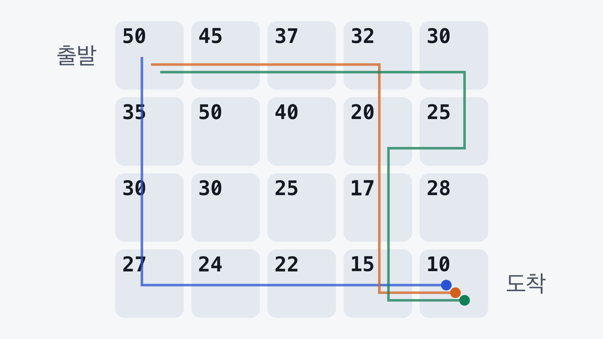
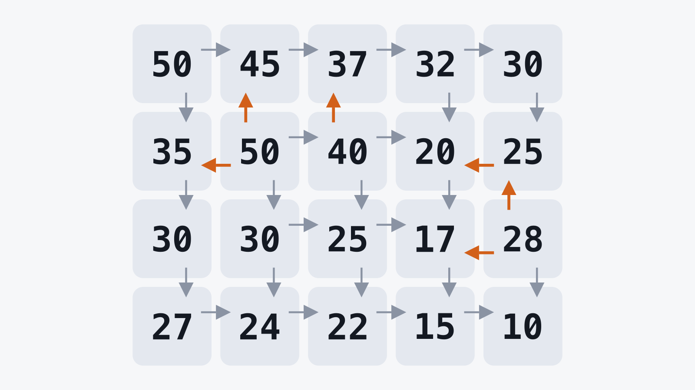
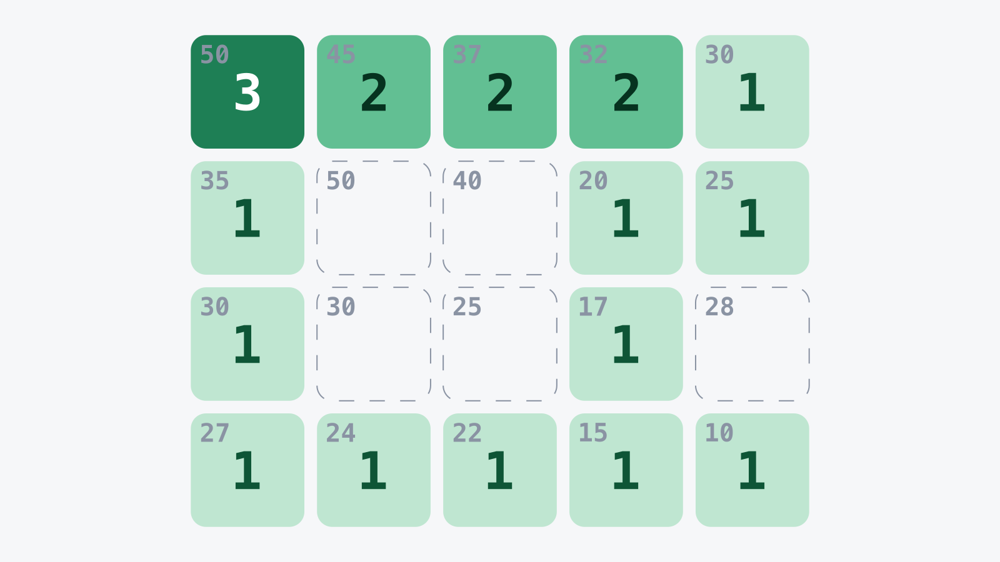
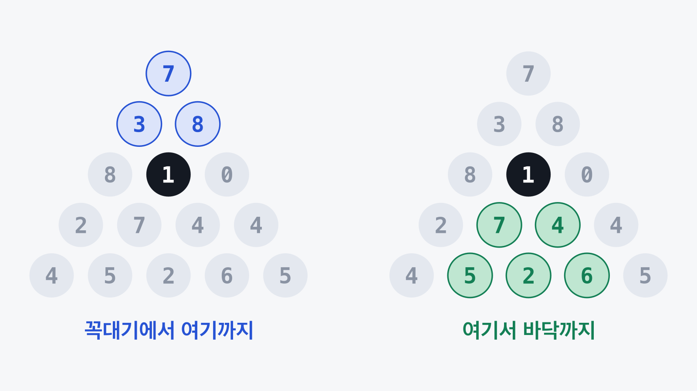
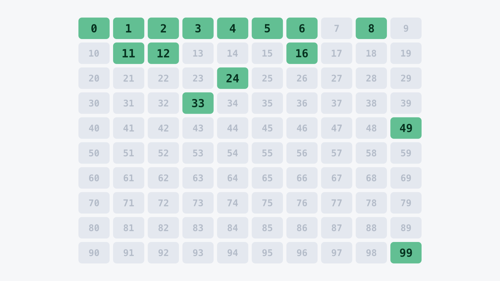
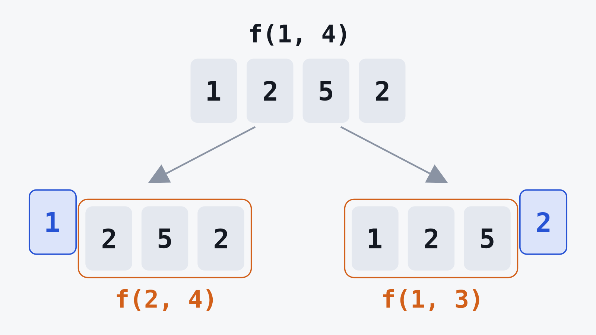
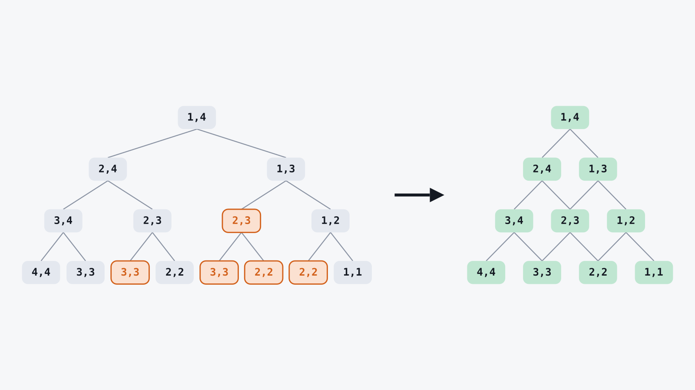

# for문 순서를 모르겠다면: 탑다운 DP

> rilog 발행 글: <https://www.rilog.kr/@iqed/posts/608> (2026-11-23)

안녕하세요 ~ 오늘은 탑다운 DP 이야기를 해보려고 합니다.

DP가 유독 어렵게 느껴진다면, 실력 문제가 아니라 바텀업 한 가지 방식만 알고 있어서일 수 있습니다.  
DP 테이블을 for문으로 채우는 방식은 채우는 순서를 내가 정해야 하는데,  
그 순서가 안 보이는 문제가 꽤 많거든요.

이럴 때 쓰는 게 **탑다운**입니다. 바텀업이 어디서 막히는지부터 보고,  
탑다운이 어떻게 돌아가는지, 상태를 어떻게 정의해야 하는지를 차례로 봅시다.  
마지막에는 게임 문제까지 적용해 풀어 봅시다.

## 바텀업이 막히는 순간

문제부터 하나 보겠습니다. [BOJ 1520 내리막 길](https://www.acmicpc.net/problem/1520)입니다.

세로 M, 가로 N인 지도가 있고 칸마다 높이가 적혀 있습니다.  
왼쪽 위에서 출발해 오른쪽 아래까지, 항상 더 낮은 칸으로만 상하좌우로 이동합니다.  
이렇게 갈 수 있는 경로가 몇 개인지 세면 됩니다. M과 N은 500까지입니다.



*예제 지도입니다. 내리막으로만 가는 경로가 3개 있습니다.*

`dp[r][c]`를 “(r, c)에서 도착점까지 가는 경로의 수”라고 두면 점화식은 쉽습니다.  
나보다 낮은 이웃 칸들의 값을 더하면 되죠.  
문제는 그 값을 **어떤 순서로 채우느냐**입니다.



*칸마다 자기가 필요로 하는 칸(더 낮은 이웃)으로 화살표를 그렸습니다.  
주황색은 위쪽이나 왼쪽을 가리키는 화살표입니다.*

왼쪽 위부터 차례로 채우는 for문은 “필요한 칸은 항상 먼저 채워져 있다”는 전제가 있어야 합니다.  
그런데 여기서는 필요한 칸이 사방에 있습니다.  
게다가 화살표 방향은 입력으로 들어오는 높이에 따라 매번 달라집니다.

칸을 높이순으로 정렬해 낮은 칸부터 채우면 되긴 합니다.  
하지만 그건 이 문제에서만 통하는 순서를 따로 찾아낸 겁니다.  
문제마다 그런 순서를 찾아야 한다면 DP가 어려울 수밖에 없죠.

## 탑다운: 순서를 재귀에게 맡깁니다

탑다운은 생각의 방향이 반대입니다. 작은 문제부터 쌓아 올리지 않고,  
구하고 싶은 답에서 출발해 “이걸 구하려면 뭐가 필요하지?”를 물으며 내려갑니다.

출발은 그냥 재귀로 푸는 겁니다.

```cpp
// (x, y)에서 도착점까지 가는 내리막 경로의 수
int f(int x, int y) {
    if (x == m && y == n) return 1;
    int ret = 0;
    for (int d = 0; d < 4; ++d) {
        int nx = x + dx[d], ny = y + dy[d];
        if (nx < 1 || ny < 1 || nx > m || ny > n) continue;
        if (h[nx][ny] < h[x][y]) ret += f(nx, ny);
    }
    return ret;
}
```

순서를 정하는 코드가 어디에도 없습니다.  
필요한 칸을 그때그때 부르면, 그 칸이 또 자기가 필요한 칸을 부릅니다.  
순서는 호출이 알아서 만들어 냅니다.

답은 맞습니다. 다만 느립니다.  
같은 칸을 여러 경로로 반복해서 부르기 때문입니다.

## 메모이제이션: 같은 질문에는 한 번만 답하기

`f(x, y)`의 답은 x와 y만 정해지면 언제 불러도 같습니다.  
그렇다면 처음 계산했을 때 적어 두고, 다시 불리면 적어 둔 값을 돌려주면 됩니다.  
이걸 메모이제이션이라고 합니다.

탑다운 DP는 이게 전부입니다. **재귀로 먼저 풀고, 답을 적어 둡니다.**

뼈대는 항상 같습니다.

1. 더 내려갈 필요가 없는 상태면 바로 답을 돌려줌 (베이스 케이스)
2. 이미 계산한 상태면 적어 둔 값을 돌려줌 (메모제이션된 값 반환)
3. 아니면 더 작은 문제를 불러서 계산 (재귀 호출)
4. 계산한 값을 적어 두고 돌려줌 (메모제이션 기록 및 반환)

```cpp
#include <bits/stdc++.h>
#define ibm514 ios::sync_with_stdio(0), cin.tie(0), cout.tie(0);
using namespace std;
int m, n, h[505][505], dp[505][505];
int dx[4] = {-1, 1, 0, 0}, dy[4] = {0, 0, -1, 1};

// f(x, y) = (x, y)에서 출발해 도착점까지 가는 내리막 경로의 수
int f(int x, int y) {
    if (x == m && y == n) return 1;       // 도착점: 경로 1개
    int &ret = dp[x][y];
    if (ret != -1) return ret;            // 이미 계산한 칸
    ret = 0;
    for (int d = 0; d < 4; ++d) {
        int nx = x + dx[d], ny = y + dy[d];
        if (nx < 1 || ny < 1 || nx > m || ny > n) continue;
        if (h[nx][ny] < h[x][y]) ret += f(nx, ny);   // 더 낮은 칸으로만
    }
    return ret;
}

void solve() {
    cin >> m >> n;
    for (int i = 1; i <= m; ++i)
        for (int j = 1; j <= n; ++j) cin >> h[i][j];
    memset(dp, -1, sizeof(dp));           // -1 = 아직 계산 안 함
    cout << f(1, 1);
}

int main() {
    ibm514
    solve();
    return 0;
}
```



*탑다운이 실제로 계산한 칸입니다. 작은 숫자가 높이, 큰 숫자가 그 칸에서 도착점까지 가는 경로의 수입니다.*

그림에서 점선 칸을 보세요. 출발점에서 내리막으로 갈 수 없는 칸은 한 번도 부르지 않았습니다.  
바텀업은 표를 전부 채우지만, 탑다운은 필요한 칸만 계산합니다.

주의할 점이 두 가지 있습니다.

**첫째, 함수의 답이 인자만으로 정해져야 합니다.**  
예를 들어 “지금까지 지나온 칸의 목록”을 함께 넘기면, 같은 (x, y)라도 답을 다시 쓸 수 없습니다.  
인자에는 앞으로의 답을 결정하는 것만 남깁니다.

**둘째, 0이 아니라 -1로 초기화합니다.**  
도착점까지 가는 길이 없는 칸은 답이 진짜 0입니다.  
0을 “아직 계산 안 함”으로 쓰면 이런 칸은 부를 때마다 처음부터 다시 계산해서,  
막다른 칸이 많은 지도에서는 시간 초과가 납니다.  
“아직 계산 안 함”과 “계산했더니 0”은 다릅니다.

## 상태를 정의하는 방향이 다릅니다

탑다운에서 가장 많이 헷갈리는 부분입니다.  
같은 문제라도 바텀업과 탑다운은 dp 값의 뜻이 다릅니다.

[BOJ 1932 정수 삼각형](https://www.acmicpc.net/problem/1932)으로 보겠습니다.  
꼭대기에서 한 줄씩 내려오며 왼쪽 아래나 오른쪽 아래로 이동할 때, 지나온 수의 합의 최댓값을 구합니다.



*검은 칸의 dp 값을 정의하는 두 가지 방법입니다.*

- **바텀업**: `dp[i][j]` = 꼭대기에서 (i, j)까지 오는 경로의 최대 합. 지나온 부분의 답입니다.
- **탑다운**: `f(i, j)` = (i, j)에서 출발해 바닥까지 가는 경로의 최대 합. 남은 부분의 답입니다.

탑다운의 함수는 “여기까지 어떻게 왔는가”는 묻지 않습니다.  
“여기서부터 끝까지 가면 얼마인가”만 답합니다.  
  
그래서 구하려는 답은 시작점을 넣고 부른 `f(1, 1)`입니다.

이렇게 정의해야 재귀가 자연스럽게 써집니다. (i, j)에서 한 칸 내려가면 남은 문제가 `f(i+1, j)`나 `f(i+1, j+1)`, 똑같은 모양의 더 작은 문제가 되니까요.

```cpp
#include <bits/stdc++.h>
#define ibm514 ios::sync_with_stdio(0), cin.tie(0), cout.tie(0);
using namespace std;
int n, a[505][505], dp[505][505];

// f(i, j) = (i, j)에서 출발해 맨 아래 줄까지 내려갈 때 얻을 수 있는 최대 합
int f(int i, int j) {
    if (i == n) return a[i][j];           // 맨 아래 줄: 자기 자신뿐
    int &ret = dp[i][j];
    if (ret != -1) return ret;
    return ret = a[i][j] + max(f(i + 1, j), f(i + 1, j + 1));
}

void solve() {
    cin >> n;
    for (int i = 1; i <= n; ++i)
        for (int j = 1; j <= i; ++j) cin >> a[i][j];
    memset(dp, -1, sizeof(dp));
    cout << f(1, 1);
}

int main() {
    ibm514
    solve();
    return 0;
}
```

내리막 길의 `f(x, y)`도 같은 식이었습니다.  
“(x, y)까지 오는 경로의 수”가 아니라 “(x, y)에서 도착점까지 가는 경로의 수”였죠.  
탑다운으로 풀 때는 **“여기서부터 끝까지”**로 정의하는 습관을 들이면 됩니다.

그리고 함수를 쓸 때는 `f(다음 상태)`가 어떻게 계산되는지 따라가지 않습니다.  
뜻대로 올바른 값을 돌려준다고 믿고, 지금 상태에서 할 일 한 단계만 적습니다.

## 기저 조건을 잘 정해야 합니다

기저 조건은 재귀가 멈추는 곳이면서, 답이 처음 만들어지는 곳입니다.  
나머지 값은 전부 여기서 올라온 값을 더하거나 비교해서 만들어지니, 여기가 틀리면 전부 틀립니다.

정하는 방법은 간단합니다. **함수의 뜻에 그대로 넣어 봅니다.**

- 내리막 길: 이미 도착점에 서 있다면 더 움직일 필요가 없습니다.  
경로 하나를 완성한 것이니 `f(도착점) = 1`입니다. 0으로 두면 모든 칸의 답이 0이 됩니다.
- 정수 삼각형: 맨 아래 줄에서는 더 내려갈 곳이 없습니다.  
얻을 수 있는 건 지금 밟고 있는 수 하나뿐이니 `f(n, j) = a[n][j]`입니다.
- 돌 게임: 내 차례인데 돌이 하나도 없다면, 방금 상대가 마지막 돌을 가져간 겁니다.  
이미 진 상황이니 `f(0)`은 “진다”입니다.

두 가지를 더 확인합니다.

**기저 조건은 적어 둔 값을 확인하기 전에 검사합니다.**  
재귀는 격자 밖 좌표로도 불릴 수 있습니다.  
이때 범위를 벗어났는지 보기 전에 dp 배열부터 읽으면, 배열 밖의 메모리를 참조하게 됩니다.

```cpp
// 잘못된 순서: f(-1, 0)으로 불리면 dp[-1][0]을 읽습니다
int f(int x, int y) {
    int &ret = dp[x][y];
    if (ret != -1) return ret;                          // 배열 밖을 읽는다
    if (x < 0 || y < 0 || x >= n || y >= m) return 0;   // 이미 늦었다
    ...
}

// 올바른 순서: 범위를 벗어나면 배열을 건드리기 전에 바로 return
int f(int x, int y) {
    if (x < 0 || y < 0 || x >= n || y >= m) return 0;
    int &ret = dp[x][y];
    if (ret != -1) return ret;
    ...
}
```

C++은 배열 범위를 대신 검사해 주지 않습니다.  
런타임 에러로 끝나면 다행이고, 엉뚱한 값을 읽어서 조용히 틀린 답이 나오기도 합니다.  
그래서 범위를 벗어나면 배열에 손대기 전에 바로 return 합니다.  
위 코드들이 전부 기저 조건 → 적어 둔 값 확인 순서인 이유입니다.

**모든 호출이 결국 기저 조건에 닿아야 합니다.**  
내리막 길은 부를 때마다 높이가 줄어드니 언젠가 멈춥니다.  
정수 삼각형은 줄 번호가 늘고, 돌 게임은 돌이 줍니다.  
이렇게 한 방향으로만 가는 값이 없으면 재귀가 끝나지 않을 수 있습니다.

## 시간 복잡도는 상태의 개수로 정해집니다

재귀는 얼마나 걸리는지 감이 잘 안 옵니다. 그런데 메모이제이션을 하면 계산이 아주 쉬워집니다.

dp 배열의 칸 하나가 상태 하나입니다.  
메모이제이션은 한 번 구한 값을 다시 구하지 않으니, **칸 하나는 딱 한 번만 계산됩니다.**  
두 번째부터는 적어 둔 값을 바로 돌려줍니다.

그러니 함수가 아무리 많이 불려도, 실제 계산 횟수는 dp 배열의 칸 수를 넘을 수 없습니다.  
**상태 공간의 크기가 곧 시간 복잡도**입니다.

물론 함수 안에 반복문이 없을 때 이야기입니다.  
한 상태를 계산하면서 반복문을 돈다면 그만큼을 곱해 줍니다.

**(상태의 개수) × (한 상태에서 하는 일)**

- 내리막 길: 칸 500 × 500개, 칸마다 네 방향 확인. 100만 번쯤입니다.
- 정수 삼각형: 칸이 약 N²/2개, 칸마다 두 번 호출.
- 카드 게임: `(l, r)`이 약 N²/2개, 상태마다 두 번 호출. N이 1000이면 100만 번쯤입니다.

이게 상태를 설계할 때의 기준이 됩니다. 인자가 가질 수 있는 값의 가짓수를 전부 곱해 보세요.  
그 수가 너무 크면 인자를 줄여야 하고, 감당할 만하면 그 재귀는 돌아갑니다.

## 이런 경우에도 유용합니다: 상태가 듬성듬성할 때

탑다운이 힘을 쓰는 경우가 하나 더 있습니다. [BOJ 1351 무한 수열](https://www.acmicpc.net/problem/1351)입니다.

`A[0] = 1`, `A[i] = A[i/P] + A[i/Q]`일 때 `A[N]`을 구합니다.  
나눗셈은 내림이고, N은 10의 12제곱까지입니다.

점화식이 문제에 그대로 적혀 있습니다. 순서도 뻔합니다. 작은 번호부터 채우면 되니까요.  
그런데도 바텀업으로는 못 풉니다. `A[1]`부터 `A[N]`까지 채울 1조 칸짜리 배열을 만들 수가 없습니다.

여기서 점화식을 다시 보세요. `A[99]`를 구하는 데 `A[98]`이나 `A[97]`은 필요 없습니다.  
필요한 건 `A[49]`와 `A[33]`뿐이고, 그 둘은 다시 자기를 2와 3으로 나눈 값만 필요로 합니다.



*P = 2, Q = 3일 때 A[99]를 구하면서 실제로 부르는 칸입니다. 100칸 중 15칸입니다.*

바텀업은 이 표를 0번부터 99번까지 전부 채웁니다. 그중 85칸은 답에 아무 영향도 주지 않는데도요.  
탑다운은 구하려는 값에서 출발해 필요한 칸만 따라 내려가니, 초록 칸만 계산합니다.

N이 커질수록 차이는 더 벌어집니다.  
나눌 때마다 값이 절반 이하로 줄어드니 필요한 칸은 아주 천천히 늘어납니다.  
N = 10¹²이면 표는 1조 칸인데, 실제로 부르는 칸은 438개뿐입니다.

이렇게 전체 상태 중 일부만 쓰이는 경우를 상태가 **희소하다**고 합니다.  
탑다운이 특히 잘 맞는 상황입니다.  
함수의 뜻은 `f(i) = A[i]` 그대로 두고, 적어 두는 곳만 바꾸면 됩니다.  
1조 칸짜리 배열은 못 만드니, 실제로 부른 값만 저장하는 `unordered_map`을 씁니다.

```cpp
#include <bits/stdc++.h>
#define ibm514 ios::sync_with_stdio(0), cin.tie(0), cout.tie(0);
using namespace std;
typedef long long ll;
ll n, p, q;
unordered_map<ll, ll> dp;      // 배열 대신 해시 맵: 실제로 부른 상태만 저장한다

// f(i) = A_i
ll f(ll i) {
    if (i == 0) return 1;
    auto it = dp.find(i);
    if (it != dp.end()) return it->second;
    return dp[i] = f(i / p) + f(i / q);
}

void solve() {
    cin >> n >> p >> q;
    cout << f(n);
}

int main() {
    ibm514
    solve();
    return 0;
}
```

내리막 길에서 본 점선 칸도 같은 이야기였습니다.  
탑다운은 “답에 필요한 상태만 계산한다”는 성질이 있고, 상태가 희소할수록 그 이득이 커집니다.

## 게임: 지금 차례인 사람의 입장에서 정의합니다

게임 문제는 “상대도 최선을 다한다”가 들어가서 어렵게 느껴집니다. 여기에 필요한 테크닉은 하나입니다.  
함수를 **지금 차례인 사람** 기준으로 정의하는 겁니다.

[BOJ 9657 돌 게임 3](https://www.acmicpc.net/problem/9657)부터 보겠습니다.  
돌 N개를 두고 둘이 번갈아 1개, 3개, 4개 중 하나를 가져갑니다. 마지막 돌을 가져가는 사람이 이깁니다.

`f(k)` = 돌이 k개 남았을 때, 지금 차례인 사람이 이기는가

내가 돌을 가져가고 나면 상대 차례가 됩니다. 그 상태가 상대에게 지는 상태라면, 나는 이깁니다.  
그래서 1개, 3개, 4개 중 하나라도 상대를 지는 상태로 보낼 수 있으면 이기고, 어떻게 해도 상대가 이기는 상태만 남으면 집니다.

```cpp
#include <bits/stdc++.h>
#define ibm514 ios::sync_with_stdio(0), cin.tie(0), cout.tie(0);
using namespace std;
int n, dp[1005];

// f(k) = 돌이 k개 남았을 때, 지금 차례인 사람이 이기면 1, 지면 0
int f(int k) {
    // 가져갈 돌이 없다 = 방금 상대가 마지막 돌을 가져갔다
    if (k == 0) return 0;                 
    int &ret = dp[k];
    if (ret != -1) return ret;
    ret = 0;
    for (int t : {1, 3, 4})
        // 상대를 지는 상태로 보낼 수 있으면 내가 이긴다
        if (k >= t && f(k - t) == 0) ret = 1;   
    return ret;
}

void solve() {
    cin >> n;
    memset(dp, -1, sizeof(dp));
    cout << (f(n) ? "SK" : "CY");
}

int main() {
    ibm514
    solve();
    return 0;
}
```

두 사람을 구분하는 인자가 없다는 점을 보세요. 누구 차례든 같은 함수를 씁니다.  
차례가 넘어가면 “지금 차례인 사람”이 바뀔 뿐이죠.

이번에는 승패가 아니라 점수를 다투는 게임입니다. [BOJ 11062 카드 게임](https://www.acmicpc.net/problem/11062)입니다.

카드 N장이 한 줄로 놓여 있습니다.  
근우와 명우가 번갈아 가며 왼쪽 끝이나 오른쪽 끝에서 한 장씩 가져가고, 근우가 먼저 시작합니다.  
둘 다 자기 점수가 최대가 되도록 최선을 다할 때 근우가 얻는 점수를 구합니다. N은 1000까지입니다.

`f(l, r)` = 카드가 l번부터 r번까지 남았을 때, 지금 차례인 사람이 앞으로 얻을 수 있는 최대 점수



*카드가 1 2 5 2일 때입니다. 한 장을 가져가면 남은 구간은 상대 차례가 됩니다.*

내가 왼쪽 끝을 가져가면 남은 카드는 `l+1..r`이고, 이제 상대 차례입니다.  
상대는 거기서 `f(l+1, r)`만큼 가져갑니다.  
그러면 내 몫은 지금 남은 카드의 합에서 상대 몫을 뺀 것입니다. 오른쪽 끝을 가져갈 때도 마찬가지고요.

둘 중 내 몫이 큰 쪽을 고르면 되니,  
`f(l, r) = (l..r의 합) − min(f(l+1, r), f(l, r−1))`입니다.

```cpp
#include <bits/stdc++.h>
#define ibm514 ios::sync_with_stdio(0), cin.tie(0), cout.tie(0);
using namespace std;
int n, a[1005], sum[1005], dp[1005][1005];

// f(l, r) = 카드가 l..r만 남았을 때, 지금 차례인 사람이 앞으로 얻을 수 있는 최대 점수
int f(int l, int r) {
    if (l > r) return 0;                  // 남은 카드가 없다
    int &ret = dp[l][r];
    if (ret != -1) return ret;
    int total = sum[r] - sum[l - 1];      // 남은 카드의 합
    // 내가 한 장 가져가면 나머지 구간은 상대 차례다. 상대가 f만큼 가져가고 나머지가 내 몫
    ret = total - min(f(l + 1, r), f(l, r - 1));
    return ret;
}

void solve() {
    cin >> n;
    for (int i = 1; i <= n; ++i) {
        cin >> a[i];
        sum[i] = sum[i - 1] + a[i];
    }
    for (int i = 1; i <= n; ++i)
        for (int j = i; j <= n; ++j) dp[i][j] = -1;
    cout << f(1, n) << '\n';
}

int main() {
    ibm514
    int t;
    cin >> t;
    while (t--) solve();
    return 0;
}
```



*f(1, 4)가 부르는 호출들입니다. 왼쪽은 메모이제이션 없이 그대로 펼친 모습이고, 주황색이 이미 계산한 걸 또 계산하는 곳입니다. 오른쪽은 메모이제이션을 했을 때로, 같은 상태가 하나로 합쳐집니다.*

카드가 N장이면 메모이제이션 없이는 호출이 2의 N제곱 개쯤 됩니다.  
하지만 서로 다른 상태 `(l, r)`은 N²/2개뿐입니다. N이 1000이어도 50만 개죠.

## 직접 풀어 보기

이제 직접 해볼 차례입니다. 코드를 쓰기 전에 **함수의 뜻을 한 문장으로** 먼저 적어 보세요.

### 문제 1. RGB거리

[BOJ 1149 RGB거리](https://www.acmicpc.net/problem/1149)입니다.  
집 N개가 한 줄로 있고, 집마다 빨강, 초록, 파랑으로 칠하는 비용이 주어집니다.  
이웃한 집은 색이 달라야 할 때, 모든 집을 칠하는 최소 비용을 구합니다.

생각해 볼 것: “pos번 집부터 끝까지 칠하는 최소 비용”만으로 답이 정해질까요? 인자가 하나 더 필요합니다.

<details>
<summary>답 보기</summary>

`f(pos, prev)` = 바로 앞 집을 prev 색으로 칠했을 때, pos번 집부터 끝까지 칠하는 최소 비용

pos번 집에 어떤 색을 쓸 수 있는지는 앞 집의 색에 달려 있습니다.  
그래서 pos만으로는 답이 정해지지 않고, 앞 집의 색 prev가 인자에 있어야 합니다.  
반대로 그보다 앞의 집들을 어떻게 칠했는지는 알 필요가 없습니다.  
“인자에는 앞으로의 답을 결정하는 것만 남긴다”가 이 뜻입니다.

상태는 N × 4개, 상태마다 색 3개를 봅니다.

```cpp
#include <bits/stdc++.h>
#define ibm514 ios::sync_with_stdio(0), cin.tie(0), cout.tie(0);
using namespace std;
int n, cost[1005][3], dp[1005][4];

// f(pos, prev) = 바로 앞 집을 prev 색으로 칠했을 때, pos번 집부터 끝까지 칠하는 최소 비용
// prev = 3 은 "앞 집이 없다"는 뜻
int f(int pos, int prev) {
    if (pos > n) return 0;            // 더 칠할 집이 없다
    int &ret = dp[pos][prev];
    if (ret != -1) return ret;
    ret = 1e9;
    for (int c = 0; c < 3; ++c)
        if (c != prev) ret = min(ret, f(pos + 1, c) + cost[pos][c]);
    return ret;
}

void solve() {
    cin >> n;
    for (int i = 1; i <= n; ++i)
        for (int c = 0; c < 3; ++c) cin >> cost[i][c];
    memset(dp, -1, sizeof(dp));
    cout << f(1, 3);
}

int main() {
    ibm514
    solve();
    return 0;
}
```

</details>

### 문제 2. LCS

[BOJ 9251 LCS](https://www.acmicpc.net/problem/9251)입니다.  
두 문자열이 주어질 때, 둘 모두의 부분 수열이 되는 가장 긴 수열의 길이를 구합니다.  
ACAYKP와 CAPCAK의 답은 ACAK, 4입니다.

생각해 볼 것: “여기서부터 끝까지”를 문자열 두 개에 대해 정의해 보세요.  
두 글자가 같을 때와 다를 때 각각 어떤 더 작은 문제가 남나요?

<details>
<summary>답 보기</summary>

`f(i, j)` = a의 i번째 글자부터, b의 j번째 글자부터만 봤을 때의 LCS 길이

두 글자가 같으면 둘 다 쓰고 `f(i+1, j+1) + 1`입니다.  
다르면 둘 중 하나는 버려야 하니 `f(i+1, j)`와 `f(i, j+1)` 중 큰 쪽입니다.  
기저 조건은 한쪽 문자열이 끝났을 때 0입니다.

상태는 길이 × 길이, 최대 100만 개입니다.

```cpp
#include <bits/stdc++.h>
#define ibm514 ios::sync_with_stdio(0), cin.tie(0), cout.tie(0);
using namespace std;
string a, b;
int dp[1005][1005];

// f(i, j) = a의 i번째 글자부터, b의 j번째 글자부터만 봤을 때의 LCS 길이
int f(int i, int j) {
    // 한쪽이 끝났다
    if (i == (int)a.size() || j == (int)b.size()) return 0; 
    int &ret = dp[i][j];
    if (ret != -1) return ret;
    // 같으면 둘 다 쓰고 넘어간다
    if (a[i] == b[j]) return ret = f(i + 1, j + 1) + 1;       
    // 다르면 한쪽을 버린다
    return ret = max(f(i + 1, j), f(i, j + 1));               
}

void solve() {
    cin >> a >> b;
    memset(dp, -1, sizeof(dp));
    cout << f(0, 0);
}

int main() {
    ibm514
    solve();
    return 0;
}
```

</details>

### 문제 3. 이진수 찾기

[BOJ 2248 이진수 찾기](https://www.acmicpc.net/problem/2248)입니다.  
N자리 이진수 중 1이 L개 이하인 것들을 크기순으로 늘어놓았을 때 I번째 수를 구합니다.  
0으로 시작해도 됩니다. N = 5, L = 3, I = 19면 답은 10011입니다.

생각해 볼 것: I번째 수를 바로 구하기는 어렵습니다.  
대신 “조건에 맞는 수가 몇 개인가”를 세는 함수를 만들 수 있을까요?  
그 값을 알면 맨 앞자리가 0인지 1인지 정할 수 있습니다.

<details>
<summary>답 보기</summary>

`f(n, m)` = n자리이고 1이 m개 이하인 이진수의 개수

맨 앞자리가 0이면 나머지는 `f(n−1, m)`개, 1이면 `f(n−1, m−1)`개입니다.

이제 이 값으로 답을 앞자리부터 만들어 갑니다.  
맨 앞자리가 0인 수는 전부 1인 수보다 작으니, 0으로 시작하는 수가 먼저 `f(n−1, m)`개 나옵니다.  
I가 그 안에 들면 이번 자리는 0입니다.  
아니면 1이고, 0으로 시작하는 수들을 건너뛰었으니 I에서 그만큼 뺀 뒤 다음 자리로 갑니다.

DP로 구한 값은 답 하나를 알려 주는 데서 끝나지 않습니다.  
이렇게 **답을 실제로 만들어 내는 데**도 쓰입니다. “k번째 것을 찾아라”는 문제가 대부분 이 방식입니다.

```cpp
#include <bits/stdc++.h>
#define ibm514 ios::sync_with_stdio(0), cin.tie(0), cout.tie(0);
using namespace std;
typedef long long ll;
ll dp[35][35];

// f(n, m) = n자리이고 1이 m개 이하인 이진수의 개수
ll f(int n, int m) {
    // 자리가 없거나 1을 못 쓰면 전부 0인 수 하나뿐
    if (n == 0 || m == 0) return 1; 
    ll &ret = dp[n][m];
    if (ret != -1) return ret;
    // 맨 앞자리가 0인 경우 + 1인 경우
    return ret = f(n - 1, m) + f(n - 1, m - 1); 
}

void solve() {
    int n, l;
    ll k;
    cin >> n >> l >> k;
    memset(dp, -1, sizeof(dp));
    for (int i = n; i >= 1; --i) {      // 앞자리부터 하나씩 정한다
        ll zero = f(i - 1, l);          // 이 자리를 0으로 둔 수의 개수
        if (k <= zero) {
            cout << 0;                  // k번째가 그 안에 있으면 0
        } else {
            cout << 1;                  // 아니면 1. 0으로 시작하는 수들을 건너뛴다
            k -= zero;
            --l;
        }
    }
}

int main() {
    ibm514
    solve();
    return 0;
}
```

</details>

## 정리

탑다운으로 풀 때의 순서를 다시 적으면 이렇습니다.

1. 함수의 뜻을 “여기서부터 끝까지”로 한 문장으로 정합니다.
2. 더 내려갈 필요가 없는 상태의 답을 정합니다.
3. 다음 상태의 답은 믿고, 지금 상태에서 할 일 한 단계만 적습니다.
4. 답을 적어 두고, 다시 불리면 그 값을 돌려줍니다.

순서가 뻔한 문제는 바텀업이 더 간단합니다. 재귀는 깊어질수록 스택을 많이 쓴다는 점도 기억해 두세요.  
하지만 채우는 순서가 안 보이거나, 표를 다 만들 수 없거나,  
게임처럼 뜻이 재귀적으로 정해지는 문제라면 탑다운부터 떠올려 보세요.

더 깊게 공부하고 싶다면 『알고리즘 문제해결 전략』의 동적 계획법 장을 추천합니다.

## 추천 문제

1. [BOJ 1932 정수 삼각형](https://www.acmicpc.net/problem/1932): 위에서 푼 문제
2. [BOJ 1520 내리막 길](https://www.acmicpc.net/problem/1520): 위에서 푼 문제
3. [BOJ 1937 욕심쟁이 판다](https://www.acmicpc.net/problem/1937): 내리막 길과 같은 구조. 시작점이 정해져 있지 않음
4. [BOJ 17090 미로 탈출하기](https://www.acmicpc.net/problem/17090): 한 칸의 답이 화살표가 가리키는 칸의 답과 같음
5. [BOJ 1351 무한 수열](https://www.acmicpc.net/problem/1351): 위에서 푼 문제
6. [BOJ 9657 돌 게임 3](https://www.acmicpc.net/problem/9657): 위에서 푼 문제
7. [BOJ 2600 구슬게임](https://www.acmicpc.net/problem/2600): 상태가 2차원인 게임
8. [BOJ 11062 카드 게임](https://www.acmicpc.net/problem/11062): 위에서 푼 문제
9. [BOJ 1103 게임](https://www.acmicpc.net/problem/1103): 계산 중인 칸을 다시 만나면 무한 반복. 사이클 확인이 필요함
