# 순서 좀 지킵시다: 위상정렬

> rilog 발행 글: <https://www.rilog.kr/@iqed/posts/627> (2026-11-26)

안녕하세요 ~ 오늘은 위상정렬 이야기를 해보려고 합니다.

옷을 입을 때 양말을 신고 나서 신발을 신죠. 이 순서는 바뀌면 안 됩니다.  
반면 양말과 셔츠는 뭘 먼저 입어도 상관없어요.  
  
이렇게 “이건 저것보다 먼저”라는 조건이 여러 개 있을 때,  
조건을 전부 지키는 순서를 하나 만드는 것이 위상정렬입니다.

방법은 [BFS 글](https://www.rilog.kr/@iqed/posts/620)에서 쓴 큐에 숫자 하나만 얹으면 됩니다.  
그래서 방법 자체는 금방 끝나고, 글의 대부분은 그걸 어디에 쓰는지에 씁니다.  
순서를 구하는 문제, 그 순서대로 값을 채우는 문제, 순서 문제처럼 안 보이는 문제 순으로 가겠습니다.

## 먼저 할 것이 없는 것부터: 줄 세우기

[BOJ 2252 줄 세우기](https://www.acmicpc.net/problem/2252)입니다.  
학생 N명을 키 순서대로 줄 세우려고 하는데, 일부 학생 둘씩만 키를 비교해 봤습니다.  
“A가 B 앞에 서야 한다”는 결과가 M개 주어질 때, 전부 지키는 줄을 하나 출력합니다.

학생을 정점으로, “A가 B 앞”을 A에서 B로 가는 간선으로 그립니다.  
그러면 맨 앞에 설 수 있는 학생은 누구일까요?  
자기보다 앞에 서야 하는 사람이 없는 학생입니다. 그림으로는 들어오는 간선이 없는 정점이에요.

그 학생을 줄에 세우고 나면, 그 학생에서 나가는 간선은 더 볼 필요가 없습니다. 이미 지켜진 조건이니까요.  
간선을 지우면 “들어오는 간선이 없는” 학생이 새로 생기고, 그 학생을 또 세웁니다.

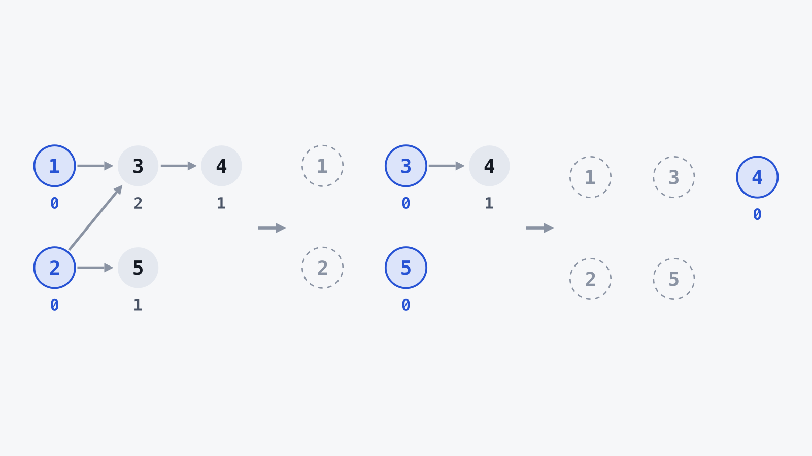

*정점 아래의 수는 들어오는 간선의 수입니다.  
0인 정점(파랑)을 꺼내고 거기서 나가는 간선을 지우면, 다음 정점의 수가 줄어듭니다.*

실제로 간선을 지울 필요는 없고 수만 세면 됩니다.  
정점마다 들어오는 간선의 수를 적어 두는데, 이 수를 진입 차수라고 부릅니다.

1. 진입 차수가 0인 정점을 전부 큐에 넣습니다.
2. 큐에서 하나를 꺼내 답에 적습니다.
3. 그 정점에서 나가는 간선마다 도착 정점의 진입 차수를 1 줄입니다. 0이 되면 큐에 넣습니다.

```cpp
#include <bits/stdc++.h>
#define ibm514 ios::sync_with_stdio(0), cin.tie(0), cout.tie(0);
using namespace std;
typedef long long ll;

int n, m;
vector<int> adj[32001];
int indeg[32001];   // 나보다 앞에 서야 하는데 아직 줄에 서지 않은 사람 수

void solve() {
    cin >> n >> m;
    for (int i = 0; i < m; i++) {
        int a, b;
        cin >> a >> b;
        adj[a].push_back(b);
        indeg[b]++;
    }

    queue<int> q;
    for (int i = 1; i <= n; i++) {
        if (indeg[i] == 0) q.push(i);
    }

    while (!q.empty()) {
        int u = q.front();
        q.pop();
        cout << u << ' ';
        for (int v : adj[u]) {
            if (--indeg[v] == 0) q.push(v);
        }
    }
}

int main() {
    ibm514
    solve();
    return 0;
}
```

BFS와 거의 같습니다. `visited` 배열 자리에 `indeg` 배열이 있을 뿐이에요.  
BFS는 어떤 정점에 **처음** 닿았을 때 큐에 넣고, 위상정렬은 **마지막으로** 닿았을 때 큐에 넣습니다.  
앞에 서야 하는 사람이 전부 선 다음에야 내 차례가 오니까요.

모든 정점이 큐에 한 번씩 들어가고 모든 간선을 한 번씩 보니 O(N + M)입니다.

### DFS로도 됩니다

DFS로 하는 방법도 있습니다.  
한 정점에서 갈 수 있는 곳을 전부 다녀온 뒤에 그 정점을 적고, 다 끝나면 적은 순서를 뒤집습니다.

```cpp
#include <bits/stdc++.h>
#define ibm514 ios::sync_with_stdio(0), cin.tie(0), cout.tie(0);
using namespace std;
typedef long long ll;

int n, m;
vector<int> adj[32001];
bool visited[32001];
vector<int> order;

void dfs(int u) {
    visited[u] = true;
    for (int v : adj[u]) {
        if (!visited[v]) dfs(v);
    }
    order.push_back(u);   // 내 뒤에 설 사람이 전부 들어간 다음에 들어간다
}

void solve() {
    cin >> n >> m;
    for (int i = 0; i < m; i++) {
        int a, b;
        cin >> a >> b;
        adj[a].push_back(b);
    }

    for (int i = 1; i <= n; i++) {
        if (!visited[i]) dfs(i);
    }

    reverse(order.begin(), order.end());
    for (int u : order) cout << u << ' ';
}

int main() {
    ibm514
    solve();
    return 0;
}
```

어떤 정점이 적히는 건, 그 뒤에 설 사람들이 모두 적힌 다음입니다.  
그래서 뒤집으면 앞에 서야 하는 사람이 항상 먼저 나옵니다.

둘 중 무엇을 써도 되지만, 이 글에서는 큐를 쓰는 쪽으로 갑니다.  
순서를 못 정하는 경우를 바로 알아낼 수 있고,  
뒤에서 볼 응용들이 전부 진입 차수를 세는 방식에서 나오거든요.

## 순서를 못 정할 때: 음악프로그램

[BOJ 2623 음악프로그램](https://www.acmicpc.net/problem/2623)입니다.  
가수 N명의 출연 순서를 정해야 하는데, 보조 PD M명이 각자 맡은 가수들의 순서를 정해 왔습니다.  
모든 PD의 순서를 지키는 전체 순서를 출력하고, 불가능하면 0을 출력합니다.

입력이 둘씩이 아니라 줄로 들어옵니다.  
`1 4 3`이면 1 다음에 4, 4 다음에 3이니, 이웃한 것끼리만 간선을 그으면 됩니다.  
1이 3보다 앞이라는 건 따로 긋지 않아도 저절로 지켜져요.

문제는 PD들의 순서가 서로 어긋날 때입니다.  
한 PD는 1을 2 앞에, 다른 PD는 2를 3 앞에,  
또 다른 PD는 3을 1 앞에 뒀다면 어떻게 세워도 누군가의 순서는 틀립니다.  
그래프로 보면 화살표를 따라 한 바퀴 돌아오는 길, 사이클이 있는 경우예요.

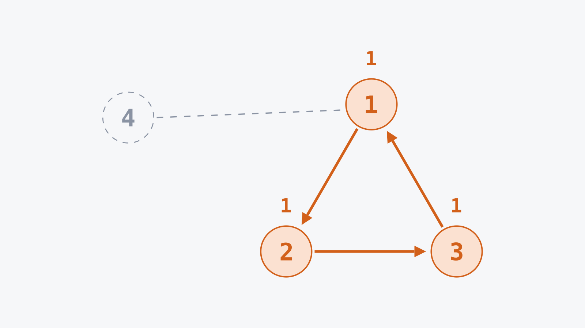

*1, 2, 3이 서로를 기다립니다.  
4를 꺼낸 뒤에도 셋 다 들어오는 간선이 하나씩 남아서, 아무도 큐에 들어가지 못합니다.*

이걸 알아내려고 따로 할 일은 없습니다.  
사이클에 속한 정점은 진입 차수가 끝까지 0이 되지 않아서 큐에 들어가지 못합니다.  
그래서 큐가 비었을 때 **꺼낸 정점의 수가 N보다 적으면** 사이클이 있는 것입니다.

```cpp
#include <bits/stdc++.h>
#define ibm514 ios::sync_with_stdio(0), cin.tie(0), cout.tie(0);
using namespace std;
typedef long long ll;

int n, m;
vector<int> adj[1001];
int indeg[1001];

void solve() {
    cin >> n >> m;
    for (int i = 0; i < m; i++) {
        int k, prev = 0;
        cin >> k;
        for (int j = 0; j < k; j++) {
            int x;
            cin >> x;
            if (prev != 0) {
                adj[prev].push_back(x);
                indeg[x]++;
            }
            prev = x;
        }
    }

    queue<int> q;
    for (int i = 1; i <= n; i++) {
        if (indeg[i] == 0) q.push(i);
    }

    vector<int> order;
    while (!q.empty()) {
        int u = q.front();
        q.pop();
        order.push_back(u);
        for (int v : adj[u]) {
            if (--indeg[v] == 0) q.push(v);
        }
    }

    // 다 꺼내지 못했다면 서로가 서로를 기다리는 가수들이 있다
    if ((int)order.size() < n) {
        cout << 0;
        return;
    }
    for (int u : order) cout << u << '\n';
}

int main() {
    ibm514
    solve();
    return 0;
}
```

답을 바로 출력하지 않고 벡터에 모아 둔 것도 그래서입니다.  
끝까지 돌려 봐야 가능한지 알 수 있으니까요.

## 여러 답 중에 고르기: 문제집

[BOJ 1766 문제집](https://www.acmicpc.net/problem/1766)입니다.  
문제가 N개 있고 번호가 작을수록 쉽습니다. “A번은 B번보다 먼저 풀어야 한다”는 조건이 M개 있어요.  
조건을 지키면서, 가능하면 쉬운 문제부터 푸는 순서를 출력합니다.

줄 세우기는 아무 순서나 하나 내면 됐는데, 이번에는 그중 하나를 골라야 합니다.  
큐에 들어 있는 정점들은 전부 “지금 풀어도 되는 문제”입니다.  
그중 번호가 가장 작은 것을 꺼내면 돼요.

큐는 들어온 순서대로 내보내니, 작은 것부터 꺼내 주는 우선순위 큐로 바꿉니다.

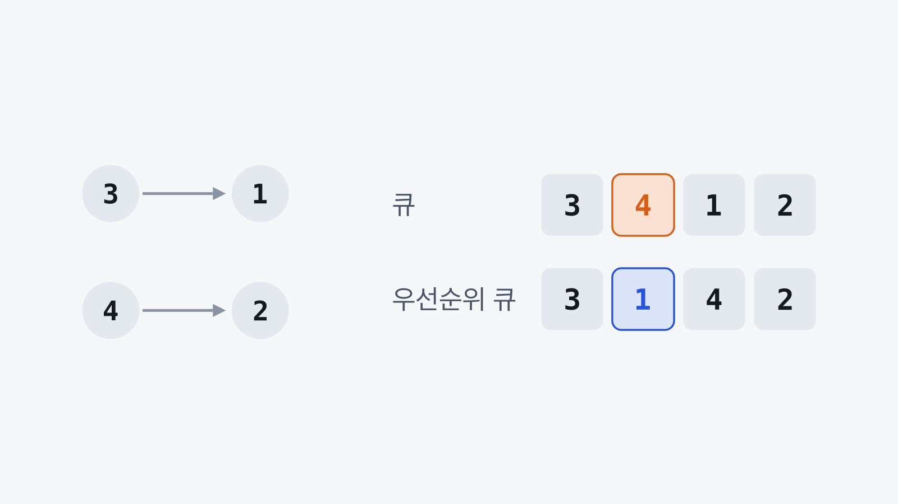

*예제입니다. 3은 1보다, 4는 2보다 먼저 풀어야 합니다.  
3을 풀고 나면 4와 1을 풀 수 있는데,  
큐는 먼저 들어와 있던 4를 내보내고(주황) 우선순위 큐는 더 작은 1을 내보냅니다(파랑).*

```cpp
#include <bits/stdc++.h>
#define ibm514 ios::sync_with_stdio(0), cin.tie(0), cout.tie(0);
using namespace std;
typedef long long ll;

int n, m;
vector<int> adj[32001];
int indeg[32001];

void solve() {
    cin >> n >> m;
    for (int i = 0; i < m; i++) {
        int a, b;
        cin >> a >> b;
        adj[a].push_back(b);
        indeg[b]++;
    }

    // 지금 풀 수 있는 문제 중 번호가 가장 작은 것부터 꺼낸다
    priority_queue<int, vector<int>, greater<int>> pq;
    for (int i = 1; i <= n; i++) {
        if (indeg[i] == 0) pq.push(i);
    }

    while (!pq.empty()) {
        int u = pq.top();
        pq.pop();
        cout << u << ' ';
        for (int v : adj[u]) {
            if (--indeg[v] == 0) pq.push(v);
        }
    }
}

int main() {
    ibm514
    solve();
    return 0;
}
```

바뀐 건 자료구조 한 줄입니다.  
우선순위 큐에 넣고 빼는 데 log N이 들어서 O((N + M) log N)이 됩니다.

매번 가장 작은 것을 고르면 전체로도 사전순으로 가장 앞서는지는 금방 확인됩니다.  
첫 자리에 올 수 있는 건 진입 차수가 0인 정점뿐이고,  
그중 가장 작은 것을 놓았으니 첫 자리가 더 작은 답은 없습니다.  
둘째 자리부터도 같은 이야기가 반복됩니다.

## 순위를 간선으로: 최종 순위

[BOJ 3665 최종 순위](https://www.acmicpc.net/problem/3665)입니다.  
작년 순위가 주어지고, 올해는 “작년과 앞뒤가 바뀐 두 팀”의 목록만 주어집니다.  
올해 순위를 출력하되, 순위를 확실히 정할 수 없으면 `?`,  
정보가 서로 맞지 않으면 `IMPOSSIBLE`을 출력합니다.

작년 순위가 5 4 3 2 1이면 5는 나머지 넷보다 앞이고, 4는 3, 2, 1보다 앞입니다.  
이웃한 팀끼리만이 아니라 **모든 쌍**에 간선을 긋습니다.  
그런 다음 바뀐 쌍이 주어지면 그 간선의 방향을 뒤집습니다.

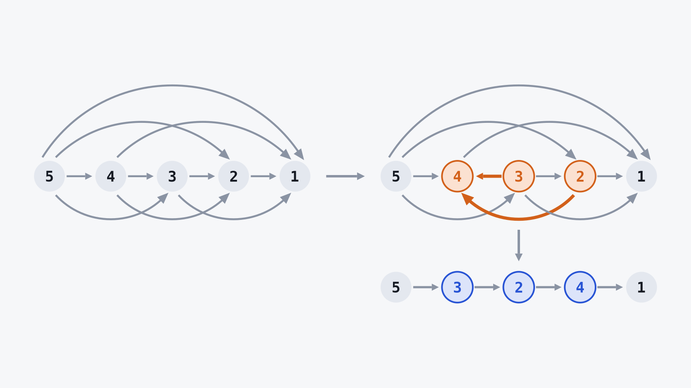

*예제 1번입니다. 작년 순위가 5 4 3 2 1이면 앞선 팀에서 뒤의 팀으로 간선이 모두 열 개 그어집니다(왼쪽).  
(2, 4)와 (3, 4)의 앞뒤가 바뀌었으니 두 간선을 뒤집습니다(오른쪽, 주황).  
위상정렬을 하면 5 3 2 4 1이 나옵니다(아래).*

이웃한 팀끼리만 간선을 그었다면 2와 4 사이에는 뒤집을 간선이 없었겠죠.  
그래서 모든 쌍에 그어 둡니다. 팀이 500개라 간선은 12만 개쯤이고, 인접 행렬로 충분합니다.

```cpp
#include <bits/stdc++.h>
#define ibm514 ios::sync_with_stdio(0), cin.tie(0), cout.tie(0);
using namespace std;
typedef long long ll;

int n, m;
int last[501];
bool higher[501][501];   // higher[a][b]: a가 b보다 순위가 높다
int indeg[501];

void run() {
    cin >> n;
    for (int i = 1; i <= n; i++) cin >> last[i];

    for (int i = 1; i <= n; i++) {
        indeg[i] = 0;
        for (int j = 1; j <= n; j++) higher[i][j] = false;
    }
    for (int i = 1; i <= n; i++) {
        for (int j = i + 1; j <= n; j++) higher[last[i]][last[j]] = true;
    }

    cin >> m;
    for (int i = 0; i < m; i++) {
        int a, b;
        cin >> a >> b;
        swap(higher[a][b], higher[b][a]);
    }

    for (int a = 1; a <= n; a++) {
        for (int b = 1; b <= n; b++) {
            if (higher[a][b]) indeg[b]++;
        }
    }

    queue<int> q;
    for (int i = 1; i <= n; i++) {
        if (indeg[i] == 0) q.push(i);
    }

    vector<int> order;
    while (!q.empty()) {
        int u = q.front();
        q.pop();
        order.push_back(u);
        for (int v = 1; v <= n; v++) {
            if (higher[u][v] && --indeg[v] == 0) q.push(v);
        }
    }

    if ((int)order.size() < n) {
        cout << "IMPOSSIBLE\n";
        return;
    }
    for (int u : order) cout << u << ' ';
    cout << '\n';
}

void solve() {
    int t;
    cin >> t;
    while (t--) run();
}

int main() {
    ibm514
    solve();
    return 0;
}
```

코드에 `?`를 출력하는 부분이 없습니다. 빠뜨린 게 아니라 나올 수가 없어서예요.

순위가 하나로 정해지지 않는다는 건, 어느 순간 큐에 정점이 둘 이상 들어 있다는 뜻입니다.  
그런데 이 그래프는 모든 쌍 사이에 간선이 있습니다.  
큐에 a와 b가 같이 있으려면 둘 다 진입 차수가 0이어야 하는데,  
a와 b 사이의 간선은 둘 중 하나로 들어가야 하니 그럴 수가 없습니다.  
그래서 결과는 순위 하나가 나오거나 `IMPOSSIBLE`이거나 둘 중 하나입니다.

## 순서대로 값을 채운다

여기까지는 순서를 구하는 이야기였습니다.  
그런데 위상정렬이 더 자주 쓰이는 곳은 순서 자체가 아니라, **그 순서대로 값을 계산하는** 문제입니다.

위상정렬 순서에는 쓸모 있는 성질이 하나 있습니다.  
어떤 정점을 꺼낼 때, 그 정점으로 들어오는 정점들은 이미 전부 꺼내진 뒤라는 것입니다.  
“앞의 것들이 다 정해져야 내 값이 정해지는” 계산을 하기에 알맞은 순서죠.

### 가장 늦는 것을 기다린다: ACM Craft

[BOJ 1005 ACM Craft](https://www.acmicpc.net/problem/1005)입니다.  
건물이 N개 있고 건물마다 짓는 데 걸리는 시간이 있습니다.  
“X를 지어야 Y를 지을 수 있다”는 규칙이 K개 있고, 여러 건물을 동시에 지을 수 있어요.  
건물 W를 다 짓는 가장 빠른 시각을 구합니다.

동시에 지을 수 있으니 시간을 전부 더하는 게 아닙니다.  
어떤 건물을 짓기 시작할 수 있는 때는, 먼저 지어야 하는 건물들 중 **가장 늦게 끝나는 것**이 끝나는 때입니다.

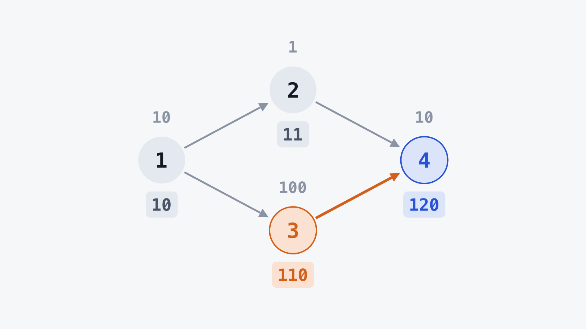

*예제 1번입니다. 위의 수는 짓는 시간, 아래의 수는 다 지어지는 시각입니다.  
4번은 11에 끝나는 2번이 아니라 110에 끝나는 3번을 기다려야 해서 120에 끝납니다.*

```cpp
#include <bits/stdc++.h>
#define ibm514 ios::sync_with_stdio(0), cin.tie(0), cout.tie(0);
using namespace std;
typedef long long ll;

int n, k, w;
int cost[1001];
vector<int> adj[1001];
int indeg[1001];
int done[1001];   // done[v]: v를 다 짓는 가장 빠른 시각

void run() {
    cin >> n >> k;
    for (int i = 1; i <= n; i++) {
        cin >> cost[i];
        adj[i].clear();
        indeg[i] = 0;
        done[i] = 0;
    }
    for (int i = 0; i < k; i++) {
        int x, y;
        cin >> x >> y;
        adj[x].push_back(y);
        indeg[y]++;
    }
    cin >> w;

    queue<int> q;
    for (int i = 1; i <= n; i++) {
        if (indeg[i] == 0) {
            done[i] = cost[i];
            q.push(i);
        }
    }

    while (!q.empty()) {
        int u = q.front();
        q.pop();
        for (int v : adj[u]) {
            // 먼저 지어야 하는 건물 중 가장 늦게 끝나는 것을 기다려야 한다
            done[v] = max(done[v], done[u] + cost[v]);
            if (--indeg[v] == 0) q.push(v);
        }
    }
    cout << done[w] << '\n';
}

void solve() {
    int t;
    cin >> t;
    while (t--) run();
}

int main() {
    ibm514
    solve();
    return 0;
}
```

큐에서 u를 꺼낼 때 `done[u]`는 이미 확정된 값입니다.  
u 앞의 건물이 전부 처리된 뒤에야 u가 큐에 들어오니까요.  
그래서 u에서 나가는 간선마다 `done[v]`를 더 큰 값으로 고쳐 주기만 하면 됩니다.

이 문제는 [탑다운 DP 글](https://www.rilog.kr/@iqed/posts/608)의 방식으로도 풀립니다.  
“W가 끝나는 시각을 알려면 앞 건물들이 끝나는 시각을 재귀로 물어본다”로 쓰고 메모이제이션을 하면 돼요.  
그 글에서는 채우는 순서를 몰라도 재귀가 알아서 찾아간다고 했는데,  
위상정렬은 그 순서를 직접 구해서 앞에서부터 채우는 방법입니다.  
같은 계산을 반대 방향에서 하는 셈이에요.

### 개수를 곱해서 내려보낸다: 장난감 조립

[BOJ 2637 장난감 조립](https://www.acmicpc.net/problem/2637)입니다.  
완제품은 N번이고, “X를 만드는 데 Y가 K개 필요하다”는 관계가 주어집니다.  
다른 부품으로 만들지 않는 부품을 기본 부품이라고 할 때,  
완제품 하나에 기본 부품이 종류별로 몇 개 필요한지 구합니다.

이번에는 최댓값이 아니라 합입니다.  
완제품에 중간 부품 6이 3개 필요하고, 6 하나에 기본 부품 4가 4개 들어간다면,  
6을 거쳐서 필요한 4는 3 × 4 = 12개입니다.  
4를 쓰는 다른 길이 있으면 그것도 더하고요.

방향을 잘 잡아야 합니다. 완제품에서 출발해서 부품 쪽으로 내려갑니다.  
어떤 부품이 **모두 몇 개 필요한지**는, 그 부품을 쓰는 윗부품들의 개수가 전부 정해져야 알 수 있거든요.  
그래서 “X가 Y를 쓴다”를 X에서 Y로 가는 간선으로 두고 위상정렬을 합니다.

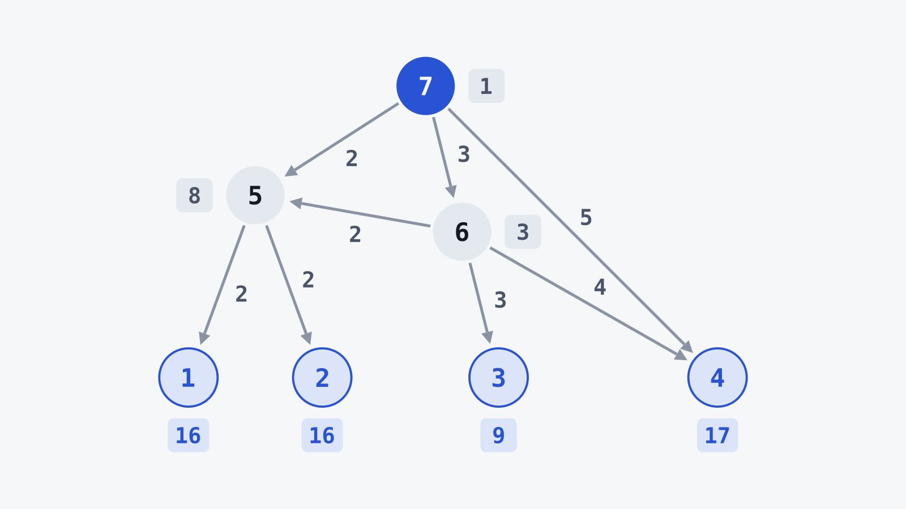

*예제입니다. 간선에 적힌 수는 필요한 개수이고,  
상자 안의 수는 완제품 하나에 그 부품이 모두 몇 개 필요한지입니다.  
5번은 7에서 직접 2개, 6을 거쳐 3 × 2 = 6개가 필요해서 8개입니다.*

```cpp
#include <bits/stdc++.h>
#define ibm514 ios::sync_with_stdio(0), cin.tie(0), cout.tie(0);
using namespace std;
typedef long long ll;

int n, m;
vector<pair<int, int>> adj[101];   // adj[x]: x를 만드는 데 필요한 (부품, 개수)
int indeg[101];
int need[101];   // need[x]: 완제품 하나에 x가 몇 개 필요한가

void solve() {
    cin >> n >> m;
    for (int i = 0; i < m; i++) {
        int x, y, k;
        cin >> x >> y >> k;
        adj[x].push_back({y, k});
        indeg[y]++;
    }

    queue<int> q;
    need[n] = 1;
    for (int i = 1; i <= n; i++) {
        if (indeg[i] == 0) q.push(i);
    }

    while (!q.empty()) {
        int x = q.front();
        q.pop();
        for (auto [y, k] : adj[x]) {
            need[y] += need[x] * k;
            if (--indeg[y] == 0) q.push(y);
        }
    }

    for (int i = 1; i <= n; i++) {
        if (adj[i].empty()) cout << i << ' ' << need[i] << '\n';
    }
}

int main() {
    ibm514
    solve();
    return 0;
}
```

기본 부품은 나가는 간선이 없는 정점입니다. 입력에서 X 자리에 한 번도 나오지 않은 부품이죠.

ACM Craft와 코드 모양이 같습니다. `max`가 `+=`와 곱셈으로 바뀌었을 뿐이에요.

### 채운 다음 거꾸로 되짚는다: 임계경로

[BOJ 1948 임계경로](https://www.acmicpc.net/problem/1948)입니다.  
일방통행 도로로 이어진 도시들이 있고, 사이클은 없습니다.  
출발 도시에서 도착 도시까지 가는 모든 경로마다 사람이 한 명씩 동시에 출발해서 쉬지 않고 달립니다.  
마지막 사람이 도착하는 시간과, 가장 오래 달린 사람들이 지나는 도로의 수를 구합니다.

첫 번째 질문은 가장 오래 걸리는 경로의 시간입니다. ACM Craft와 같아요.  
`dist[v]`를 출발 도시에서 v까지 가장 오래 걸리는 시간으로 두고, 위상정렬 순서로 최댓값을 채웁니다.

두 번째 질문이 새롭습니다.  
가장 오래 걸리는 경로는 여러 개일 수 있고, 그 경로들에 속한 도로를 겹치지 않게 세야 합니다.

[역추적 글](https://www.rilog.kr/@iqed/posts/610)에서 답을 만든 선택을 거꾸로 되짚었던 것을 떠올리면 됩니다.  
도착 도시에서 시작해 도로를 거꾸로 따라가되, `dist[u] + w == dist[v]`인 도로만 따라갑니다.  
이 식이 맞는다는 건 v의 최댓값이 바로 이 도로로 만들어졌다는 뜻이니까요.

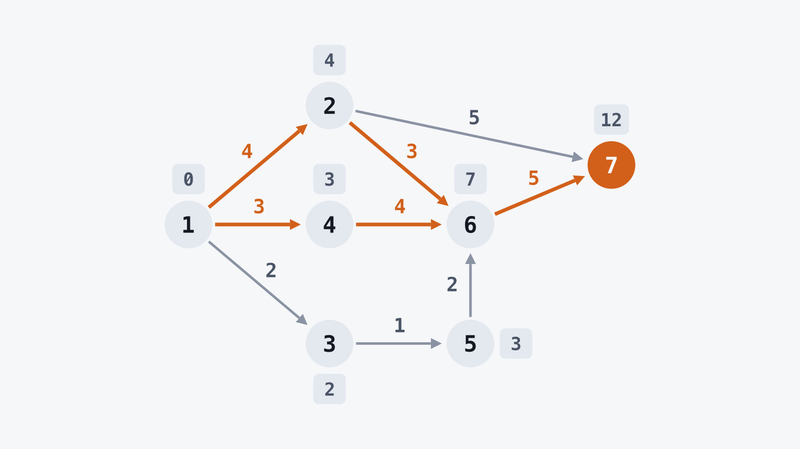

*예제입니다. 정점 옆의 상자가 dist입니다.  
6번의 7은 2번에서 온 4 + 3과 4번에서 온 3 + 4로 두 번 만들어져서 두 도로 모두 주황색입니다.  
5번에서 오는 도로는 3 + 2 = 5라서 아닙니다.*

```cpp
#include <bits/stdc++.h>
#define ibm514 ios::sync_with_stdio(0), cin.tie(0), cout.tie(0);
using namespace std;
typedef long long ll;

int n, m, s, e;
vector<pair<int, int>> adj[10001], radj[10001];
int indeg[10001];
int dist[10001];   // dist[v]: 출발 도시에서 v까지 가장 오래 걸리는 시간
bool visited[10001];

void solve() {
    cin >> n >> m;
    for (int i = 0; i < m; i++) {
        int u, v, w;
        cin >> u >> v >> w;
        adj[u].push_back({v, w});
        radj[v].push_back({u, w});
        indeg[v]++;
    }
    cin >> s >> e;

    queue<int> q;
    q.push(s);
    while (!q.empty()) {
        int u = q.front();
        q.pop();
        for (auto [v, w] : adj[u]) {
            dist[v] = max(dist[v], dist[u] + w);
            if (--indeg[v] == 0) q.push(v);
        }
    }

    // 도착 도시에서 거꾸로 가면서, 가장 긴 시간을 만든 도로만 따라간다
    int cnt = 0;
    q.push(e);
    visited[e] = true;
    while (!q.empty()) {
        int v = q.front();
        q.pop();
        for (auto [u, w] : radj[v]) {
            if (dist[u] + w != dist[v]) continue;
            cnt++;
            if (!visited[u]) {
                visited[u] = true;
                q.push(u);
            }
        }
    }

    cout << dist[e] << '\n' << cnt;
}

int main() {
    ibm514
    solve();
    return 0;
}
```

- 도로는 식이 맞을 때마다 세고, 정점은 한 번만 큐에 넣습니다.  
`visited` 없이 정점을 여러 번 넣으면 같은 도로를 여러 번 세게 됩니다.
- 거꾸로 가야 하니 뒤집은 그래프 `radj`를 같이 만들어 둡니다.

### 값 두 개를 들고 간다: Strahler 순서

[BOJ 9470 Strahler 순서](https://www.acmicpc.net/problem/9470)입니다.  
강이 흐르는 방향을 간선으로 한 그래프가 주어집니다. 강이 시작하는 노드의 순서는 1입니다.  
나머지 노드는 들어오는 강의 순서 중 가장 큰 값을 i라고 할 때, i인 강이 하나면 i, 둘 이상이면 i + 1입니다.  
바다와 만나는 노드의 순서를 구합니다.

규칙을 그대로 옮기면 됩니다. 다만 정점마다 값 하나로는 부족해요.  
들어오는 강 중 **가장 큰 순서**와 **그 값이 몇 번 들어왔는지**, 두 가지를 알아야 합니다.

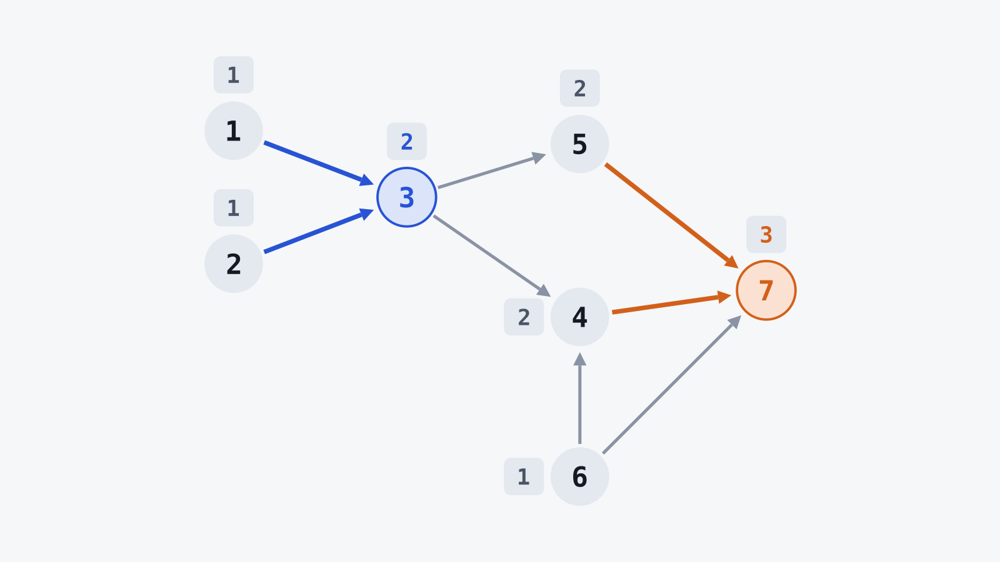

*예제입니다. 상자 안의 수가 순서예요.  
3번은 순서 1이 두 번 들어와서 2가 됐고(파랑), 7번은 순서 2가 두 번 들어와서 3이 됐습니다(주황).  
4번은 2와 1이 하나씩 들어와서 그대로 2입니다.*

```cpp
#include <bits/stdc++.h>
#define ibm514 ios::sync_with_stdio(0), cin.tie(0), cout.tie(0);
using namespace std;
typedef long long ll;

int k, n, p;
vector<int> adj[1001];
int indeg[1001];
int ord[1001];   // 이 노드의 순서
int best[1001];  // 들어오는 강의 순서 중 가장 큰 값
int cnt[1001];   // 그 가장 큰 값이 몇 번 들어왔는가

void run() {
    cin >> k >> n >> p;
    for (int i = 1; i <= n; i++) {
        adj[i].clear();
        indeg[i] = ord[i] = best[i] = cnt[i] = 0;
    }
    for (int i = 0; i < p; i++) {
        int a, b;
        cin >> a >> b;
        adj[a].push_back(b);
        indeg[b]++;
    }

    queue<int> q;
    for (int i = 1; i <= n; i++) {
        if (indeg[i] == 0) {
            ord[i] = 1;
            q.push(i);
        }
    }

    while (!q.empty()) {
        int u = q.front();
        q.pop();
        for (int v : adj[u]) {
            if (ord[u] > best[v]) {
                best[v] = ord[u];
                cnt[v] = 1;
            } else if (ord[u] == best[v]) {
                cnt[v]++;
            }
            if (--indeg[v] == 0) {
                ord[v] = cnt[v] >= 2 ? best[v] + 1 : best[v];
                q.push(v);
            }
        }
    }
    cout << k << ' ' << ord[n] << '\n';
}

void solve() {
    int t;
    cin >> t;
    while (t--) run();
}

int main() {
    ibm514
    solve();
    return 0;
}
```

간선을 볼 때마다 `best`와 `cnt`를 고쳐 두었다가, 진입 차수가 0이 되는 순간 순서를 확정합니다.  
0이 됐다는 건 들어오는 강을 전부 봤다는 뜻이니까요.

위상정렬 순서로 들고 가는 값은 문제에 맞게 정하면 됩니다.  
최댓값, 합, 그리고 이번처럼 둘을 묶은 것까지 전부 같은 틀이에요.

## 위상정렬처럼 안 보이는 문제

이제 순서를 구하라는 말이 없는 문제들입니다.  
공통점은 진입 차수에서 쓴 생각, “**남은 수가 0이 되면 다음으로 넘어간다**”를 꺼내 쓴다는 것입니다.

### 0으로 만든 사람이 누구인가: 계보 복원가 호석

[BOJ 21276 계보 복원가 호석](https://www.acmicpc.net/problem/21276)입니다.  
마을 사람 N명이 각자 자기 조상을 전부 기억하고 있고, “X의 조상 중에 Y가 있다”는 정보가 M개 주어집니다.  
가문마다 시조 한 명을 뿌리로 하는 트리 모양이라고 할 때, 시조들과 각 사람의 자식을 출력합니다.

주어지는 건 조상 관계인데, 구해야 하는 건 부모와 자식입니다.  
할아버지와 아버지가 둘 다 조상으로 들어오니, 그중 누가 부모인지 가려내야 해요.

조상에서 자손으로 간선을 그으면, 각 사람의 진입 차수는 조상의 수입니다. 조상이 없는 사람이 시조고요.

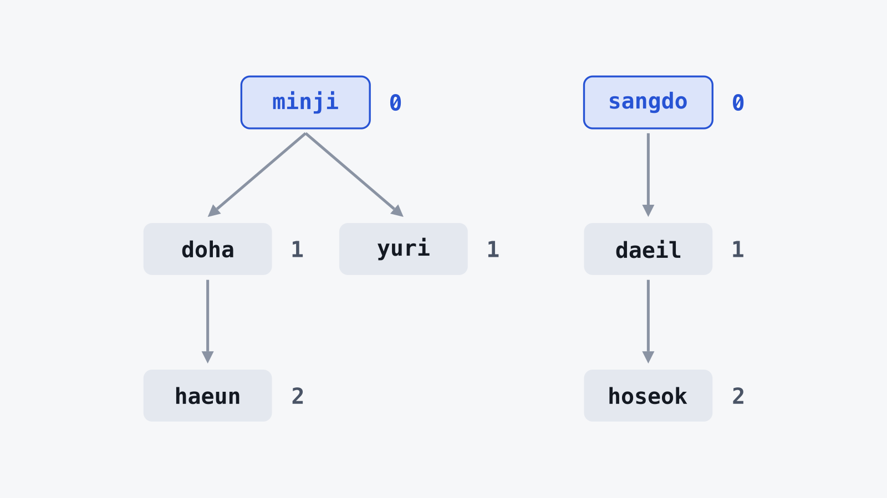

*예제의 계보입니다. 이름 옆의 수는 그 사람이 기억하는 조상의 수예요.  
haeun은 minji와 doha를 조상으로 기억하고, 둘 중 나중에 꺼내지는 doha가 부모입니다.*

시조부터 위상정렬을 돌립니다. 누군가를 꺼낼 때마다 그 사람을 조상으로 둔 사람들의 수가 1씩 줄어요.  
여기서 볼 것은 **어떤 사람의 수를 0으로 만든 사람**입니다.  
한 사람의 조상들은 시조부터 차례로 꺼내지고,  
맨 마지막에 꺼내지는 조상이 가장 가까운 조상, 곧 부모입니다.

```cpp
#include <bits/stdc++.h>
#define ibm514 ios::sync_with_stdio(0), cin.tie(0), cout.tie(0);
using namespace std;
typedef long long ll;

int n, m;
string name[1001];
map<string, int> id;
vector<int> adj[1001];       // adj[y]: y를 조상으로 기억하는 사람들
int indeg[1001];             // 아직 처리되지 않은 조상의 수
vector<int> child[1001];

void solve() {
    cin >> n;
    for (int i = 0; i < n; i++) cin >> name[i];
    sort(name, name + n);
    for (int i = 0; i < n; i++) id[name[i]] = i;

    cin >> m;
    for (int i = 0; i < m; i++) {
        string x, y;
        cin >> x >> y;
        adj[id[y]].push_back(id[x]);
        indeg[id[x]]++;
    }

    queue<int> q;
    vector<int> root;
    for (int i = 0; i < n; i++) {
        if (indeg[i] == 0) {
            root.push_back(i);
            q.push(i);
        }
    }

    while (!q.empty()) {
        int u = q.front();
        q.pop();
        for (int v : adj[u]) {
            // v의 조상 중 마지막으로 처리된 사람이 v의 부모다
            if (--indeg[v] == 0) {
                child[u].push_back(v);
                q.push(v);
            }
        }
    }

    cout << root.size() << '\n';
    for (int r : root) cout << name[r] << ' ';
    cout << '\n';
    for (int i = 0; i < n; i++) {
        sort(child[i].begin(), child[i].end());
        cout << name[i] << ' ' << child[i].size();
        for (int c : child[i]) cout << ' ' << name[c];
        cout << '\n';
    }
}

int main() {
    ibm514
    solve();
    return 0;
}
```

이름을 먼저 정렬한 뒤에 번호를 붙였습니다.  
그러면 번호 순서가 곧 사전 순서라서, 출력할 때 번호만 정렬하면 됩니다.

위상정렬 코드의 `if (--indeg[v] == 0)` 안에 한 줄을 넣었을 뿐인데,  
순서가 아니라 트리의 모양을 얻었습니다.

### 정점이 아니라 묶음을 센다: 클레어와 물약

[BOJ 20119 클레어와 물약](https://www.acmicpc.net/problem/20119)입니다.  
물약이 N종류 있고 레시피가 M개 있습니다. 레시피는 “이 물약들을 전부 섞으면 저 물약이 된다”는 꼴이에요.  
지금 가진 물약들로 만들 수 있는 물약을 전부 구합니다.

재료에서 결과로 간선을 긋고 물약의 진입 차수를 세고 싶어지는데, 그러면 틀립니다.  
같은 물약을 만드는 레시피가 여러 개일 수 있고, 그중 **하나만** 완성돼도 그 물약은 만들어지거든요.  
물약의 진입 차수를 세면 모든 레시피의 재료가 다 모여야 하는 것처럼 되어 버립니다.

세야 하는 건 물약이 아니라 레시피입니다.  
레시피마다 “아직 없는 재료의 수”를 적어 두고,  
물약이 하나 생길 때마다 그 물약을 쓰는 레시피들의 수를 1씩 줄입니다.  
0이 된 레시피는 완성이니 결과 물약을 얻습니다.

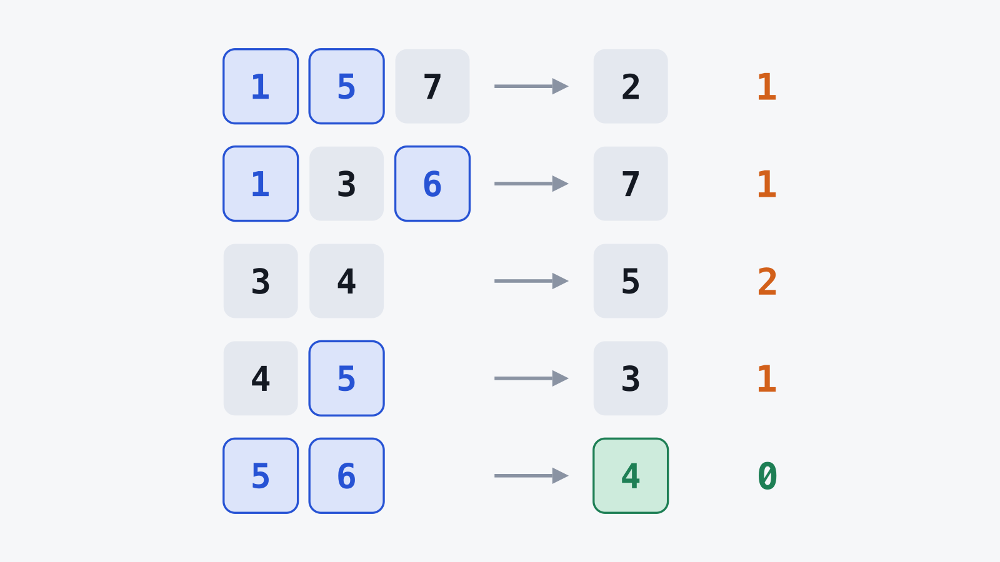

*예제 1번의 레시피 다섯 개입니다. 파란 것은 가지고 있는 물약이고, 오른쪽 수는 아직 없는 재료의 수입니다. 맨 아래 레시피가 0이라 4번을 만들 수 있고, 4번이 생기면 넷째 레시피가 0이 됩니다.*

```cpp
#include <bits/stdc++.h>
#define ibm514 ios::sync_with_stdio(0), cin.tie(0), cout.tie(0);
using namespace std;
typedef long long ll;

int n, m, l;
vector<int> uses[200001];   // uses[x]: 물약 x가 재료로 들어가는 레시피들
int lack[200001];           // lack[i]: 레시피 i에서 아직 없는 재료의 수
int result[200001];         // result[i]: 레시피 i로 만들어지는 물약
bool have[200001];

void solve() {
    cin >> n >> m;
    for (int i = 0; i < m; i++) {
        cin >> lack[i];
        for (int j = 0; j < lack[i]; j++) {
            int x;
            cin >> x;
            uses[x].push_back(i);
        }
        cin >> result[i];
    }

    queue<int> q;
    cin >> l;
    for (int i = 0; i < l; i++) {
        int y;
        cin >> y;
        have[y] = true;
        q.push(y);
    }

    while (!q.empty()) {
        int x = q.front();
        q.pop();
        for (int i : uses[x]) {
            if (--lack[i] > 0) continue;
            int r = result[i];
            if (!have[r]) {
                have[r] = true;
                q.push(r);
            }
        }
    }

    vector<int> ans;
    for (int i = 1; i <= n; i++) {
        if (have[i]) ans.push_back(i);
    }
    cout << ans.size() << '\n';
    for (int x : ans) cout << x << ' ';
}

int main() {
    ibm514
    solve();
    return 0;
}
```

`have`를 확인하는 이유는 같은 물약이 여러 레시피로 만들어질 수 있어서입니다.  
이미 있는 물약을 큐에 또 넣으면, 그 물약을 쓰는 레시피의 수를 두 번 줄이게 됩니다.

이 문제에는 사이클이 있어도 됩니다. 예제에서도 3과 4로 5를 만들고, 4와 5로 3을 만들어요.  
순서를 구하는 게 아니라 “0이 되면 넘어간다”만 쓰는 것이라 상관없습니다.

### 지우고 남는 것: 텀 프로젝트

[BOJ 9466 텀 프로젝트](https://www.acmicpc.net/problem/9466)입니다.  
학생마다 같이 하고 싶은 학생을 한 명씩 고릅니다(자기 자신도 됩니다).  
고른 것을 따라갔을 때 한 바퀴 돌아오는 학생들끼리 팀이 됩니다.  
어느 팀에도 들어가지 못한 학생의 수를 구합니다.

보통 DFS로 사이클을 찾는 문제로 알려져 있고, 방문 상태를 여러 단계로 나눠야 해서 실수하기 쉽습니다.  
진입 차수로 보면 훨씬 짧아져요.

음악프로그램에서 사이클에 속한 정점은 끝까지 큐에 못 들어간다고 했죠.  
그때는 그게 실패의 신호였는데, 여기서는 그게 답입니다.

아무에게도 선택받지 못한 학생은 팀이 될 수 없으니 뺍니다.  
그러면 그 학생이 고른 사람은 선택을 하나 잃고, 그래서 받은 선택이 0이 되면 그 학생도 뺍니다.  
더 뺄 사람이 없을 때 남아 있는 학생들이 팀을 이룬 학생들입니다.

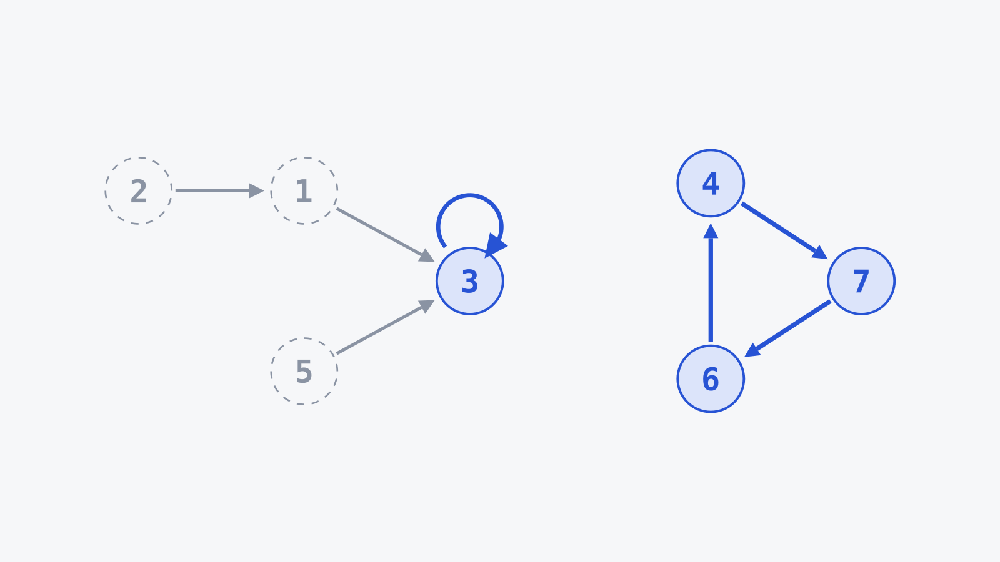

*예제 1번입니다. 2, 1, 5를 차례로 빼면(점선) 자기 자신을 고른 3과, 서로 돌아가며 고른 4, 7, 6만 남습니다.*

```cpp
#include <bits/stdc++.h>
#define ibm514 ios::sync_with_stdio(0), cin.tie(0), cout.tie(0);
using namespace std;
typedef long long ll;

int n;
int pick[100001];
int indeg[100001];   // 나를 고른 사람 중 아직 남아 있는 사람 수

void run() {
    cin >> n;
    for (int i = 1; i <= n; i++) indeg[i] = 0;
    for (int i = 1; i <= n; i++) {
        cin >> pick[i];
        indeg[pick[i]]++;
    }

    queue<int> q;
    for (int i = 1; i <= n; i++) {
        if (indeg[i] == 0) q.push(i);
    }

    // 아무도 고르지 않은 학생은 팀이 될 수 없다. 빼고 나면 또 그런 학생이 생긴다
    int out = 0;
    while (!q.empty()) {
        int u = q.front();
        q.pop();
        out++;
        if (--indeg[pick[u]] == 0) q.push(pick[u]);
    }
    cout << out << '\n';
}

void solve() {
    int t;
    cin >> t;
    while (t--) run();
}

int main() {
    ibm514
    solve();
    return 0;
}
```

남은 학생들이 전부 고리 위에 있다고 말할 수 있는 건, 모든 학생이 정확히 한 명을 고르기 때문입니다.  
남은 학생은 모두 선택을 하나 이상 받았는데,  
남은 선택의 수와 남은 학생의 수가 같으니 모두 정확히 하나씩 받았습니다.  
한 명을 고르고 한 명에게 선택받는 모양은 고리뿐이에요.

큐에서 꺼낸 학생의 수가 곧 답입니다.

### 묶은 다음에 순서를 본다: Chess Tournament

[BOJ 13344 Chess Tournament](https://www.acmicpc.net/problem/13344)입니다. 지문이 영어인데 내용은 간단합니다.  
선수 N명의 경기 결과가 M개 주어집니다. `K > L`은 K가 이겼다는 뜻이고 `K = L`은 비겼다는 뜻이에요.  
실력이 높은 쪽이 반드시 이기고 실력이 같을 때만 비긴다고 할 때, 결과들이 서로 맞는지 판단합니다.

`>`만 있다면 이긴 쪽에서 진 쪽으로 간선을 긋고 사이클이 있는지 보면 끝입니다.  
문제는 `=`예요. 비긴 두 선수는 실력이 같으니, 순서에서 **같은 자리**에 있어야 합니다.

같은 자리에 있어야 하는 것들은 아예 하나로 합쳐 버리면 됩니다.  
[유니온 파인드 글](https://www.rilog.kr/@iqed/posts/619)에서 한 것처럼 비긴 선수끼리 묶고, 간선은 선수가 아니라 묶음의 대표끼리 긋습니다.

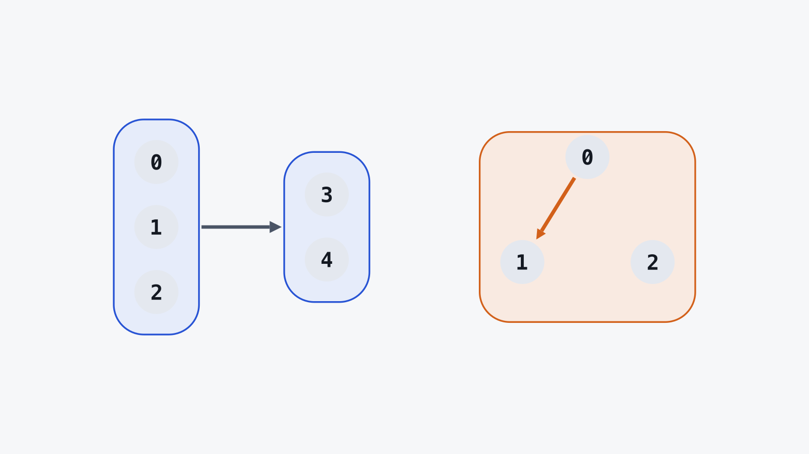

*왼쪽은 예제 2번입니다.  
0, 1, 2가 한 묶음, 3, 4가 한 묶음이고 간선은 묶음 사이에 하나만 남아서 문제가 없습니다.  
오른쪽은 예제 1번으로, 셋이 한 묶음인데 그 안에서 0이 1을 이겼다고 해서 모순입니다.*

1. `=`인 경기를 먼저 전부 처리해서 묶습니다.
2. `>`인 경기마다 두 선수의 대표를 찾습니다.  
대표가 같으면 실력이 같은 둘 사이에 승패가 난 것이니 모순입니다.
3. 대표끼리 간선을 긋고 위상정렬을 합니다. 꺼낸 수가 묶음의 수보다 적으면 사이클이 있으니 모순입니다.

```cpp
#include <bits/stdc++.h>
#define ibm514 ios::sync_with_stdio(0), cin.tie(0), cout.tie(0);
using namespace std;
typedef long long ll;

int n, m;
int parent[50001];
vector<int> adj[50001];
int indeg[50001];
vector<pair<int, int>> win;

int find(int x) {
    if (parent[x] == x) return x;
    return parent[x] = find(parent[x]);
}

void solve() {
    cin >> n >> m;
    for (int i = 0; i < n; i++) parent[i] = i;

    for (int i = 0; i < m; i++) {
        int k, l;
        char c;
        cin >> k >> c >> l;
        if (c == '=') parent[find(k)] = find(l);
        else win.push_back({k, l});
    }

    // 비긴 선수들은 한 묶음이다. 간선은 묶음과 묶음 사이에 긋는다
    for (auto [k, l] : win) {
        int a = find(k), b = find(l);
        if (a == b) {
            cout << "inconsistent";
            return;
        }
        adj[a].push_back(b);
        indeg[b]++;
    }

    int total = 0, cnt = 0;
    queue<int> q;
    for (int i = 0; i < n; i++) {
        if (find(i) != i) continue;
        total++;
        if (indeg[i] == 0) q.push(i);
    }

    while (!q.empty()) {
        int u = q.front();
        q.pop();
        cnt++;
        for (int v : adj[u]) {
            if (--indeg[v] == 0) q.push(v);
        }
    }

    cout << (cnt == total ? "consistent" : "inconsistent");
}

int main() {
    ibm514
    solve();
    return 0;
}
```

`>`는 벡터에 모아 뒀다가 나중에 간선으로 바꿉니다.  
입력 순서대로 바로 그으면, 나중에 한 묶음이 될 선수들의 간선이 서로 다른 대표에 붙어 버려요.

## 고난도: 그래프 수정

[BOJ 1432 그래프 수정](https://www.acmicpc.net/problem/1432)입니다.  
정점 N개의 번호를 1부터 N까지로 다시 매기려고 합니다.  
V1에서 V2로 가는 간선이 있으면 V2의 새 번호가 더 커야 해요.  
1번 정점의 새 번호, 2번 정점의 새 번호, … 를 늘어놓은 수열이 사전순으로 가장 앞서게 만듭니다.

문제집과 비슷해 보입니다.  
위상정렬 순서로 1, 2, 3, … 을 주면 되고, 사전순이니 번호가 작은 정점부터 꺼내면 될 것 같죠.  
그런데 이렇게 하면 틀립니다.

문제집에서 구한 건 “꺼낸 **순서**가 사전순으로 가장 앞선 것”이었습니다.  
여기서 구하는 건 “정점들이 **받은 번호**를 늘어놓은 것이 가장 앞선 것”이에요.  
그러려면 1번 정점이 최대한 작은 번호를 받아야 합니다.

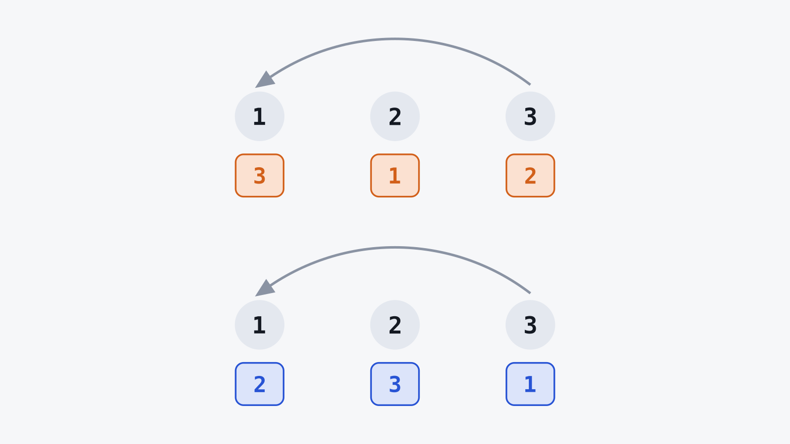

*3번에서 1번으로 가는 간선 하나만 있는 그래프입니다.  
정점 아래가 새 번호예요. 번호가 작은 정점부터 꺼내면(위) 2번이 1을 가져가서 1번은 3을 받습니다.  
답은 아래쪽이고, 1번이 2를 받습니다.*

1번이 작은 번호를 받으려면,  
1번보다 앞서야 하는 정점들만 먼저 번호를 받고 나머지는 전부 뒤로 밀려야 합니다.  
앞에서부터 정하면 누가 1번 앞에 꼭 있어야 하는지 모르는 채로 번호를 줘야 해서 어긋나요.

거꾸로 생각하면 풀립니다. **가장 큰 번호 N을 누구에게 줄지**부터 정합니다.  
N을 받을 수 있는 건 나가는 간선이 없는 정점들이고, 그중에서 정점 번호가 가장 큰 것에게 줍니다.  
큰 번호를 뒤쪽 정점에게 넘겨야 앞쪽 정점이 작은 번호를 받을 수 있으니까요.  
그다음 N − 1도 같은 식으로 줍니다.

1. 정점마다 나가는 간선의 수를 셉니다.
2. 그 수가 0인 정점을, 큰 것이 먼저 나오는 우선순위 큐에 넣습니다.
3. 꺼낸 정점에 N부터 차례로 번호를 주고, 그 정점으로 들어오는 간선의 출발 정점들의 수를 1씩 줄입니다.

```cpp
#include <bits/stdc++.h>
#define ibm514 ios::sync_with_stdio(0), cin.tie(0), cout.tie(0);
using namespace std;
typedef long long ll;

int n;
string g[51];
int outdeg[51];   // 나보다 번호가 커야 하는데 아직 번호를 받지 않은 정점 수
int num[51];

void solve() {
    cin >> n;
    for (int i = 0; i < n; i++) {
        cin >> g[i];
        for (int j = 0; j < n; j++) {
            if (g[i][j] == '1') outdeg[i]++;
        }
    }

    // 큰 번호부터, 번호를 받을 수 있는 정점 중 가장 뒤의 정점에 준다
    priority_queue<int> pq;
    for (int i = 0; i < n; i++) {
        if (outdeg[i] == 0) pq.push(i);
    }

    int next = n;
    while (!pq.empty()) {
        int v = pq.top();
        pq.pop();
        num[v] = next--;
        for (int u = 0; u < n; u++) {
            if (g[u][v] == '1' && --outdeg[u] == 0) pq.push(u);
        }
    }

    if (next > 0) {
        cout << -1;
        return;
    }
    for (int i = 0; i < n; i++) cout << num[i] << ' ';
}

int main() {
    ibm514
    solve();
    return 0;
}
```

끝까지 번호를 받지 못한 정점이 있으면 사이클이 있는 것이라 -1입니다.

사전순으로 가장 앞선 것을 구하는데 뒤에서부터 큰 번호를 채운다는 점이 이 문제의 전부입니다.  
앞에서부터 채우는 방법이 틀리는 예는 정점 세 개로도 만들어지니,  
비슷한 문제를 만나면 작은 그래프로 먼저 확인해 보세요.

## 고난도: 알고스팟어

[BOJ 2848 알고스팟어](https://www.acmicpc.net/problem/2848)입니다.  
알고스팟어는 영어 알파벳을 쓰지만 알파벳 순서가 다릅니다.  
알고스팟어의 사전순으로 정렬된 단어 목록이 주어질 때 알파벳 순서를 구하고,  
올바른 순서가 없으면 `!`, 가능한 순서가 둘 이상이면 `?`를 출력합니다.

간선이 입력에 없습니다. 단어 목록에서 직접 만들어야 해요.

사전에서 두 단어의 앞뒤를 정하는 것은 **처음으로 다른 글자**입니다.  
ula가 uka보다 앞에 있다면,  
첫 글자는 같고 둘째 글자에서 l과 k가 갈렸으니 l이 k보다 앞선다는 것을 알 수 있습니다.  
그 뒤의 글자는 아무것도 알려 주지 않아요.

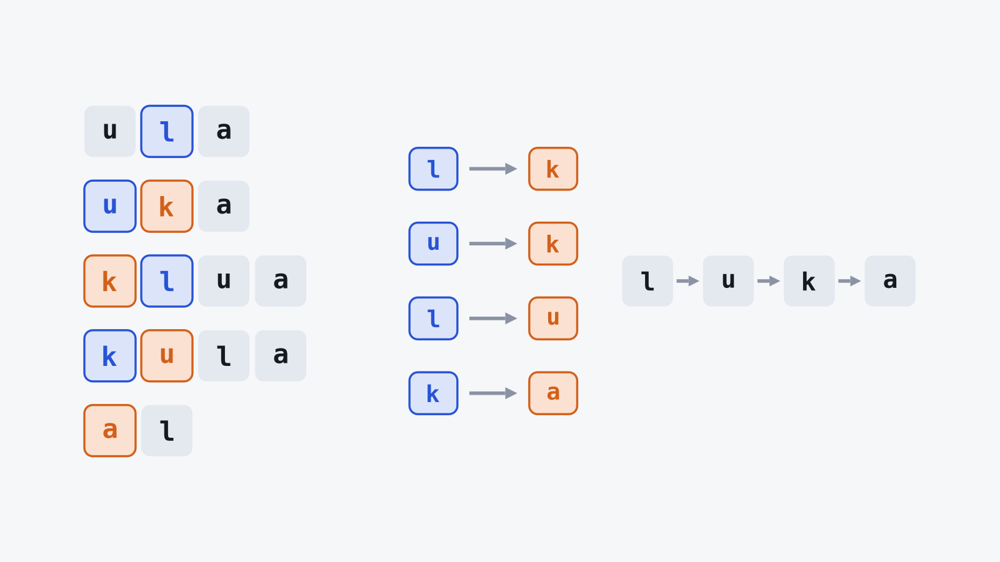

*예제 1번입니다. 이웃한 두 단어에서 처음으로 다른 글자를 찾으면(색칠) 간선이 하나씩 나옵니다.  
네 간선을 모으면 순서는 l, u, k, a 하나뿐입니다.*

그림에는 이웃한 단어만 그렸지만 코드에서는 모든 쌍을 비교했습니다.  
단어가 100개뿐이라 부담이 없고, 빠뜨리는 조건이 없다는 게 분명하니까요.

챙길 것이 세 가지 있습니다.

- **한 단어가 다른 단어의 앞부분일 때.** 다른 글자가 없으니 간선은 나오지 않습니다.  
대신 짧은 쪽이 먼저 나와야 해요.  
`ab`가 `a`보다 앞에 있으면 어떤 알파벳 순서로도 설명이 안 되니 바로 `!`입니다.
- **순서가 없는 경우.** 사이클이 있을 때입니다. 꺼낸 글자의 수가 등장한 글자의 수보다 적으면 `!`입니다.
- **순서가 여러 개인 경우.** 큐에 글자가 둘 이상 들어 있는 순간이 한 번이라도 있으면,  
그 둘은 무엇을 먼저 놓아도 됩니다. 그러면 `?`입니다.

```cpp
#include <bits/stdc++.h>
#define ibm514 ios::sync_with_stdio(0), cin.tie(0), cout.tie(0);
using namespace std;
typedef long long ll;

int n;
string word[101];
bool used[26];
bool before[26][26];   // before[a][b]: a가 b보다 앞선다
int indeg[26];

void solve() {
    cin >> n;
    for (int i = 0; i < n; i++) {
        cin >> word[i];
        for (char c : word[i]) used[c - 'a'] = true;
    }

    for (int i = 0; i < n; i++) {
        for (int j = i + 1; j < n; j++) {
            const string& a = word[i];
            const string& b = word[j];
            int len = min(a.size(), b.size());
            int p = 0;
            while (p < len && a[p] == b[p]) p++;

            if (p == len) {
                // 한쪽이 다른 쪽의 앞부분이면 짧은 쪽이 먼저 나와야 한다
                if (a.size() > b.size()) {
                    cout << "!";
                    return;
                }
                continue;
            }
            int x = a[p] - 'a', y = b[p] - 'a';
            if (!before[x][y]) {
                before[x][y] = true;
                indeg[y]++;
            }
        }
    }

    int total = 0;
    queue<int> q;
    for (int c = 0; c < 26; c++) {
        if (!used[c]) continue;
        total++;
        if (indeg[c] == 0) q.push(c);
    }

    string order;
    bool many = false;
    while (!q.empty()) {
        // 고를 수 있는 글자가 둘 이상이면 순서가 하나로 정해지지 않는다
        if (q.size() > 1) many = true;   
        int u = q.front();
        q.pop();
        order += char('a' + u);
        for (int v = 0; v < 26; v++) {
            if (before[u][v] && --indeg[v] == 0) q.push(v);
        }
    }

    if ((int)order.size() < total) cout << "!";
    else if (many) cout << "?";
    else cout << order;
}

int main() {
    ibm514
    solve();
    return 0;
}
```

`?`인 것을 알아도 바로 끝내면 안 됩니다. 뒤에 사이클이 있으면 답은 `!`여야 하거든요.  
그래서 표시만 해 두고 끝까지 돌린 다음에 판단합니다.

단어에 한 번도 나오지 않은 글자는 순서에 넣지 않습니다. `used`로 등장한 글자만 셉니다.

## 자주 하는 실수

- **간선 방향을 반대로 긋는다.** “먼저 하는 것”에서 “나중에 하는 것”으로 긋습니다.  
장난감 조립처럼 일부러 반대로 긋는 문제도 있으니,  
구하려는 값이 어느 쪽에서 정해지는지를 먼저 보세요.
- **사이클 확인을 빼먹는다.** 순서를 못 정할 수 있는 문제라면 꺼낸 수를 꼭 셉니다.
- **테스트 케이스마다 초기화를 안 한다.** 인접 리스트와 진입 차수를 둘 다 비워야 합니다.
- **같은 간선이 여러 번 주어지는 경우를 놓친다.** 인접 리스트에 여러 번 넣고  
진입 차수도 그만큼 올리면 문제없습니다.  
인접 행렬을 쓴다면 진입 차수를 한 번만 올려야 합니다.
- **무엇의 사전순인지 안 본다.** 꺼내는 순서의 사전순이면 문제집,  
정점이 받는 번호의 사전순이면 그래프 수정입니다.

## 마무리

1. 들어오는 간선이 없는 정점부터 꺼내고, 꺼낼 때마다 다음 정점의 진입 차수를 줄입니다.  
BFS와 같은 모양이고 O(N + M)입니다.
2. 다 꺼내지 못했으면 사이클이 있습니다.
3. 큐를 우선순위 큐로 바꾸면 여러 순서 중 하나를 고를 수 있습니다.
4. 위상정렬 순서는 앞의 값이 다 정해진 뒤에 내 값을 계산하는 순서입니다.  
최댓값이나 합을 이 순서로 채웁니다.
5. 순서를 묻지 않는 문제에서도 “남은 수가 0이 되면 넘어간다”는 생각은 그대로 쓰입니다.

## 추천 문제

본문에서 본 유형을 그대로 연습할 수 있는 문제들입니다.

1. [BOJ 14567 선수과목 (Prerequisite)](https://www.acmicpc.net/problem/14567): 위상정렬 순서로 학기 수 채우기
2. [BOJ 2056 작업](https://www.acmicpc.net/problem/2056): ACM Craft와 같은 계산을 한 번 더
3. [BOJ 1516 게임 개발](https://www.acmicpc.net/problem/1516): 모든 건물에 대해 끝나는 시각 구하기
4. [BOJ 23059 리그 오브 레게노](https://www.acmicpc.net/problem/23059): 큐를 한 층씩 비우면서 층 안에서 정렬하기
5. [BOJ 24461 그래프의 줄기](https://www.acmicpc.net/problem/24461): 트리의 가장자리부터 지워 나가기

여기서부터는 도전 문제입니다. 아래로 갈수록 어려워집니다.

1. [BOJ 2611 자동차경주](https://www.acmicpc.net/problem/2611): 가장 긴 경로를 구하고 그 경로까지 출력하기
2. [BOJ 14907 프로젝트 스케줄링](https://www.acmicpc.net/problem/14907): 입력을 직접 읽어서 그래프 만들기
3. [BOJ 15758 Milking Order](https://www.acmicpc.net/problem/15758): 이분탐색으로 조건의 수를 정하고 위상정렬로 확인하기
4. [BOJ 4196 도미노](https://www.acmicpc.net/problem/4196): 사이클을 한 덩어리로 묶은 다음에 진입 차수 보기
