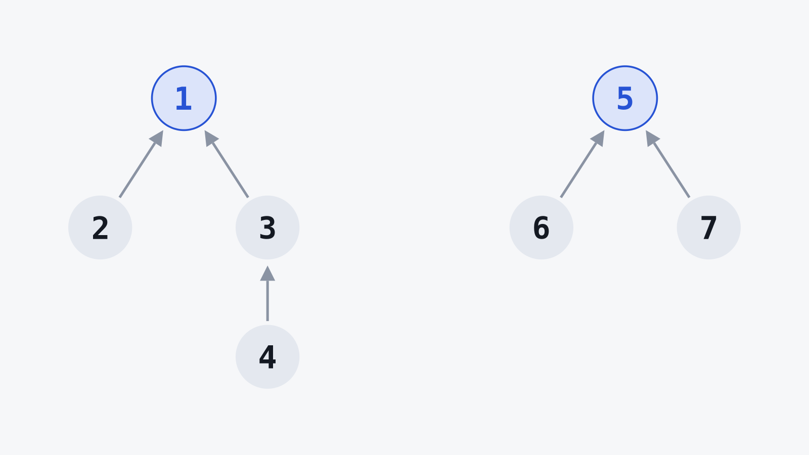
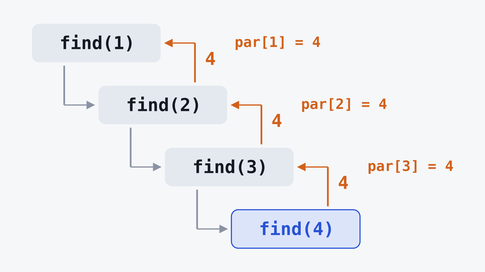
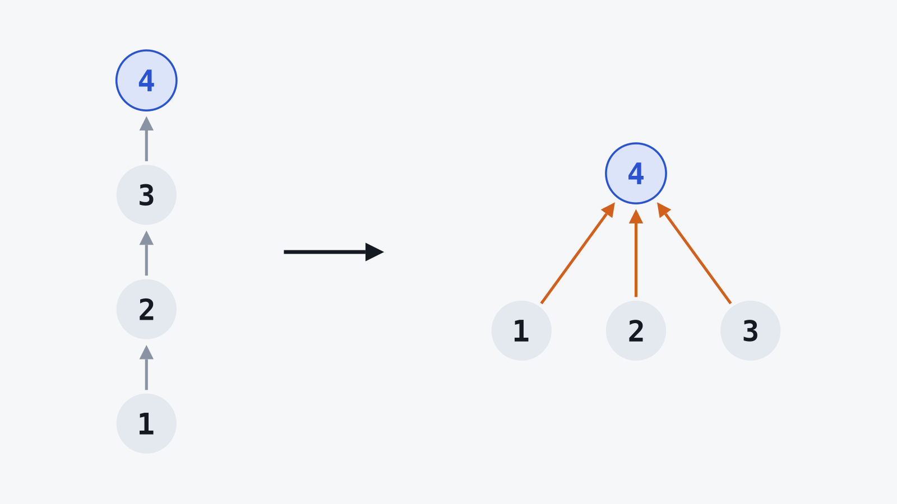
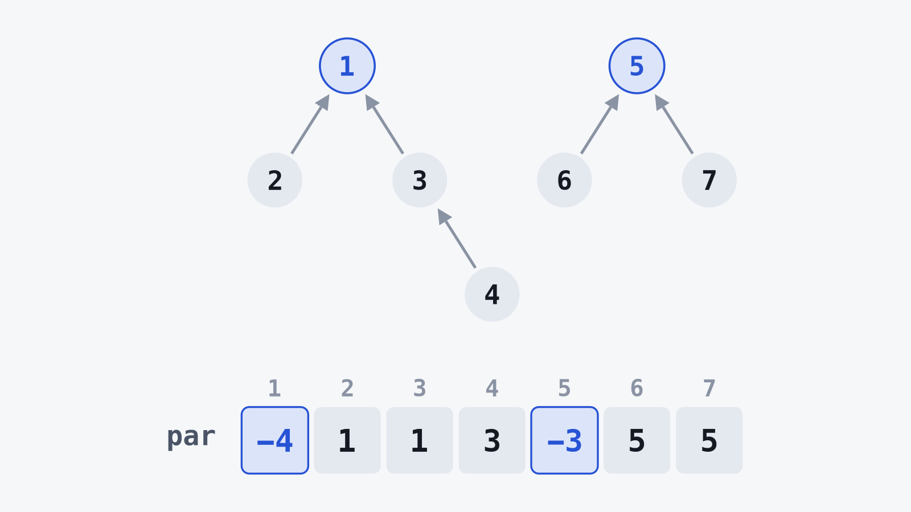
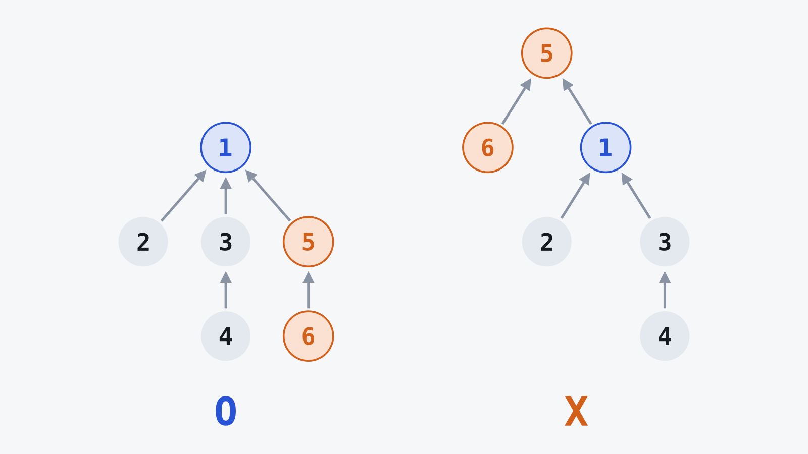
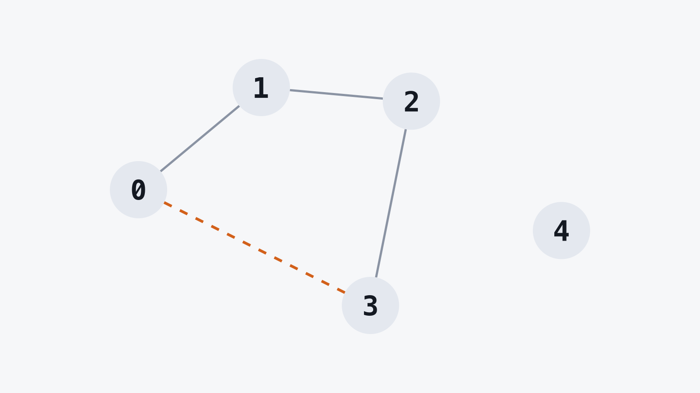
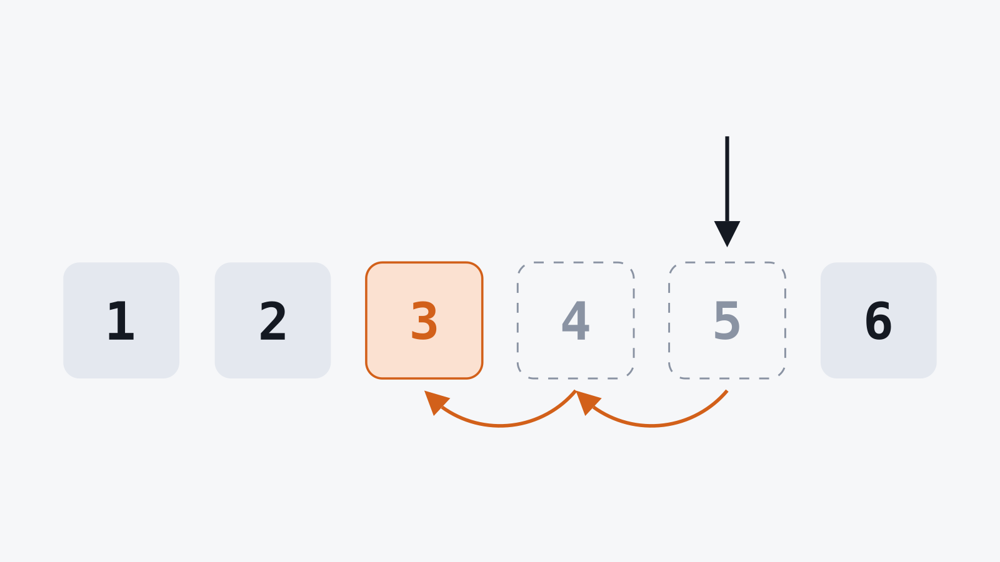
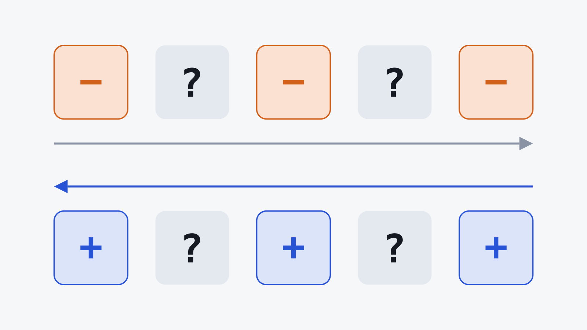
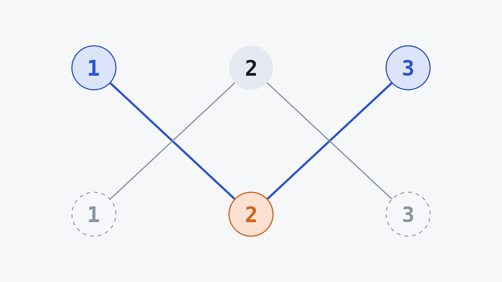
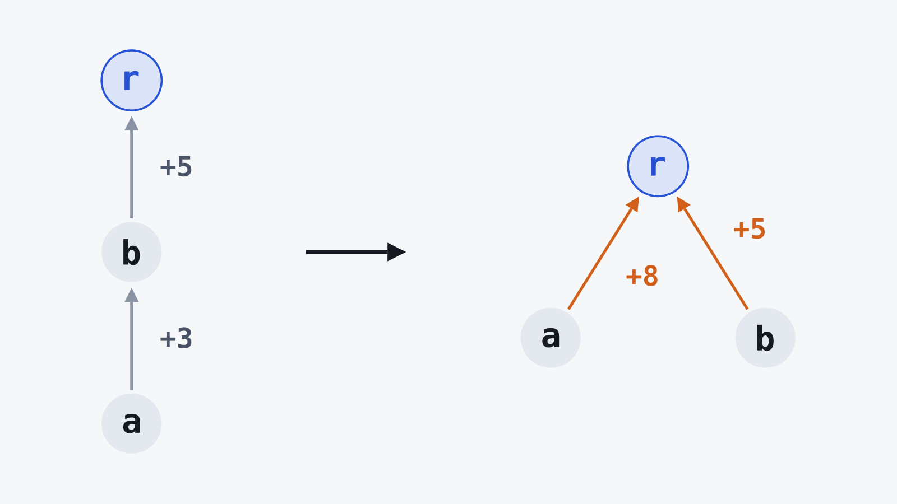

# 사장 나오라 그래!: 유니온 파인드

> rilog 발행 글: <https://www.rilog.kr/@iqed/posts/619> (2026-11-24)

안녕하세요 ~ 오늘은 유니온 파인드 이야기를 해보려고 합니다.

가게에서 뭔가 잘못됐을 때 직원을 붙잡고 따져 봐야 소용없죠.  
결국 나오는 말은 “사장 나오라 그래!”입니다.  
  
유니온 파인드가 하는 일도 똑같아요.  
누구한테 물어보든 위로, 또 위로 올라가서 그 무리의 사장, 그러니까 대표를 찾아냅니다.  
대표가 같으면 같은 편이고, 다르면 다른 편이죠.  
할 수 있는 일은 두 가지뿐이에요.  
두 편을 하나로 합치는 것(union)과, 누가 어느 편인지 찾는 것(find)입니다.

코드도 열 줄 남짓이라 금방 외워집니다.  
그런데 막상 문제를 풀다 보면, 이 짧은 코드를 조금씩 비틀어서 쓰는 경우가 훨씬 많습니다.  
그래서 이번 글에서는 기본 구조를 제대로 뜯어본 다음,  
다른 알고리즘의 부품으로 쓰는 문제와 구조 자체를 바꿔 쓰는 문제까지 차례로 보겠습니다.

## 기본 구조: 집합의 표현

[BOJ 1717 집합의 표현](https://www.acmicpc.net/problem/1717)부터 봅시다.  
0부터 N까지의 수가 각자 다른 집합에 들어 있습니다.  
여기에 “두 수가 속한 집합을 합쳐라”와 “두 수가 같은 집합에 있느냐”가 섞여서 들어옵니다.

유니온 파인드는 집합 하나를 트리 하나로 나타냅니다.  
원소마다 부모를 하나씩 기억해 두고, 부모를 따라 계속 올라가면 맨 꼭대기에 닿게 되죠.  
이 꼭대기에 있는 원소를 그 집합의 **대표**라고 부릅니다.



*집합이 두 개 있습니다. 화살표를 따라 올라가면 왼쪽은 1, 오른쪽은 5에 닿습니다. 이 둘이 대표입니다.*

대표만 알면 두 가지 일을 모두 할 수 있습니다.  
두 원소의 대표가 같으면 같은 집합이고, 한쪽 대표를 다른 쪽 대표 밑에 붙이면 두 집합이 합쳐집니다.

```cpp
#include <bits/stdc++.h>
#define ibm514 ios::sync_with_stdio(0), cin.tie(0), cout.tie(0);
using namespace std;
typedef long long ll;
const int MX = 1000001;
int n, m, par[MX];

// find(x) = x가 속한 집합의 대표
int find(int x) {
    if (par[x] == x) return x;       // 자기 자신을 가리키면 대표다
    return par[x] = find(par[x]);    // 대표를 알아낸 김에 바로 그쪽을 가리키게 한다
}

void merge(int a, int b) {
    a = find(a), b = find(b);
    if (a != b) par[a] = b;          // 한쪽 대표를 다른 쪽 대표 밑에 붙인다
}

void solve() {
    cin >> n >> m;
    for (int i = 0; i <= n; ++i) par[i] = i;
    while (m--) {
        int op, a, b;
        cin >> op >> a >> b;
        if (op == 0) merge(a, b);
        else cout << (find(a) == find(b) ? "YES" : "NO") << '\n';
    }
}

int main() {
    ibm514
    solve();
    return 0;
}
```

`par[x]`는 x의 부모입니다. 처음에는 모두 자기 자신을 가리키게 해 두는데,  
이게 “나 혼자 있는 집합이고 내가 대표다”라는 뜻입니다.

### 경로 압축은 어떻게 일어날까

`find`에서 눈여겨볼 건 이 한 줄입니다.

`return par[x] = find(par[x]);`

그냥 `return find(par[x]);`라고 써도 대표는 잘 찾습니다.  
다만 그렇게 하면 트리가 한 줄로 길게 늘어졌을 때,  
부를 때마다 맨 아래에서 꼭대기까지 다시 걸어 올라가야 합니다.

1 → 2 → 3 → 4 순서로 이어져 있고 4가 대표라고 합시다.  
여기서 `find(1)`을 부르면 무슨 일이 일어나는지 따라가 볼게요.



*find(1)은 find(2)를, find(2)는 find(3)을 부릅니다.  
대표인 find(4)가 4를 돌려주면, 그 값이 거꾸로 전달되면서 par가 하나씩 4로 바뀝니다.*

1. `find(1)`은 1이 대표가 아니니까 `find(2)`를 부르고 기다립니다.  
`find(2)`도, `find(3)`도 마찬가지입니다.
2. `find(4)`는 4가 대표이므로 바로 4를 돌려줍니다.
3. 기다리던 `find(3)`이 4를 받습니다. 받은 값을 `par[3]`에 적고, 그 값을 다시 돌려줍니다.
4. `find(2)`도 4를 받아서 `par[2]`에 적고 돌려줍니다. `find(1)`도 똑같이 합니다.

올라갈 때는 아무것도 바꾸지 않습니다.  
대표를 알아낸 뒤 **돌아오는 길에** 지나온 원소들을 전부 대표에 직접 붙이는 거예요.



*find(1)을 한 번 부르고 나면, 지나온 1, 2, 3이 모두 대표 4를 직접 가리킵니다.*

이걸 경로 압축이라고 합니다. 한 번 지나간 길은 다음부터 한 걸음에 끝나게 되죠.

## 크기도 같이 기억하기: 친구 네트워크

[BOJ 4195 친구 네트워크](https://www.acmicpc.net/problem/4195)입니다.  
친구 관계가 하나씩 생길 때마다, 그 두 사람이 속한 친구 네트워크에 모두 몇 명이 있는지 출력합니다.

같은 집합인지뿐 아니라 집합의 크기도 알아야 합니다.  
크기는 집합마다 하나만 있으면 되니까 대표가 들고 있으면 되는데,  
이걸 배열을 따로 만들지 않고 `par` 하나로 해결하는 방법이 있습니다.

대표는 부모가 없으니 `par` 칸이 사실상 비어 있는 셈이잖아요?  
거기에 집합의 크기를 **음수로** 적어 두는 겁니다.



*par 배열입니다. 양수는 부모의 번호이고, 음수는 그 칸이 대표라는 표시이자 집합의 크기입니다.  
1번은 크기 4, 5번은 크기 3인 집합의 대표입니다.*

이러면 `par[x] < 0`인지만 보면 대표인지 알 수 있고, 대표라면 `-par[x]`가 곧 크기입니다.  
처음에는 모두 혼자니까 전부 -1로 채우면 되고요.

크기를 알게 된 김에 합치는 방법도 하나 고칩니다.  
두 집합을 합칠 때 **작은 쪽을 큰 쪽 밑에** 붙이는 거예요.



*크기 4인 집합과 크기 2인 집합(주황)을 합칩니다.  
작은 쪽을 큰 쪽 밑에 붙이면(왼쪽) 높이가 그대로인데, 반대로 붙이면(오른쪽) 한 층이 더 생깁니다.*

트리가 높아질수록 `find`가 올라가야 하는 길이 길어지니까, 되도록 낮게 유지하려는 겁니다.  
큰 쪽을 작은 쪽 밑에 붙이면 큰 쪽에 있던 많은 원소들이 전부 한 층씩 내려가게 되거든요.

```cpp
#include <bits/stdc++.h>
#define ibm514 ios::sync_with_stdio(0), cin.tie(0), cout.tie(0);
using namespace std;
typedef long long ll;
const int MX = 200001;
int par[MX];   // 음수면 대표이고 절댓값이 집합의 크기, 아니면 부모의 번호

int find(int x) {
    if (par[x] < 0) return x;
    return par[x] = find(par[x]);
}

void merge(int a, int b) {
    a = find(a), b = find(b);
    if (a == b) return;
    if (par[a] > par[b]) swap(a, b);   // a가 더 큰 집합이 되게 한다 (음수라 부등호가 반대)
    par[a] += par[b];                  // 크기를 합치고
    par[b] = a;                        // 작은 쪽을 큰 쪽 밑에 붙인다
}

void solve() {
    int t;
    cin >> t;
    while (t--) {
        int f;
        cin >> f;
        unordered_map<string, int> id;   // 이름 -> 번호
        fill(par, par + 2 * f, -1);
        while (f--) {
            string a, b;
            cin >> a >> b;
            // 처음 나온 이름이면 새 번호를 준다
            int x = id.emplace(a, id.size()).first->second;
            int y = id.emplace(b, id.size()).first->second;
            merge(x, y);
            cout << -par[find(x)] << '\n';
        }
    }
}

int main() {
    ibm514
    solve();
    return 0;
}
```

`merge`에서 헷갈리기 쉬운 곳이 부등호입니다.  
크기가 음수로 들어 있어서, 값이 더 작은 쪽이 더 큰 집합입니다.  
`par[a] > par[b]`면 a가 더 작은 집합이니 둘을 바꿔 줍니다.

이름은 문자열이라 `unordered_map`으로 번호를 붙여서 썼습니다.  
그리고 앞으로 나오는 코드는 전부 이 `find`와 `merge`를 그대로 가져다 씁니다.

## 도구로 쓰기

여기까지가 유니온 파인드의 전부입니다.  
그런데 유니온 파인드만 물어보는 문제는 많지 않아요.  
보통은 다른 문제를 풀다가 “이미 이어져 있나?”를 빨리 확인해야 할 때 꺼내 쓰게 됩니다.

### 사이클 찾기

[BOJ 20040 사이클 게임](https://www.acmicpc.net/problem/20040)입니다.  
점들 사이에 선분을 하나씩 그어 나갈 때, 몇 번째 선분에서 처음으로 사이클이 생기는지 구합니다.



*0, 1, 2, 3은 이미 이어져 있습니다. 여기서 0과 3을 또 이으면(점선) 한 바퀴 도는 길이 생깁니다.*

사이클이 생긴다는 건, 이미 다른 길로 이어져 있는 두 점을 또 잇는다는 뜻입니다.  
그러니 선분을 그을 때마다 두 점이 같은 집합인지 보고, 아니면 합치면 됩니다.

```cpp
#include <bits/stdc++.h>
#define ibm514 ios::sync_with_stdio(0), cin.tie(0), cout.tie(0);
using namespace std;
typedef long long ll;
const int MX = 500000;
int n, m, par[MX];

int find(int x) {
    if (par[x] < 0) return x;
    return par[x] = find(par[x]);
}

// 이미 같은 집합이면 false를 돌려준다
bool merge(int a, int b) {
    a = find(a), b = find(b);
    if (a == b) return false;
    if (par[a] > par[b]) swap(a, b);
    par[a] += par[b];
    par[b] = a;
    return true;
}

void solve() {
    cin >> n >> m;
    fill(par, par + n, -1);
    int ans = 0;
    for (int i = 1; i <= m; ++i) {
        int a, b;
        cin >> a >> b;
        // 이미 이어져 있는 두 점을 또 이으면 사이클이 생긴다
        if (!merge(a, b) && !ans) ans = i;
    }
    cout << ans << '\n';
}

int main() {
    ibm514
    solve();
    return 0;
}
```

`merge`가 `bool`을 돌려주도록 바꿨습니다.  
실제로 합쳤으면 `true`, 이미 같은 집합이었으면 `false`입니다.  
이 작은 변화 하나로 `merge`가 “합쳐라”와 “이미 이어져 있었니?”를 한 번에 처리하게 됩니다.

### 최소 스패닝 트리

[BOJ 1197 최소 스패닝 트리](https://www.acmicpc.net/problem/1197)입니다.  
모든 정점을 잇는 간선들을 고르되, 가중치의 합이 가장 작게 고르는 문제입니다.

크루스칼 알고리즘은 가중치가 작은 간선부터 차례로 보면서, 사이클이 생기지 않는 간선만 고릅니다.  
사이클이 생기는지는 방금 사이클 게임에서 한 것과 완전히 똑같이 확인하면 되고요.

```cpp
#include <bits/stdc++.h>
#define ibm514 ios::sync_with_stdio(0), cin.tie(0), cout.tie(0);
using namespace std;
typedef long long ll;
const int MX = 10001;
int v, e, par[MX];

int find(int x) {
    if (par[x] < 0) return x;
    return par[x] = find(par[x]);
}

bool merge(int a, int b) {
    a = find(a), b = find(b);
    if (a == b) return false;
    if (par[a] > par[b]) swap(a, b);
    par[a] += par[b];
    par[b] = a;
    return true;
}

void solve() {
    cin >> v >> e;
    vector<tuple<int, int, int>> edges(e);
    for (auto &[w, a, b] : edges) cin >> a >> b >> w;
    sort(edges.begin(), edges.end());   // 가중치가 작은 간선부터
    fill(par, par + v + 1, -1);

    ll ans = 0;
    for (auto &[w, a, b] : edges) {
        if (merge(a, b)) ans += w;      // 사이클이 안 생기는 간선만 고른다
    }
    cout << ans << '\n';
}

int main() {
    ibm514
    solve();
    return 0;
}
```

`solve` 안에서 유니온 파인드가 나오는 곳은 `if (merge(a, b))` 한 군데뿐입니다.  
알고리즘의 주인공은 “작은 간선부터 고른다”는 그리디이고,  
유니온 파인드는 옆에서 사이클만 확인해 주는 도구인 거죠.

## 구조를 바꿔 쓰기

지금부터는 유니온 파인드를 그대로 쓰지 않고 조금씩 고쳐서 쓰는 문제들입니다.  
뒤로 갈수록 고치는 폭이 커집니다.

### 대표의 뜻을 바꾸기: 공항

[BOJ 10775 공항](https://www.acmicpc.net/problem/10775)입니다.  
게이트가 1번부터 G번까지 있고, 비행기가 차례로 도착합니다.  
i번째 비행기는 1번부터 g번 게이트 중 하나에만 들어갈 수 있고,  
들어갈 곳이 없으면 공항이 닫힙니다. 최대 몇 대를 받을 수 있는지 구합니다.

작은 번호의 게이트는 더 많은 비행기가 쓸 수 있으니 아껴 두는 게 좋습니다.  
그래서 비행기마다 들어갈 수 있는 게이트 중 **가장 번호가 큰 빈 게이트**에 넣습니다.

문제는 그 게이트를 어떻게 빨리 찾느냐입니다.  
g번부터 한 칸씩 내려가며 찾으면 최악의 경우 너무 느려요.  
여기서 유니온 파인드를 이렇게 씁니다. 게이트가 차면 그 게이트를 바로 앞 게이트에 붙여 버립니다.



*4번과 5번 게이트는 이미 찼습니다. 5번으로 온 비행기는 화살표를 따라가서 3번에 들어갑니다.*

```cpp
#include <bits/stdc++.h>
#define ibm514 ios::sync_with_stdio(0), cin.tie(0), cout.tie(0);
using namespace std;
typedef long long ll;
const int MX = 100001;
int g, p, par[MX];

// find(x) = x번 이하의 게이트 중 비어 있는 가장 큰 번호 (없으면 0)
int find(int x) {
    if (par[x] == x) return x;
    return par[x] = find(par[x]);
}

void solve() {
    cin >> g >> p;
    for (int i = 0; i <= g; ++i) par[i] = i;
    int ans = 0;
    while (p--) {
        int x;
        cin >> x;
        int gate = find(x);
        if (gate == 0) break;    // 들어갈 게이트가 없으면 공항을 닫는다
        par[gate] = gate - 1;    // 이 게이트는 찼으니 바로 앞 게이트에 붙인다
        ++ans;
    }
    cout << ans << '\n';
}

int main() {
    ibm514
    solve();
    return 0;
}
```

여기서는 대표가 “그 집합에서 아직 비어 있는 가장 큰 게이트”라는 뜻을 갖습니다.  
그래서 붙이는 방향이 정해져 있어요.  
반드시 찬 게이트를 앞 게이트 밑에 붙여야 하고, 크기를 보고 방향을 바꾸면 안 됩니다.

[이분탐색 글](https://www.rilog.kr/@iqed/posts/611)에서 풀었던 카드 게임(16566)이 바로 이 방식이었습니다.  
그때는 오른쪽으로 붙였고 이번에는 왼쪽으로 붙인다는 것만 다릅니다.

### 거꾸로 읽기: 트리

[BOJ 13306 트리](https://www.acmicpc.net/problem/13306)입니다.  
트리에서 간선을 하나씩 끊어 나가는데, 중간중간 “지금 이 두 정점이 이어져 있느냐”는 질문이 들어옵니다.

유니온 파인드는 합칠 줄만 알고 나눌 줄은 모릅니다. 그러니 이 문제는 그대로는 못 풀어요.  
그런데 입력을 전부 받아 놓고 **맨 뒤에서부터 거꾸로** 읽으면 어떻게 될까요?



*위는 주어진 순서입니다. 끊기(−)와 질문(?)이 섞여 있습니다.  
이걸 뒤에서부터 읽으면(아래) 끊기가 잇기(+)로 바뀝니다.*

끊는 일을 거꾸로 돌리면 잇는 일이 됩니다.  
이 문제는 마지막에 모든 간선이 끊기니까,  
전부 떨어져 있는 상태에서 시작해서 거꾸로 읽으며 하나씩 이어 주면 됩니다.  
질문의 답은 거꾸로 쌓이니, 다 끝난 뒤에 뒤집어서 출력하고요.

```cpp
#include <bits/stdc++.h>
#define ibm514 ios::sync_with_stdio(0), cin.tie(0), cout.tie(0);
using namespace std;
typedef long long ll;
const int MX = 200001;
int n, q, up[MX], par[MX];

int find(int x) {
    if (par[x] < 0) return x;
    return par[x] = find(par[x]);
}

void merge(int a, int b) {
    a = find(a), b = find(b);
    if (a == b) return;
    if (par[a] > par[b]) swap(a, b);
    par[a] += par[b];
    par[b] = a;
}

void solve() {
    cin >> n >> q;
    for (int i = 2; i <= n; ++i) cin >> up[i];
    int total = n - 1 + q;
    vector<array<int, 3>> ask(total);
    for (auto &[x, a, b] : ask) {
        cin >> x >> a;
        if (x == 1) cin >> b;
    }
    // 간선이 전부 끊긴 마지막 상태에서 출발해, 질의를 거꾸로 읽으며 다시 잇는다
    fill(par, par + n + 1, -1);
    vector<bool> ans;
    for (int i = total - 1; i >= 0; --i) {
        auto [x, a, b] = ask[i];
        if (x == 0) merge(a, up[a]);
        else ans.push_back(find(a) == find(b));
    }
    for (int i = (int)ans.size() - 1; i >= 0; --i) cout << (ans[i] ? "YES" : "NO") << '\n';
}

int main() {
    ibm514
    solve();
    return 0;
}
```

이렇게 질문을 미리 다 받아 놓고 편한 순서로 처리하는 걸 오프라인 처리라고 부릅니다.  
“끊는다”, “지운다”가 나오는 문제를 만나면 거꾸로 읽을 수 있는지부터 생각해 보면 좋습니다.

### 원수의 자리 만들기: 닭싸움 팀 정하기

[BOJ 1765 닭싸움 팀 정하기](https://www.acmicpc.net/problem/1765)입니다.  
학생들 사이의 친구 관계와 원수 관계가 주어집니다.  
친구의 친구는 친구이고, **원수의 원수도 친구**입니다.  
친구끼리 같은 팀이 될 때 팀이 최대 몇 개 나오는지 구합니다.

친구 관계는 그냥 합치면 됩니다. 골치 아픈 건 원수 관계예요.  
1과 2가 원수라고 해서 둘을 합칠 수는 없고, 나중에 2의 다른 원수가 나타나면 그 사람을 1과 합쳐야 합니다.

이럴 때는 학생마다 자리를 하나씩 더 만듭니다.  
i번 학생 옆에 “i의 원수들이 모이는 자리”를 두는 거예요.



*아래 줄이 원수 자리입니다. 1과 2가 원수이고 2와 3이 원수라면,  
1과 3은 둘 다 ‘2의 원수 자리’(주황)에 묶여서 같은 집합이 됩니다.*

p와 q가 원수라면 p를 “q의 원수 자리”에 합치고, q를 “p의 원수 자리”에 합칩니다.  
그러면 같은 사람을 원수로 둔 학생들은 그 자리를 거쳐서 저절로 한 집합이 됩니다.

```cpp
#include <bits/stdc++.h>
#define ibm514 ios::sync_with_stdio(0), cin.tie(0), cout.tie(0);
using namespace std;
typedef long long ll;
const int MX = 2001;
int n, m, par[MX];

int find(int x) {
    if (par[x] < 0) return x;
    return par[x] = find(par[x]);
}

void merge(int a, int b) {
    a = find(a), b = find(b);
    if (a == b) return;
    if (par[a] > par[b]) swap(a, b);
    par[a] += par[b];
    par[b] = a;
}

void solve() {
    cin >> n >> m;
    // i번 = i번 학생, i + n번 = "i번 학생의 원수들"을 모으는 자리
    fill(par, par + 2 * n + 1, -1);
    while (m--) {
        char c;
        int p, q;
        cin >> c >> p >> q;
        if (c == 'F') merge(p, q);
        else merge(p, q + n), merge(q, p + n);
    }
    // 학생들만 놓고 팀을 센다: 처음 보는 대표가 나올 때마다 팀이 하나 늘어난다
    vector<bool> seen(2 * n + 1);
    int ans = 0;
    for (int i = 1; i <= n; ++i) {
        int r = find(i);
        if (!seen[r]) seen[r] = true, ++ans;
    }
    cout << ans << '\n';
}

int main() {
    ibm514
    solve();
    return 0;
}
```

노드를 두 배로 늘렸을 뿐 `find`와 `merge`는 손대지 않았습니다.  
마지막에 팀을 셀 때는 원수 자리는 빼고 학생들만 봐야 한다는 것만 주의하면 됩니다.

## 고난도: 교수님은 기다리지 않는다

마지막으로 [BOJ 3830 교수님은 기다리지 않는다](https://www.acmicpc.net/problem/3830)를 같이 풀어 봅시다.  
“b가 a보다 w그램 무겁다”는 측정 결과가 하나씩 들어오고,  
중간중간 “b는 a보다 얼마나 무겁냐”는 질문이 들어옵니다.  
지금까지의 결과로 알 수 없으면 UNKNOWN을 출력합니다.

두 샘플의 무게 차이를 알 수 있는지는 유니온 파인드로 바로 알 수 있습니다.  
측정으로 이어진 샘플끼리 같은 집합에 넣으면 되니까요.  
  
문제는 **차이가 얼마인지**까지 답해야 한다는 겁니다.

그래서 원소마다 값을 하나 더 들고 다닙니다.

`diff[x]` = x가 자기 부모보다 몇 그램 더 무거운가

부모를 따라 올라가면서 이 값을 전부 더하면 “x가 대표보다 몇 그램 더 무거운가”가 됩니다.  
같은 집합의 두 샘플은 대표가 같으니, 각자 대표와의 차이를 구해서 빼면 둘 사이의 차이가 나오죠.

그런데 `find`는 경로를 압축하면서 부모를 바꿔 버립니다. 부모가 바뀌면 `diff`도 거기에 맞춰 고쳐야 해요.



*a는 b보다 3그램, b는 대표 r보다 5그램 무겁습니다.  
경로를 압축해서 a를 r에 직접 붙이려면, a의 값을 3 + 5 = 8로 바꿔야 합니다.*

```cpp
#include <bits/stdc++.h>
#define ibm514 ios::sync_with_stdio(0), cin.tie(0), cout.tie(0);
using namespace std;
typedef long long ll;
const int MX = 100001;
int n, m, par[MX];
ll diff[MX];   // diff[x] = x가 부모보다 몇 그램 더 무거운가 (find를 거치면 대표 기준이 된다)

int find(int x) {
    if (par[x] < 0) return x;
    int root = find(par[x]);
    diff[x] += diff[par[x]];   // 부모가 대표 기준으로 바뀌었으니, 그 값을 내 값에 더한다
    return par[x] = root;
}

// b가 a보다 w그램 무겁다
void merge(int a, int b, ll w) {
    int ra = find(a), rb = find(b);
    if (ra == rb) return;
    // rb를 ra 밑에 붙일 때 rb가 ra보다 얼마나 무거운지 계산한다
    ll d = diff[a] + w - diff[b];
    if (par[ra] > par[rb]) swap(ra, rb), d = -d;   // 방향이 바뀌면 부호도 바뀐다
    par[ra] += par[rb];
    par[rb] = ra;
    diff[rb] = d;
}

void solve() {
    while (cin >> n >> m && n) {
        fill(par, par + n + 1, -1);
        fill(diff, diff + n + 1, 0);
        while (m--) {
            char c;
            int a, b;
            cin >> c >> a >> b;
            if (c == '!') {
                ll w;
                cin >> w;
                merge(a, b, w);
            } else if (find(a) != find(b)) {
                cout << "UNKNOWN\n";
            } else {
                cout << diff[b] - diff[a] << '\n';   // 둘 다 같은 대표 기준이라 빼면 된다
            }
        }
    }
}

int main() {
    ibm514
    solve();
    return 0;
}
```

`find`부터 봅시다. 앞에서 경로 압축이 돌아오는 길에 일어난다고 했죠.  
`find(par[x])`가 끝나고 돌아온 시점에는, 부모의 `diff`가 이미 대표 기준으로 바뀌어 있습니다.  
그래서 그 값을 내 `diff`에 더하기만 하면 나도 대표 기준이 됩니다.

순서가 중요합니다. `diff[x] += diff[par[x]]`를 먼저 하고, 그다음에 `par[x]`를 대표로 바꿔야 해요.  
거꾸로 하면 `par[x]`가 이미 대표라서 엉뚱한 값을 더하게 됩니다.

다음은 `merge`입니다. b가 a보다 w그램 무겁다는 걸 알았을 때,  
b의 대표 rb를 a의 대표 ra 밑에 붙이려고 합니다.  
  
그러려면 rb가 ra보다 얼마나 무거운지를 알아야 하는데, `find`를 한 직후라서 이 두 가지는 알고 있습니다.

- a는 ra보다 `diff[a]`만큼 무겁다.
- b는 rb보다 `diff[b]`만큼 무겁다.

ra를 기준으로 놓고 따라가 보면, a는 `diff[a]`, b는 거기서 w를 더한 `diff[a] + w`만큼 무겁습니다.  
rb는 b보다 `diff[b]`만큼 가벼우니까 `diff[a] + w - diff[b]`가 됩니다. 코드의 `d`가 이 값이에요.

크기를 비교해서 붙이는 방향이 반대가 되면, 기준이 뒤집히니 부호도 뒤집어 줍니다.

기본 코드에서 달라진 건 `find`에 두 줄, `merge`에 세 줄뿐입니다.  
그런데 그 몇 줄을 제대로 쓰려면 경로 압축이 언제 어떤 순서로 일어나는지를 정확히 알고 있어야 하죠.  
앞에서 그 과정을 길게 따라가 본 이유가 이것입니다.

## 자주 하는 실수

- **대표가 아닌 원소끼리 붙인다.** `par[a] = b`가 아니라, `find`로 대표를 찾은 뒤에 대표끼리 붙여야 합니다.
- **음수 크기의 부등호를 반대로 쓴다.** 값이 작을수록 큰 집합입니다.
- **크기를 대표가 아닌 칸에서 읽는다.** 크기는 `-par[find(x)]`입니다.
- **방향이 정해진 문제에서 크기 기준으로 합친다.** 공항처럼 대표에 뜻이 있으면 방향을 바꾸면 안 됩니다.
- **테스트 케이스마다 초기화하지 않는다.** `par`뿐 아니라 같이 들고 다니는 값도 전부 다시 채워야 합니다.

## 마무리

1. 유니온 파인드는 집합을 트리로 나타내고, 꼭대기의 대표로 집합을 구분합니다.
2. 경로 압축은 대표를 찾고 돌아오는 길에 일어납니다. 지나온 원소를 전부 대표에 직접 붙입니다.
3. 대표 칸에 크기를 음수로 적어 두면 배열 하나로 충분하고, 작은 집합을 큰 집합 밑에 붙일 수 있습니다.
4. 사이클 확인처럼 “이미 이어져 있나?”가 필요한 곳에 도구로 꺼내 씁니다.
5. 대표의 뜻을 바꾸거나, 거꾸로 읽거나, 노드를 늘리거나, 값을 같이 들고 다니는 식으로 고쳐 쓸 수 있습니다.

## 추천 문제

본문에서 다루지 않은 쓰임새가 하나씩 들어 있는 문제들입니다. 아래로 갈수록 어려워집니다.

1. [BOJ 16724 피리 부는 사나이](https://www.acmicpc.net/problem/16724): 격자의 칸을 원소로 보고 합치기
2. [BOJ 14595 동방 프로젝트 (Large)](https://www.acmicpc.net/problem/14595): 구간을 통째로 합치기
3. [BOJ 17619 개구리 점프](https://www.acmicpc.net/problem/17619): 정렬한 뒤 이웃끼리만 합치기
4. [BOJ 20303 할로윈의 양아치](https://www.acmicpc.net/problem/20303): 묶은 결과를 배낭 DP로 넘기기
5. [BOJ 2463 비용](https://www.acmicpc.net/problem/2463): 거꾸로 합치면서 집합 크기의 곱으로 세기
6. [BOJ 9938 방 청소](https://www.acmicpc.net/problem/9938): 집합마다 남은 빈자리 관리하기
